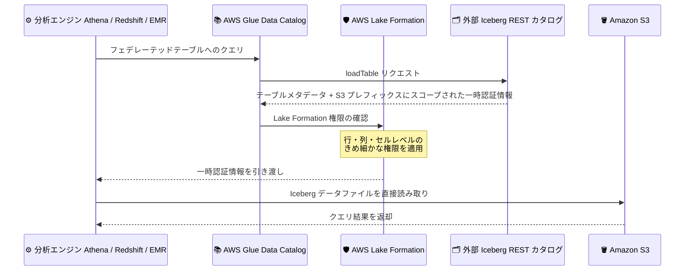

# AWS Glue Data Catalog - Apache Iceberg REST カタログフェデレーションにおける catalog-vended credentials サポート

**リリース日**: 2026 年 11 月 6 日
**サービス**: AWS Glue (AWS Glue Data Catalog)、AWS Lake Formation
**機能**: Apache Iceberg REST カタログフェデレーションにおける catalog-vended credentials (外部カタログ発行の一時認証情報) のサポート

📊 [このアップデートのインフォグラフィックを見る](https://takech9203.github.io/aws-news-summary/20261106-glue-catalog-vended-credentials-iceberg.html)

## 概要

AWS Glue Data Catalog が、Apache Iceberg REST カタログフェデレーションにおいて、外部カタログが発行する一時認証情報 (catalog-vended credentials) をサポートしました。これにより、Snowflake Horizon や Databricks Unity Catalog などの外部 Iceberg REST カタログ側で付与されたテーブル権限に基づいて、Amazon Athena、Amazon EMR、Amazon Redshift、AWS Glue から外部 Iceberg テーブルを読み取れるようになります。

この機能では、外部カタログが Iceberg REST API の loadTable レスポンスを通じて、Amazon S3 ストレージプレフィックスにスコープされた一時セキュリティ認証情報を発行します。AWS Lake Formation はこの認証情報を分析エンジンに引き渡すとともに、行レベル・列レベル・セルレベルのきめ細かなアクセス制御や、AWS アカウント間での外部 Iceberg テーブルの共有を管理します。本機能は AWS Lake Formation マネジメントコンソール、AWS CLI、AWS Glue および Lake Formation の SDK から利用できます。

**アップデート前の課題**

このアップデート以前は、Iceberg REST カタログフェデレーションの認証方式に制約がありました。

- 外部 Iceberg REST カタログへのフェデレーションでは、テーブルデータを格納する S3 バケットへのアクセス権を持つ IAM ロール (Registered role 方式) を Lake Formation に登録する必要があった
- 外部カタログサービス側がストレージを所有している場合や、AWS の IAM ロールに S3 への直接アクセスを許可したくない場合に、フェデレーションの構成が困難だった
- 外部カタログ側で管理しているテーブル権限 (粗粒度のテーブルグラント) を AWS 側のアクセス制御に直接反映できなかった

**アップデート後の改善**

今回のアップデートにより、以下が可能になりました。

- 外部カタログが許可したテーブルのみを読み取る新しい接続方式 (Vended credential 方式、`CREDENTIAL_VENDING_MODE: SOURCE_VENDED`) を選択できるようになった
- Lake Formation に登録する IAM ロールに、テーブルデータが格納された S3 バケットへのアクセス権限が不要になった
- 外部カタログ側の権限と Lake Formation のきめ細かな権限 (行・列・セルレベル、LF-Tag ベース) を組み合わせた多層的なアクセス制御が可能になった
- 外部カタログ側でアクセスを取り消すと、AWS 側の変更なしに次回のテーブル読み込み時からクエリが拒否されるようになった

## アーキテクチャ図



Vended credential 方式では、外部 Iceberg REST カタログが loadTable レスポンスで S3 ストレージプレフィックスにスコープされた一時認証情報を発行し、Lake Formation がきめ細かな権限を適用した上で分析エンジンに引き渡します。IAM ロールによる S3 への直接アクセスは不要です。

## サービスアップデートの詳細

### 主要機能

1. **Vended credential 方式 (SOURCE_VENDED) の追加**
   - 外部カタログが Iceberg REST の loadTable レスポンスを通じて S3 への一時認証情報を発行する
   - Lake Formation に登録する IAM ロールは S3 バケットへのアクセス権限が不要 (Secrets Manager のシークレットへのアクセスのみ必要)
   - 接続作成時に接続プロパティ `CREDENTIAL_VENDING_MODE` で `SOURCE_VENDED` を指定する (デフォルトは従来の `AWS_VENDED`)

2. **外部カタログの権限と Lake Formation 権限の多層適用**
   - 外部カタログ側の粗粒度のテーブルグラントがそのまま適用され、外部カタログ側でアクセスを取り消すと AWS 側の変更なしに次回のテーブル読み込み時からクエリが失敗する
   - 外部カタログの権限の上に、Lake Formation の行・列・セルレベル権限および LF-Tag ベースのアクセス制御を重ねて適用できる
   - フェデレーテッドカタログおよび関連オブジェクトを AWS アカウント間で安全に共有できる

3. **一時認証情報の自動更新**
   - 発行された S3 一時認証情報の有効期間は外部カタログ側が設定する
   - AWS Glue は長時間実行クエリの実行中に認証情報を自動的に更新するため、元の認証情報の有効期限切れによるクエリ失敗が発生しない

4. **幅広い分析エンジンのサポート**
   - Amazon Athena、Amazon Redshift、Amazon EMR、AWS Glue に加え、Apache Spark などのサードパーティエンジンからもフェデレーテッドテーブルを読み取り可能
   - クエリ時に Data Catalog が外部カタログから最新のテーブル情報 (S3 ロケーション、現在のスキーマ、パーティション情報) を取得する

## 技術仕様

### アクセス委任モードの比較

| 項目 | Registered role (AWS_VENDED) | Vended credential (SOURCE_VENDED) |
|------|------------------------------|-----------------------------------|
| S3 認証情報の発行元 | Lake Formation (登録した IAM ロールを引き受けて発行) | 外部カタログ (Iceberg REST の loadTable レスポンスで発行) |
| IAM ロールの S3 アクセス権限 | 必要 | 不要 |
| データアクセス範囲の制御 | Lake Formation 権限と IAM ロール | Lake Formation 権限と外部カタログのグラント |
| 主なユースケース | 外部テーブルを格納する S3 バケットを所有、またはアクセス権を付与できる場合 | 外部カタログサービスがストレージを所有している場合や、AWS ロールに直接読み取りを許可したくない場合 |
| 接続プロパティ `CREDENTIAL_VENDING_MODE` | `AWS_VENDED` (デフォルト) | `SOURCE_VENDED` |

### 接続設定例 (AWS Glue 接続オブジェクト)

```json
{
  "Name": "my-connection-to-snowflake",
  "ConnectionType": "SNOWFLAKEICEBERGRESTCATALOG",
  "ConnectionProperties": {
    "INSTANCE_URL": "https://<account>.snowflakecomputing.com",
    "ROLE_ARN": "arn:aws:iam::123456789012:role/GlueConnectionRole",
    "CREDENTIAL_VENDING_MODE": "SOURCE_VENDED",
    "CATALOG_CASING_FILTER": "UPPERCASE_ONLY"
  },
  "AuthenticationConfiguration": {
    "AuthenticationType": "OAUTH2",
    "OAuth2Properties": {
      "OAuth2GrantType": "CLIENT_CREDENTIALS",
      "TokenUrl": "https://<account>.snowflakecomputing.com/polaris/api/catalog/v1/oauth/tokens",
      "TokenUrlParametersMap": {
        "scope": "session:role:<snowflake-role>"
      }
    },
    "SecretArn": "arn:aws:secretsmanager:<region>:123456789012:secret:<secret-name>"
  }
}
```

`CREDENTIAL_VENDING_MODE` に `SOURCE_VENDED` を指定することで、外部カタログ発行の一時認証情報を使用する Vended credential 方式になります。

## 設定方法

### 前提条件

1. 外部 Iceberg REST カタログ側で、フェデレーション対象のデータベース・スキーマ・テーブルに対する読み取り権限をサービスプリンシパル (ロール) に付与しておくこと
2. 外部カタログのアクセストークン (クライアントシークレット) を AWS Secrets Manager に `USER_MANAGED_CLIENT_APPLICATION_CLIENT_SECRET` キーで保存しておくこと
3. 操作する IAM プリンシパルに `lakeformation:RegisterResource`、`glue:CreateConnection`、`glue:CreateCatalog`、`secretsmanager:CreateSecret` などの権限があること
4. Lake Formation のデータレイク管理者であるか、Data Catalog に対する `CREATE_CATALOG` 権限を持つこと

### 手順

#### ステップ 1: Secrets Manager シークレットの作成

```bash
aws secretsmanager create-secret \
  --name my-remote-catalog-secret \
  --description "Remote Iceberg catalog secret" \
  --secret-string '{"USER_MANAGED_CLIENT_APPLICATION_CLIENT_SECRET": "<client_secret>"}' \
  --region <region>
```

外部カタログへの認証に使用するクライアントシークレットを AWS Secrets Manager に保存します。`USER_MANAGED_CLIENT_APPLICATION_CLIENT_SECRET` は AWS Glue が参照する予約キーワードです。

#### ステップ 2: 接続用 IAM ロールの作成

Vended credential 方式の場合、IAM ロールにはシークレットへのアクセス権限 (`secretsmanager:GetSecretValue`、`secretsmanager:DescribeSecret`、`secretsmanager:PutSecretValue`) のみが必要です (Amazon VPC 経由で接続する場合は VPC ネットワークインターフェイスの権限も必要)。S3 への読み取り権限を付与する必要はありません。信頼ポリシーでは `glue.amazonaws.com` にロールの引き受けを許可します。

#### ステップ 3: AWS Glue 接続オブジェクトの作成

```bash
aws glue create-connection \
  --connection-input '{
    "Name": "my-connection-to-remote-catalog",
    "ConnectionType": "SNOWFLAKEICEBERGRESTCATALOG",
    "ConnectionProperties": {
      "INSTANCE_URL": "https://<account>.snowflakecomputing.com",
      "ROLE_ARN": "<接続用 IAM ロールの ARN>",
      "CREDENTIAL_VENDING_MODE": "SOURCE_VENDED",
      "CATALOG_CASING_FILTER": "UPPERCASE_ONLY"
    },
    "AuthenticationConfiguration": {
      "AuthenticationType": "OAUTH2",
      "OAuth2Properties": {
        "OAuth2GrantType": "CLIENT_CREDENTIALS",
        "TokenUrl": "https://<account>.snowflakecomputing.com/polaris/api/catalog/v1/oauth/tokens",
        "TokenUrlParametersMap": {"scope": "session:role:<snowflake-role>"}
      },
      "SecretArn": "<シークレットの ARN>"
    }
  }'
```

外部 Iceberg REST カタログへの接続オブジェクトを作成します。`CREDENTIAL_VENDING_MODE` に `SOURCE_VENDED` を指定することで、外部カタログ発行の一時認証情報を使用します。

#### ステップ 4: 接続の Lake Formation への登録

```bash
aws lakeformation register-resource \
  --resource-arn <Glue 接続の ARN> \
  --role-arn <IAM ロールの ARN> \
  --with-federation \
  --with-privileged-access
```

作成した Glue 接続オブジェクトを Lake Formation 管理リソースとして登録します。カタログ作成前に接続を登録しないと `create-catalog` が失敗するため、順序に注意してください。

#### ステップ 5: フェデレーテッドカタログの作成

```bash
aws glue create-catalog \
  --name my-federated-catalog \
  --catalog-input '{
    "FederatedCatalog": {
      "Identifier": "<外部カタログ名>",
      "ConnectionName": "my-connection-to-remote-catalog"
    },
    "CreateTableDefaultPermissions": [],
    "CreateDatabaseDefaultPermissions": []
  }'
```

Data Catalog にフェデレーテッドカタログを作成します。外部カタログのデータベースを参照する識別子と、先に作成した接続名を指定します。

#### ステップ 6: Lake Formation 権限の付与とクエリの実行

カタログレベルの権限はフェデレーテッドデータベースやテーブルには継承されないため、クエリを実行する各プリンシパルに対して、データベースへの `DESCRIBE`、テーブル (ワイルドカード) への `SELECT` と `DESCRIBE` を付与します。その後、Amazon Athena などから以下のようにクエリできます。

```sql
SELECT * FROM "<federated-catalog>"."<schema>"."<table>" LIMIT 10;
```

## メリット

### ビジネス面

- **マルチカタログ環境のガバナンス統合**: Snowflake や Databricks など外部カタログで管理されているデータを、データ移動なしに AWS の分析エンジンと Lake Formation のガバナンス下で活用できる
- **アクセス管理の二重化による安全性向上**: 外部カタログ側の権限取り消しが AWS 側の変更なしに即座に反映されるため、データ所有者側の統制を維持できる
- **セットアップの簡素化**: S3 バケットへの IAM アクセス権限の調整が不要になり、組織間・サービス間でのデータ共有の調整コストが低減する

### 技術面

- **IAM ロールの権限最小化**: Lake Formation に登録する IAM ロールに S3 アクセス権限が不要になり、最小権限の原則に沿った構成が可能
- **スコープされた一時認証情報**: S3 ストレージプレフィックスにスコープされた一時認証情報を使用するため、アクセス範囲が限定される
- **長時間クエリへの対応**: AWS Glue が一時認証情報を自動更新するため、認証情報の有効期限切れによるクエリ失敗を回避できる
- **きめ細かなアクセス制御の重ね掛け**: 外部カタログの粗粒度のテーブルグラントの上に、Lake Formation の行・列・セルレベル権限や LF-Tag ベースの制御を適用できる

## デメリット・制約事項

### 制限事項

- フェデレーテッド Iceberg カタログでは、REST API 呼び出しあたりのメタデータサイズは最大 5 MB に制限される (超過するテーブルへのリクエストは拒否される)
- 本機能は外部 Iceberg テーブルの読み取りに対応するものであり、外部カタログ側で許可されたテーブルのみが対象となる
- Polaris カタログのネストされた名前空間はサポートされない (`catalog.database.table` の 3 階層表記に従うテーブルのみアクセス可能)

### 考慮すべき点

- 一時認証情報の有効期間は外部カタログ側の設定に依存するため、外部カタログ側のポリシーを確認しておく必要がある
- 外部カタログ側でデータベースやテーブルを削除しても、Lake Formation 側で付与済みの権限は自動的に取り消されないため、明示的な権限の削除が必要
- `CATALOG_CASING_FILTER` の設定によっては、大文字または小文字の識別子を持つオブジェクトのみがフェデレーションされる点に注意が必要

## ユースケース

### ユースケース 1: Snowflake 管理データの AWS 分析エンジンからの参照

**シナリオ**: データウェアハウスとして Snowflake を利用しており、Snowflake Horizon カタログで管理する Iceberg テーブルを、Amazon Athena や Amazon Redshift からも分析したい。ただし、Snowflake 側が管理する S3 ストレージへの直接アクセス権を AWS の IAM ロールに付与したくない。

**実装例**:
```
1. Snowflake 側でサービスプリンシパルにテーブルの SELECT 権限を付与
2. CREDENTIAL_VENDING_MODE: SOURCE_VENDED で Glue 接続を作成
3. フェデレーテッドカタログを作成し、Lake Formation で利用者に権限付与
4. Athena から SELECT * FROM "fed_catalog"."schema"."table" を実行
```

**効果**: データの複製や ETL なしに、Snowflake 側の権限統制を維持したまま AWS の分析エンジンからクエリ可能になる。

### ユースケース 2: 行・列レベル制御を加えたアカウント間データ共有

**シナリオ**: 外部カタログで管理する Iceberg テーブルを複数の AWS アカウントのデータ分析チームに共有したいが、チームごとに参照可能な列や行を制限したい。

**実装例**:
```
1. Vended credential 方式でフェデレーテッドカタログを作成
2. Lake Formation で列レベルフィルタや行レベルフィルタを定義
3. Lake Formation のクロスアカウント共有で対象アカウントに権限付与
4. 各アカウントの分析エンジンからフィルタ適用済みのデータを参照
```

**効果**: 外部カタログの粗粒度権限に加えて、Lake Formation のきめ細かな権限とアカウント間共有を組み合わせた多層的なガバナンスを実現できる。

### ユースケース 3: 長時間実行される ETL ジョブからの外部テーブル読み取り

**シナリオ**: AWS Glue の Spark ETL ジョブで外部カタログの大規模 Iceberg テーブルを読み取るが、処理時間が長く、一時認証情報の有効期限切れが懸念される。

**実装例**:
```
1. Vended credential 方式のフェデレーテッドカタログを構成
2. Glue ジョブからフェデレーテッドテーブルを入力として読み取り
3. AWS Glue が実行中に一時認証情報を自動更新
```

**効果**: 認証情報の有効期限を意識することなく、長時間実行ジョブでも安定して外部 Iceberg テーブルを処理できる。

## 料金

カタログフェデレーション機能自体の追加料金に関する記載は、今回の発表にはありません。AWS Glue Data Catalog のストレージおよびリクエスト、ならびにクエリを実行する各分析エンジン (Amazon Athena、Amazon Redshift、Amazon EMR、AWS Glue)、AWS Secrets Manager の利用に応じた標準料金が適用されます。詳細は各サービスの料金ページを参照してください。

## 利用可能リージョン

AWS Glue および AWS Lake Formation が利用可能なすべての商用 AWS リージョンで利用できます。

## 関連サービス・機能

- **AWS Lake Formation**: フェデレーテッドカタログへのアクセス制御 (行・列・セルレベル権限、LF-Tag、クロスアカウント共有) を管理
- **Amazon Athena / Amazon Redshift / Amazon EMR**: フェデレーテッドテーブルへのクエリを実行する分析エンジン。Lake Formation 権限を適用した上で S3 のデータファイルを直接読み取る
- **AWS Secrets Manager**: 外部カタログへの認証に使用するクライアントシークレットやアクセストークンを保管
- **Amazon S3**: 外部 Iceberg テーブルのデータファイルを格納するストレージ。一時認証情報はストレージプレフィックスにスコープされる

## 参考リンク

- 📊 [インフォグラフィック](https://takech9203.github.io/aws-news-summary/20261106-glue-catalog-vended-credentials-iceberg.html)
- [公式発表 (What's New)](https://aws.amazon.com/about-aws/whats-new/2026/11/glue-catalog-vended-credentials-iceberg/)
- [ドキュメント: Catalog federation to remote Iceberg catalogs](https://docs.aws.amazon.com/lake-formation/latest/dg/catalog-federation.html)
- [ドキュメント: Federate to Snowflake Iceberg Catalog](https://docs.aws.amazon.com/lake-formation/latest/dg/catalog-federation-snowflake.html)
- [AWS Glue 料金ページ](https://aws.amazon.com/glue/pricing/)

## まとめ

AWS Glue Data Catalog の Iceberg REST カタログフェデレーションに Vended credential 方式が追加され、IAM ロールに S3 アクセス権限を付与することなく、外部カタログ発行の一時認証情報で外部 Iceberg テーブルを安全に読み取れるようになりました。Snowflake や Databricks などの外部カタログと AWS 分析エンジンを併用している環境では、最小権限での構成と外部カタログ側の統制維持を両立できるため、接続作成時のアクセス委任モードとして `SOURCE_VENDED` の採用を検討することを推奨します。
