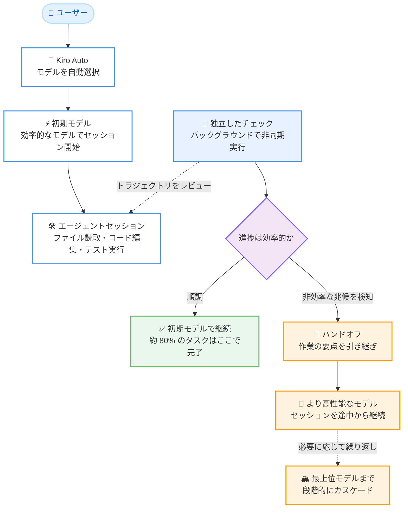

# Kiro - Auto におけるモデルカスケーディング

**リリース日**: 2026 年 11 月 6 日
**サービス**: Kiro
**機能**: Kiro Auto のモデルカスケーディング (Model Cascading)

📊 [このアップデートのインフォグラフィックを見る](https://takech9203.github.io/aws-news-summary/20261106-kiro-model-cascade.html)

## 概要

Kiro は、モデル選択機能「Auto」の内部で採用している「モデルカスケーディング (model cascading)」という技術の詳細を公開しました。Auto は Kiro が推奨するモデル選択方式で、ユーザーに代わって最適なモデルを選択し、有料プランでは Claude Opus クラスの品質を維持します。モデルカスケーディングは、この品質基準を効率的に達成するための中核技術の 1 つです。

モデルカスケーディングでは、すべてのセッションが効率的な「初期モデル」で開始され、独立したモデルによるチェックがバックグラウンドでセッションの進捗 (トラジェクトリ) をレビューします。セッションが効率的な進捗を失った兆候 (同じコードの繰り返し探索、完了済み作業のやり直しなど) が検知された場合にのみ、Auto はより高性能なモデルにセッションをハンドオフします。長時間実行されるエージェントセッションの難易度は開始時点では分からず、作業が進むにつれて明らかになるため、1 回の事前判断ではなく、セッション全体を通じて継続的に判断を行うアプローチが採用されています。

内部評価 (Datacurve 社の長期ホライズンソフトウェアエンジニアリングベンチマーク DeepSWE v1.1) では、カスケード構成は高性能モデル単独とほぼ同等の品質を達成し、約 5 件中 4 件のタスクはハンドオフなしで初期モデルのみで完了しました。この仕組みにより、Auto は複雑な作業を高品質でこなしながら、1x のクレジット倍率を維持できています。

**アップデート前の課題**

エージェントセッション開始前にモデルを 1 つ選択する方式には、以下の課題がありました。

- モデル選択の判断材料が最初のリクエストしかなく、セッションの難易度は作業が進むまで分からなかった
- 高性能モデルを最初から選ぶと、効率的なモデルでも十分にこなせる定型的なステップにまで過剰な能力 (とコスト) を割り当てることになった
- 効率的なモデルを選ぶと、作業が難しくなった際に同じ箇所を行き来したり、完了済みの作業をやり直したりして行き詰まる可能性があった

**アップデート後の改善**

- 1 回の事前のモデル選択が、セッション全体を通じた一連の継続的な判断に置き換わった
- 独立したチェックが非同期で動作するため、セッションを停止させることなく進捗を監視できるようになった
- ハンドオフ時には作業の要点が引き継がれるため、高性能モデルはゼロからやり直すのではなく、セッションを途中から引き継げるようになった
- 作業がいつ難しくなるかを事前に予測する必要がなく、必要になった時点でハンドオフが発生するようになった

## アーキテクチャ図

セッションは効率的な初期モデルで開始され、独立したチェックがバックグラウンドで進捗を監視します。非効率な進捗の兆候が検知された場合のみ、より高性能なモデルへのハンドオフが発生し、作業の要点を引き継いでセッションが継続されます。

## サービスアップデートの詳細

### 主要機能

1. **効率的な初期モデルでの開始 (Start lean)**
   - すべてのセッションは、幅広い日常的な作業を十分にこなせる効率的な「初期モデル」で開始される
   - 多くのセッションでは初期モデルが最適な選択であり、すべての作業を完了する
   - 内部評価では 80.48% のタスクが初期モデルのみで完了した

2. **バックグラウンドでの独立したチェック**
   - 独立したモデルが、セッションのトラジェクトリ (これまでに実行された作業) をレビューする
   - チェックは非同期で実行されるため、セッションがチェックを待つことはない
   - 作業中のモデルが自身の進捗を自己採点することはなく、評価は常に独立したチェックが担う

3. **必要時のみのハンドオフ**
   - セッションが着実に進捗している間は何も変わらない
   - 同じコードの繰り返し探索や完了済み作業のやり直しなど、効率的な進捗が止まった兆候をチェックが検知すると、Auto はより高性能なモデルにセッションをハンドオフする
   - ハンドオフではそれまでの作業の要点 (crux) が引き継がれ、高性能モデルはゼロからやり直すのではなくセッションを途中から引き継ぐ

4. **段階的なカスケードの繰り返し**
   - ハンドオフは、セッションが最上位の高性能モデルで実行されるまで繰り返される可能性がある
   - 現時点でハンドオフは上位方向のみで、効率的なモデルへ戻すダウングレードは今後のアップデートで検討予定
   - ユーザーはハンドオフを意識する必要がなく、品質上のメリットを透過的に享受できる

5. **モデルガバナンスとの整合**
   - ハンドオフで使用されるモデルは Auto が使用できるモデルに限定される
   - 管理者がモデルアクセスを制御している場合、ハンドオフも Auto と同じガバナンス設定に従う

## 技術仕様

### 内部評価の結果 (DeepSWE v1.1)

Datacurve 社の長期ホライズンソフトウェアエンジニアリングベンチマーク DeepSWE v1.1 を使用し、Kiro エージェントエンジン上で 3 つの構成をそれぞれ 3 回ずつ独立に実行した結果は以下の通りです。指標は pass@1 (1 回の試行でタスクを解決した割合) で、3 回の実行の平均 ± 標準偏差 1 つ分で報告されています。

| 構成 | pass@1 (平均 ± 1 sd、3 回実行) |
|------|------|
| 初期モデル単独 | 63.96% ± 2.70 |
| 高性能モデル単独 | 70.57% ± 2.08 |
| カスケード (初期モデル開始、高性能モデルが利用可能) | 69.37% ± 1.56 |

カスケードは高性能モデル単独とほぼ同等 (実行間のばらつきの範囲内) の品質を達成し、初期モデル単独を 5.40 ポイント上回りました。また、3 構成の中で実行間のばらつきが最も小さい結果となりました。

### ハンドオフの発生状況

| 結果 (カスケード構成) | タスク実行の割合 |
|------|------|
| 初期モデルのみで完了 | 80.48% |
| 初期モデルで開始し、高性能モデルにハンドオフ | 19.52% |

### ハンドオフが発生したタスクの特徴

| 項目 | 詳細 |
|------|------|
| ハンドオフされやすいタスク | 型・API から CLI・設定まで多くのレイヤーにまたがる機能変更、保存された状態・キャッシュ・順序に依存する動作など、端から端まで正しく実装することが難しい変更 |
| ハンドオフされにくいタスク | 小さく局所的な変更。ただし大きな変更が常にハンドオフを必要とするわけではなく、重要なのは設計の慎重さとコード各部の整合性維持への依存度 |
| ハンドオフの発生タイミング | 初期モデルは序盤 (コード記述、ビルドやテストの成功) をほぼ自力で通過し、ハンドオフは後半の検証・統合フェーズで発生する傾向 |

## メリット

### ビジネス面

- **コスト効率**: ほとんどのセッションが初期モデルで完了し、高性能モデルは必要な場合のみ使用されるため、Auto は複雑な作業を高品質でこなしながら 1x のクレジット倍率を維持できる
- **透過的な品質保証**: ユーザーはハンドオフを意識する必要がなく、モデル選択の判断を Kiro に任せるだけで高い品質基準の恩恵を受けられる
- **ガバナンスとの整合**: ハンドオフは Auto と同じモデルガバナンス設定に従うため、エンタープライズの管理者によるモデルアクセス制御と矛盾しない

### 技術面

- **継続的な判断**: 1 回の事前のモデル選択では見えないセッションの難易度変化に、作業の進行に合わせて適応できる
- **非同期チェックによる低オーバーヘッド**: 独立したチェックはバックグラウンドで実行され、セッションがチェックを待って停止することがない
- **自己採点の排除**: 作業中のモデルが自身の進捗を評価しない設計により、客観的な判断が担保され、デフォルトで安全に運用できる
- **作業の継続性**: ハンドオフ時に作業の要点が引き継がれるため、高性能モデルはやり直しではなく途中からの継続が可能

## デメリット・制約事項

### 制限事項

- 現時点でハンドオフは上位方向 (より高性能なモデルへ) のみで、効率的なモデルへ戻すことはできない (今後のアップデートで検討予定)
- ベンチマーク数値は内部評価の特定の実行に基づくものであり、本番環境の個々のワークロードでの結果は異なる
- DeepSWE の数値は公式の公開リーダーボードとは異なる内部ベンチマークハーネスによるもので、公開リーダーボードの数値と比較すべきではない

### 考慮すべき点

- ハンドオフ率 (約 19.52%) はタスク全体の平均であり、個々のセッションでの発生頻度は作業内容によって変動する
- ハンドオフの発生有無やタイミングはユーザーからは見えないため、特定のモデルの挙動に依存したワークフローを組むことは想定されていない
- モデルカスケーディングの恩恵を受けるには、特定モデルの手動選択ではなく Auto を選択する必要がある

## ユースケース

### ユースケース 1: 途中から難易度が上がるバグ修正

**シナリオ**: 不安定な日付パーサーの修正を依頼する。序盤はファイルの読み取り、関数の特定、失敗するテストの作成といった定型作業だが、テストによってタイムゾーンの前提が他の 3 つのモジュールに波及していることが判明し、小さな修正がリファクタリングに発展する。

**動作**: 初期モデルが序盤の定型作業を効率的にこなし、作業が複雑化して進捗が非効率になった時点で、独立したチェックの判断により高性能モデルにハンドオフされる。

**効果**: 序盤の定型作業に過剰な能力を使わず、難しい局面では必要な能力が投入されるため、品質とコストが両立する。

### ユースケース 2: 最後まで容易なタスク

**シナリオ**: 一見大きく見えたタスクが、実際には 2 行の変更で済むことが判明する。

**動作**: セッションが初期モデルの能力を超える難易度に達しないため、カスケードは最後まで初期モデルのまま進行し、ハンドオフは発生しない。

**効果**: 事前に高性能モデルを選択した場合に発生する不要な能力 (とコスト) の割り当てを回避できる。

### ユースケース 3: 多層にまたがる機能実装の検証・統合フェーズ

**シナリオ**: 型、API、CLI、設定ファイルなど複数のレイヤーにまたがる機能を実装する。初期モデルはコードの記述、ビルドとテストの成功までは自力で到達するが、すべての要件が変更したコード全体で満たされていることを示す検証・統合の段階で行き詰まる。

**動作**: 検証・統合フェーズで効率的な進捗が止まった兆候をチェックが検知し、高性能モデルがそれまでの作業を引き継いで検証を完遂する。

**効果**: リクエストの時点では予測できなかった難所に対して、必要なタイミングで必要な能力が投入される。

## 料金

モデルカスケーディングは Auto の動作の一部であり、効率化のメリットはすべての Kiro ユーザーが利用できます。Auto は有料プランで Claude Opus クラスの品質を提供しながら、1x のクレジット倍率で課金されます。モデルカスケーディングにより大半のセッションが初期モデルで完了することが、この料金設定を支える要因の 1 つです。

## 利用可能リージョン

グローバル (Kiro はグローバルサービスとして提供)

## 関連サービス・機能

- **Kiro Auto**: 本技術が組み込まれているモデル自動選択機能。Kiro が推奨する既定の作業方法
- **Kiro モデルガバナンス**: 管理者によるモデルアクセス制御。ハンドオフも Auto と同じガバナンス設定に従う
- **Kiro エージェントエンジン**: 本評価が実行された基盤。IDE、CLI、Web などの Kiro 製品群で共通して使用される

## 参考リンク

- 📊 [インフォグラフィック](https://takech9203.github.io/aws-news-summary/20261106-kiro-model-cascade.html)
- [Kiro Blog: How Kiro Auto uses model cascading to match the model to the work](https://kiro.dev/blog/model-cascade/)
- [Kiro ドキュメント: モデル概要](https://kiro.dev/docs/plans-and-pricing/models/)
- [Kiro 料金ページ](https://kiro.dev/pricing/)

## まとめ

Kiro Auto のモデルカスケーディングは、エージェントセッションの難易度が作業の進行とともに明らかになるという特性に対し、効率的な初期モデルでの開始、バックグラウンドでの独立したチェック、必要時のみのハンドオフという継続的な判断で対応する技術です。内部評価では高性能モデル単独とほぼ同等の品質を達成しつつ、約 8 割のタスクが初期モデルのみで完了しており、1x クレジット倍率での高品質な作業を支えています。Kiro を利用する際は、特定モデルを手動で選択するのではなく Auto を選択することで、この仕組みのメリットを活用することが推奨されます。
