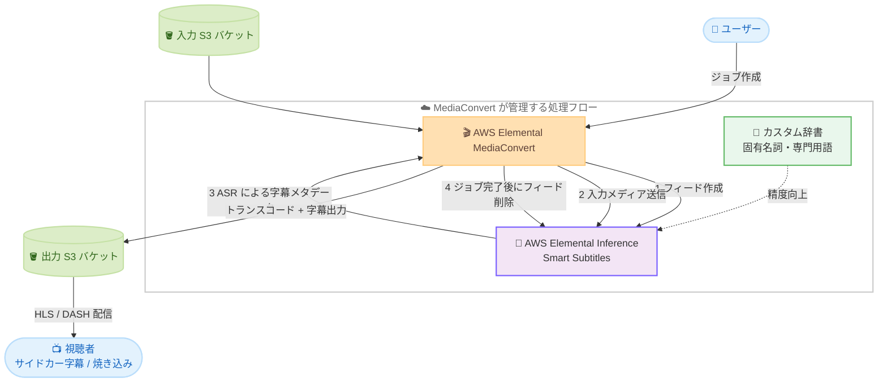

# AWS Elemental MediaConvert - AWS Elemental Inference Smart Subtitles とのネイティブ統合

**リリース日**: 2026 年 11 月 6 日
**サービス**: AWS Elemental MediaConvert / AWS Elemental Inference
**機能**: Smart Subtitles (AI による字幕自動生成) のネイティブ統合

📊 [このアップデートのインフォグラフィックを見る](https://takech9203.github.io/aws-news-summary/20261106-mediaconvert-elemental-smart-subtitles.html)

## 概要

AWS Elemental MediaConvert が、AWS Elemental Inference 上に構築された AI 字幕生成ソリューション「Smart Subtitles」とのネイティブ統合を発表しました。Smart Subtitles は最新の音声認識 (ASR) モデルを利用して音声から字幕を自動生成する機能で、今回の統合により VOD のトランスコードおよびパッケージングワークフローの中で字幕作成を直接実行できるようになります。

これまで字幕生成には外部のキャプションパイプラインを別途構築・運用する必要がありましたが、今回のアップデートにより、トランスコードと字幕生成を単一の MediaConvert ジョブに統合できます。英語、フランス語、ドイツ語、イタリア語、ポルトガル語、スペイン語の 6 言語にネイティブ対応し、サイドカー形式のテキスト字幕と映像への焼き込み (burn-in) の両方で出力できます。HLS や DASH などのストリーミング配信フォーマットにも対応します。

また、Elemental Inference のカスタム辞書を利用することで、固有名詞、ブランド名、技術用語などの認識精度を向上させることができます。本機能は、既存の Smart Cropping などの Smart features を補完するアドオンとして提供されます。

**アップデート前の課題**

このアップデート以前は、VOD コンテンツへの字幕付与に以下の課題がありました。

- 字幕生成のために Amazon Transcribe などを組み合わせた外部キャプションパイプラインを別途構築・運用する必要があった
- トランスコードと字幕生成が別ワークフローとなり、Step Functions や Lambda などによるオーケストレーションや形式変換の手間が発生していた
- 字幕ファイルとトランスコード出力のタイミング同期や成果物の管理を自前で行う必要があった

**アップデート後の改善**

今回のアップデートにより、以下が可能になりました。

- MediaConvert ジョブの字幕設定で「Smart subtitle」をキャプションソースとして選択するだけで、字幕の自動生成からパッケージングまでを 1 つのジョブで完結できる
- サイドカー形式 (TTML など) と焼き込みの両方に対応し、HLS / DASH 配信用の字幕を直接出力できる
- カスタム辞書により、固有名詞や専門用語の認識精度をチューニングできる
- 外部パイプラインが不要になり、運用負荷と配信までのリードタイムを削減できる

## アーキテクチャ図



MediaConvert は Smart features を有効にしたジョブの実行中に Elemental Inference フィードを自動作成し、入力メディアを送信して ASR による字幕メタデータを取得、トランスコード出力に組み込んだ後、ジョブ終了時にフィードを自動削除します。

## サービスアップデートの詳細

### 主要機能

1. **音声の自動文字起こしによる字幕生成**
   - AWS Elemental Inference と最新の音声認識モデルによる自動字幕生成
   - 英語、フランス語、ドイツ語、イタリア語、ポルトガル語、スペイン語の 6 言語にネイティブ対応
   - 英語はオーストラリア英語 (eng-au)、イギリス英語 (eng-gb)、アメリカ英語 (eng-us) の地域バリアントも指定可能

2. **トランスコードワークフローへのネイティブ統合**
   - MediaConvert ジョブのキャプション設定で「Smart subtitle」をキャプションソースとして選択するだけで有効化
   - MediaConvert が Elemental Inference フィードのライフサイクル (作成・メディア送信・メタデータ取得・削除) を自動管理
   - サイドカー形式のテキスト字幕と映像への焼き込みの両方に対応し、HLS / DASH などの配信形式で出力可能

3. **カスタム辞書による精度向上**
   - 固有名詞、ブランド名、技術用語などを登録した辞書を参照して認識精度を向上
   - 辞書エントリには `content` (用語) と `sounds_like` (発音ヒント) を指定可能
   - `CreateDictionary` / `UpdateDictionary` などの Elemental Inference API またはコンソールで管理

4. **フィード設定ソース ARN によるオプション設定**
   - 不適切表現フィルター (profanity filter) などのオプションパラメータは、事前に作成した Elemental Inference フィードの ARN をジョブの「AWS Elemental Inference feed configuration source ARN」に指定して適用
   - フィルターは DISABLED (デフォルト)、CENSOR (アスタリスク置換)、DROP (削除) から選択可能 (英語、スペイン語、イタリア語のみ)

## 技術仕様

### Smart Subtitles の仕様

| 項目 | 詳細 |
|------|------|
| 対応言語 | ドイツ語 (deu)、英語 (eng / eng-au / eng-gb / eng-us)、フランス語 (fra)、イタリア語 (ita)、ポルトガル語 (por)、スペイン語 (spa) |
| 生成形式 | Elemental Inference は TTML 字幕を生成。MediaConvert の出力コーデックと互換性のあるサイドカー形式および焼き込みに変換可能 |
| 不適切表現フィルター | DISABLED / CENSOR / DROP (英語、スペイン語、イタリア語のみ対応) |
| カスタム辞書 | 言語ごとに作成 (地域バリアント不可、ベース言語コードを使用)。エントリは JSON 配列、最大 40 KB |
| 料金ティア | Professional Tier (出力ごとに有効化) |
| 非対応機能 | 高速トランスコード (Accelerated transcoding)、HTTP 入力、リザーブドキュー |

### API 変更履歴

2026 年 11 月 7 日時点で、awsapichanges.com に本アップデートに関連する MediaConvert / Elemental Inference の API 変更は確認されていません。

### IAM ロールに必要な権限

MediaConvert のサービスロールに以下の権限を追加する必要があります。

```json
{
  "Version": "2012-10-17",
  "Statement": [
    {
      "Effect": "Allow",
      "Action": [
        "elemental-inference:CreateFeed",
        "elemental-inference:AssociateFeed",
        "elemental-inference:PutMedia",
        "elemental-inference:GetMetadata",
        "elemental-inference:DeleteFeed",
        "elemental-inference:TagResource"
      ],
      "Resource": "*"
    }
  ]
}
```

フィード設定ソース ARN を指定する場合は、`elemental-inference:GetFeed` アクションも追加する必要があります。

## 設定方法

### 前提条件

1. Smart features が利用可能なリージョン (バージニア北部、オレゴン、アイルランド、ムンバイ、シドニー) で MediaConvert ジョブを実行すること
2. MediaConvert のサービスロールに Elemental Inference 関連の IAM 権限を追加していること
3. オンデマンドキューの「Maximum concurrent feeds」を 1 以上に設定していること (0 の場合、Smart features を使用するジョブは処理されない)

### 手順

#### ステップ 1: キューの最大同時フィード数を設定

```bash
# コンソールの場合: Queues -> 対象キュー -> Edit queue -> Maximum concurrent feeds を設定
```

Smart features を有効にしたジョブは実行中に 1 つの Elemental Inference フィードを作成します。キューごとの最大同時フィード数を設定し、アカウント全体では Elemental Inference の「Active feeds per account」クォータを超えないようにします。上限を超えたジョブはキューイングされ、フィード容量が空き次第処理されます。

#### ステップ 2: ジョブで Smart subtitle を有効化

MediaConvert コンソールでの設定手順は以下のとおりです。

1. MediaConvert コンソールで「Jobs」->「Create job」を選択
2. 出力グループと出力を追加
3. 出力のエンコード設定で「Add captions」を選択
4. キャプション出力設定の「Captions source」で「Smart subtitle」を選択
5. 出力ビデオコーデックと互換性のある「Destination type」を選択
6. 「Audio source name」を選択
7. 音声ソースの言語に一致する「Language」を選択

#### ステップ 3: オプション設定の適用 (必要に応じて)

```bash
# 不適切表現フィルターなどを設定したソースフィードを事前作成
aws elemental-inference create-feed \
  --name "subtitle-config-feed" \
  --outputs '[{
    "name": "subtitles",
    "status": "ENABLED",
    "outputConfig": {
      "subtitling": {
        "language": "eng",
        "aspectRatio": {"width": 16, "height": 9},
        "profanityFilter": "CENSOR"
      }
    }
  }]'
```

不適切表現フィルターやカスタム辞書などのオプションパラメータを使用する場合は、同一アカウント・同一リージョンに設定用のソースフィードを作成し、ジョブの「AWS integration」->「AWS Elemental Inference feed configuration source ARN」にその ARN を指定します。MediaConvert がジョブ実行時に作成する管理フィードへ、サポートされる設定をコピーします。

#### ステップ 4: カスタム辞書の作成 (必要に応じて)

```bash
# 固有名詞や専門用語の辞書を作成
aws elemental-inference create-dictionary \
  --name "my-terms" \
  --language "eng" \
  --entries '[{"content": "Kubernetes", "sounds_like": ["koo-ber-net-eez"]}]'
```

ASR エンジンが認識しにくいブランド名や技術用語を辞書に登録し、ソースフィードの字幕出力設定から辞書 ID を参照することで、文字起こし精度を向上できます。辞書はベース言語コード (eng など) で作成し、エントリは JSON 配列で最大 40 KB まで登録できます。

## メリット

### ビジネス面

- **配信リードタイムの短縮**: 字幕生成がトランスコードと同一ワークフローで完結するため、VOD コンテンツの公開までの時間を短縮できる
- **運用コストの削減**: 外部キャプションパイプラインの構築・保守が不要になり、手動キャプション作業の工数も削減できる
- **アクセシビリティとリーチの向上**: 6 言語対応の字幕により、聴覚障がいのある視聴者への対応や多言語圏への展開を低コストで実現できる

### 技術面

- **フィードライフサイクルの自動管理**: フィードの作成・メディア送信・メタデータ取得・削除を MediaConvert が自動で行い、ジョブ終了時にクリーンアップされる
- **柔軟な出力形式**: サイドカー形式と焼き込みの両方に対応し、HLS / DASH などの配信要件に合わせて選択できる
- **精度チューニングが可能**: カスタム辞書の `sounds_like` ヒントにより、ドメイン固有用語の認識精度を改善できる
- **同時実行制御**: キュー単位の「Maximum concurrent feeds」設定により、フィードクォータを考慮したジョブ制御が可能

## デメリット・制約事項

### 制限事項

- 利用可能リージョンは Elemental Inference が利用できる 5 リージョン (バージニア北部、オレゴン、アイルランド、ムンバイ、シドニー) に限定される
- 対応言語は 6 言語 (英語、フランス語、ドイツ語、イタリア語、ポルトガル語、スペイン語) で、日本語には未対応
- 高速トランスコード、HTTP 入力、リザーブドキューとは併用できない
- 不適切表現フィルターは英語、スペイン語、イタリア語のみ対応
- カスタム辞書はベース言語コードのみ対応で、地域バリアント (eng-us など) では作成できない

### 考慮すべき点

- MediaConvert のトランスコード料金に加えて Elemental Inference の推論料金が発生する (Professional Tier)
- アカウント全体の同時フィード数は Elemental Inference の「Active feeds per account」クォータに制限されるため、大量のジョブを並列実行する場合はクォータ引き上げの申請を検討する
- 自動生成字幕の品質は音声の明瞭さに依存するため、公開前の品質確認プロセスや辞書によるチューニングを検討する

## ユースケース

### ユースケース 1: VOD プラットフォームの字幕自動付与

**シナリオ**: 動画配信プラットフォームで、大量の VOD コンテンツに字幕を付与して HLS 配信したい。

**実装例**:
```
1. S3 に入力動画をアップロード
2. MediaConvert ジョブで Apple HLS 出力グループを作成
3. 出力に Captions を追加し、Captions source に Smart subtitle を選択
4. Destination type に WebVTT などの HLS 互換形式を指定
5. ジョブ実行後、字幕付き HLS 出力を CloudFront で配信
```

**効果**: 外部字幕パイプラインなしで、トランスコードと同時に配信用字幕を生成し、公開までのリードタイムを大幅に短縮できます。

### ユースケース 2: スポーツ・ニュース映像の専門用語対応字幕

**シナリオ**: 選手名、チーム名、専門用語が多いスポーツ映像の字幕精度を高めたい。

**実装例**:
```
1. CreateDictionary で選手名・チーム名を登録した辞書を作成
   [{"content": "Northport Comets"}, {"content": "Kubernetes", "sounds_like": ["koo-ber-net-eez"]}]
2. 辞書 ID を参照するソースフィードを作成
3. MediaConvert ジョブの AWS integration でソースフィード ARN を指定
4. Smart subtitle を有効にしてジョブを実行
```

**効果**: ASR が認識しにくい固有名詞の誤変換を減らし、手動修正コストを削減できます。

### ユースケース 3: ファミリー向けコンテンツの不適切表現フィルタリング

**シナリオ**: 英語圏向けのファミリー向けコンテンツで、字幕中の不適切表現を自動的に伏せ字にしたい。

**実装例**:
```
1. profanityFilter を CENSOR に設定したソースフィードを作成
2. MediaConvert ジョブでソースフィード ARN を指定し、Smart subtitle を有効化
3. 生成された字幕では不適切表現がアスタリスクに置換される
```

**効果**: 人手によるレビュー工数を削減しながら、ブランドセーフティ要件を満たした字幕を配信できます。

## 料金

Smart Subtitles を使用すると、Elemental Inference の推論料金と MediaConvert のトランスコード料金の両方が課金されます。Smart features はすべて Professional Tier の機能であり、出力ごとに有効化されます。

課金はジョブが正常に完了した場合のみ発生し、エラーまたはキャンセルされたジョブには両サービスとも課金されません。具体的な料金レートは、AWS Elemental MediaConvert および AWS Elemental Inference の料金ページを参照してください。

## 利用可能リージョン

Elemental Inference が利用可能なすべてのリージョンで利用できます。

- 米国東部 (バージニア北部)
- 米国西部 (オレゴン)
- 欧州 (アイルランド)
- アジアパシフィック (ムンバイ)
- アジアパシフィック (シドニー)

## 関連サービス・機能

- **AWS Elemental Inference**: メディアファイルから AI でメタデータを生成するマネージドサービス。Smart Subtitles のほか、Smart Cropping、コンテキストメタデータ、イベントクリッピングなどの機能を提供
- **Smart Cropping**: Elemental Inference を利用した既存の Smart feature。映像の主要被写体を検出して自動クロップを行う。Smart Subtitles はこれを補完するアドオン
- **Amazon S3**: 入力メディアおよび字幕付きトランスコード出力の保存先
- **AWS Elemental MediaTailor / MediaLive**: Elemental Inference のコンテキストメタデータと連携した広告挿入ワークフローを構成可能

## 参考リンク

- 📊 [インフォグラフィック](https://takech9203.github.io/aws-news-summary/20261106-mediaconvert-elemental-smart-subtitles.html)
- [公式発表 (What's New)](https://aws.amazon.com/about-aws/whats-new/2026/11/mediaconvert-elemental-smart-subtitles/)
- [ドキュメント: Smart subtitling with AWS Elemental Inference (MediaConvert)](https://docs.aws.amazon.com/mediaconvert/latest/ug/smart-subtitling-with-elemental-inference.html)
- [ドキュメント: MediaConvert features that use AWS Elemental Inference](https://docs.aws.amazon.com/mediaconvert/latest/ug/elemental-inference.html)
- [ドキュメント: Elemental Inference の Smart Subtitles 設定](https://docs.aws.amazon.com/elemental-inference/latest/userguide/create-feed-outputs.html#create-feed-console-smart-subtitles)
- [料金ページ (MediaConvert)](https://aws.amazon.com/mediaconvert/pricing/)

## まとめ

今回のアップデートにより、VOD ワークフローにおける字幕生成が MediaConvert ジョブ内で完結するようになり、外部キャプションパイプラインの構築・運用が不要になりました。6 言語対応、カスタム辞書、不適切表現フィルターなど実運用に必要な機能が揃っているため、対象リージョンで VOD 配信を行っている場合は、既存の字幕ワークフローの置き換えを検討することを推奨します。日本語は未対応のため、日本語コンテンツについては今後の言語拡大に注目してください。
