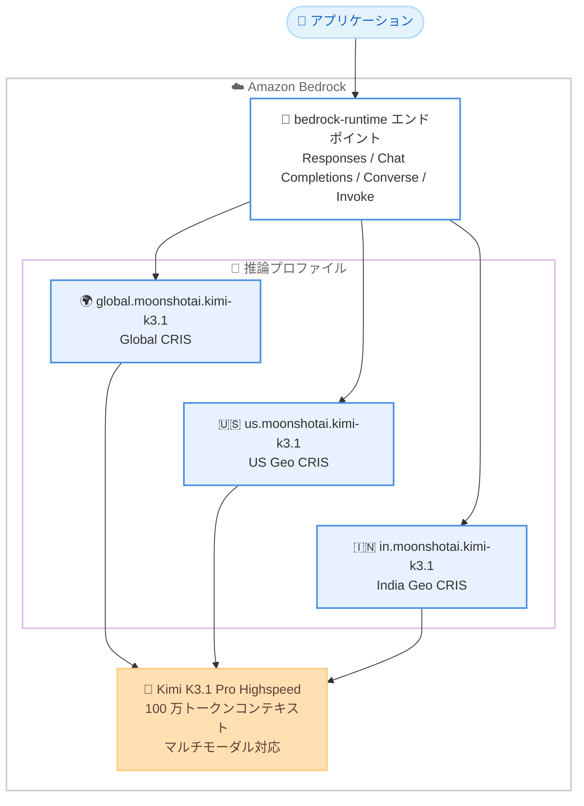

# Amazon Bedrock - Kimi K3.1 Pro (Highspeed) の提供開始

**リリース日**: 2026 年 11 月 6 日
**サービス**: Amazon Bedrock
**機能**: Moonshot AI Kimi K3.1 Pro (Highspeed) モデルの提供開始

📊 [このアップデートのインフォグラフィックを見る](https://takech9203.github.io/aws-news-summary/20261106-moonshot-ai-kimi-k3-1-pro-on-amazon-bedrock.html)

## 概要

Moonshot AI の Kimi K3.1 Pro (Highspeed) が Amazon Bedrock で利用可能になりました。Kimi K3.1 Pro は、ネイティブなマルチモーダル対応 (画像 + テキスト入力) と 100 万トークンのコンテキストウィンドウを備えたオープンウェイトのエージェント型モデルで、Moonshot AI によれば 3 兆パラメータクラスで同社最高性能のモデルです。コーディング、ドキュメント処理、3D 作成、金融リサーチなどのエージェント型ワークロードに強みを持ちます。

今回提供される Highspeed バリアントは、高い出力トークンスループット (OTPS: Output Tokens Per Second) を重視した構成で、コーディングエージェントや対話型アプリケーションなど応答性が求められるユースケースに適しています。Amazon Bedrock 上ではプロプライエタリモデルと同一のセキュリティ境界内で動作し、明示的プロンプトキャッシュによるレイテンシーと入力コストの削減もサポートします。

モデルは Global クロスリージョン推論に加えて、US Geo および India Geo のクロスリージョン推論プロファイルを通じて利用でき、東京・大阪リージョンからも Global プロファイル経由でアクセスできます。

**アップデート前の課題**

- Kimi シリーズの最新世代モデルを AWS 上で利用するには、セルフホスティング環境の構築・運用が必要だった
- 100 万トークン級の長大なコンテキストを扱えるオープンウェイトモデルの選択肢が限られていた
- オープンウェイトモデルの利用時に、エンタープライズレベルのセキュリティ統制や監査対応を独自に実装する必要があった

**アップデート後の改善**

- Amazon Bedrock のフルマネージドなサーバーレス API として、インフラ管理なしで Kimi K3.1 Pro を利用できるようになった
- 100 万トークンのコンテキストウィンドウにより、大規模リポジトリや長大なドキュメント、画像をまたいだ長時間のワークフローを単一コンテキストで処理できるようになった
- 明示的プロンプトキャッシュ、Guardrails、呼び出しログなど Bedrock の既存機能と組み合わせて、セキュアかつ低コストに運用できるようになった

## アーキテクチャ図



アプリケーションは bedrock-runtime エンドポイントに対してリクエストを送信し、選択した推論プロファイル (Global、US Geo、India Geo) に応じて Amazon Bedrock がリクエストを適切なリージョンへルーティングします。

## サービスアップデートの詳細

### 主要機能

1. **100 万トークンのコンテキストウィンドウ**
   - 大規模コードリポジトリ、長大なドキュメント、複数画像をまたぐ長時間のワークフローを単一コンテキストで維持可能
   - 長期実行のエージェント型タスク (コーディング、ナレッジワーク) に最適化

2. **ネイティブマルチモーダル対応**
   - テキストと画像の入力をサポート (出力はテキスト)
   - テキストと画像を組み合わせる場合、画像コンテンツブロックをテキストより前に配置すると回答品質が向上する傾向がある
   - 動画・音声入力は非対応

3. **Highspeed バリアントによる高速推論**
   - 高い出力トークンスループット (OTPS) により、応答性が求められるエージェント型アプリケーションに対応
   - デフォルトで推論 (Reasoning) が有効。reasoning effort パラメータで `none` / `low` / `medium` / `high` / `xhigh` / `max` を指定可能 (デフォルトは `max`、`minimal` は非対応)

4. **プロンプトキャッシュのサポート**
   - 暗黙的 (自動) プロンプトキャッシュをデフォルトでサポート
   - 明示的プロンプトキャッシュにも対応しており、キャッシュヒット率の向上によりレイテンシーとコストを削減可能 (Responses、Chat Completions、InvokeModel API で利用可能。Converse では非対応)
   - キャッシュチェックポイントあたり最小 256 トークン、キャッシュ保持期間は最低 30 分

5. **Bedrock 機能との統合**
   - レスポンスストリーミング、クライアントサイドツール呼び出し、構造化出力、呼び出しログ、Guardrails、アプリケーション推論プロファイルをサポート
   - Intelligent prompt routing、Knowledge base、Count tokens、Watermarking は非対応

## 技術仕様

### モデル仕様

| 項目 | 詳細 |
|------|------|
| プロバイダー | Moonshot AI |
| モデル名 | Kimi K3.1 Pro - Highspeed |
| モデル ID | `moonshotai.kimi-k3.1` |
| Global 推論プロファイル ID | `global.moonshotai.kimi-k3.1` |
| Geo 推論プロファイル ID | `us.moonshotai.kimi-k3.1` (US) / `in.moonshotai.kimi-k3.1` (India) |
| モデル公開日 | 2026 年 11 月 4 日 |
| コンテキストウィンドウ | 100 万トークン |
| 入力モダリティ | テキスト、画像 |
| 出力モダリティ | テキスト |
| 対応 API | Responses、Chat Completions、Converse、Invoke |
| 対応エンドポイント | bedrock-runtime |
| サービスティア | Standard、Priority、Flex (Reserved は非対応) |
| ライセンス | オープンウェイト (Bedrock 経由の利用は Certified Inference Partners 経由のアクセスと見なされる) |

### クォータに関する注意

- 出力トークンのバーンダウンレートは 10 倍 (出力 1 トークンがクォータから 10 トークンを消費)

### reasoning effort の指定方法

API ごとにパラメータ名が異なります。

| API | パラメータ |
|------|------|
| Responses API | `reasoning.effort` |
| Chat Completions API | `reasoning_effort` |
| InvokeModel API | リクエストボディの `reasoning_effort` |

## 設定方法

### 前提条件

1. AWS アカウントを保有していること
2. Amazon Bedrock へのアクセス権限を持つ IAM プリンシパル、または Bedrock API キーを用意していること
3. Python 環境と必要な SDK (boto3 または openai + aws-bedrock-token-generator) がインストールされていること

### 手順

#### ステップ 1: SDK のインストール

```bash
# Responses / Chat Completions API を使用する場合
pip install -U openai aws-bedrock-token-generator

# Invoke / Converse API を使用する場合
pip install boto3
```

使用する API に応じて必要な SDK をインストールします。このモデルでは OpenAI 互換の Chat Completions API または Responses API の利用が推奨されています。

#### ステップ 2: Responses API での呼び出し

```python
from aws_bedrock_token_generator import provide_token
from openai import OpenAI

region = "us-west-2"
client = OpenAI(
    api_key=provide_token(region=region),
    base_url=f"https://bedrock-runtime.{region}.amazonaws.com/openai/v1",
)

resp = client.responses.create(
    input="Can you explain the features of Amazon Bedrock?",
    model="global.moonshotai.kimi-k3.1",
)
print(resp.output_text)
```

aws-bedrock-token-generator で Bedrock 用の短期トークンを生成し、OpenAI SDK から Bedrock の OpenAI 互換エンドポイントに接続して、Global 推論プロファイル経由で Kimi K3.1 Pro を呼び出しています。

#### ステップ 3: Converse API での呼び出し

```python
import boto3

client = boto3.client('bedrock-runtime', region_name='us-west-2')
response = client.converse(
    modelId='global.moonshotai.kimi-k3.1',
    messages=[
        {
            'role': 'user',
            'content': [{'text': 'Can you explain the features of Amazon Bedrock?'}]
        }
    ]
)
print(response)
```

boto3 の Converse API でモデルを呼び出しています。ただし、このモデルでは Converse に既知の制限があるため (後述)、可能な限り OpenAI 互換 API の使用が推奨されます。

## メリット

### ビジネス面

- **インフラ管理不要**: フルマネージドなサーバーレス API として従量課金で利用でき、GPU インフラの調達・運用コストが不要
- **コスト最適化の選択肢**: プロンプトキャッシュ (キャッシュ読み取りは入力の 1/20 の価格)、Flex ティア (50% 割引) により、ワークロード特性に応じたコスト削減が可能
- **エンタープライズセキュリティ**: プロプライエタリモデルと同一のセキュリティ境界内で動作し、Guardrails や呼び出しログによる統制が可能

### 技術面

- **長大コンテキスト**: 100 万トークンのコンテキストウィンドウにより、大規模リポジトリ全体やドキュメント群を単一コンテキストで処理可能
- **高速なエージェント実行**: Highspeed バリアントの高い OTPS により、多数のツール呼び出しを伴うエージェントループの実行時間を短縮
- **OpenAI 互換 API**: Chat Completions / Responses API に対応しており、既存の OpenAI SDK ベースのコードからの移行が容易

## デメリット・制約事項

### 制限事項

- In-Region 推論は非対応で、クロスリージョン推論 (Global、US Geo、India Geo) のみで提供される
- 動画・音声入力は非対応
- Intelligent prompt routing、Knowledge base、Count tokens、Watermarking は非対応
- 明示的プロンプトキャッシュは Converse API では利用できない
- 出力トークンのバーンダウンレートが 10 倍のため、クォータ消費が速い

### 考慮すべき点

- **Converse API の既知の制限**: 過去ターンの reasoning コンテンツを含むマルチターンリクエストで `InternalServerException` が発生する。LangChain や Strands Agents のデフォルト構成に影響するため、Converse を使う場合は過去ターンから reasoning ブロックを除去する必要がある。また、PDF や HTML などのドキュメント添付入力は拒否される
- デフォルトの reasoning effort は `max` のため、レイテンシーとトークン消費を抑えたい場合は明示的に下げる必要がある
- 画像入力の `detail` パラメータは Chat Completions API でのみ有効で、Responses API では常に高精細で処理される
- データレジデンシー要件がある場合は、Global ではなく US / India Geo プロファイルの利用を検討する (日本国内に閉じたルーティングは現時点で提供されていない)

## ユースケース

### ユースケース 1: 大規模リポジトリを対象としたコーディングエージェント

**シナリオ**: 数十万行規模のコードベース全体を参照しながら、リファクタリングやバグ修正を行うコーディングエージェントを構築する。

**実装例**:
```python
resp = client.responses.create(
    model="global.moonshotai.kimi-k3.1",
    input=[{"role": "user", "content": repo_context + task_description}],
    reasoning={"effort": "high"},
)
```

**効果**: 100 万トークンのコンテキストにリポジトリの主要部分を保持したまま作業でき、高 OTPS によりエージェントループの反復が高速化される。

### ユースケース 2: 長大ドキュメントのマルチモーダル処理

**シナリオ**: 図表を含む大量の技術文書や契約書をまとめて読み込み、横断的な分析・要約・質問応答を行う。

**実装例**:
```python
messages = [{
    "role": "user",
    "content": [
        {"type": "image_url", "image_url": {"url": image_url, "detail": "high"}},
        {"type": "text", "text": "この図と以下のドキュメント群を分析してください。" + docs},
    ],
}]
resp = client.chat.completions.create(
    model="global.moonshotai.kimi-k3.1", messages=messages)
```

**効果**: 画像とテキストを単一コンテキストで処理でき、ドキュメントを分割せずに横断分析が可能。画像をテキストより前に配置することで回答品質の向上が期待できる。

### ユースケース 3: プロンプトキャッシュを活用した低コストな対話型アシスタント

**シナリオ**: 長いシステムプロンプトと共通ナレッジを持つ社内アシスタントで、多数のユーザーリクエストを低コスト・低レイテンシーで処理する。

**実装例**:
```python
messages = [
    {"role": "system", "content": [
        {"type": "text", "text": long_system_prompt,
         "cache_control": {"type": "ephemeral"}},
    ]},
    {"role": "user", "content": user_query},
]
```

**効果**: 共通部分がキャッシュされ、キャッシュ読み取りは通常入力の 1/20 の料金 ($0.20/100 万トークン、Global CRIS) となり、レイテンシーも削減される。

## 料金

トークン数に応じた従量課金です。Standard ティアの料金は以下のとおりです (100 万トークンあたり、米ドル)。

| 推論オプション | 入力 | 出力 | キャッシュ読み取り | キャッシュ書き込み (30 分) |
|----------------|------|------|--------------------|----------------------------|
| Global CRIS | $4.00 | $20.00 | $0.20 | $5.00 |
| US CRIS | $4.40 | $22.00 | $0.22 | $5.50 |
| India CRIS | $4.40 | $22.00 | $0.22 | $5.50 |

- **Priority ティア**: Standard の 1.75 倍 (75% プレミアム)。最速の応答時間が必要な場合に使用
- **Flex ティア**: Standard の 0.5 倍 (50% 割引)。時間に厳しくないワークロード向け

### 料金例

| 使用量 (Global CRIS、Standard) | 月額料金 (概算) |
|--------|------------------|
| 入力 1,000 万トークン + 出力 200 万トークン | $80 ($40 + $40) |
| 入力 1 億トークン (うち 80% キャッシュヒット) + 出力 1,000 万トークン | $296 ($80 + $16 + $200) ※キャッシュ書き込み費用別途 |

## 利用可能リージョン

Amazon Bedrock が利用可能なすべての商用 AWS リージョンから、クロスリージョン推論経由で利用できます。In-Region 推論は非対応です。

- **Global クロスリージョン推論** (`global.moonshotai.kimi-k3.1`): 東京 (ap-northeast-1)、大阪 (ap-northeast-3) を含む全対応商用リージョンから利用可能。リクエストは世界中の対応リージョンにルーティングされる
- **US Geo クロスリージョン推論** (`us.moonshotai.kimi-k3.1`): バージニア北部、オハイオ、北カリフォルニア、オレゴン、カナダ、カルガリーから利用可能。US 地理内のリージョンのみにルーティング
- **India Geo クロスリージョン推論** (`in.moonshotai.kimi-k3.1`): ムンバイ、ハイデラバードから利用可能。インド地理内のみにルーティング

## 関連サービス・機能

- **Amazon Bedrock クロスリージョン推論**: 本モデルの提供形態。Global / Geo プロファイルによりキャパシティとデータレジデンシーを両立
- **Amazon Bedrock プロンプトキャッシュ**: 繰り返し使用されるプロンプト部分をキャッシュし、レイテンシーと入力コストを削減
- **Amazon Bedrock Guardrails**: 本モデルと組み合わせて、有害コンテンツのフィルタリングや PII 保護などの安全策を適用可能
- **Amazon Bedrock サービスティア**: Standard / Priority / Flex の 3 ティアに対応し、性能要件とコストのバランスを選択可能

## 参考リンク

- 📊 [インフォグラフィック](https://takech9203.github.io/aws-news-summary/20261106-moonshot-ai-kimi-k3-1-pro-on-amazon-bedrock.html)
- [公式発表 (What's New)](https://aws.amazon.com/about-aws/whats-new/2026/11/moonshot-ai-kimi-k3-1-pro-on-amazon-bedrock)
- [モデルカード: Kimi K3.1 Pro - Highspeed](https://docs.aws.amazon.com/bedrock/latest/userguide/model-card-moonshot-ai-kimi-k3-1-highspeed.html)
- [プロンプトキャッシュのドキュメント](https://docs.aws.amazon.com/bedrock/latest/userguide/prompt-caching.html)
- [モデルのリージョン対応状況](https://docs.aws.amazon.com/bedrock/latest/userguide/models-region-compatibility.html)
- [Amazon Bedrock コンソール](https://console.aws.amazon.com/bedrock/)

## まとめ

Moonshot AI の最新フラッグシップであるオープンウェイトモデル Kimi K3.1 Pro (Highspeed) が Amazon Bedrock で利用可能になり、100 万トークンのコンテキストと高速な出力スループットを備えたエージェント型モデルをフルマネージドで活用できるようになりました。コーディングエージェントや長大ドキュメント処理のモデル選択肢として有力であり、OpenAI 互換 API で簡単に試せるため、まずは Global 推論プロファイルで評価を開始し、明示的プロンプトキャッシュや Flex ティアによるコスト最適化を検討することを推奨します。
