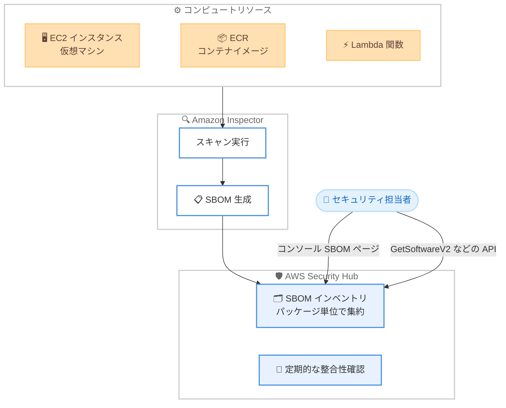

# AWS Security Hub - コンピュートリソース向け SBOM インベントリ

**リリース日**: 2026 年 11 月 6 日
**サービス**: AWS Security Hub
**機能**: SBOM (Software Bill of Materials) インベントリ

📊 [このアップデートのインフォグラフィックを見る](https://takech9203.github.io/aws-news-summary/20261106-security-hub-sbom-inventory.html)

## 概要

AWS Security Hub が、コンピュートリソース向けの SBOM (Software Bill of Materials) インベントリの提供を開始しました。SBOM はコンピュートリソースにインストールされているソフトウェアパッケージの一覧であり、Security Hub は Amazon Inspector がスキャン対象リソースに対して生成する SBOM をもとに、組織全体のソフトウェアインベントリを自動的に構築・維持します。

このインベントリは、EC2 インスタンスなどの仮想マシン、Amazon ECR のコンテナイメージ、AWS Lambda 関数といったコンピュートリソースを対象とし、Security Hub に接続した他のクラウドプロバイダー (例: Microsoft Azure の仮想マシンや Azure Container Registry のコンテナイメージ) のリソースもカバーします。新しい脆弱性が公開された際に特定のパッケージを含むすべてのリソースを即座に特定したり、検出結果のトリアージ時にリソースの役割を把握したり、コンプライアンスプログラム向けにソフトウェアサプライチェーンの最新記録を維持したりする用途に活用できます。

SBOM インベントリは Security Hub の追加設定なしで利用でき、Security Hub Essentials の料金に含まれるため追加コストは発生しません。セキュリティ担当者やプラットフォームチームにとって、ソフトウェアサプライチェーンの可視性を大幅に向上させるアップデートです。

**アップデート前の課題**

- 組織全体でどのソフトウェアパッケージがどのリソースにインストールされているかを把握するには、Amazon Inspector の SBOM エクスポート機能で SBOM ファイルを S3 にエクスポートし、自前で集計・突合する必要があった
- Log4Shell のような重大な脆弱性が公開された際、影響を受けるパッケージを含むリソースを迅速に特定する統一的な手段がなかった
- マルチアカウント・マルチリージョン環境やマルチクラウド環境では、ソフトウェアインベントリの集約に独自の仕組みの構築が必要だった

**アップデート後の改善**

- Amazon Inspector が生成する SBOM をもとに、組織全体のソフトウェアインベントリが Security Hub 上で自動的に構築・更新されるようになった
- パッケージ名でリソースを横断検索し、特定パッケージを含むすべてのリソースをコンソールまたは API で即座に特定できるようになった
- リソース詳細の「Installed software」タブで、検出結果のトリアージ時にそのリソースにインストールされているすべてのパッケージを確認できるようになった
- SBOM ファイルのエクスポートや突合作業が不要になり、インベントリは常に最新の状態に保たれるようになった

## アーキテクチャ図



Amazon Inspector がコンピュートリソースをスキャンして SBOM を生成し、Security Hub がそれを集約して組織全体の SBOM インベントリを構築します。セキュリティ担当者はコンソールまたは API からパッケージとリソースを横断的に検索できます。

## サービスアップデートの詳細

### 主要機能

1. **組織全体の SBOM インベントリの自動構築**
   - Amazon Inspector がスキャン対象リソースの SBOM を生成すると、Security Hub に自動送信され、リソースごとに最新の SBOM が保持される
   - リソースが終了・削除された場合や Inspector のカバレッジから外れた場合は、該当ソフトウェアがインベントリから自動的に削除される
   - Security Hub は定期的に Amazon Inspector との整合性確認を行い、インベントリを最新の状態に維持する
   - 管理者アカウントは組織内の全有効化アカウントのソフトウェアを閲覧でき、メンバーアカウントは自アカウントのリソースのみ閲覧できる

2. **SBOM ページでのパッケージ一覧と可視化**
   - コンソールのナビゲーションペインの「Inventory」配下にある「SBOM」ページで、閲覧可能なアカウントの全パッケージを一覧表示
   - 「Packages by type」チャートでパッケージタイプ別のインストール分布を、「Most common packages」チャートで最も多くのリソースにインストールされているパッケージを可視化
   - パッケージテーブルにはパッケージ名、バージョン、パッケージタイプ、インストール先リソース数が表示される
   - パッケージ、バージョン、パッケージタイプ、アカウント、リージョン、リソースタイプ、クラウドプロバイダーによるフィルタリングと、パッケージタイプ、アカウント、リージョン、リソースタイプによるグルーピングが可能。フィルタ条件はフィルタセットとして保存・再利用できる

3. **パッケージとリソース間の双方向ピボット**
   - SBOM ページでパッケージ名またはリソース数を選択すると、そのパッケージを含むリソースの一覧を表示できる
   - リソースページまたは検出結果からコンピュートリソースを開き、「Installed software」タブでそのリソースにインストールされている全パッケージをバージョン・パッケージタイプとともに確認できる
   - 検出結果のトリアージ時に、リソースの重要度、検出結果、インストール済みソフトウェアをまとめて確認できる

4. **API によるプログラマティックなアクセス**
   - 新しい Software API (GetSoftwareV2、GetSoftwareStatisticsV2、GetSoftwareResourcesV2) により、インベントリをプログラムから利用可能
   - 自動化ワークフローや外部ツールとの連携に活用できる

## 技術仕様

### 対象リソースタイプ

| リソースタイプ | 例 |
|------|------|
| 仮想マシン | Amazon EC2 インスタンス、Microsoft Azure 仮想マシン |
| コンテナイメージ | Amazon ECR コンテナイメージ、Azure Container Registry コンテナイメージ |
| サーバーレス関数 | AWS Lambda 関数 |

### インベントリのデータモデル

| 項目 | 詳細 |
|------|------|
| 集約単位 | パッケージ (例: openssl バージョン 3.1.4) 単位で 1 行。複数リソースにインストールされていても 1 行で表示 |
| リソース数 | 「Resources」列でそのパッケージのインストール先リソース数を表示 |
| チャート集計 | チャートはリソースごとに 1 インストールとしてカウントするため、チャート合計はテーブル行数より多くなる場合がある |
| 更新遅延 | Amazon Inspector が新しい SBOM を生成してからインベントリに反映されるまで数時間かかる場合がある |

### API 変更履歴

| 日付 | サービス | 変更内容 |
|------|----------|----------|
| 2026/11/04 | [securityhub](https://awsapichanges.com/archive/changes/f6d89d-securityhub.html) | 3 new api methods - GetSoftwareV2 (集約リソース数付きのソフトウェアパッケージ一覧)、GetSoftwareStatisticsV2 (集約されたソフトウェア統計の取得)、GetSoftwareResourcesV2 (特定のソフトウェアパッケージを含むリソースの検索) |

## 設定方法

### 前提条件

1. AWS アカウントとリージョンで Security Hub が有効化されていること
2. インベントリ対象のリソースタイプ (EC2 インスタンス、ECR コンテナイメージ、Lambda 関数など) に対して Amazon Inspector が有効化されていること
3. 他のクラウドプロバイダーのリソースを対象にする場合は、該当プロバイダーが Security Hub に接続されていること (接続時に Inspector のスキャンが設定される)

### 手順

#### ステップ 1: 前提条件の確認

SBOM インベントリは Security Hub 側の追加設定が不要で、前提条件を満たすと自動的にデータが蓄積されます。Amazon Inspector が有効化されていない場合、SBOM ページに「Amazon Inspector is not enabled」というメッセージと [Enable Inspector] ボタンが表示されるため、そこから Security Hub の設定画面を開いて有効化できます。

なお、Security Hub に表示されるのは Amazon Inspector がスキャンするリソースタイプのソフトウェアのみです。例えば Inspector が EC2 インスタンスのみをスキャンし Lambda 関数をスキャンしていない場合、インベントリには EC2 インスタンスのソフトウェアのみが含まれます。

#### ステップ 2: コンソールで SBOM ページを開く

1. Security Hub コンソール (https://console.aws.amazon.com/securityhub/) を開く
2. ナビゲーションペインの「Inventory」配下にある [SBOM] を選択

パッケージの一覧、分布チャート、フィルタ・グルーピング機能を利用できます。

#### ステップ 3: 特定パッケージを含むリソースの特定

SBOM ページでパッケージ名またはリソース数を選択すると、そのパッケージがインストールされているリソースの一覧が表示されます。各リソースを選択すると、リソース詳細パネルでリソースの重要度、検出結果、インストール済みソフトウェアを確認できます。

#### ステップ 4: API からの利用

```bash
# ソフトウェアパッケージの一覧を集約リソース数付きで取得
aws securityhub get-software-v2

# 集約されたソフトウェア統計を取得
aws securityhub get-software-statistics-v2

# 特定のソフトウェアパッケージを含むリソースを検索
aws securityhub get-software-resources-v2
```

Security Hub の Software API を使用して、SBOM インベントリをプログラムから取得します。脆弱性対応の自動化や外部のアセット管理ツールとの連携に活用できます。

## メリット

### ビジネス面

- **インシデント対応時間の短縮**: 新しい脆弱性が公開された際、影響を受けるパッケージを含むリソースを即座に特定でき、対応の初動を大幅に短縮できる
- **コンプライアンス対応の効率化**: ソフトウェアサプライチェーンの最新記録が自動的に維持されるため、監査やコンプライアンスプログラムへの対応工数を削減できる
- **追加コストなし**: Security Hub Essentials に含まれるため、追加料金なしで利用できる

### 技術面

- **運用負荷の削減**: SBOM ファイルのエクスポート・突合といった手作業が不要になり、インベントリは Inspector のスキャンに追従して自動更新される
- **組織全体・マルチクラウドの可視性**: マルチアカウント環境では管理者アカウントから組織全体を一元的に把握でき、Azure など接続済みの他クラウドのリソースもカバーできる
- **トリアージの効率化**: 検出結果からリソースのインストール済みソフトウェアに直接ピボットでき、調査のコンテキストスイッチが減る

## デメリット・制約事項

### 制限事項

- インベントリに含まれるのは Amazon Inspector がスキャンするリソースタイプのソフトウェアのみ (Inspector が有効化されていないリソースタイプは対象外)
- Amazon Inspector が新しい SBOM を生成してから、SBOM インベントリに反映されるまで数時間かかる場合がある
- メンバーアカウントは自アカウントのリソースのソフトウェアのみ閲覧可能 (組織全体の閲覧は管理者アカウントのみ)

### 考慮すべき点

- SBOM インベントリの利用には Security Hub Essentials と Amazon Inspector の有効化が前提となるため、未導入の場合はそれぞれの料金とカバレッジを確認する必要がある
- チャートのインストール数はリソースごとにカウントされるため、テーブルのパッケージ行数とは集計方法が異なる点に注意が必要

## ユースケース

### ユースケース 1: 新規公開された脆弱性の影響範囲調査

**シナリオ**: 広く利用されているオープンソースライブラリに重大な脆弱性が公開され、組織内で該当パッケージを使用しているリソースをすべて特定する必要がある。

**実装例**:
```
1. Security Hub コンソールの SBOM ページを開く
2. パッケージ名 (例: openssl) とバージョンでフィルタリング
3. リソース数を選択し、該当パッケージを含むリソースの一覧を表示
4. アカウント・リージョンでグルーピングして影響範囲を整理
```

**効果**: 従来は各アカウントで SBOM をエクスポートして突合する必要があった作業が、コンソール上の数クリックで完了し、影響範囲の特定から修復対応までのリードタイムを大幅に短縮できる。

### ユースケース 2: 検出結果トリアージ時のリソース把握

**シナリオ**: Security Hub の検出結果をトリアージする際に、対象リソースがどのような役割を持つかを、インストールされているソフトウェアから判断したい。

**実装例**:
```
1. 検出結果から対象のコンピュートリソースを開く
2. [Installed software] タブを選択
3. インストール済みパッケージの一覧をバージョン・パッケージタイプとともに確認
4. 必要に応じてパッケージ名でフィルタリング
```

**効果**: リソースの用途や構成をその場で把握でき、検出結果の重要度判断と対応優先順位付けの精度が向上する。

### ユースケース 3: ソフトウェアサプライチェーンの継続的な記録

**シナリオ**: コンプライアンスプログラムの要件として、組織内のソフトウェアサプライチェーンの最新インベントリを維持・報告する必要がある。

**実装例**:
```bash
# 定期実行するレポートジョブの例
aws securityhub get-software-v2 > software-inventory.json
aws securityhub get-software-statistics-v2 > software-statistics.json
```

**効果**: Software API による自動取得で、常に最新のソフトウェアインベントリを監査資料や資産管理システムに連携でき、手動での棚卸し作業が不要になる。

## 料金

SBOM インベントリは Security Hub Essentials に含まれており、追加料金なしで利用できます。新たな有効化作業も不要で、Amazon Inspector が有効化されている環境では自動的にインベントリが蓄積されます。

なお、前提となる Security Hub および Amazon Inspector 自体の料金は別途発生します。詳細は各サービスの料金ページを参照してください。

## 利用可能リージョン

Security Hub が利用可能なすべての AWS リージョンで利用できます。

## 関連サービス・機能

- **Amazon Inspector**: SBOM インベントリのデータソース。EC2 インスタンス、ECR コンテナイメージ、Lambda 関数をスキャンして SBOM を生成する
- **AWS Security Hub リソースインベントリ**: Security Hub の Inventory 機能の一部として SBOM ページが提供され、リソース詳細パネルから検出結果やインストール済みソフトウェアを横断的に確認できる
- **Microsoft Azure 統合**: Security Hub に Azure を接続すると、Azure 仮想マシンや Azure Container Registry のコンテナイメージも SBOM インベントリの対象になる

## 参考リンク

- 📊 [インフォグラフィック](https://takech9203.github.io/aws-news-summary/20261106-security-hub-sbom-inventory.html)
- [公式発表 (What's New)](https://aws.amazon.com/about-aws/whats-new/2026/11/security-hub-sbom-inventory/)
- [ドキュメント: Software bill of materials - AWS Security Hub User Guide](https://docs.aws.amazon.com/securityhub/latest/userguide/securityhub-v2-sbom.html)
- [AWS Security Hub 製品ページ](https://aws.amazon.com/security-hub/)
- [料金ページ](https://aws.amazon.com/security-hub/pricing/)

## まとめ

AWS Security Hub の SBOM インベントリにより、Amazon Inspector が生成する SBOM をもとに組織全体のソフトウェアインベントリが追加設定・追加コストなしで自動構築されるようになりました。新しい脆弱性公開時の影響範囲調査や検出結果のトリアージ、コンプライアンス対応を大きく効率化できます。Security Hub と Amazon Inspector を利用中の環境では、まずコンソールの SBOM ページを開いてインベントリの内容を確認し、脆弱性対応の運用フローに組み込むことを推奨します。
