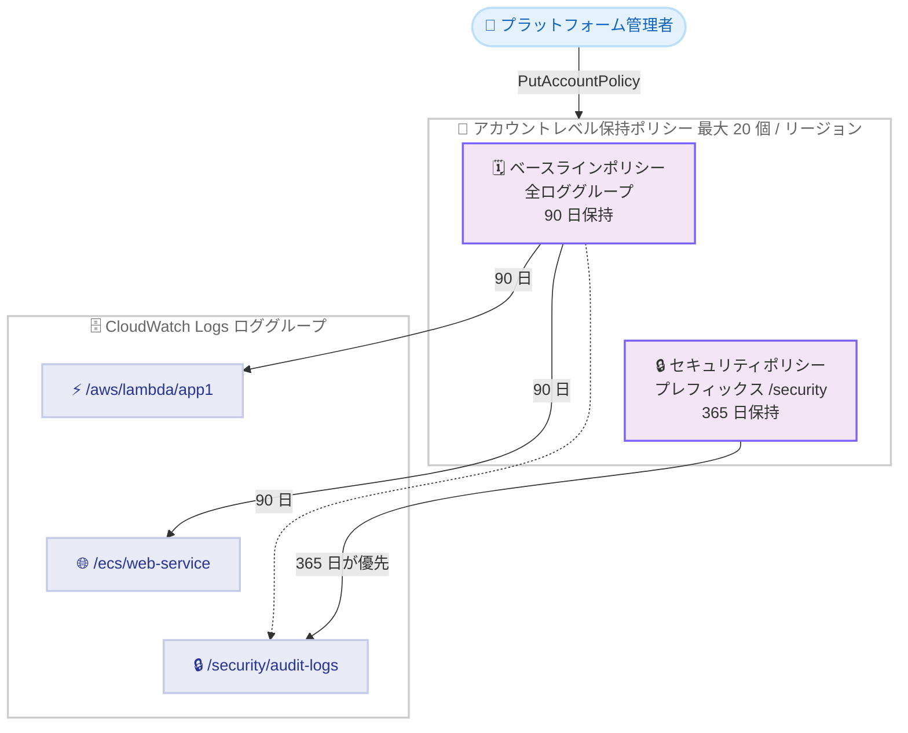

# Amazon CloudWatch Logs - アカウントレベル保持ポリシー

**リリース日**: 2026 年 11 月 9 日
**サービス**: Amazon CloudWatch Logs
**機能**: アカウントレベル保持ポリシー (Account-level retention policies)

📊 [このアップデートのインフォグラフィックを見る](https://takech9203.github.io/aws-news-summary/20261109-amazon-cloudwatch-log-retention.html)

## 概要

Amazon CloudWatch Logs が、アカウントレベルの保持ポリシー (retention policy) をサポートしました。単一のポリシーで、AWS アカウント内のすべてのロググループ、またはプレフィックスで指定した一部のロググループに対して、ログデータの保持期間を一括設定できます。

プラットフォームチームやセキュリティチームは、ロググループを個別に追跡することなく、アカウント全体のロググループを組織の保持基準に準拠させることができます。たとえば、アカウント全体に 90 日のベースラインを設定しつつ、`/security` で始まるロググループには監査要件を満たすために 1 年のポリシーを適用する、といった運用が可能になります。複数のポリシーが同じロググループにマッチする場合は、最も長い保持期間が適用されます。

ポリシーはリージョンごとに最大 20 個まで作成でき、AWS Management Console、AWS CLI、AWS SDK から管理できます。追加料金はかかりません。

**アップデート前の課題**

- 保持期間の設定はロググループ単位でしか行えず、ロググループごとに `PutRetentionPolicy` を個別に実行する必要があった
- 新しく作成されるロググループはデフォルトで無期限保持となるため、保持基準を徹底するには Lambda や AWS Config などによる独自の自動化が必要だった
- ロググループが増えるたびに名前を追跡し、ポリシー適用漏れがないかを監視する運用負荷が発生していた

**アップデート後の改善**

- 単一のポリシーでアカウント内の全ロググループ、またはプレフィックスにマッチするロググループ群に保持期間を一括適用できるようになった
- `RETROACTIVE` (既存ロググループにも適用) と `NEW_ONLY` (新規作成分のみ適用) を選択でき、既存環境への影響をコントロールできるようになった
- 複数ポリシーがマッチした場合は最長の保持期間が適用されるため、ベースライン + 例外 (長期保持や無期限保持) という階層的な設計が可能になった
- ドライラン機能により、ポリシー作成前に影響を受けるロググループ数を確認できるようになった

## アーキテクチャ図



アカウント全体のベースラインポリシーとプレフィックス指定のポリシーが重複してマッチする場合、より長い保持期間を持つポリシーが優先されます。上図では `/security/audit-logs` に両ポリシーがマッチしますが、365 日のセキュリティポリシーが適用されます。

## サービスアップデートの詳細

### 主要機能

1. **アカウント全体またはプレフィックス指定での一括適用**
   - ポリシーの適用範囲として、アカウント内の全ロググループ、または `LogGroupNamePrefix` で指定したプレフィックス (例: `/aws/lambda`) にマッチするロググループ群を選択できる
   - 選択条件はロググループ名のプレフィックスのみサポート
   - リージョンごとに最大 20 個のポリシーを作成可能 (アカウントレベルポリシーはリージョン単位で独立)

2. **既存 / 新規ロググループへの適用制御 (enforcementMode)**
   - `RETROACTIVE`: 選択条件にマッチするすべてのロググループ (ポリシー作成前から存在するものを含む) に適用
   - `NEW_ONLY`: ポリシー作成後に新規作成されたロググループのみに適用。既存ロググループは各自の保持期間を維持

3. **重複ポリシーの解決ルール**
   - 複数の保持ポリシーが同じロググループにマッチする場合、最も長い保持期間が適用される
   - `NEVER_EXPIRE` は最長の保持期間として扱われるため、特定のロググループを削除対象から除外する用途にも使える
   - 同じ保持期間のポリシーが複数マッチする場合、先に作成されたポリシーが `retentionPolicyName` として報告される

4. **ドライランによる事前影響確認**
   - `dryRun` を `true` に指定すると、ポリシーを作成・更新・削除せずに影響を試算できる
   - 保持期間が長くなる / 短くなる / 変わらないロググループの数と、対象範囲内でデータ保存量が多い上位 20 のロググループを返す
   - ドライランには実際の操作と同じ IAM 権限が必要

## 技術仕様

### ポリシー仕様

| 項目 | 詳細 |
|------|------|
| API | `PutAccountPolicy` / `DescribeAccountPolicies` / `DeleteAccountPolicy` (`policyType: RETENTION_POLICY`) |
| ポリシー数上限 | アカウント・リージョンごとに最大 20 個 |
| 保持期間の有効値 | 30、60、90、120、150、180、365、400、545、731、1096、1827、2192、2557、2922、3288、3653 日、または `NEVER_EXPIRE` |
| 最小保持期間 | 30 日 (アカウントレベルポリシーの場合) |
| 選択条件 | `LogGroupNamePrefix` のみ。省略時はアカウント内の全ロググループに適用 |
| 適用モード | `RETROACTIVE` (既存含む) / `NEW_ONLY` (新規のみ) |
| 優先順位 | ロググループ単位の保持設定よりアカウントレベルポリシーが優先。複数マッチ時は最長の保持期間を適用 |
| 反映タイミング | ポリシー作成・更新から 24 時間後に有効化。更新の場合は反映まで旧設定が有効 |

### API 変更履歴

| 日付 | サービス | 変更内容 |
|------|----------|----------|
| 2026/11/05 | [Amazon CloudWatch Logs](https://awsapichanges.com/archive/changes/7e892e-logs.html) | 4 updated api methods - アカウントレベル保持ポリシーとドライランプレビューのサポート追加 |

### 必要な IAM 権限

| 操作 | 必要な権限 |
|------|-----------|
| 保持ポリシーの作成・更新 | `logs:PutAccountPolicy` および `logs:PutRetentionPolicy` |
| 保持ポリシーの削除 | `logs:DeleteAccountPolicy` および `logs:DeleteRetentionPolicy` |
| 保持ポリシーの表示 | `logs:DescribeAccountPolicies` |

ドライランには、プレビュー対象の操作と同じ権限が必要です。`PutAccountPolicy` はアカウント全体に影響するため、アカウント横断でロギング設定を管理する管理者のみに権限を付与することが推奨されています。

## 設定方法

### 前提条件

1. CloudWatch Logs のアカウントレベルポリシーを管理できる IAM 権限 (`logs:PutAccountPolicy`、`logs:PutRetentionPolicy` など) を持っていること
2. 対象リージョンがサポート対象であること (中東 2 リージョンを除く商用リージョン)
3. 既存ロググループに適用する場合、現在より短い保持期間になるロググループがないか事前に確認すること

### 手順

#### ステップ 1: ドライランで影響を確認する

```bash
aws logs put-account-policy \
    --policy-name LambdaRetentionPolicy \
    --policy-type RETENTION_POLICY \
    --policy-document '{"retentionInDays": 90, "enforcementMode": "RETROACTIVE"}' \
    --selection-criteria 'LogGroupNamePrefix="/aws/lambda"' \
    --dry-run
```

`/aws/lambda` で始まるロググループに 90 日の保持期間を設定した場合の影響を試算します。ポリシーは作成されず、保持期間が長くなる / 短くなる / 変わらないロググループの数と、データ保存量が多い上位 20 のロググループが返されます。

#### ステップ 2: ポリシーを作成する

```bash
aws logs put-account-policy \
    --policy-name LambdaRetentionPolicy \
    --policy-type RETENTION_POLICY \
    --policy-document '{"retentionInDays": 90, "enforcementMode": "RETROACTIVE"}' \
    --selection-criteria 'LogGroupNamePrefix="/aws/lambda"'
```

ドライランの結果に問題がなければ、`--dry-run` を外して同じコマンドを実行し、ポリシーを作成します。ポリシーは作成から 24 時間後に有効になります。

#### ステップ 3: ポリシーを確認・削除する

```bash
# 保持ポリシーの一覧を表示
aws logs describe-account-policies --policy-type RETENTION_POLICY

# 保持ポリシーを削除 (事前確認は --dry-run を追加)
aws logs delete-account-policy \
    --policy-name LambdaRetentionPolicy \
    --policy-type RETENTION_POLICY
```

`describe-account-policies` でアカウント内の保持ポリシーを確認し、不要になったポリシーは `delete-account-policy` で削除します。削除の影響もドライランで事前確認できます。

## メリット

### ビジネス面

- **ガバナンスの標準化**: ロググループを個別に追跡せずに、アカウント全体で保持基準を強制でき、監査・コンプライアンス要件への対応が容易になる
- **コスト最適化**: デフォルトで無期限保持となるロググループに自動的にベースラインの保持期間が適用されるため、不要なログの蓄積によるストレージコストを削減できる
- **追加料金なし**: アカウントレベル保持ポリシー自体に追加料金はかからない

### 技術面

- **運用自動化の簡素化**: 従来必要だった Lambda や AWS Config ルールなどによる保持期間設定の自動化が不要になる
- **柔軟な階層設計**: 最長保持期間優先のルールにより、アカウント全体のベースライン + 特定プレフィックスの長期保持 + `NEVER_EXPIRE` による除外、という階層的な設計ができる
- **安全な導入**: ドライランで影響を受けるロググループを事前に確認でき、`NEW_ONLY` モードで既存環境に影響を与えずに導入できる

## デメリット・制約事項

### 制限事項

- アカウントレベルポリシーの最小保持期間は 30 日 (ロググループ単位の設定では 1 日から指定可能)
- ポリシー数はアカウント・リージョンごとに最大 20 個
- 選択条件はロググループ名のプレフィックスのみで、タグやログクラスによる選択はできない
- ポリシーはリージョン単位のため、複数リージョンに適用するにはリージョンごとに作成が必要
- 中東 (バーレーン) と中東 (UAE) リージョンでは利用不可

### 考慮すべき点

- **アカウントレベルポリシーはロググループ単位の保持設定を上書きする**。ロググループに 10 年の保持期間が設定されていても、90 日のアカウントレベルポリシーがマッチすると 90 日より古いログは削除される。導入前に必ずドライランで確認すること
- ポリシーは作成・更新から有効化まで 24 時間かかり、その間は旧設定が有効
- 保持期間に達したログイベントの実際の削除には最大 72 時間程度かかる場合がある (削除マーク後はアーカイブストレージ料金の対象外)
- ドライランはアカウントごとに同時に 1 つしか実行できない

## ユースケース

### ユースケース 1: アカウント全体のベースライン保持期間の設定

**シナリオ**: 中央のプラットフォームチームが、開発者が作成するすべてのロググループに対して、無期限保持によるコスト増を防ぐために 90 日のベースラインを設定したい。

**実装例**:
```bash
aws logs put-account-policy \
    --policy-name AccountBaselineRetention \
    --policy-type RETENTION_POLICY \
    --policy-document '{"retentionInDays": 90, "enforcementMode": "RETROACTIVE"}'
```

**効果**: 選択条件を省略することで全ロググループに 90 日の保持期間が適用され、新規作成されるロググループも自動的に準拠する。個別設定の追跡や独自の自動化が不要になる。

### ユースケース 2: セキュリティログの長期保持による監査対応

**シナリオ**: セキュリティチームが、`/security` で始まるロググループのみ監査要件に合わせて 1 年間保持したい。アカウントには 90 日のベースラインポリシーがすでに存在する。

**実装例**:
```bash
aws logs put-account-policy \
    --policy-name SecurityAuditRetention \
    --policy-type RETENTION_POLICY \
    --policy-document '{"retentionInDays": 365, "enforcementMode": "RETROACTIVE"}' \
    --selection-criteria 'LogGroupNamePrefix="/security"'
```

**効果**: `/security` 配下のロググループには 90 日と 365 日の両ポリシーがマッチするが、最長の 365 日が適用される。ベースラインを維持したまま監査要件を満たせる。

### ユースケース 3: 新規ロググループのみへの段階的な適用

**シナリオ**: 既存のロググループの保持設定には影響を与えずに、今後作成されるロググループにのみ保持基準を適用して段階的に標準化を進めたい。

**実装例**:
```bash
aws logs put-account-policy \
    --policy-name NewLogGroupsRetention \
    --policy-type RETENTION_POLICY \
    --policy-document '{"retentionInDays": 180, "enforcementMode": "NEW_ONLY"}'
```

**効果**: `NEW_ONLY` モードにより、ポリシー作成後に作成されたロググループのみに 180 日の保持期間が適用される。既存環境のリスクを避けながら新しい基準を導入できる。

## 料金

アカウントレベル保持ポリシーの利用に追加料金はかかりません。

ログの取り込みと保存には、従来どおり CloudWatch Logs の標準料金が適用されます。保持期間に達して削除マークが付いたログイベントは、実際の削除前であってもアーカイブストレージ料金の課金対象から除外されます。適切な保持ポリシーの設定により、ログストレージコストの削減が期待できます。

## 利用可能リージョン

中東 (バーレーン) と中東 (UAE) を除く、すべての商用 AWS リージョンで利用可能です。

## 関連サービス・機能

- **AWS Lambda / Amazon ECS など**: `/aws/lambda` などサービスが自動作成するロググループはデフォルトで無期限保持のため、本機能によるベースライン設定の効果が大きい
- **アカウントレベルポリシー (他のポリシータイプ)**: `PutAccountPolicy` はデータ保護、サブスクリプションフィルター、トランスフォーマー、フィールドインデックス、メトリクス抽出のポリシーもサポートしており、本アップデートで保持ポリシーが追加された
- **AWS Organizations / AWS Config**: 従来はカスタム Config ルールや自動修復で保持基準を強制していたが、本機能によりアカウント単位の強制がネイティブに可能になる
- **CloudWatch Logs ログ集約 (Centralization)**: 複数アカウント・リージョンのログを集約する構成と組み合わせることで、組織全体のログライフサイクル管理を標準化できる

## 参考リンク

- 📊 [インフォグラフィック](https://takech9203.github.io/aws-news-summary/20261109-amazon-cloudwatch-log-retention.html)
- [公式発表 (What's New)](https://aws.amazon.com/about-aws/whats-new/2026/11/amazon-cloudwatch-log-retention/)
- [ドキュメント: Set log data retention for your account with account-level retention policies](https://docs.aws.amazon.com/AmazonCloudWatch/latest/logs/Working-with-log-groups-and-streams.html#account-level-retention-policies)
- [API リファレンス: PutAccountPolicy](https://docs.aws.amazon.com/AmazonCloudWatchLogs/latest/APIReference/API_PutAccountPolicy.html)
- [料金ページ: Amazon CloudWatch の料金](https://aws.amazon.com/cloudwatch/pricing/)

## まとめ

CloudWatch Logs のアカウントレベル保持ポリシーにより、ロググループを個別に追跡することなく、アカウント全体のログ保持基準を一括で強制できるようになりました。無期限保持のロググループによるコスト増や、保持基準の適用漏れといった長年の運用課題をネイティブ機能で解決できます。導入時はアカウントレベルポリシーがロググループ単位の設定を上書きする点に注意し、まずドライランで影響範囲を確認してから、ベースライン + 例外ポリシーの構成で段階的に適用することを推奨します。
