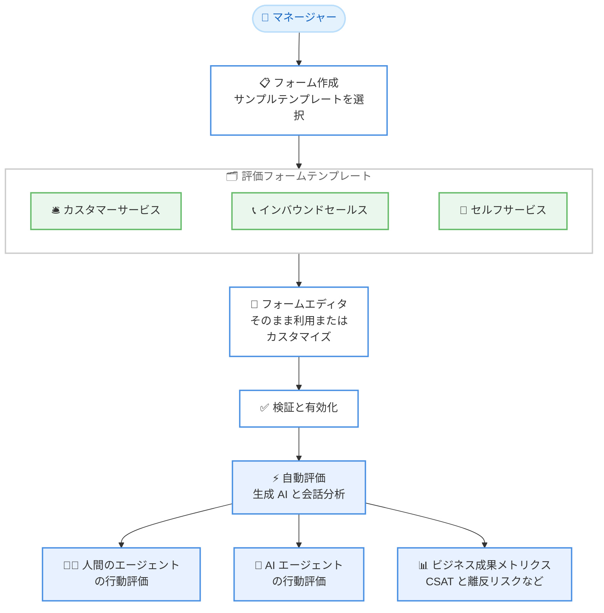

# Amazon Connect Customer - 評価フォームテンプレート

**リリース日**: 2026 年 11 月 9 日
**サービス**: Amazon Connect Customer
**機能**: 評価フォームテンプレート (Evaluation Form Templates)

📊 [このアップデートのインフォグラフィックを見る](https://takech9203.github.io/aws-news-summary/20261109-amazon-connect-customer-evaluation-form-templates.html)

## 概要

Amazon Connect Customer が評価フォームテンプレートの提供を開始しました。コンタクトセンターのマネージャーは、評価フォームをゼロから構築することなく、事前構築済みのテンプレートを利用して、人間のエージェントと AI エージェント双方のパフォーマンスを自動評価する仕組みを短時間でデプロイできるようになります。

テンプレートは、典型的な顧客対応シナリオであるカスタマーサービス、インバウンドセールス、セルフサービスの 3 種類をカバーしています。各テンプレートには、「エージェントは顧客の問題に共感を示したか?」のようなエージェントの行動を評価する質問に加えて、顧客満足度 (CSAT) や離反リスクといったビジネス成果を評価する質問が含まれており、エージェントの行動がビジネス成果にどのように関係しているかを把握できます。テンプレートはそのまま利用することも、デプロイ前にカスタマイズすることも可能です。

**アップデート前の課題**

このアップデート以前には、以下の課題がありました。

- 評価フォームを空のフォームからセクション、質問、回答、スコアリングをすべて手動で構築する必要があった
- 評価項目の設計やスコアリング設定の作成に時間がかかり、自動評価のデプロイまでのリードタイムが長かった
- エージェントの行動評価とビジネス成果 (顧客満足度や離反リスクなど) を関連付ける質問設計を各組織が独自に検討する必要があった

**アップデート後の改善**

今回のアップデートにより、以下が可能になりました。

- 事前構築済みテンプレートを選択するだけで、セクション、質問、回答、スコアリング、自動化設定が構成済みのフォームを作成できる
- カスタマーサービス、インバウンドセールス、セルフサービスの典型的なシナリオにすぐ対応できる
- ビジネス成果メトリクス (CSAT、離反傾向、販売成功、セルフサービス成功) にマッピングされた質問が標準で含まれ、分析ダッシュボードで集計できる
- テンプレートをベースに自社要件に合わせたカスタマイズのみ行えばよく、デプロイまでの時間を短縮できる

## アーキテクチャ図



マネージャーがテンプレートを選択してフォームを作成し、必要に応じてカスタマイズした後に有効化すると、生成 AI と会話分析による自動評価がエージェントの行動とビジネス成果の両方を評価するフローです。

## サービスアップデートの詳細

### 主要機能

1. **3 種類の事前構築済みテンプレート**
   - カスタマーサービス、インバウンドセールス、セルフサービスの典型的な顧客対応シナリオをカバー
   - セクション、質問、回答、スコアリング、自動化設定がすべて構成済みの状態でフォームが作成される
   - 人間のエージェントと AI エージェント (Lex ボットや AI エージェントによるセルフサービス対応) の両方の行動を評価可能

2. **エージェント行動の評価質問**
   - 「エージェントは顧客の問題に共感を示したか?」など、対応品質を測る質問を標準で収録
   - 生成 AI や会話分析 (Conversational Analytics) のインサイトとメトリクスを利用した自動回答に対応
   - 評価者による自動回答の確認・上書きも可能

3. **ビジネス成果メトリクスへのマッピング**
   - ビジネス成果を測定する質問には「Business outcome metric」のフラグが付与され、標準化された成果指標にマッピングされる
   - エージェント対応向けには顧客満足度 (CSAT)、離反傾向 (Churn Propensity)、販売成功 (Successful Sale) の 3 指標
   - セルフサービス対応向けには完全セルフサービス成功と部分的セルフサービス成功の 2 指標
   - これらの成果は分析ダッシュボードに集約され、評価全体のサマリーやエージェント別の内訳として確認できる

4. **柔軟なカスタマイズ**
   - テンプレートをそのまま利用することも、フォームエディタで質問やスコアリングを編集してから有効化することも可能
   - フォームは完全に構成済みのため、通常はプレビューと有効化のステップに直接進める

## 技術仕様

### 評価フォームの作成方法の比較

| 作成方法 | 内容 |
|------|------|
| サンプルテンプレート | 今回のアップデートで追加。セクション、質問、スコアリング、自動化が構成済み。ビジネス成果メトリクスを含む |
| PDF からの AI インポート | 他の品質管理システムのフォームを PDF (最大 2 MB) からインポートし、AI がドラフトを作成 |
| 空のフォーム | すべてのセクション、質問、スコアを手動で構築 |
| 別インスタンスからのインポート | JSON エクスポート・インポートでインスタンス間のフォームをコピー |

### ビジネス成果メトリクス

| 対象 | メトリクス |
|------|------|
| エージェント対応 | 顧客満足度 (CSAT)、離反傾向、販売成功 |
| セルフサービス対応 | 完全セルフサービス成功、部分的セルフサービス成功 |

### 必要な権限

評価フォームの作成には、以下のセキュリティプロファイル権限が必要です。

| 項目 | 詳細 |
|------|------|
| 権限カテゴリ | Analytics and Optimization |
| 権限 | Evaluation forms - manage form definitions - Create |

## 設定方法

### 前提条件

1. Amazon Connect Customer インスタンスが利用可能リージョンに存在すること
2. 評価フォーム作成権限 (Evaluation forms - manage form definitions - Create) を持つセキュリティプロファイルがユーザーに割り当てられていること
3. 生成 AI による自動評価を利用する場合は、会話分析 (Conversational Analytics) が有効化されていること

### 手順

#### ステップ 1: 評価フォームページへ移動

Connect Customer 管理 Web サイトにログインし、[Analytics and optimization] から [Evaluation forms] を選択します。

#### ステップ 2: サンプルテンプレートからフォームを作成

[Create new form] を選択し、[Use a sample form] を選んでテンプレート (例: Agent Interaction Outcomes) を選択します。必要に応じてアクセス制御用のタグを追加し、[Create] を選択します。

フォームはセクション、質問、スコアリングがすべて構成済みの状態で開きます。ビジネス成果を測定する質問には [Business outcome metric] のフラグが付与されています。

#### ステップ 3: 内容の確認とカスタマイズ

フォームの内容を確認し、必要に応じて質問やスコアリングを編集します。テンプレートは完全に構成済みのため、通常はプレビューのステップに直接進むことができます。

#### ステップ 4: プレビュー、検証、有効化

[Preview] でフォームの表示を確認し、[Save and validate] で構造チェックと生成 AI 自動化のベストプラクティスチェックを実行します。問題がなければ [Activate] でフォームを有効化し、評価者が利用できる状態にします。

## メリット

### ビジネス面

- **デプロイ時間の短縮**: 評価フォームをゼロから設計する必要がなくなり、自動評価の導入までの時間を大幅に短縮できる
- **行動と成果の関連付け**: エージェントの行動評価とビジネス成果 (顧客満足度や離反リスク) を同じフォームで評価し、改善施策の優先順位付けに活用できる
- **評価品質の標準化**: 業界標準の成果メトリクスにマッピングされた質問を利用することで、組織全体で一貫した評価基準を確立できる

### 技術面

- **構成済みの自動化設定**: 生成 AI や会話分析メトリクスによる自動回答の設定がテンプレートに含まれており、個別の設定作業が不要
- **人間と AI の統一的な評価**: 人間のエージェントと AI エージェント (セルフサービス) を同じ仕組みで評価でき、ハイブリッドなコンタクトセンター運用に対応
- **カスタマイズの自由度**: テンプレートをベースに、既存のフォームエディタ機能 (条件付き質問、重み付け、スコアリングモードなど) をそのまま利用して調整できる

## デメリット・制約事項

### 制限事項

- 利用可能リージョンは 8 リージョンに限定される (米国東部 (バージニア北部)、米国西部 (オレゴン)、カナダ (中部)、欧州 (フランクフルト)、欧州 (ロンドン)、アジアパシフィック (シンガポール)、アジアパシフィック (シドニー)、アジアパシフィック (東京))
- テンプレートはカスタマーサービス、インバウンドセールス、セルフサービスの 3 シナリオのみで、業界特化型のテンプレートは提供されていない
- 生成 AI による自動評価には、コンタクトあたりの質問数の上限などのサービスクォータが適用される

### 考慮すべき点

- テンプレートの質問は汎用的な内容のため、自社の業務プロセスやコンプライアンス要件に合わせたカスタマイズの要否を確認する必要がある
- 生成 AI の検証機能にはレート制限がある (インスタンスあたり並列 3 件、1 時間あたり 30 件まで)
- フォームの有効化後は、評価者は以前のバージョンのフォームで新しい評価を開始できなくなる

## ユースケース

### ユースケース 1: カスタマーサービス品質評価の迅速な立ち上げ

**シナリオ**: 新しくコンタクトセンターの品質管理プログラムを開始する企業が、評価基準の設計に時間をかけずに自動評価を導入したい。

**実装例**:
```text
1. [Evaluation forms] で [Create new form] を選択
2. [Use a sample form] からカスタマーサービステンプレートを選択
3. 「エージェントは顧客の問題に共感を示したか?」などの質問を確認
4. そのまま有効化し、自動評価のルールを設定
```

**効果**: フォーム設計の工数を削減し、導入初日から共感性などの行動評価と CSAT などの成果評価を開始できる。

### ユースケース 2: 行動評価とビジネス成果の相関分析

**シナリオ**: マネージャーが、エージェントのどの行動が顧客満足度や離反リスクに影響しているかをデータに基づいて把握したい。

**実装例**:
```text
1. テンプレートに含まれるビジネス成果メトリクス付きの質問をそのまま利用
2. 自動評価を有効化し、対象コンタクトを評価
3. 分析ダッシュボードで評価結果を集計し、
   エージェント別・行動別に CSAT や離反傾向との関係を確認
```

**効果**: エージェントの行動とビジネス成果の関係を可視化し、コーチングやトレーニングの優先領域を特定できる。

### ユースケース 3: AI エージェントを含むセルフサービス品質の評価

**シナリオ**: Lex ボットや AI エージェントによるセルフサービス対応を導入している企業が、人間のエージェントと同じ枠組みで AI の対応品質を評価したい。

**実装例**:
```text
1. セルフサービステンプレートからフォームを作成
2. 完全セルフサービス成功・部分的セルフサービス成功の
   成果メトリクスを確認
3. セルフサービス対応向けの自動評価を有効化
```

**効果**: AI エージェントの解決率や対応品質を定量的に把握し、ボットの改善サイクルを回せる。

## 料金

評価フォームテンプレート自体の追加料金に関する記載はありません。評価機能や生成 AI による自動評価の利用には Amazon Connect Customer の料金が適用されます。詳細は [Amazon Connect Customer の料金ページ](https://aws.amazon.com/products/connect/customer/pricing/) を参照してください。

## 利用可能リージョン

以下の 8 リージョンで利用可能です。

- 米国東部 (バージニア北部)
- 米国西部 (オレゴン)
- カナダ (中部)
- 欧州 (フランクフルト)
- 欧州 (ロンドン)
- アジアパシフィック (シンガポール)
- アジアパシフィック (シドニー)
- アジアパシフィック (東京)

## 関連サービス・機能

- **Amazon Connect Customer 会話分析 (Conversational Analytics)**: 評価の自動回答に利用されるインサイトとメトリクスを提供し、コンタクトのカテゴリ分類やルール設定と連携する
- **生成 AI による自動評価**: テンプレートの質問に対して生成 AI が会話トランスクリプトを分析して自動回答する。Gen AI モデルバージョンの選択も可能
- **Amazon Lex / AI エージェント**: セルフサービステンプレートの評価対象となる自動対応チャネル

## 参考リンク

- 📊 [インフォグラフィック](https://takech9203.github.io/aws-news-summary/20261109-amazon-connect-customer-evaluation-form-templates.html)
- [公式発表 (What's New)](https://aws.amazon.com/about-aws/whats-new/2026/11/amazon-connect-customer-evaluation-form-templates/)
- [ドキュメント: 評価フォームの作成](https://docs.aws.amazon.com/connect/latest/adminguide/create-evaluation-forms.html#step-title)
- [Conversational Analytics 製品ページ](https://aws.amazon.com/products/connect/customer/conversational-analytics/)
- [料金ページ](https://aws.amazon.com/products/connect/customer/pricing/)

## まとめ

評価フォームテンプレートの提供により、コンタクトセンターのマネージャーは評価フォームの設計工数を大幅に削減し、人間と AI エージェント双方の自動評価を迅速に導入できるようになりました。東京リージョンを含む 8 リージョンで利用可能なため、品質管理プログラムの立ち上げや既存評価プロセスの標準化を検討している場合は、まずテンプレートからフォームを作成して自社要件とのギャップを確認することを推奨します。
