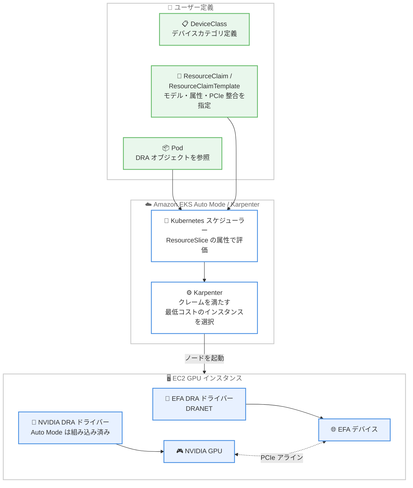

# Amazon EKS - EKS Auto Mode と Karpenter の Dynamic Resource Allocation (DRA) サポート

**リリース日**: 2026 年 11 月 9 日
**サービス**: Amazon Elastic Kubernetes Service (Amazon EKS)
**機能**: Amazon EKS Auto Mode and Karpenter now support Dynamic Resource Allocation

📊 [このアップデートのインフォグラフィックを見る](https://takech9203.github.io/aws-news-summary/20261109-amazon-eks-auto-mode-karpenter-dra.html)

## 概要

Amazon EKS は、Amazon EKS Auto Mode と Karpenter の使用時に、NVIDIA GPU と Elastic Fabric Adapter (EFA) ネットワークデバイスに対する Dynamic Resource Allocation (DRA) をサポートしました。DRA は Kubernetes 1.34 で一般提供された機能で、デバイスプラグインの制限を解消し、属性ベースのデバイス選択、トポロジーを考慮した割り当て、Pod 間でのデバイス共有を可能にします。

ユーザーは ResourceClaim または ResourceClaimTemplate オブジェクトを定義し、モデル、アーキテクチャなどの属性によって、ワークロードに割り当て可能な GPU や EFA デバイスを記述できます。分散トレーニングや推論の実行時には、PCIe アラインされた GPU と EFA デバイスを定義して最適なパフォーマンスを得られます。ワークロードがこれらの DRA オブジェクトを要求すると、Karpenter は条件に一致する最低コストのインスタンスを自動的に起動します。

EKS Auto Mode では NVIDIA DRA ドライバーと EFA DRA ドライバー (DRANET) がノードランタイムに組み込まれているため、ドライバーのインストールや管理は不要で、DRA オブジェクトを定義してワークロードから使用するだけで利用できます。さらに EKS Auto Mode は、同一デバイスタイプに対して DRA を使用するワークロードとデバイスプラグインを使用するワークロードが同じノード上で実行されることを自動的に防止し、移行時のサイレントなデバイスオーバーサブスクリプションのリスクを軽減します。本機能は、GPU や EFA を利用した機械学習の分散トレーニング・推論を EKS 上で運用するユーザーに特に有用です。

**アップデート前の課題**

このアップデート以前は、EKS Auto Mode や Karpenter の動的プロビジョニングでは、デバイスプラグインによる GPU・EFA 管理に以下の制限がありました。

- デバイスプラグインではデバイスを不透明な整数カウント (`nvidia.com/gpu` など) として要求するため、GPU のモデルやアーキテクチャなどの属性に基づくフィルタリングができなかった
- コンテナや Pod 間でのデバイス共有ができなかった
- GPU と EFA をまたぐトポロジー (PCIe スイッチや NUMA ドメイン) を考慮した割り当てを表現できず、インテリジェントな配置にはカスタムスケジューラー拡張が必要だった
- DRA を使うには既存ノードが必要で、Karpenter や EKS Auto Mode が DRA の ResourceClaim を解釈してゼロからノードをスケールアウトすることができなかった

**アップデート後の改善**

今回のアップデートにより、以下が可能になりました。

- DRA の ResourceClaim / ResourceClaimTemplate で必要なデバイス属性を定義し、Karpenter が保留中のクレームを評価して条件に一致する最低コストの EC2 インスタンスを自動起動 (スケールフロムゼロに対応)
- 複数の Pod が同じ ResourceClaim を参照することで GPU デバイスを Pod 間で共有
- 分散トレーニング・推論向けに、PCIe アラインされた GPU と EFA デバイスのトポロジー整合割り当てが可能に
- EKS Auto Mode では NVIDIA DRA ドライバーと EFA DRA ドライバー (DRANET) が組み込み済みとなり、ドライバーの導入・運用が不要に
- EKS Auto Mode が DRA ノードとデバイスプラグインノードをデバイスタイプごとに自動分離し、サイレントなデバイスオーバーサブスクリプションを防止

## アーキテクチャ図



ユーザーが DeviceClass と ResourceClaim / ResourceClaimTemplate で必要なデバイスを宣言すると、Karpenter が保留中のクレームを評価して条件に一致する最低コストの EC2 インスタンスを起動し、組み込みの DRA ドライバーが GPU と EFA デバイスを Pod に割り当てる流れを示しています。

## サービスアップデートの詳細

### 主要機能

1. **属性ベースのデバイス選択**
   - DRA ドライバーが ResourceSlice オブジェクトを通じてデバイスの詳細な属性を Kubernetes スケジューラーに公開
   - ResourceClaim / ResourceClaimTemplate で GPU のモデルやアーキテクチャなどの属性を Common Expression Language (CEL) 式で指定可能
   - デバイスプラグインの「整数カウントのみ」の要求方式から、宣言的で表現力の高い要求方式に進化

2. **トポロジーを考慮した GPU / EFA 割り当て**
   - 同一 PCIe スイッチや NUMA ドメイン上に配置されたデバイスの組み合わせを保証する割り当てが可能
   - 分散トレーニングや推論で、GPU とトポロジー的に近接する EFA デバイスをペアで割り当て、通信パフォーマンスを最適化
   - トポロジー整合割り当てには GPU と EFA の両方で DRA が必要 (EFA デバイスプラグインは PCIe トポロジー属性を公開しないため)

3. **Pod 間での GPU 共有**
   - 複数の Pod が同じ ResourceClaim を参照することで、同一の GPU デバイスを共有可能 (同一ノードにスケジュールされる)
   - EKS Auto Mode ではタイムスライシングや MIG による GPU 共有は利用不可 (上流の NVIDIA DRA ドライバーでアルファ段階のため)。タイムスライシングによる共有は Karpenter を使用
   - EFA デバイスは一度に 1 つの Pod にのみ割り当てられるため共有不可。EFA ワークロードは ResourceClaimTemplate を使用

4. **Karpenter による DRA 対応の動的プロビジョニング**
   - Karpenter バージョン 1.15 以降、サポート対象インスタンスタイプのデバイスメタデータを同梱し、保留中の ResourceClaim を評価して適切なノードを起動
   - DRA ワークロードのスケールフロムゼロに対応 (デバイスを持つ既存ノードが不要)
   - 動的プロビジョニングはアルファ機能で、Helm チャートの `settings.enableDRA: true` などのフィーチャーゲートで有効化
   - 静的キャパシティプロビジョニング (静的 NodePool) は、静的 NodePool をサポートする任意の Karpenter バージョンで DRA と併用可能

5. **EKS Auto Mode の組み込み DRA ドライバーと安全機構**
   - NVIDIA DRA ドライバーと EFA DRA ドライバー (DRANET) がノードランタイムに組み込まれ、インストール・設定・アップグレードが不要
   - ノードはデバイスタイプごとに「DRA ノード」または「デバイスプラグインノード」の役割を持ち、ライフタイム全体でその役割を維持
   - `eks.amazonaws.com/device-manager-nvidia` と `eks.amazonaws.com/device-manager-efa` ラベル (`dra` または `device-plugin`) でデバイスマネージャーを明示的に選択可能
   - DeviceClass オブジェクトはユーザー自身が作成する必要がある (Auto Mode は DRA ドライバーを提供するが DeviceClass は作成しない)

## 技術仕様

### サポート条件

| 項目 | 詳細 |
|------|------|
| 対象デバイス | NVIDIA GPU、EFA ネットワークデバイス |
| EKS Auto Mode | Kubernetes バージョン 1.36 以降で DRA をサポート |
| Karpenter | すべての Kubernetes バージョンでサポート。動的プロビジョニングは Karpenter 1.15 以降 (アルファ、フィーチャーゲートで有効化) |
| EKS 全般の DRA 対応 | Kubernetes 1.33 以降で利用可能、上流の既知の問題のため 1.34 以降を推奨 |
| DRA ドライバー | NVIDIA DRA ドライバー、EFA DRA ドライバー (DRANET)、Neuron DRA ドライバー |
| 対応 AMI | EKS 最適化 AL2023 AMI、Bottlerocket AMI |
| Trainium / Inferentia | EKS Auto Mode では DRA 非対応 (Neuron デバイスプラグインを使用) |
| g7e インスタンスファミリー | DRA のデバイスメタデータ未提供のため動的プロビジョニング非対応 (NVIDIA デバイスプラグインを使用) |

### DRA とデバイスプラグインの比較

| 観点 | デバイスプラグイン | DRA |
|------|-------------------|-----|
| デバイス要求方法 | 拡張リソースの整数カウント (`nvidia.com/gpu` など) | ResourceClaim / ResourceClaimTemplate + DeviceClass |
| 属性ベースの選択 | 不可 | CEL 式によるモデル・アーキテクチャ等の指定が可能 |
| Pod 間のデバイス共有 | 不可 | 共有 ResourceClaim で可能 (対応ドライバーのみ) |
| トポロジー整合割り当て | デバイスタイプをまたぐ表現は不可 | PCIe スイッチ / NUMA ドメイン単位で可能 |
| GPU パーティショニング | 静的 | MIG やタイムスライシングの動的な分割・共有 (環境による) |

### ResourceClaim と ResourceClaimTemplate の使い分け

| 動作 | ResourceClaim | ResourceClaimTemplate |
|------|---------------|----------------------|
| 作成 | ユーザーが事前に手動作成 | Pod ごとに Kubernetes が自動生成 |
| ライフサイクル | 明示的に削除するまで存続 | 生成されたクレームは Pod に連動して削除 |
| Pod 間のデバイス共有 | 可能 (複数 Pod が同じクレームを参照) | 不可 (Pod ごとに個別のクレーム) |
| Pod 仕様のフィールド | `resourceClaimName` | `resourceClaimTemplateName` |

### Karpenter の DRA フィーチャーゲート設定例

```yaml
# Karpenter Helm チャートの values 設定
settings:
  # NVIDIA GPU と EFA の両方の DRA を有効化
  # DRANVIDIAGPU と DRAEFA の AWS フィーチャーゲートが有効になり
  # ignoreDRARequests が false に設定される
  enableDRA: true

# 片方のドライバーのみ使用する場合は個別のゲートを使用
# (enableDRA と個別ゲートの併用は不可)
# settings:
#   awsFeatureGates:
#     draNVIDIAGPU: true
#     draEFA: false
```

## 設定方法

### 前提条件

1. EKS Auto Mode の場合: Kubernetes バージョン 1.36 以降のクラスター
2. Karpenter の場合: 動的プロビジョニングには Karpenter 1.15 以降とフィーチャーゲートの有効化 (静的 NodePool は追加設定なしで利用可能)
3. Karpenter、マネージドノードグループ、セルフマネージドノードの場合: DRA ドライバーのインストールと、同一ノード上で同一デバイスタイプのデバイスプラグインと DRA ドライバーが共存しないような管理

### 手順 (EKS Auto Mode の場合)

#### ステップ 1: DeviceClass の作成

```bash
cat <<EOF | kubectl apply -f -
apiVersion: resource.k8s.io/v1
kind: DeviceClass
metadata:
  name: gpu.nvidia.com
spec:
  selectors:
    - cel:
        expression: device.driver == 'gpu.nvidia.com'
EOF
```

NVIDIA GPU 用の DeviceClass を作成します。EKS Auto Mode は DRA ドライバーを組み込みで提供しますが、DeviceClass オブジェクトは作成しないため、ユーザー自身が作成する必要があります。上流ドライバーの Helm チャートと同じ名前を使用すると、ドライバーを自己管理するクラスターとの間でクレームの可搬性を維持できます。

#### ステップ 2: ResourceClaimTemplate の作成

```bash
cat <<EOF | kubectl apply -f -
apiVersion: resource.k8s.io/v1
kind: ResourceClaimTemplate
metadata:
  name: single-gpu
spec:
  spec:
    devices:
      requests:
        - name: gpu
          exactly:
            deviceClassName: gpu.nvidia.com
            allocationMode: ExactCount
            count: 1
EOF
```

Pod ごとに GPU を 1 つ割り当てる ResourceClaimTemplate を作成します。CEL 式のセレクターを追加することで、GPU のモデルやアーキテクチャなどの属性で割り当て対象を絞り込むこともできます。

#### ステップ 3: ワークロードから DRA オブジェクトを参照

```bash
cat <<EOF | kubectl apply -f -
apiVersion: v1
kind: Pod
metadata:
  name: gpu-workload
spec:
  containers:
    - name: app
      image: nvidia/cuda:13.0.1-base-ubuntu24.04
      command: ["nvidia-smi"]
      resources:
        claims:
          - name: gpu
  resourceClaims:
    - name: gpu
      resourceClaimTemplateName: single-gpu
EOF
```

Pod の `resourceClaims` で ResourceClaimTemplate を参照します。EKS Auto Mode はクレームを満たすデバイスを持つインスタンスを起動し、該当ノードで NVIDIA DRA ドライバーを有効化して GPU を割り当てます。

#### ステップ 4 (Karpenter の場合): フィーチャーゲートの有効化

```bash
helm upgrade karpenter oci://public.ecr.aws/karpenter/karpenter \
  --namespace kube-system \
  --reset-then-reuse-values \
  --set settings.enableDRA=true
```

Karpenter の動的プロビジョニングで DRA を使用するためのフィーチャーゲートを有効化します。既存リリースのアップグレードでは、以前のチャートバージョンが `settings.ignoreDRARequests` を `true` にデフォルト設定しているため、`--reuse-values` ではなく `--reset-then-reuse-values` (Helm 3.14 以降が必要) を使用します。

## メリット

### ビジネス面

- **コスト最適化**: Karpenter がクレームを満たす最低コストのインスタンスを自動選択し、スケールフロムゼロにも対応するため、高価な GPU インスタンスの無駄な常時稼働を削減できる
- **運用負荷の削減**: EKS Auto Mode では DRA ドライバーが組み込み済みで、インストール・設定・アップグレードが不要
- **パフォーマンス向上による学習時間短縮**: PCIe アラインされた GPU と EFA の割り当てにより、分散トレーニングの通信効率が向上し、ジョブ完了までの時間短縮が期待できる

### 技術面

- **宣言的で表現力の高いデバイス要求**: CEL 式により GPU のモデルやアーキテクチャなどの属性ベースでデバイスを選択でき、カスタムスケジューラー拡張が不要
- **トポロジー整合割り当て**: 同一 PCIe スイッチ / NUMA ドメイン上の GPU と EFA のペア割り当てを標準機能で実現
- **安全な移行**: EKS Auto Mode がデバイスタイプごとに DRA ノードとデバイスプラグインノードを自動分離し、同一デバイスの二重割り当て (サイレントオーバーサブスクリプション) を防止
- **デバイス共有**: 共有 ResourceClaim により複数 Pod で同一 GPU を安全に共有可能

## デメリット・制約事項

### 制限事項

- EKS Auto Mode の DRA は Kubernetes 1.36 以降が必要 (それ以前のバージョンではデバイスプラグインを使用)
- EKS Auto Mode では DRA 経由の GPU 共有のうちタイムスライシングと MIG は利用不可 (共有 ResourceClaim による共有のみ)。タイムスライシングが必要な場合は Karpenter を使用
- EKS Auto Mode の DRA 対象は NVIDIA GPU と EFA のみ。Trainium / Inferentia は Neuron デバイスプラグインを使用
- `ComputeDomain` を使用する Multi-Node NVLink ワークロードは動的プロビジョニング非対応 (Karpenter の静的キャパシティ、マネージドノードグループ、セルフマネージドノードが必要)
- `g7e` インスタンスファミリーは DRA のデバイスメタデータが提供されておらず、動的プロビジョニングの対象外
- Karpenter の動的プロビジョニングによる DRA サポートはアルファ機能で、デフォルトで無効。また Karpenter がメタデータを同梱するインスタンスタイプに限りクレームを評価できる
- AWS GovCloud (US) リージョンと中国リージョンでは利用不可

### 考慮すべき点

- EKS Auto Mode のノードはデバイスタイプごとに DRA ノードまたはデバイスプラグインノードの役割を終生維持するため、デバイスプラグインから DRA への移行にはノードの置き換えが必要 (Capacity Reservation / Capacity Block 利用時はスケールダウン後にスケールアップ)
- Karpenter の `settings.enableDRA` は NVIDIA と EFA の両方の DRA ドライバーが稼働している前提のため、片方のみ使用する場合は個別のフィーチャーゲート (`settings.awsFeatureGates.draNVIDIAGPU` / `draEFA`) を有効化する
- 動的プロビジョニング、静的なネットワークインターフェイス設定、トポロジー整合割り当ての 3 つを併用すると動作が未定義となる (Pod が Pending のまま残る可能性)。カスタムインターフェイスレイアウトと EFA DRA の両方が必要な場合は静的キャパシティプロビジョニングを使用する
- EFA ワークロードの動的プロビジョニングではノードに複数のネットワークインターフェイスがアタッチされ、パブリック IP が割り当てられないため、NAT ゲートウェイを持つプライベートサブネットまたは必要な AWS PrivateLink エンドポイントを持つサブネットで実行する
- DeviceClass が存在しないクレームは割り当てられず Pod が Pending のままになるため、ワークロード展開前に DeviceClass の作成を確認する
- Karpenter、マネージドノードグループ、セルフマネージドノードでは、同一デバイスタイプの DRA ドライバーとデバイスプラグインを同一ノードで実行しないようユーザー自身が管理する必要がある

## ユースケース

### ユースケース 1: 分散トレーニングにおけるトポロジー整合割り当て

**シナリオ**: 大規模言語モデルの分散トレーニングで、ノード間通信に EFA を使用している。GPU と EFA デバイスが PCIe トポロジー上で離れていると GPUDirect RDMA の性能が低下するため、トポロジーを考慮した割り当てを行いたい。

**実装例**:
```yaml
apiVersion: resource.k8s.io/v1
kind: ResourceClaimTemplate
metadata:
  name: gpu-efa-aligned
spec:
  spec:
    devices:
      requests:
        - name: gpu
          exactly:
            deviceClassName: gpu.nvidia.com
            allocationMode: ExactCount
            count: 1
        - name: efa
          exactly:
            deviceClassName: efa.dra.net
            allocationMode: ExactCount
            count: 1
      constraints:
        - requests: ["gpu", "efa"]
          matchAttribute: "dra.net/pcieRoot"
```

**効果**: 同一 PCIe ルート配下の GPU と EFA デバイスがペアで割り当てられ、GPU と NIC 間の通信パスが最短になり、分散トレーニングの通信パフォーマンスが最適化される。

### ユースケース 2: 推論ワークロードでの GPU 共有によるコスト削減

**シナリオ**: 複数の軽量な推論サービスがそれぞれ GPU 全体を占有しており、GPU 使用率が低く、コストが課題になっている。

**実装例**:
```yaml
apiVersion: resource.k8s.io/v1
kind: ResourceClaim
metadata:
  name: shared-gpu
spec:
  devices:
    requests:
      - name: gpu
        exactly:
          deviceClassName: gpu.nvidia.com
          allocationMode: ExactCount
          count: 1
---
# 複数の推論 Pod が resourceClaimName: shared-gpu を参照
```

**効果**: 複数の推論 Pod が同じ ResourceClaim を参照して同一 GPU を共有し、同じノードにスケジュールされるため、GPU 使用率が向上しインスタンス数を削減できる。

### ユースケース 3: 特定 GPU モデルを指定したスケールフロムゼロ

**シナリオ**: バッチ推論ジョブで特定の GPU アーキテクチャが必要だが、ジョブ実行時以外は GPU ノードを保持したくない。従来はデバイスプラグインの整数カウントでは GPU モデルを指定できず、NodePool のインスタンスタイプ制限で代替していた。

**実装例**:
```yaml
apiVersion: resource.k8s.io/v1
kind: ResourceClaimTemplate
metadata:
  name: specific-gpu
spec:
  spec:
    devices:
      requests:
        - name: gpu
          exactly:
            deviceClassName: gpu.nvidia.com
            allocationMode: ExactCount
            count: 1
            selectors:
              - cel:
                  expression: device.attributes["gpu.nvidia.com"].productName.contains("L40S")
```

**効果**: CEL 式で GPU モデルを直接指定でき、Karpenter がクレームを評価して条件を満たす最低コストのインスタンスをゼロから起動する。ジョブ完了後はノードが削除され、GPU コストをジョブ実行時間に限定できる。

## 料金

DRA サポート自体に追加料金はありません。以下の既存の料金体系が適用されます。

- **EKS Auto Mode**: EKS クラスター料金に加え、Auto Mode が管理する EC2 インスタンスに対する管理料金と EC2 インスタンス料金が発生
- **Karpenter**: Karpenter 自体はオープンソースで無料。起動される EC2 インスタンス (GPU / EFA 対応インスタンス) の料金が発生

詳細は [Amazon EKS 料金ページ](https://aws.amazon.com/eks/pricing/) を参照してください。

## 利用可能リージョン

AWS GovCloud (US) リージョンと中国リージョンを除く、すべての AWS リージョンで利用可能です (東京・大阪リージョンを含む)。

- Karpenter: すべての Kubernetes バージョンで利用可能
- EKS Auto Mode: Kubernetes バージョン 1.36 以降で利用可能

## 関連サービス・機能

- **Amazon EKS Auto Mode**: コンピューティング、ストレージ、ネットワーキングを AWS が管理する EKS の運用モード。今回のアップデートで DRA ドライバーが組み込みに
- **Karpenter**: Kubernetes ネイティブのノードプロビジョニングツール。バージョン 1.15 以降で DRA の動的プロビジョニングに対応
- **Elastic Fabric Adapter (EFA)**: HPC や機械学習向けの低レイテンシー・高スループットなネットワークインターフェイス。DRANET ドライバーによる DRA 管理に対応
- **Amazon EC2 GPU インスタンス**: P 系・G 系インスタンスなど、NVIDIA GPU を搭載したインスタンス。DRA の属性ベース選択の対象
- **AWS Trainium / Inferentia**: Neuron DRA ドライバーによる DRA 管理が可能 (ただし EKS Auto Mode では Neuron デバイスプラグインを使用)

## 参考リンク

- 📊 [インフォグラフィック](https://takech9203.github.io/aws-news-summary/20261109-amazon-eks-auto-mode-karpenter-dra.html)
- [公式発表 (What's New)](https://aws.amazon.com/about-aws/whats-new/2026/11/amazon-eks-auto-mode-karpenter-dra/)
- [ドキュメント: Manage hardware devices on Amazon EKS](https://docs.aws.amazon.com/eks/latest/userguide/device-management.html)
- [Karpenter ドキュメント: Utilizing GPUs and EFAs with Dynamic Resource Allocation](https://karpenter.sh/docs/tasks/dra/)
- [Amazon EKS Auto Mode](https://aws.amazon.com/eks/auto-mode/)
- [Kubernetes ドキュメント: Dynamic Resource Allocation](https://kubernetes.io/docs/concepts/scheduling-eviction/dynamic-resource-allocation/)
- [料金ページ](https://aws.amazon.com/eks/pricing/)

## まとめ

EKS Auto Mode と Karpenter が DRA に対応したことで、GPU や EFA を使う機械学習ワークロードにおいて、属性ベースのデバイス選択、Pod 間の GPU 共有、PCIe アラインされたトポロジー整合割り当てと、動的なノードプロビジョニングを組み合わせられるようになりました。EKS Auto Mode ではドライバーが組み込み済みのため導入障壁が低く、Kubernetes 1.36 以降のクラスターでの新規 GPU ワークロードには DRA の採用を推奨します。Karpenter の動的プロビジョニングはアルファ機能のため、フィーチャーゲートの設定と制限事項を確認した上で検証環境から導入することを推奨します。
