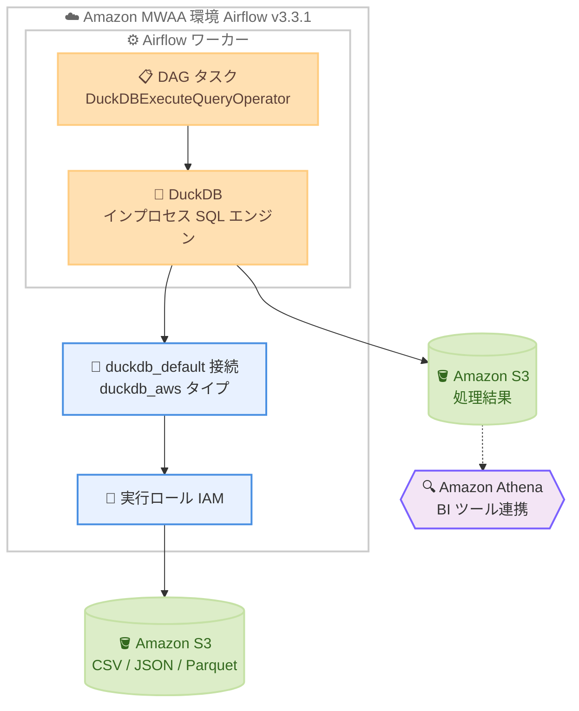

# Amazon MWAA - DuckDB オペレーターのネイティブサポート

**リリース日**: 2026 年 11 月 9 日
**サービス**: Amazon Managed Workflows for Apache Airflow (Amazon MWAA)
**機能**: DuckDB オペレーターのネイティブサポート

📊 [このアップデートのインフォグラフィックを見る](https://takech9203.github.io/aws-news-summary/20261109-amazon-mwaa-supports-duckdb-operators.html)

## 概要

Amazon Managed Workflows for Apache Airflow (Amazon MWAA) が、DuckDB オペレーターのネイティブサポートを発表しました。DuckDB は組み込み型の分析データベースであり、Amazon S3 を含むサポート対象のデータソースに対して、データ品質チェック、集計、変換を実行できます。

Apache Airflow v3.3.1 を使用する MWAA プロビジョンド環境では、DuckDB がプリインストールされ、AWS 接続向けに事前設定された状態で提供されます。環境を Airflow 3.3.1 に更新し、実行ロールにデータストアへのアクセス権を付与するだけで、追加のセットアップなしに `DuckDBExecuteQueryOperator` を使用したタスクを記述できます。

DuckDB はワーカー上の Apache Airflow タスク内で動作するインプロセス SQL エンジンであるため、別途データベースサーバーやクラスターを用意する必要がありません。パイプラインが生成する CSV、JSON、Parquet などのファイルに対する軽量な SQL 処理を、データエンジニアが手軽に実装できるようになります。

**アップデート前の課題**

- 以前は DuckDB を利用するために `requirements.txt` へ `apache-airflow-providers-duckdb` と `duckdb` を追加し、パッケージを自分でインストールする必要があった
- Amazon S3 のデータを読み書きするには、SQL 内で `INSTALL httpfs` や `CREATE SECRET` などの拡張機能ロードと認証設定を記述する必要があった
- DuckDB の拡張機能は `extensions.duckdb.org` からダウンロードされるため、インターネットアクセスのない環境では追加の対応が必要だった
- 小規模なデータ品質チェックや集計のためだけに、外部のデータベースやクエリエンジンを用意するケースがあった

**アップデート後の改善**

- Airflow v3.3.1 環境では DuckDB、DuckDB プロバイダー、Amazon プロバイダーがプリインストールされ、パッケージ追加なしで利用可能になった
- `duckdb_default` 接続が自動作成され、環境の実行ロールの認証情報で Amazon S3 へアクセスできるため、アクセスキーの管理が不要になった
- Amazon S3 サポートが MWAA イメージに同梱されるため、デフォルトバージョンの利用ではインターネットアクセスが不要になった
- タスク内でインメモリの SQL 処理が完結するため、外部データベースサーバーやクラスターの運用が不要になった

## アーキテクチャ図



DAG タスク内の `DuckDBExecuteQueryOperator` が、ワーカー上で動作するインプロセスの DuckDB エンジンを呼び出し、自動作成される `duckdb_default` 接続と環境の実行ロールを通じて Amazon S3 のデータを読み書きする構成です。処理結果を Parquet 形式で S3 に書き出せば、Amazon Athena や BI ツールからも参照できます。

## サービスアップデートの詳細

### 主要機能

1. **DuckDB のプリインストール**
   - Apache Airflow v3.3.1 以降の MWAA 環境に DuckDB がデフォルトで含まれる
   - `requirements.txt` へのパッケージ追加が不要
   - 現在の Airflow v3.3.1 イメージには DuckDB 2.0.0、Apache Airflow DuckDB プロバイダー 0.2.0、Amazon プロバイダー (apache-airflow-providers-amazon) 9.38.0 が含まれる

2. **duckdb_default 接続の自動作成**
   - 環境の作成時または更新時に MWAA が `duckdb_default` 接続を自動作成する
   - Amazon プロバイダーが追加する `duckdb_aws` 接続タイプを使用し、環境の実行ロールで Amazon S3 にアクセスする
   - Apache Airflow や SQL にアクセスキーを追加する必要がない
   - 既存の `duckdb_default` 接続は上書きされず、削除した場合は次回の環境更新時に再作成される

3. **インターネットアクセス不要の Amazon S3 サポート**
   - Amazon S3 サポート用の DuckDB 拡張機能が MWAA イメージに同梱されている
   - デフォルトの DuckDB バージョンを使用する場合、拡張機能のダウンロードのためのインターネットアクセスが不要
   - プライベートネットワーク構成の環境でもそのまま利用できる

4. **インメモリ実行**
   - DuckDB はワーカー上のタスク内でインメモリ実行されるため、各タスクは空のデータベースから開始する
   - タスク間でデータを共有する場合は Amazon S3 に書き出す
   - 別途データベースサーバーやクラスターの運用が不要

## 技術仕様

### 同梱コンポーネント

| 項目 | 詳細 |
|------|------|
| 対象環境 | MWAA プロビジョンド環境 (Apache Airflow v3.3.1 以降、Python 3.12) |
| DuckDB バージョン | 2.0.0 (デフォルト) |
| DuckDB プロバイダー | apache-airflow-providers-duckdb 0.2.0 |
| Amazon プロバイダー | apache-airflow-providers-amazon 9.38.0 (duckdb_aws 接続タイプに必要) |
| オペレーター | DuckDBExecuteQueryOperator |
| デフォルト接続 | duckdb_default (duckdb_aws 接続タイプ) |
| 実行方式 | ワーカー上でのインプロセス、インメモリ実行 |

### 旧バージョンでの利用 (Airflow v2.11 から v3.2)

Apache Airflow v3.2 以前の環境には DuckDB は含まれず、`duckdb_default` 接続も作成されません。v2.11 から v3.2 の環境で利用する場合は、以下の対応が必要です (v2.10 以前では DuckDB プロバイダーを利用できません)。

1. `requirements.txt` に `apache-airflow-providers-duckdb` と `duckdb` を追加する
2. Amazon S3 へアクセスする場合は、クエリの前に拡張機能のロードと認証設定を SQL で記述する

```sql
INSTALL httpfs;
LOAD httpfs;
INSTALL aws;
LOAD aws;
CREATE SECRET (TYPE s3, PROVIDER credential_chain);
```

## 設定方法

### 前提条件

1. Apache Airflow v3.3.1 以降を使用する Amazon MWAA 環境
2. 環境の実行ロールに対象データストア (Amazon S3 バケットなど) へのアクセス権限を付与
3. DuckDB サポートが提供される前に作成した v3.3.1 環境の場合は、環境を更新して最新の MWAA イメージを適用 (環境設定の変更は不要)

### 手順

#### ステップ 1: 環境を Airflow v3.3.1 に更新する

```bash
aws mwaa update-environment \
  --name my-environment \
  --airflow-version 3.3.1
```

既存の MWAA 環境の Apache Airflow バージョンを v3.3.1 に更新します。更新が完了すると、DuckDB と関連プロバイダーがプリインストールされ、`duckdb_default` 接続が自動作成されます。

#### ステップ 2: 実行ロールに Amazon S3 権限を付与する

```json
{
  "Version": "2012-10-17",
  "Statement": [
    {
      "Effect": "Allow",
      "Action": [
        "s3:GetObject",
        "s3:PutObject",
        "s3:ListBucket"
      ],
      "Resource": [
        "arn:aws:s3:::my-data-bucket",
        "arn:aws:s3:::my-data-bucket/*"
      ]
    }
  ]
}
```

環境の実行ロールに、DuckDB のクエリで読み書きする S3 バケットへの権限を追加します。ワイルドカードパスを展開するために `s3:ListBucket` が必要です。バケットが AWS KMS キーで暗号化されている場合は、KMS の権限も必要です。

#### ステップ 3: DAG で DuckDBExecuteQueryOperator を使用する

```python
from airflow.providers.duckdb.operators.duckdb import DuckDBExecuteQueryOperator

quality_check = DuckDBExecuteQueryOperator(
    task_id="quality_check",
    sql="""
        SELECT COUNT(*) AS row_count
        FROM read_parquet('s3://my-data-bucket/orders/*.parquet');
    """,
)
```

接続 ID を指定しない場合、オペレーターは自動作成された `duckdb_default` 接続を使用し、実行ロールの認証情報で Amazon S3 にアクセスします。追加のセットアップは不要です。

## メリット

### ビジネス面

- **運用コストの削減**: 軽量な SQL 処理のために外部データベースやクエリエンジンを運用する必要がなく、インフラコストと管理負荷を削減できる
- **開発速度の向上**: パッケージインストールや接続設定、認証情報管理が不要になり、データ品質チェックや変換処理をすぐに実装できる
- **セキュリティの向上**: アクセスキーを Apache Airflow や SQL に埋め込む必要がなく、IAM 実行ロールによる一元的な権限管理を維持できる

### 技術面

- **ゼロセットアップ**: DuckDB、プロバイダー、S3 拡張機能がイメージに同梱され、`requirements.txt` の変更なしで利用できる
- **閉域環境での利用**: デフォルトバージョンでは拡張機能のダウンロードが不要なため、インターネットアクセスのない環境でも動作する
- **Airflow エコシステムとの統合**: アセットベースのスケジューリングと組み合わせて、上流 DAG のデータ更新をトリガーに DuckDB タスクを実行できる

## デメリット・制約事項

### 制限事項

- ネイティブサポートは Apache Airflow v3.3.1 以降の MWAA プロビジョンド環境が対象 (v2.11 から v3.2 では手動セットアップが必要、v2.10 以前は利用不可)
- DuckDB はインメモリで実行されるため、各タスクは空のデータベースから開始し、タスク間のデータ共有には Amazon S3 への書き出しが必要
- `duckdb_aws` 接続タイプには Amazon プロバイダー 9.38.0 以降が必要で、`requirements.txt` で古いバージョンを指定していると S3 アクセスが失敗する

### 考慮すべき点

- DuckDB はワーカー上で実行され、他のタスクとメモリを共有するため、大規模データのクエリでは環境クラスのサイズや `memory_limit` 設定に注意が必要 (大規模データセットには Amazon Athena の利用を検討)
- デフォルト以外の DuckDB バージョンをインストールすると、初回タスク実行時に拡張機能のダウンロードが発生する (閉域環境では起動スクリプトで拡張機能を配置する対応が必要)
- DuckDB サポート提供前に作成した v3.3.1 環境では、最新イメージを適用するための環境更新が必要

## ユースケース

### ユースケース 1: パイプライン出力のデータ品質チェック

**シナリオ**: 上流の ETL ジョブが S3 に出力した Parquet ファイルについて、行数や NULL 値の有無を検証してから下流処理に進めたい。

**実装例**:
```python
check = DuckDBExecuteQueryOperator(
    task_id="validate_orders",
    sql="""
        SELECT
            COUNT(*) AS total_rows,
            COUNT(*) FILTER (WHERE order_id IS NULL) AS null_ids
        FROM read_parquet('s3://my-bucket/orders/dt=2026-11-09/*.parquet');
    """,
)
```

**効果**: 外部のクエリエンジンを起動することなく、DAG 内で軽量にデータ品質を検証でき、不正データの下流伝播を防止できる。

### ユースケース 2: CSV から Parquet への変換と集計

**シナリオ**: 日次で S3 に届く CSV ファイルを集計し、分析用の Parquet 形式に変換して別のプレフィックスに保存したい。

**実装例**:
```python
transform = DuckDBExecuteQueryOperator(
    task_id="daily_summary",
    sql="""
        COPY (
            SELECT order_date, region, SUM(amount) AS total_amount
            FROM read_csv('s3://my-bucket/raw/orders/*.csv')
            GROUP BY order_date, region
        ) TO 's3://my-bucket/curated/daily_summary.parquet'
        (FORMAT parquet);
    """,
)
```

**効果**: 変換結果を Parquet として S3 に出力することで、Amazon Athena や BI ツールから効率的に参照できる分析基盤を低コストで構築できる。

### ユースケース 3: アセットベースのイベント駆動処理

**シナリオ**: 既存の DAG がデータを更新したタイミングで、その DAG を変更せずに DuckDB による検証タスクを自動実行したい。

**実装例**:
```python
from airflow.sdk import Asset

orders_asset = Asset("s3://my-bucket/orders/")

# データを書き込むタスクに outlets を追加
write_task = SomeOperator(task_id="write_orders", outlets=[orders_asset])

# DuckDB DAG はアセットをスケジュールとして使用
with DAG(dag_id="duckdb_checks", schedule=[orders_asset]):
    ...
```

**効果**: Apache Airflow のアセット対応スケジューリングと組み合わせ、データ更新をトリガーとした疎結合なデータ品質チェックのワークフローを実現できる。

## 料金

今回の発表に追加料金に関する記載はありません。DuckDB は MWAA 環境のワーカー上で実行されるため、通常の Amazon MWAA の環境料金 (環境クラスとワーカー数に基づく時間課金) の範囲内で利用できます。ワーカーのメモリを消費するため、処理するデータ量によっては環境クラスのサイズ変更に伴うコスト増加を考慮してください。

詳細は [Amazon MWAA の料金ページ](https://aws.amazon.com/managed-workflows-for-apache-airflow/pricing/) を参照してください。

## 利用可能リージョン

Amazon MWAA が利用可能なすべての AWS リージョンで利用できます。対象リージョンは [AWS リージョン表](https://docs.aws.amazon.com/mwaa/latest/userguide/get-started.html#regions) を参照してください。

## 関連サービス・機能

- **Amazon S3**: DuckDB の読み書き対象となるデータストア。実行ロールの認証情報で CSV、JSON、Parquet ファイルにアクセスできる
- **Amazon Athena**: 大規模データセットのクエリに適したサービス。DuckDB が出力した Parquet ファイルを Athena で参照する連携も可能
- **AWS IAM**: `duckdb_default` 接続は環境の実行ロールを使用するため、IAM ポリシーによる一元的なアクセス制御が適用される
- **AWS KMS**: 暗号化された S3 バケットへアクセスする場合、実行ロールに KMS 権限の付与が必要

## 参考リンク

- 📊 [インフォグラフィック](https://takech9203.github.io/aws-news-summary/20261109-amazon-mwaa-supports-duckdb-operators.html)
- [公式発表 (What's New)](https://aws.amazon.com/about-aws/whats-new/2026/11/amazon-mwaa-supports-duckdb-operators/)
- [ドキュメント: Using DuckDB with Amazon MWAA](https://docs.aws.amazon.com/mwaa/latest/userguide/samples-duckdb.html)
- [DuckDB 公式ドキュメント](https://duckdb.org/docs/)
- [料金ページ](https://aws.amazon.com/managed-workflows-for-apache-airflow/pricing/)

## まとめ

Amazon MWAA の Apache Airflow v3.3.1 環境で DuckDB がネイティブサポートされ、パッケージインストールや認証設定なしで DAG 内の軽量な SQL 処理を実装できるようになりました。データ品質チェックや小規模な変換処理のために外部エンジンを用意していたワークロードでは、アーキテクチャの簡素化とコスト削減が期待できます。まずは環境を Airflow 3.3.1 に更新し、実行ロールに S3 権限を付与して `DuckDBExecuteQueryOperator` を試すことを推奨します。
