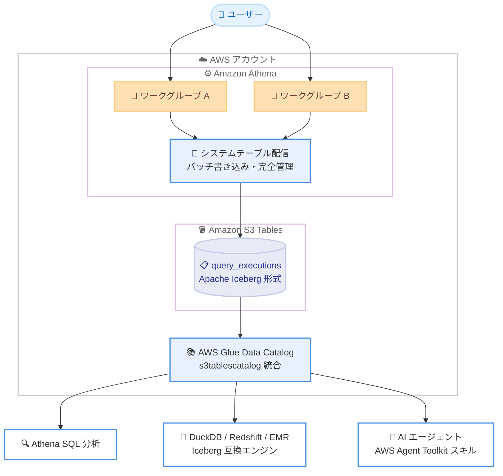

# Amazon Athena - システムテーブルによる可観測性・監査・使用状況分析

**リリース日**: 2026 年 11 月 9 日
**サービス**: Amazon Athena
**機能**: システムテーブル (System Tables)

📊 [このアップデートのインフォグラフィックを見る](https://takech9203.github.io/aws-news-summary/20261109-athena-system-tables.html)

## 概要

Amazon Athena が、使用状況データを自動的にキャプチャして可観測性、使用状況分析、監査に活用できるシステムテーブルを発表しました。システムテーブルを有効化すると、アカウント内のすべてのワークグループを対象に、クエリ完了から数分以内に使用状況データが利用可能になります。データはサービス管理の読み取り専用 Apache Iceberg テーブルとして Amazon S3 Tables に保存され、保持期間も設定できます。

スキーマ定義、パーティショニング、コンパクション、スナップショット管理は AWS が代行するため、ユーザー側の運用負荷はありません。データはオープンな Apache Iceberg 形式で保存されるため、Athena だけでなく DuckDB、Amazon Redshift、Amazon EMR など Iceberg 互換の任意のエンジンからクエリできます。プラットフォームチーム、セキュリティチーム、FinOps チームなど、Athena の利用状況を横断的に把握したいすべてのユーザーが対象です。

**アップデート前の課題**

- 以前は使用状況データの取得に GetQueryExecution API、CloudWatch メトリクス、CloudTrail ログを組み合わせる必要があった
- ワークグループ横断の使用状況を SQL で分析するには、カスタムの ETL パイプラインを構築・維持する必要があった
- コスト配分ダッシュボードや監査レポートの作成に、独自のデータ収集基盤の開発が必要だった

**アップデート後の改善**

- 使用状況データが Iceberg テーブルとして自動的に蓄積され、SQL で直接検索・フィルタリング・集計・結合できるようになった
- カスタムパイプラインを構築せずに、query_executions テーブルからワークグループ別・ユーザー別・テーブル別のスキャン量を集計できるようになった
- AWS Agent Toolkit のスキルを使い、AI エージェントから自然言語で使用状況の分析や最適化の推奨を取得できるようになった

## アーキテクチャ図



すべてのワークグループのクエリ実行データが、Athena により自動的に S3 Tables 上の Iceberg テーブルへバッチ配信され、AWS Glue Data Catalog 経由で Athena や Iceberg 互換エンジン、AI エージェントから分析できます。

## サービスアップデートの詳細

### 主要機能

1. **query_executions システムテーブル**
   - 成功・失敗を問わず、完了した各クエリにつき 1 行を記録
   - クエリ識別情報 (実行 ID、クエリ文字列、送信時刻)、コンテキスト (ワークグループ、カタログ、データベース、テーブル)、送信者の principal ARN を含む
   - パフォーマンス情報 (総実行時間、プランニング時間、キュー時間)、リソース消費 (スキャンバイト数、DPU 数)、実行結果 (成功 / 失敗 / キャンセル、エラー詳細) を含む

2. **サービス管理の Iceberg テーブル**
   - アカウント内の S3 Tables バケット aws-athena にデータを保存し、スキーマ定義・進化、パーティショニング、コンパクション、スナップショット管理を AWS が代行
   - 配信されたデータは不変 (イミュータブル) で、各レコードは厳密に 1 回だけ配信される
   - 保持期間は S3 Tables のレコード有効期限機能で設定可能 (最短 1 日、上限なし)

3. **オープンフォーマットによる相互運用性**
   - Apache Iceberg 形式のため、Athena に加えて DuckDB、Amazon Redshift、Amazon EMR などの互換エンジンからクエリ可能
   - AWS Glue Data Catalog との統合により、IAM や AWS Lake Formation でテーブル・列・行レベルのアクセス制御を適用可能

4. **AI エージェント連携**
   - AWS Agent Toolkit がシステムテーブルをクエリするスキルを提供し、使用パターンの把握や最適化の推奨を自然言語で取得可能
   - MCP 対応エージェントから IAM 認証情報を使って接続でき、すべての API 呼び出しは CloudTrail に記録される

## 技術仕様

### システムテーブルの仕様

| 項目 | 詳細 |
|------|------|
| 対象範囲 | アカウント・リージョン単位で有効化。既存および将来のすべてのワークグループをカバー |
| 保存先 | S3 Tables バケット aws-athena 内の metadata 名前空間 |
| フォーマット | Apache Iceberg (読み取り専用、行の挿入・更新・削除は不可) |
| 配信 | クエリ完了から数分以内、固定頻度のバッチ配信、exactly-once |
| 暗号化 | デフォルトは SSE-S3。カスタマーマネージド KMS キーも指定可能 (テーブル作成後は変更不可) |
| 保持期間 | デフォルト設定なし (無期限)。S3 Tables のレコード有効期限で設定 (最短 1 日) |
| クエリ方法 | `SELECT * FROM "s3tablescatalog/aws-athena"."metadata"."query_executions"` |

### API 変更履歴

| 日付 | サービス | 変更内容 |
|------|----------|----------|
| 2026/11/06 | [Amazon Athena](https://awsapichanges.com/archive/changes/76ccee-athena.html) | 5 new 2 updated api methods - CreateSystemTableConfiguration、UpdateSystemTableConfiguration、DeleteSystemTableConfiguration、GetSystemTableConfiguration、ListSystemTableStatuses を追加 |

### 管理者に必要な IAM 権限 (抜粋)

```json
{
  "Version": "2012-10-17",
  "Statement": [
    {
      "Sid": "ManageSystemTableConfiguration",
      "Effect": "Allow",
      "Action": [
        "athena:CreateSystemTableConfiguration",
        "athena:UpdateSystemTableConfiguration",
        "athena:DeleteSystemTableConfiguration",
        "athena:GetSystemTableConfiguration"
      ],
      "Resource": "arn:aws:athena:<REGION>:<ACCOUNT>:system-table/ALL"
    },
    {
      "Sid": "CreateSystemTablesBucket",
      "Effect": "Allow",
      "Action": [
        "s3tables:CreateTableBucket",
        "s3tables:PutTableBucketPolicy"
      ],
      "Resource": "arn:aws:s3tables:<REGION>:<ACCOUNT>:bucket/aws-athena"
    }
  ]
}
```

## 設定方法

### 前提条件

1. Athena と Amazon S3 Tables が利用可能なリージョンであること
2. システムテーブルをクエリするには、S3 Tables バケットを AWS Glue Data Catalog と統合済みであること (アカウント・リージョンごとに 1 回の作業)
3. 管理者がシステムテーブル管理用の IAM 権限を持っていること

### 手順

#### ステップ 1: システムテーブルを有効化する

```bash
aws athena create-system-table-configuration \
    --table-name ALL
```

アカウント・リージョンのシステムテーブルを有効化します。Athena が S3 Tables バケット aws-athena をアカウント内にプロビジョニングし、使用状況データの配信を開始します。カスタマーマネージド KMS キーで暗号化する場合は `--kms-key-arn` オプションでキー ARN を指定します。コンソールの場合は、Athena コンソールの [Administration] - [System tables] から [Configure] を選択して有効化します。

#### ステップ 2: 設定とテーブルの状態を確認する

```bash
aws athena get-system-table-configuration --table-name ALL
aws athena list-system-table-statuses
```

現在のシステムテーブル設定と、物理テーブルごとの有効化状態を確認します。

#### ステップ 3: システムテーブルをクエリする

```sql
SELECT work_group_name,
       SUM(data_scanned_bytes) / 1e12 AS scanned_tb
FROM "s3tablescatalog/aws-athena"."metadata"."query_executions"
WHERE submission_date_time >= DATE '2026-11-01'
GROUP BY work_group_name
ORDER BY scanned_tb DESC;
```

ワークグループ別のスキャン量 (TB) を集計する例です。システムテーブルはパーティション化されているため、パーティション列でフィルタリングするとスキャン量を削減できます。

## メリット

### ビジネス面

- **コスト配分の簡素化**: Athena はスキャン量ベースの課金のため、query_executions のスキャンバイト数集計がそのままチームや部門へのチャージバック / ショーバックに利用できる
- **監査・コンプライアンス対応**: 「誰が、いつ、どのテーブルにアクセスしたか」を SQL で追跡でき、要件に応じて数か月から数年のデータ保持が可能
- **運用コストの削減**: カスタム ETL パイプラインの構築・維持が不要になり、分析基盤の開発工数を削減できる

### 技術面

- **完全マネージド**: スキーマ管理、パーティショニング、コンパクション、スナップショット管理を AWS が代行
- **オープンフォーマット**: Apache Iceberg 形式のため、DuckDB や Redshift、EMR など既存の分析ツールチェーンにそのまま組み込める
- **ガバナンス統合**: Glue Data Catalog と Lake Formation により、列レベル・行レベルの細かなアクセス制御を適用できる

## デメリット・制約事項

### 制限事項

- 単一アカウント・単一リージョン内のみサポートされ、クロスアカウント・クロスリージョンの集約には対応していない
- 配信されたデータは不変で、行単位の挿入・更新・削除はできない
- デフォルトの保持期間が設定されないため、ストレージコスト管理には S3 Tables のレコード有効期限の設定が必要
- クエリには S3 Tables バケットと AWS Glue Data Catalog の統合が必要
- KMS キーはテーブル作成後に変更できない (変更にはテーブルの削除と再作成が必要で、既存データは失われる)

### 考慮すべき点

- クエリ文字列には PII や独自ロジックなどの機密情報が含まれる可能性があるため、Lake Formation の列レベル権限などでアクセスを制限することが推奨される
- 無効化している期間のデータはキャプチャされず、再有効化してもバックフィルされない
- 無効化直前に送信されたクエリは query_executions に記録されない場合がある

## ユースケース

### ユースケース 1: ワークグループ別のコスト配分ダッシュボード

**シナリオ**: プラットフォームチームが、部門ごとの Athena 利用コストを可視化してチャージバックを行いたい。

**実装例**:
```sql
SELECT work_group_name,
       DATE_TRUNC('month', submission_date_time) AS month,
       SUM(data_scanned_bytes) / 1e12 AS scanned_tb
FROM "s3tablescatalog/aws-athena"."metadata"."query_executions"
GROUP BY work_group_name, DATE_TRUNC('month', submission_date_time);
```

**効果**: カスタム ETL なしで、ワークグループ別・月別のスキャン量からコストを按分でき、正確なコスト配分レポートを迅速に作成できる。

### ユースケース 2: パフォーマンス劣化の検出

**シナリオ**: データエンジニアリングチームが、クエリ実行時間の悪化やキャパシティ逼迫を早期に検出したい。

**実装例**:
```sql
SELECT query_execution_id,
       total_execution_time_ms,
       query_queue_time_ms
FROM "s3tablescatalog/aws-athena"."metadata"."query_executions"
WHERE submission_date_time >= CURRENT_DATE - INTERVAL '7' DAY
ORDER BY total_execution_time_ms DESC
LIMIT 50;
```

**効果**: 直近 7 日間の最遅クエリやキュー時間の傾向を把握し、ワークグループのキャパシティ調整やクエリ最適化の判断材料にできる。

### ユースケース 3: 監査とアクセス追跡

**シナリオ**: セキュリティチームが、機密データを含む特定のテーブルに誰がアクセスしたかを定期的に監査したい。

**実装例**:
```sql
SELECT principal_arn,
       submission_date_time,
       query_string
FROM "s3tablescatalog/aws-athena"."metadata"."query_executions"
WHERE query_string LIKE '%sensitive_table%'
ORDER BY submission_date_time DESC;
```

**効果**: 特定テーブルへのアクセス履歴と実行者を SQL だけで特定でき、コンプライアンス要件に応じた長期保持と組み合わせて監査対応を効率化できる。

## 料金

システムテーブルへのデータ配信自体は無料です。課金対象は以下のとおりです。

- **S3 Tables ストレージ**: 保持するデータに対して標準の S3 Tables ストレージ料金とメンテナンス料金が発生
- **クエリ料金**: Athena でシステムテーブルをクエリする際は標準の Athena クエリ料金 (スキャン量ベース) が発生。DuckDB、Redshift、EMR など他のエンジンはそれぞれの料金体系に従う

保持期間を S3 Tables のレコード有効期限で適切に設定することで、ストレージコストを管理できます。

## 利用可能リージョン

Athena と Amazon S3 Tables の両方が利用可能なすべての AWS リージョンで利用できます。

## 関連サービス・機能

- **Amazon S3 Tables**: システムテーブルの保存先。レコード有効期限による保持期間管理や自動コンパクションを提供
- **AWS Glue Data Catalog**: システムテーブルの検出とクエリに必要なカタログ統合を提供
- **AWS Lake Formation**: システムテーブルに対するテーブル・列・行レベルの細かなアクセス制御を提供
- **AWS Agent Toolkit**: システムテーブルをクエリして使用パターンや最適化推奨を提示する AI エージェント用スキルを提供

## 参考リンク

- 📊 [インフォグラフィック](https://takech9203.github.io/aws-news-summary/20261109-athena-system-tables.html)
- [公式発表 (What's New)](https://aws.amazon.com/about-aws/whats-new/2026/11/athena-system-tables/)
- [AWS Blog](https://aws.amazon.com/blogs/big-data/amazon-athena-introduces-system-tables-for-query-execution-observability/)
- [ドキュメント (Use Athena system tables)](https://docs.aws.amazon.com/athena/latest/ug/athena-system-tables.html)
- [AWS Agent Toolkit - System Table Skills](https://github.com/aws/agent-toolkit-for-aws/tree/main/skills/specialized-skills/system-table-skills)
- [料金ページ (Amazon S3 の料金)](https://aws.amazon.com/s3/pricing/)

## まとめ

Athena の使用状況データが、ETL 不要で SQL 分析可能な Iceberg テーブルとして自動蓄積されるようになり、コスト配分、パフォーマンス分析、監査が大幅に容易になりました。Athena を複数チームで利用している組織は、コンソールまたは API からシステムテーブルを有効化し、S3 Tables のレコード有効期限で保持期間を設定することから始めることを推奨します。クエリ文字列に機密情報が含まれる可能性があるため、Lake Formation によるアクセス制御の設計も合わせて検討してください。
