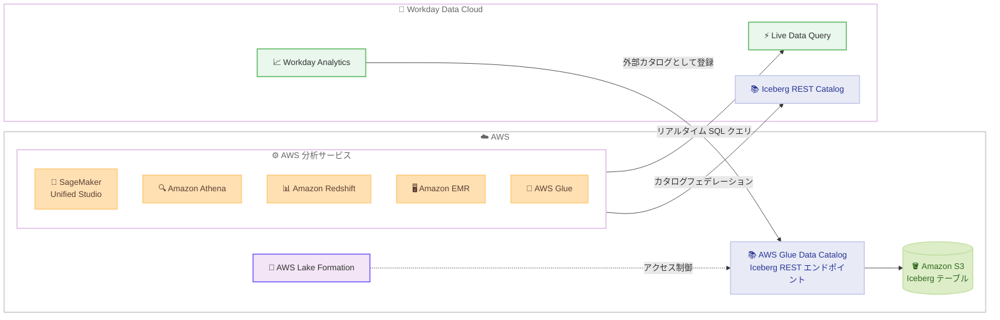

# AWS Analytics サービス - Workday Data Cloud との双方向ゼロコピー統合

**リリース日**: 2026 年 11 月 9 日
**サービス**: Amazon SageMaker Unified Studio、Amazon EMR、AWS Glue、Amazon Redshift、Amazon Athena
**機能**: Workday Data Cloud との双方向ゼロコピー統合

📊 [このアップデートのインフォグラフィックを見る](https://takech9203.github.io/aws-news-summary/20261109-aws-analytics-workday-data-cloud.html)

## 概要

AWS は、AWS の分析サービスと Workday Data Cloud の間の双方向ゼロコピー統合を発表しました。両プラットフォームを利用する共同顧客は、ETL パイプラインを構築・保守してデータを複製することなく、AWS と Workday の双方のデータセットをその場 (in place) で横断的にクエリできます。その際、両環境の既存のセキュリティ制御はそのまま維持されます。

AWS 側からは、Amazon SageMaker Unified Studio、Amazon EMR、AWS Glue、Amazon Redshift、Amazon Athena を使用して、Workday Live Data Query 経由で Workday データをクエリするか、カタログフェデレーションを通じて Workday Data Cloud 内の Apache Iceberg テーブルにフェデレートできます。逆方向では、Workday 側から AWS Glue Data Catalog の Iceberg REST エンドポイントを Workday Analytics の外部カタログとして登録し、AWS 上の Iceberg テーブルを直接クエリできます。人事データと業務データを組み合わせたタレント分析、ワークフォースプランニング、機械学習などのユースケースを想定した統合です。

**アップデート前の課題**

- Workday のデータを AWS で分析するには、ETL パイプラインを構築・保守してデータを複製する必要があった
- データのコピーにより、鮮度の低下、ストレージコストの増加、ガバナンスの二重管理が発生していた
- Workday 側から AWS のデータレイク上のデータを参照するには、データのエクスポートや連携処理が必要だった

**アップデート後の改善**

- AWS の 5 つの分析サービスから Workday データをコピーせずに直接クエリできるようになった
- SageMaker Unified Studio、AWS Glue、AWS Lake Formation の各コンソールで接続を設定するだけで、すぐにクエリを開始できるようになった
- Workday 側からも AWS Glue Data Catalog 経由で Amazon S3 上の Iceberg テーブルを直接クエリできるようになった
- アクセスは AWS と Workday 双方の権限モデルで引き続きガバナンスされる

## アーキテクチャ図



AWS の分析サービスは Live Data Query またはカタログフェデレーション経由で Workday データをその場でクエリし、Workday Analytics は AWS Glue Data Catalog を外部カタログとして登録して S3 上の Iceberg テーブルを直接参照します。データは双方向ともコピーされません。

## サービスアップデートの詳細

### 主要機能

1. **AWS から Workday へのアクセス: Workday Live Data Query**
   - SageMaker Unified Studio、Athena、EMR、AWS Glue からコネクタ経由で接続し、Workday テナントの最新データに対してリアルタイム SQL を直接実行できる
   - クエリは Workday のガバナンス環境内で実行され、結果がニアリアルタイムで返却される
   - 現在の人員数の確認など、データ鮮度が重要なダッシュボードや運用系 AI エージェントに適している

2. **AWS から Workday へのアクセス: Iceberg カタログフェデレーション**
   - Workday Data Cloud の Iceberg REST Catalog を AWS Glue Data Catalog / AWS Lake Formation にフェデレーテッドカタログとして登録する
   - Workday のデータセットが標準の Apache Iceberg テーブルとして AWS 側に表示され、Athena、Redshift、EMR、SageMaker から検出・クエリできる
   - コンピュートは顧客の AWS 環境で実行され、データは Workday Data Cloud に留まる。大規模な履歴分析や機械学習に適している

3. **Workday から AWS へのアクセス: 外部カタログ登録**
   - AWS Glue Data Catalog の Iceberg REST エンドポイントを Workday Analytics の外部カタログとして登録する
   - OAuth 2.0 認証によるフェデレーションで、Workday のアプリケーションや AI エージェントが Amazon S3 上の Iceberg テーブルをコピーなしでクエリできる

4. **双方向のガバナンス維持**
   - Workday 側では権限モデル、監査制御、セマンティック定義がデータとともに維持される
   - AWS 側では Lake Formation が Workday 接続の読み取り範囲をデータベース・テーブル単位などで制御する

## 技術仕様

### 接続方式の比較

| 項目 | Workday Live Data Query | Iceberg カタログフェデレーション |
|------|------------------------|--------------------------------|
| データ鮮度 | Workday テナントの最新データ | Workday がスケジュールに従って更新する Iceberg テーブル |
| 適したワークロード | リアルタイム参照、鮮度重視のダッシュボード | 大規模な履歴クエリ、分析、機械学習 |
| クエリ実行環境 | Workday のガバナンス環境内 | 顧客の AWS 環境のコンピュート |
| 利用サービス | SageMaker Unified Studio、Athena、EMR、AWS Glue | Athena、Redshift、EMR、SageMaker |
| 設定場所 | SageMaker Unified Studio、AWS Glue コンソール | AWS Glue / Lake Formation コンソール |

### 認証とアクセス制御

| 項目 | 詳細 |
|------|------|
| Workday から AWS への認証 | OAuth 2.0 によるフェデレーション |
| AWS 側のアクセス制御 | AWS Lake Formation によるきめ細かなアクセス制御 |
| Workday 側のアクセス制御 | Workday の Configurable Security がフェデレーテッドテーブルへのアクセスを制御 |
| データ形式 | Apache Iceberg (オープンテーブルフォーマット) |

## 設定方法

### 前提条件

1. Workday Data Cloud (Live Data Query または Data Connect) が利用可能な Workday テナント
2. AWS Glue Data Catalog および AWS Lake Formation を利用できる AWS アカウントと IAM 権限
3. Workday から AWS へのアクセスには OAuth 2.0 認証の構成

### 手順

#### ステップ 1: AWS から Workday への接続を作成する

SageMaker Unified Studio、AWS Glue、または AWS Lake Formation のコンソールで Workday への接続を設定します。リアルタイムクエリには Live Data Query コネクタを、大規模な履歴分析には Workday の Iceberg REST Catalog のフェデレーテッドカタログ登録を使用します。接続を設定するとすぐにクエリを開始できます。

#### ステップ 2: AWS の分析サービスからクエリを実行する

```sql
-- Athena などから Workday のフェデレーテッドカタログ内のテーブルをクエリする例
SELECT *
FROM "workday_catalog"."hcm_db"."worker_data"
LIMIT 10;
```

フェデレーション設定後は、Workday のデータセットが通常の Iceberg テーブルとして表示されるため、Athena、Redshift、EMR、AWS Glue から標準の SQL でクエリできます。アクセス可能な範囲は Lake Formation と Workday 双方の権限設定に従います。

#### ステップ 3: Workday から AWS のデータをクエリする

Workday Analytics の管理画面で、AWS Glue Data Catalog の Iceberg REST エンドポイントを外部カタログとして登録します。OAuth 2.0 で認証を構成すると、Workday のアプリケーションから S3 上の Iceberg テーブルを直接参照できます。詳細な手順は Workday の管理者ガイドを参照してください。

## メリット

### ビジネス面

- **ETL パイプラインの削減**: データ複製のためのパイプライン構築・保守が不要になり、データエンジニアリングの工数を分析や ML アプリケーション開発に振り向けられる
- **人事データと業務データの統合分析**: タレント分析、ワークフォースプランニング、報酬ベンチマーク分析など、これまでサイロ化していたデータを組み合わせた意思決定が可能になる
- **ガバナンスの一貫性**: 既存のセキュリティ制御が両環境で維持されるため、規制業界でも統制を保ったままデータ活用を進められる

### 技術面

- **ゼロコピーによる鮮度とコストの両立**: データを移動・複製しないため、データ鮮度の低下や重複ストレージのコストが発生しない
- **オープンスタンダード採用**: Apache Iceberg と REST カタログという標準技術に基づくため、特定ベンダーへのロックインを抑えられる
- **ワークロードに応じた 2 つの接続方式**: リアルタイム参照には Live Data Query、大規模分析にはカタログフェデレーションと、要件に応じて使い分けられる

## デメリット・制約事項

### 制限事項

- Iceberg カタログフェデレーション経由の Workday データは、Workday がスケジュールに従って更新するため、最新データが必要な場合は Live Data Query を使用する必要がある
- 利用可能リージョンは AWS Glue が利用可能な AWS 商用リージョンに限られる
- Live Data Query コネクタには制限事項があり、詳細は AWS Glue ドキュメントの制限事項ページで確認が必要

### 考慮すべき点

- Workday 側で Workday Data Cloud (Live Data Query / Data Connect) の契約・有効化が前提となる
- アクセス制御は AWS (Lake Formation / IAM) と Workday (Configurable Security) の双方で設計する必要があり、権限モデルの整合性を事前に検討することが望ましい
- Live Data Query のクエリは Workday 環境内で実行されるため、大量データのスキャンを伴う分析にはカタログフェデレーション方式が適している

## ユースケース

### ユースケース 1: AI を活用したタレント分析

**シナリオ**: 人事部門がエンゲージメント、報酬、離職の関係を分析し、離職リスクの高い従業員パターンを特定したい。

**実装例**:
```
1. AWS Glue の事前構築コネクタで Workday Data Cloud に接続
2. S3 上の市場報酬ベンチマークデータと Workday の人事データを Athena で SQL 結合
3. SageMaker で離職リスク予測モデルを構築
4. リアルタイム信号には Live Data Query、履歴トレンドには Iceberg フェデレーションを使用
```

**効果**: ETL なしで人事データと外部データを統合し、離職リスクの早期検知と対策立案が可能になる。

### ユースケース 2: ワークフォースプランニング

**シナリオ**: Workday 内のワークフォースプランニング AI エージェントが、AWS 上にある収益予測データを参照して採用計画を立案したい。

**実装例**:
```
1. AWS Glue Data Catalog の Iceberg REST エンドポイントを
   Workday Analytics の外部カタログとして登録
2. Workday の AI エージェントが S3 上の収益予測テーブルを直接クエリ
3. 人員データと収益予測を組み合わせて採用推奨を生成
```

**効果**: AWS 側のデータをエクスポートすることなく、Workday のアプリケーション内で業務データを活用した計画立案ができる。

### ユースケース 3: 鮮度重視の経営ダッシュボード

**シナリオ**: 経営層向けダッシュボードで、現在の人員数や当日の財務状況など、常に最新の Workday データを表示したい。

**実装例**:
```
1. SageMaker Unified Studio または Athena で
   Workday Live Data Query 接続を作成
2. ダッシュボードのクエリを Live Data Query 経由で実行し、
   Workday テナントの最新データを取得
```

**効果**: バッチ連携の待ち時間なしに、ニアリアルタイムの人事・財務データを経営判断に利用できる。

## 料金

公式発表に、この統合自体の追加料金に関する記載はありません。クエリに使用する各 AWS 分析サービス (Athena、Redshift、EMR、AWS Glue、SageMaker) の標準料金が適用されます。Workday Data Cloud 側の利用条件については Workday に確認してください。

## 利用可能リージョン

AWS Glue が利用可能なすべての AWS 商用リージョンで利用できます (東京・大阪リージョンを含む)。

## 関連サービス・機能

- **AWS Glue Data Catalog**: 双方向フェデレーションの中核となるメタデータリポジトリ。Iceberg REST エンドポイントを Workday に公開する
- **AWS Lake Formation**: Workday からのアクセスを含む、AWS 側データへのきめ細かなアクセス制御を提供する
- **Amazon SageMaker Unified Studio**: 接続設定からデータ探索、SQL、ノートブック開発までを統合的に行える環境
- **Amazon S3 Tables / Apache Iceberg**: 本統合の基盤となるオープンテーブルフォーマット。Iceberg 互換エンジンからの相互運用を可能にする

## 参考リンク

- 📊 [インフォグラフィック](https://takech9203.github.io/aws-news-summary/20261109-aws-analytics-workday-data-cloud.html)
- [公式発表 (What's New)](https://aws.amazon.com/about-aws/whats-new/2026/11/aws-analytics-workday-data-cloud/)
- [AWS Blog: Introducing the Workday Data Cloud integration with AWS](https://aws.amazon.com/blogs/big-data/introducing-the-workday-data-cloud-integration-with-aws/)
- [AWS Glue User Guide: Connecting to Workday Live Data Query](https://docs.aws.amazon.com/glue/latest/dg/connecting-to-data-workday.html)
- [AWS Lake Formation Developer Guide: Federate to Workday Data Connect](https://docs.aws.amazon.com/lake-formation/latest/dg/catalog-federation-workday.html)
- [Workday Data Cloud integration with AWS (Workday ドキュメント)](https://doc.workday.com/admin-guide/en-us/workday-data-cloud/data-out/workday-data-lake/workday-data-lake.html)

## まとめ

AWS の主要分析サービスと Workday Data Cloud が双方向のゼロコピー統合に対応し、ETL パイプラインなしで人事データと業務データを横断的に分析できるようになりました。Workday を利用している組織は、タレント分析やワークフォースプランニングの基盤として本統合の活用を検討する価値があります。まずは AWS Glue または SageMaker Unified Studio のコンソールで接続を作成し、小規模なデータセットでクエリとアクセス制御の動作を確認することを推奨します。
