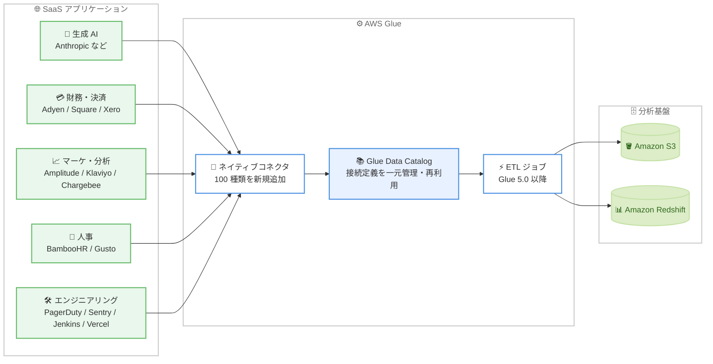

# AWS Glue - 人気 SaaS アプリケーション向け 100 種類の新しいネイティブコネクタ

**リリース日**: 2026 年 11 月 9 日
**サービス**: AWS Glue
**機能**: 100 new native connectors for popular SaaS applications

📊 [このアップデートのインフォグラフィックを見る](https://takech9203.github.io/aws-news-summary/20261109-aws-glue-adds-100-new-native-connectors.html)

## 概要

AWS Glue が、人気の SaaS アプリケーションおよび REST API ベースのアプリケーションへのアクセスを簡素化する 100 種類の新しいネイティブコネクタをサポートしました。AWS Glue Data Catalog で接続を一度作成すれば、既存の AWS Glue と同じ権限モデルを使用して、複数の ETL ジョブ間で接続を再利用できます。

新しいコネクタは、生成 AI、財務、決済、マーケティング、プロダクト分析、人事、エンジニアリング、IT 運用、コラボレーションツールといった幅広いカテゴリをカバーしています。取り込んだデータは Amazon S3 や Amazon Redshift にロードして、分析やレポーティングに活用できます。データエンジニアリングチームだけでなく、財務、マーケティング、人事など、SaaS 上のデータを AWS の分析基盤に統合したいすべてのチームにとって価値のあるアップデートです。

**アップデート前の課題**

このアップデート以前には、以下の課題がありました。

- SaaS アプリケーションのデータを AWS に取り込むには、各アプリケーションの API 仕様に合わせたカスタムコードの開発が必要だった
- API の認証、ページネーション、レート制限、スキーマ変更などへの対応を自前で実装・保守する必要があった
- チームごとに個別の連携処理を作り込むため、接続情報や権限の管理が分散しがちだった

**アップデート後の改善**

今回のアップデートにより、以下が可能になりました。

- 100 種類の SaaS / REST API ベースのアプリケーションに、カスタムコードなしでネイティブに接続できるようになった
- AWS Glue Data Catalog で接続を一度作成すれば、複数の ETL ジョブで再利用できるようになった
- 既存の AWS Glue と同じ権限モデルをそのまま利用でき、ガバナンスを統一できるようになった

## アーキテクチャ図



各 SaaS アプリケーションへの接続を AWS Glue Data Catalog に一度定義すると、複数の ETL ジョブから再利用して Amazon S3 や Amazon Redshift にデータをロードできます。

## サービスアップデートの詳細

### 主要機能

1. **100 種類のネイティブコネクタの追加**
   - SaaS および REST API ベースのアプリケーションに対するネイティブ接続をサポート
   - カスタムコードの開発なしで、AWS Glue の ETL ジョブからデータソースとして利用可能
   - 生成 AI、財務、決済、マーケティング、プロダクト分析、人事、エンジニアリング、IT 運用、コラボレーションツールなど幅広いカテゴリに対応

2. **Glue Data Catalog による接続の一元管理と再利用**
   - 接続を AWS Glue Data Catalog で一度作成すれば、複数の ETL ジョブ間で再利用可能
   - 既存の AWS Glue と同じ権限モデルを使用でき、アクセス制御を統一可能

3. **分析基盤へのシームレスなデータロード**
   - 統合したデータを Amazon S3 や Amazon Redshift にロードし、分析・レポーティングに活用可能
   - チーム横断でのデータ統合 (例: 課金データ + 利用データ + キャンペーンデータ) を実現

### 代表的なコネクタの例

公式発表では、以下のようなアプリケーションが例として挙げられています。

| カテゴリ | アプリケーション例 | 想定ユースケース |
|------|------|------|
| 生成 AI | Anthropic | モデルプロバイダーの利用量・コストデータで生成 AI の導入状況と支出を追跡 |
| 財務・決済 | Adyen、Square、Xero | トランザクションを統合し、レポーティングを高速化 |
| プロダクト・マーケティング | Chargebee、Amplitude、Klaviyo | 課金・利用・キャンペーンデータを組み合わせて顧客生涯価値を把握 |
| 人事 | BambooHR、Gusto | 人員計画のためのワークフォースデータの統合 |
| エンジニアリング | PagerDuty、Sentry、Jenkins、Vercel | インシデントとデプロイのデータを結合し、信頼性を追跡 |

このほか、[利用可能なコネクタの一覧](https://docs.aws.amazon.com/glue/latest/dg/available-connections.html)には Datadog、HubSpot、Jira Cloud、Slack、Stripe、Zendesk、Okta、Google Ads、Facebook Ads など多数のコネクタが記載されています。

## 技術仕様

### 利用要件

| 項目 | 詳細 |
|------|------|
| 対象サービス | AWS Glue |
| 対応バージョン | AWS Glue 5.0 以降 |
| 接続の管理 | AWS Glue Data Catalog で作成・再利用 |
| 権限モデル | 既存の AWS Glue と同じ権限モデル (IAM) |
| データのロード先 | Amazon S3、Amazon Redshift |
| コネクタ数 | 100 種類を新規追加 |

### VPC 設定を伴う接続に必要な IAM アクション

ドキュメントによると、カスタム IAM ロールで VPC 設定を使用する接続を作成する場合、ロールに以下のアクションが必要です。

```json
{
  "Version": "2012-10-17",
  "Statement": [
    {
      "Effect": "Allow",
      "Action": [
        "secretsmanager:GetSecretValue",
        "secretsmanager:PutSecretValue",
        "secretsmanager:DescribeSecret",
        "ec2:CreateNetworkInterface",
        "ec2:DeleteNetworkInterface",
        "ec2:DescribeNetworkInterfaces",
        "ec2:DescribeSubnets"
      ],
      "Resource": "*"
    }
  ]
}
```

## 設定方法

### 前提条件

1. AWS Glue を利用できる AWS アカウントと、Glue の操作に必要な IAM 権限があること
2. ETL ジョブで AWS Glue 5.0 以降を使用すること
3. 接続先 SaaS アプリケーションの認証情報 (API キーや OAuth など、アプリケーションごとに異なる) を準備していること

### 手順

#### ステップ 1: 接続の作成

AWS Glue コンソールの [Data connections] から接続を作成します。接続タイプとして対象の SaaS アプリケーション (例: Anthropic、Square、PagerDuty) を選択し、認証情報を設定します。

接続の作成手順はコネクタごとに異なるため、[個別コネクタへの接続方法](https://docs.aws.amazon.com/glue/latest/dg/console-connections.html)を参照してください。

#### ステップ 2: ETL ジョブでの接続の利用

```bash
# 作成済みの接続を確認する例
aws glue get-connections --query "ConnectionList[].Name"
```

作成済みの接続一覧を AWS CLI で確認しています。AWS Glue Studio でジョブを作成する際に、データソースとして作成済みの接続を選択します。接続は複数のジョブで再利用できます。

#### ステップ 3: データのロードと分析

ETL ジョブのターゲットとして Amazon S3 または Amazon Redshift を指定し、ジョブを実行します。ロード後は Amazon Athena や Amazon Redshift、Amazon QuickSight などで分析・可視化できます。

## メリット

### ビジネス面

- **データ統合の高速化**: カスタム連携コードの開発・保守が不要になり、SaaS データを使った分析をすばやく開始できる
- **チーム横断のインサイト**: 財務、マーケティング、人事、エンジニアリングなど各部門の SaaS データを AWS の分析基盤に統合し、全社的な意思決定に活用できる
- **生成 AI コストの可視化**: Anthropic などモデルプロバイダーの利用量・コストデータを取り込み、生成 AI の導入状況と支出を追跡できる

### 技術面

- **運用負荷の削減**: API の認証やスキーマへの対応を自前で実装・保守する必要がなくなる
- **接続の再利用**: Glue Data Catalog で接続を一元管理し、複数の ETL ジョブで再利用できる
- **ガバナンスの統一**: 既存の AWS Glue と同じ権限モデルを使用でき、アクセス制御を一貫して適用できる

## デメリット・制約事項

### 制限事項

- AWS Glue 5.0 以降のバージョンが必要 (古い Glue バージョンのジョブでは利用できない)
- 利用できる機能や設定手順はコネクタごとに異なるため、個別のドキュメント確認が必要
- 一部の接続 (Amazon DocumentDB、Amazon Aurora、MariaDB、MongoDB、MongoDB Atlas) は、AWS Glue API で v2 接続として作成した場合、コンソールから編集できない

### 考慮すべき点

- SaaS 側の API レート制限や認証情報 (API キー、OAuth トークン) のライフサイクル管理は引き続き考慮が必要
- 取り込むデータに個人情報が含まれる場合は、ロード先 (S3 / Redshift) でのアクセス制御や暗号化の設計が必要

## ユースケース

### ユースケース 1: 生成 AI の利用状況とコストの追跡

**シナリオ**: AI チームが、Anthropic などのモデルプロバイダーの利用量・コストデータを毎日取り込み、全社の生成 AI 導入状況と支出をダッシュボードで可視化する。

**実装例**:
```
1. Glue コンソールで Anthropic への接続を作成
2. 利用量・コストデータを Amazon S3 に日次ロードする ETL ジョブを作成
3. Athena + QuickSight でチーム別・モデル別の利用コストを可視化
```

**効果**: 生成 AI の支出をプロジェクト単位で把握し、コスト最適化の判断材料にできる。

### ユースケース 2: 財務データの統合レポーティング

**シナリオ**: 財務チームが、Adyen、Square、Xero に分散する取引データを統合し、月次決算レポートの作成を高速化する。

**実装例**:
```
1. 各決済・会計サービスへの接続を Glue Data Catalog に作成
2. 取引データを共通スキーマへ変換して Amazon Redshift にロード
3. Redshift 上で統合レポート用のビューを作成
```

**効果**: 手作業によるデータ収集が不要になり、決算レポーティングのリードタイムを短縮できる。

### ユースケース 3: エンジニアリングの信頼性分析

**シナリオ**: エンジニアリングチームが、PagerDuty のインシデントデータと Jenkins / Vercel のデプロイデータを結合し、デプロイ頻度と障害発生の相関を分析する。

**実装例**:
```
1. PagerDuty、Jenkins、Vercel への接続を作成
2. インシデントとデプロイ履歴を Amazon S3 にロードする ETL ジョブを作成
3. デプロイ単位で障害率を集計し、DORA メトリクスの算出に活用
```

**効果**: 信頼性に関する指標をデータに基づいて追跡し、リリースプロセスの改善につなげられる。

## 料金

今回の公式発表には、コネクタ自体の追加料金に関する記載はありません。AWS Glue の標準料金 (ETL ジョブは DPU 時間単位の課金) が適用されます。最新の料金詳細は [AWS Glue の料金ページ](https://aws.amazon.com/glue/pricing/)を確認してください。

## 利用可能リージョン

すべての AWS 商用リージョンで、AWS Glue バージョン 5.0 以降にて利用可能です。

## 関連サービス・機能

- **AWS Glue Data Catalog**: 接続定義を一元管理し、複数の ETL ジョブで再利用するためのメタデータストア
- **Amazon S3 / Amazon Redshift**: 統合したデータのロード先となる分析基盤
- **Amazon AppFlow**: SaaS アプリケーションと AWS サービス間のデータ転送を行うマネージドサービス。コードを書かずにフローを構成するケースで補完的に利用可能
- **AWS Secrets Manager**: SaaS 接続の認証情報を安全に保管するサービス。VPC 設定を伴う接続で利用

## 参考リンク

- 📊 [インフォグラフィック](https://takech9203.github.io/aws-news-summary/20261109-aws-glue-adds-100-new-native-connectors.html)
- [公式発表 (What's New)](https://aws.amazon.com/about-aws/whats-new/2026/11/aws-glue-adds-100-new-native-connectors/)
- [ドキュメント: 利用可能なコネクタの一覧](https://docs.aws.amazon.com/glue/latest/dg/available-connections.html)
- [ドキュメント: 個別コネクタへの接続方法](https://docs.aws.amazon.com/glue/latest/dg/console-connections.html)
- [料金ページ](https://aws.amazon.com/glue/pricing/)

## まとめ

AWS Glue に 100 種類の SaaS / REST API 向けネイティブコネクタが追加され、カスタムコードなしで SaaS データを AWS の分析基盤に統合できるようになりました。SaaS データの取り込みに独自実装を使用している場合は、[コネクタ一覧](https://docs.aws.amazon.com/glue/latest/dg/available-connections.html)で対象アプリケーションの対応状況を確認し、Glue 5.0 以降のジョブへの置き換えを検討することを推奨します。
