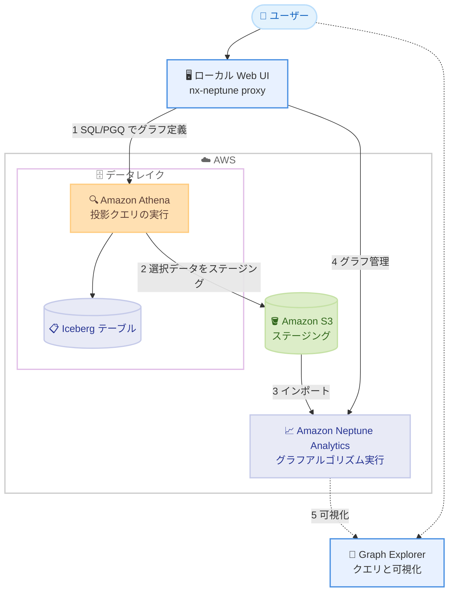

# Amazon Neptune Analytics - データレイク上のグラフ分析のためのオープンソース UI

**リリース日**: 2026 年 11 月 9 日
**サービス**: Amazon Neptune Analytics
**機能**: データレイク上のグラフ分析のためのオープンソース UI (Open-source UI for graph analytics over data lakes)

📊 [このアップデートのインフォグラフィックを見る](https://takech9203.github.io/aws-news-summary/20261109-aws-graphover-datalakes-generally-available.html)

## 概要

AWS は、データレイク上のレコードをグラフに変換し、Amazon Neptune Analytics で分析するためのローカル Web UI を備えたオープンソースソリューションを発表しました。選択したレコードとリレーションシップをグラフとして投影 (プロジェクション) することで、独自の ETL パイプラインを構築することなく、テーブルをまたぐつながりの調査やグラフアルゴリズムの実行が可能になります。

この UI は、Athena カタログとデータベースの選択、SQL/PGQ によるプロパティグラフの定義、インポート前の行プレビューという一連のステップを単一のワークフローに統合します。ソリューションは Athena を通じて投影クエリを実行し、選択したデータを Amazon S3 にステージングして、Neptune Analytics にインポートします。ロード済みのグラフは Graph Explorer で開いて、リレーションシップをクエリ・可視化できます。本ソリューションは awslabs の [nx-neptune](https://github.com/awslabs/nx-neptune) リポジトリで公開されています。

データレイク (Iceberg テーブル) に蓄積されたデータに対して、不正検知やコミュニティ検出などのグラフ分析を試したいデータエンジニアやアナリストが主な対象ユーザーです。

**アップデート前の課題**

- データレイクのデータをグラフ分析するには、ノードとリレーションシップのデータを準備するクエリの作成、Neptune Analytics グラフの作成、インポートの管理をそれぞれ個別に行う必要があった
- 狭い範囲の分析課題のためにデータセット全体をロードしないよう、選択的な投影を自前で構築する必要があった
- これらの手順をつなぐ独自の ETL パイプラインの構築・運用が必要だった

**アップデート後の改善**

- Athena カタログの選択、SQL/PGQ によるグラフ定義、行のプレビュー、インポート、グラフ管理までを単一のワークフローとして Web UI 上で実行できるようになった
- 必要なレコードとリレーションシップだけを選択的に投影できるため、データセット全体をロードする必要がなくなった
- ロードしたグラフを Graph Explorer でそのまま開き、クエリと可視化ができるようになった

## アーキテクチャ図



ローカルで稼働する Web UI が、Athena による投影クエリの実行、S3 へのステージング、Neptune Analytics へのインポートという一連のフローをオーケストレーションし、ロードされたグラフは Graph Explorer で可視化できます。

## サービスアップデートの詳細

### 主要機能

1. **単一ワークフローでのグラフ投影**
   - Athena カタログとデータベースを選択し、SQL/PGQ (SQL:2023 標準の `CREATE PROPERTY GRAPH` 構文) でプロパティグラフを定義する
   - インポート前に行をプレビューして、投影されるデータを確認できる
   - 投影クエリは Athena を通じて実行され、選択されたデータが S3 にステージングされた後、Neptune Analytics にインポートされる

2. **選択的な投影によるコスト・時間の最適化**
   - データセット全体ではなく、分析に必要なレコードとリレーションシップのみをグラフとして投影できる
   - アカウントとトランザクションをグラフに投影して口座のつながりを調べる、調査対象となり得るコミュニティを特定するといった分析を、ETL パイプラインなしで実行できる

3. **グラフのライフサイクル管理と可視化**
   - UI 上で投影結果のグラフ (作成、インポート、削除など) を管理できる
   - ロード済みのグラフを Graph Explorer で開き、リレーションシップのクエリと可視化ができる

4. **nx-neptune ライブラリとの統合**
   - 本 UI は、NetworkX 互換バックエンドとして Neptune Analytics にアルゴリズム実行をオフロードできる Python ライブラリ nx-neptune の一部 (proxy コンポーネント) として提供される
   - PageRank、Louvain コミュニティ検出、BFS、各種中心性などのグラフアルゴリズムを Neptune Analytics 上で実行できる

## 技術仕様

### ソリューションの構成

| 項目 | 詳細 |
|------|------|
| 提供形態 | オープンソース (GitHub: awslabs/nx-neptune、Apache-2.0 ライセンス) |
| UI 構成 | FastAPI バックエンド + React (TypeScript + Vite) フロントエンドのローカル Web UI |
| 実行環境 | ローカル実行 (デフォルトで 127.0.0.1:8080 にバインド)。コンテナ実行にも対応 |
| 必要環境 | Python 3.11 以上、Node.js と npm、AWS 認証情報 (Athena、S3、Neptune Analytics の IAM 権限) |
| 対象データ | Athena カタログ経由でアクセスできる Iceberg テーブルなど |
| グラフ定義 | SQL/PGQ (SQL:2023 標準) |
| メタデータ保存先 | ローカルの SQLite (`~/.nx-neptune/proxy.db`) |
| 認証 | サーバー起動ごとに再生成されるワンタイムトークン付き URL で API アクセスを保護 |
| 可視化 | Graph Explorer (サイドカーコンテナとして起動可能) |
| ステータス | Alpha Preview (リポジトリ上はテスト用途を推奨) |

### API 変更履歴

今回のアップデートはオープンソースソリューション (ローカル UI) の提供であり、awsapichanges.com では本アップデートに対応する新規の API 変更は確認できませんでした (2026 年 11 月 10 日時点)。

## 設定方法

### 前提条件

1. Python 3.11 以上と Node.js、npm がインストールされていること
2. Athena、S3、Neptune Analytics に対する IAM 権限を持つ AWS 認証情報とリージョンが設定されていること
3. 長期認証情報 (IAM ユーザーのアクセスキー) ではなく、`aws sso login` や `aws sts assume-role` などによる短期認証情報を使用すること (リポジトリの推奨事項)

### 手順

#### ステップ 1: リポジトリの取得とインストール

```bash
git clone https://github.com/awslabs/nx-neptune.git
cd nx-neptune
pip install -e .
```

nx-neptune リポジトリを取得し、ライブラリを編集可能モードでインストールします。

#### ステップ 2: UI のビルドとサーバーの起動

```bash
cd proxy
make install
make ui
make dev
```

proxy ディレクトリで依存関係をインストールし、React UI をビルドして、開発サーバーを 127.0.0.1:8080 で起動します。起動時に `http://127.0.0.1:8080/?token=<token>` 形式のワンタイム URL が出力されるので、この URL でブラウザからアクセスします。トークンは起動ごとに再生成され、すべての API 呼び出しに必要です。

**注意**: `make dev`、`make run`、`make up` は、作成するグラフにパブリックエンドポイントを付与し削除保護を無効化する設定 (`NETWORKX_PUBLIC_CONNECTIVITY=true`、`NETWORKX_DELETION_PROTECTION=false`) で動作するため、開発アカウントのテストデータでのみ使用してください。

#### ステップ 3: グラフの投影と分析

UI 上で Athena カタログとデータベースを選択し、SQL/PGQ でプロパティグラフを定義して、行をプレビューした後にインポートを実行します。インポート完了後、ロードされたグラフを Graph Explorer で開いてリレーションシップをクエリ・可視化できます。

## メリット

### ビジネス面

- **分析着手までの時間短縮**: ETL パイプラインの構築なしでデータレイク上のデータをグラフ分析でき、不正調査などのインサイト獲得までの時間を短縮できる
- **コスト効率**: 必要なデータのみを選択的に投影するため、データセット全体のロードによる不要なコストを回避できる
- **オープンソース**: Apache-2.0 ライセンスで公開されており、ソリューション自体は無償で利用・カスタマイズできる

### 技術面

- **ワークフローの統合**: クエリ準備、グラフ作成、インポート管理という従来は個別だった手順が単一の UI に統合されている
- **標準準拠のグラフ定義**: SQL:2023 標準の SQL/PGQ でグラフスキーマを宣言的に定義できる
- **可視化との連携**: ロード済みグラフを Graph Explorer でそのまま開けるため、分析から可視化までがシームレス

## デメリット・制約事項

### 制限事項

- UI はローカル実行を前提としており、マネージドサービスとしてホストされるものではない
- リポジトリは Alpha Preview ステータスであり、テスト用途での利用が推奨されている
- Python 3.11 以上、Node.js などのローカル実行環境のセットアップが必要

### 考慮すべき点

- `make dev` などの開発用ターゲットは、グラフのパブリックエンドポイント有効化と削除保護無効化を伴うため、本番データでは使用せず、`python -m nx_neptune_proxy` の直接実行によるセキュアなデフォルト設定を利用すること
- 長期認証情報の使用は避け、短期認証情報 (SSO、AssumeRole、インスタンスプロファイル) を使用することが推奨されている
- 投影クエリは Athena で実行され、グラフは Neptune Analytics 上に作成されるため、これらのサービスの利用料金が発生する

## ユースケース

### ユースケース 1: 金融取引の不正調査

**シナリオ**: データレイクに蓄積された口座テーブルとトランザクションテーブルから、不正の疑いがある口座のつながりを調査したい。

**実装例**:
```
1. UI で Athena カタログと対象データベースを選択
2. SQL/PGQ で口座をノード、送金をエッジとするプロパティグラフを定義
3. 行をプレビューして対象期間のトランザクションのみを投影
4. Neptune Analytics 上で Louvain コミュニティ検出を実行し、
   調査対象となり得るコミュニティを特定
```

**効果**: ETL パイプラインを構築することなく、口座間のつながりやコミュニティを特定でき、不正調査の初動を迅速化できる。

### ユースケース 2: NetworkX コードによるグラフアルゴリズムのスケール実行

**シナリオ**: ローカルの NetworkX では処理しきれない規模のデータに対して、既存の分析コードを大きく変えずに PageRank などを実行したい。

**実装例**:
```python
import networkx as nx

# nx-neptune を NetworkX 互換バックエンドとして使用
result = nx.pagerank(G, backend="neptune")
```

**効果**: 既存の NetworkX コードをほぼ変更せずに、アルゴリズム実行を Neptune Analytics にオフロードし、大規模グラフにスケールできる。

### ユースケース 3: 探索的なグラフ分析の試行

**シナリオ**: グラフデータベースへの本格移行を判断する前に、既存の Iceberg テーブルに対してグラフ分析が有効かを低コストで検証したい。

**実装例**:
```
1. 検証対象のテーブルから必要な列・行のみを SQL/PGQ で選択的に投影
2. 短命のグラフを作成してアルゴリズムを実行し、結果を評価
3. 検証完了後は UI からグラフを削除してコストを抑制
```

**効果**: データをグラフデータベースへ恒久的に移行することなく、必要なときだけグラフを作成して検証でき、投資判断の材料を低コストで得られる。

## 料金

本ソリューション自体はオープンソースであり、無償で利用できます。ただし、ワークフローの実行に伴い、以下の AWS サービスの利用料金が発生します。

- **Amazon Athena**: 投影クエリのスキャンデータ量に応じた料金
- **Amazon S3**: ステージングデータのストレージとリクエストの料金
- **Amazon Neptune Analytics**: グラフの容量 (m-NCU) と稼働時間に応じた料金

## 利用可能リージョン

UI はローカルで実行され、Amazon Neptune Analytics が利用可能なすべてのリージョンで利用できます。

## 関連サービス・機能

- **Amazon Neptune Analytics**: 投影されたグラフを保持し、グラフアルゴリズムと openCypher クエリを実行する分析エンジン
- **Amazon Athena**: Iceberg テーブルなどデータレイクに対する投影クエリの実行を担う
- **Amazon S3**: 投影で選択されたデータのステージング先
- **Graph Explorer**: ロードされたグラフのクエリと可視化を行うオープンソースツール

## 参考リンク

- 📊 [インフォグラフィック](https://takech9203.github.io/aws-news-summary/20261109-aws-graphover-datalakes-generally-available.html)
- [公式発表 (What's New)](https://aws.amazon.com/about-aws/whats-new/2026/11/aws-graphover-datalakes-generally-available)
- [GitHub: awslabs/nx-neptune](https://github.com/awslabs/nx-neptune)
- [セットアップ手順 (proxy/README.md)](https://github.com/awslabs/nx-neptune/blob/main/proxy/README.md)
- [Amazon Neptune Analytics](https://aws.amazon.com/neptune/)
- [料金ページ (Amazon Neptune)](https://aws.amazon.com/neptune/pricing/)

## まとめ

データレイクのデータをグラフ分析する際の最大の障壁であった ETL パイプラインの構築を不要にし、投影からインポート、可視化までを単一のワークフローに統合する実用的なソリューションです。Iceberg テーブルに蓄積したデータのつながりを分析したいチームは、開発アカウントで本 UI を試すことから始めてください。なお、リポジトリは Alpha Preview ステータスのため、本番データでの利用前にセキュリティ設定 (パブリックエンドポイントと削除保護) を必ず確認することが推奨されます。
