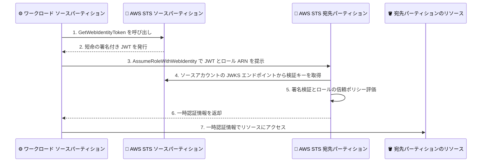

# AWS STS - クロスパーティションフェデレーション

**リリース日**: 2026 年 11 月 9 日
**サービス**: AWS Security Token Service (AWS STS)、AWS Identity and Access Management (IAM)
**機能**: AWS ID のクロスパーティションフェデレーション (Cross-partition federation for AWS identities)

📊 [このアップデートのインフォグラフィックを見る](https://takech9203.github.io/aws-news-summary/20261109-aws-sts-cross-partition.html)

## 概要

AWS Security Token Service (AWS STS) が、あるパーティションの IAM アイデンティティを使用して、別のパーティションの IAM ロールの一時認証情報を取得できるクロスパーティションフェデレーションをサポートしました。パーティションとは、商用リージョンや AWS GovCloud (US) リージョンなどの AWS リージョンのグループであり、各パーティションは独立した IAM インスタンスを持つ強固な分離境界 (ハードバウンダリ) を形成しています。

この新機能により、ワークロードは自身のパーティションの AWS STS から短命トークン (JWT) を取得し、既存の `GetWebIdentityToken` および `AssumeRoleWithWebIdentity` API を使用して、別のパーティションの一時 AWS 認証情報と交換できます。長期認証情報を保存する必要がなくなるため、セキュリティ態勢の向上に役立ちます。どのアイデンティティがどのロールにアクセスできるかを制御し、組織全体でガバナンスを適用し、両方のパーティションの AWS CloudTrail でトークンの使用を監査できます。

複数のパーティションにまたがってワークロードを運用する組織、特にセキュリティ・コンプライアンスレポートの統合や、運用ツールの一元化を必要とする組織が主な対象ユーザーです。

**アップデート前の課題**

- 各パーティションは独立した IAM インスタンスを持つため、あるパーティションで発行された認証情報は別のパーティションでは無効であり、`AssumeRole` API によるパーティション間の直接のロール引き受けはできなかった
- リソースポリシーで他パーティションのプリンシパルを参照することもできなかった
- そのため、パーティションをまたぐワークロードを運用する組織は、自動的に失効しない IAM ユーザーのアクセスキーなどの長期認証情報に依存することが一般的で、保存やローテーションの管理負担とセキュリティリスクを抱えていた

**アップデート後の改善**

- ワークロードが自パーティションの AWS STS から短命トークンを取得し、別パーティションの一時認証情報と交換できるようになり、長期認証情報の保存が不要になった
- すべての段階で一時認証情報を使用できるため、「ワークロードには一時認証情報を使用する」という IAM のベストプラクティスに準拠できるようになった
- 独自の PKI や OpenID Provider をホストすることなく、フルマネージドなトークン基盤でクロスパーティションアクセスを実現できるようになった
- 両パーティションの CloudTrail でトークンの発行と使用を相関させて監査できるようになった

## アーキテクチャ図



ソースパーティションの AWS STS が発行した短命 JWT を、宛先パーティションの AWS STS が OIDC フェデレーションの仕組みで検証し、一時認証情報と交換する 2 段階のフローです。

## サービスアップデートの詳細

### 主要機能

1. **既存 API による 2 段階のトークン交換**
   - ワークロードはソースパーティションで `sts:GetWebIdentityToken` を呼び出し、短命の暗号署名付き JWT を取得する
   - JWT には、アカウント ID、プリンシパル ARN、ソースリージョンなど、ワークロードの AWS アイデンティティを表明するクレームが含まれる
   - 宛先パーティションの AWS STS エンドポイントで `sts:AssumeRoleWithWebIdentity` を呼び出し、JWT を宛先ロールの一時認証情報と交換する
   - `AssumeRoleWithWebIdentity` の呼び出しには AWS 認証情報は不要 (JWT 自体が認証に使用される)

2. **発行元アイデンティティに基づくアクセス制御**
   - 宛先ロールの信頼ポリシーで、ソースのアカウント ID、組織 ID、ソースリージョン、プリンシパルなどを条件として指定できる
   - IAM ポリシー条件により、許可するオーディエンス、トークンの有効期間、署名アルゴリズムを制限できる
   - 既存の IAM ロールとポリシーの仕組みをそのまま利用して、組織全体のガバナンスを適用できる

3. **クロスパーティションの監査証跡**
   - 宛先パーティションの CloudTrail イベントにソースプリンシパルの ARN とトークン ID が含まれる
   - ソースパーティション側の `GetWebIdentityToken` イベントと相関させることで、両パーティションにまたがるエンドツーエンドの監査が可能
   - 発行済みの一時認証情報のセッション失効にも対応

## 技術仕様

### トークン交換の仕様

| 項目 | 詳細 |
|------|------|
| 使用 API | `sts:GetWebIdentityToken` (ソース側)、`sts:AssumeRoleWithWebIdentity` (宛先側) |
| トークン形式 | 短命の暗号署名付き JWT (JSON Web Token) |
| トークンのクレーム | アカウント ID、プリンシパル ARN、ソースリージョンなど |
| 検証方式 | 宛先 STS がソースアカウントの Issuer URL の JWKS エンドポイントから公開検証キーを取得し署名を検証 |
| オーディエンス | クロスパーティションフェデレーションでは `GetWebIdentityToken` 呼び出し時にオーディエンスを 1 つだけ指定する (複数指定したトークンは交換不可) |
| 対象パーティション | `aws` (商用)、`aws-cn` (中国)、`aws-us-gov` (GovCloud)、`aws-eusc` (欧州ソブリンクラウド) |
| 制約 | 宛先ロールはトークン発行元と異なるパーティションに存在する必要がある。同一パーティション内のロール引き受けには `AssumeRole` を使用 |

### API 変更履歴

今回のアップデートは既存の `GetWebIdentityToken` および `AssumeRoleWithWebIdentity` API を利用するもので、awsapichanges.com では本アップデートに対応する新規の API 変更は確認できませんでした (2026 年 11 月 10 日時点)。

### 信頼ポリシーによる制御

宛先パーティションのロールの信頼ポリシーでは、ソースアカウントの Issuer URL で作成した OIDC アイデンティティプロバイダーを信頼し、`aud` や `sub` クレームを条件として使用します。トークン生成側では、以下のようなポリシーで `sts:GetWebIdentityToken` を許可します。

```json
{
  "Version": "2012-10-17",
  "Statement": [
    {
      "Effect": "Allow",
      "Action": "sts:GetWebIdentityToken",
      "Resource": "*"
    }
  ]
}
```

## 設定方法

### 前提条件

1. ソースパーティションと宛先パーティションのそれぞれに AWS アカウントがあること
2. ソース側で `iam:EnableOutboundWebIdentityFederation` と `sts:GetWebIdentityToken` の権限があること
3. 宛先側で `iam:CreateOpenIDConnectProvider` の権限と、信頼ポリシーを持つロールの作成権限があること

### 手順

#### ステップ 1: ソースアカウントでアウトバウンド ID フェデレーションを有効化

```bash
aws iam enable-outbound-web-identity-federation
```

ソースアカウントでアウトバウンド ID フェデレーションを有効化し、アカウント固有の Issuer URL を取得します。アカウント単位の設定のため、実行は 1 回のみです。

#### ステップ 2: 宛先アカウントで OIDC アイデンティティプロバイダーとロールを作成

宛先パーティションで、ソースアカウントの Issuer URL を使用して OIDC アイデンティティプロバイダーを作成します。プロバイダーのクライアント ID リストには、ワークロードが `GetWebIdentityToken` で使用するオーディエンスを含めます。次に、この OIDC プロバイダーを信頼し `sts:AssumeRoleWithWebIdentity` を許可する信頼ポリシーを持つ IAM ロールを作成します。

#### ステップ 3: トークンを取得して一時認証情報と交換

```bash
# ソースパーティションで短命 JWT を取得
TOKEN=$(aws sts get-web-identity-token \
  --region us-east-1 \
  --endpoint-url https://sts.us-east-1.amazonaws.com \
  --audience "your-audience" \
  --signing-algorithm ES384 \
  --duration-seconds 300 \
  --query WebIdentityToken --output text)

# 宛先パーティションで一時認証情報と交換
aws sts assume-role-with-web-identity \
  --region cn-north-1 \
  --role-arn arn:aws-cn:iam::111122223333:role/DestinationWorkloadRole \
  --role-session-name cross-partition-session \
  --web-identity-token "$TOKEN" \
  --no-sign-request
```

1 つ目のコマンドは、ソースパーティションの IAM プリンシパルの認証情報を使用して短命 JWT を取得します。2 つ目のコマンドは、取得した JWT を宛先パーティションの STS エンドポイントに提示し、宛先ロールの一時認証情報と交換します。`AssumeRoleWithWebIdentity` の呼び出しは JWT で認証されるため、AWS 認証情報による署名は不要です (`--no-sign-request`)。

## メリット

### ビジネス面

- **セキュリティ態勢の向上**: 自動的に失効しない IAM ユーザーのアクセスキーなどの長期認証情報を排除でき、認証情報漏えいのリスクを低減できる
- **ガバナンスの一元化**: どのアイデンティティがどのロールにアクセスできるかを制御し、組織全体で一貫したガバナンスを適用できる
- **コンプライアンス対応の効率化**: パーティションをまたぐセキュリティ・コンプライアンスレポートの統合が容易になる

### 技術面

- **運用負担の軽減**: 長期認証情報の保存・ローテーション管理や、独自の PKI、OpenID Provider のホスティングが不要
- **既存の仕組みの活用**: 既存の `GetWebIdentityToken` と `AssumeRoleWithWebIdentity` API、既存の IAM ロール・ポリシーをそのまま利用できる
- **監査性の向上**: 両パーティションの CloudTrail でトークン発行と使用を相関させたエンドツーエンドの監査が可能

## デメリット・制約事項

### 制限事項

- 宛先ロールはトークン発行元と異なるパーティションに存在する必要があり、`GetWebIdentityToken` の JWT を同一パーティション内の OIDC フェデレーションに使用することはできない (同一パーティション内は `AssumeRole` を使用)
- クロスパーティションフェデレーションでは、`GetWebIdentityToken` 呼び出し時にオーディエンスを 1 つだけ指定する必要がある (複数のオーディエンスを指定したトークンは交換できない)
- ソースアカウントでのアウトバウンド ID フェデレーションの有効化や、宛先アカウントでの OIDC プロバイダー・ロールの作成など、事前のセットアップが必要

### 考慮すべき点

- パーティションは規制・コンプライアンス上の分離境界として機能しているため、クロスパーティションアクセスが必要な場合は、FedRAMP、ITAR、DoD CC SRG、GDPR などの規制・コンプライアンス要件に適合するかをコンプライアンスチームに確認することが推奨されている
- 信頼ポリシーでは `aud` や `sub` クレームに加え、組織 ID やソースリージョンなどの条件でアクセスを絞り込むことがベストプラクティス
- 組織がすでに PKI を運用している場合は、IAM Roles Anywhere もクロスパーティションアクセスの選択肢となる

## ユースケース

### ユースケース 1: セキュリティ・コンプライアンスレポートの統合

**シナリオ**: 商用パーティションと AWS GovCloud (US) の両方でワークロードを運用する組織が、セキュリティ監査情報を商用パーティションの中央アカウントに集約したい。

**実装例**:
```
GovCloud 上のレポート収集ワークロードがクロスパーティションフェデレーションで
商用パーティションの集約用ロールを引き受け、監査データを中央の S3 バケットに書き込む。
信頼ポリシーでソースの組織 ID とアカウント ID を条件に指定し、アクセス元を限定する。
```

**効果**: IAM ユーザーのアクセスキーを配布することなく、パーティションをまたいだレポート集約を一時認証情報のみで実現できる。

### ユースケース 2: 運用ツールの一元化

**シナリオ**: 中央の運用チームが商用パーティションで運用ツールを稼働させており、GovCloud や中国リージョンの環境に対しても同じツールから運用タスクを実行したい。

**実装例**:
```
商用パーティションの運用ツール (EC2 や Lambda 上で実行) が、実行ロールの権限で
GetWebIdentityToken を呼び出し、各パーティションの運用用ロールの一時認証情報と交換する。
EC2 や Lambda ではインスタンスプロファイルや実行ロールが自動的に使用されるため、
手動のロール引き受けは不要。
```

**効果**: パーティションごとに長期認証情報を管理することなく、単一の運用ツール基盤から複数パーティションを安全に運用できる。

### ユースケース 3: GovCloud から商用パーティションの S3 へのデータアクセス

**シナリオ**: AWS GovCloud (US) の us-gov-west-1 で稼働するワークロードが、商用パーティションの us-east-1 にある S3 バケットのデータにアクセスする必要がある。

**実装例**:
```
1. GovCloud アカウントで enable-outbound-web-identity-federation を実行し Issuer URL を取得
2. 商用アカウントで Issuer URL を使用して OIDC プロバイダーを作成
3. aud と sub クレームを条件とする信頼ポリシーを持つロールを商用アカウントに作成
4. ワークロードが GetWebIdentityToken で JWT を取得し、
   商用パーティションの AssumeRoleWithWebIdentity で一時認証情報と交換して S3 にアクセス
```

**効果**: IAM ユーザーのアクセスキーを GovCloud 側に保存することなく、短命トークンと一時認証情報のみで商用パーティションのデータにアクセスできる。

## 料金

クロスパーティションフェデレーションは追加料金なしで利用できます。

## 利用可能リージョン

以下のパーティションで利用可能です。

- すべての商用 AWS リージョン
- AWS GovCloud (US) リージョン
- 中国リージョン
- AWS 欧州ソブリンクラウド (ドイツ) リージョン

## 関連サービス・機能

- **AWS IAM**: アウトバウンド ID フェデレーションの有効化、OIDC アイデンティティプロバイダーの作成、ロールの信頼ポリシーによるアクセス制御を担う
- **AWS CloudTrail**: ソース・宛先両パーティションでのトークン発行・使用イベントの監査に使用する
- **IAM Roles Anywhere**: 組織がすでに PKI を運用している場合の、クロスパーティションアクセスの代替手段
- **AWS Organizations**: 信頼ポリシーの条件として組織 ID を使用した、組織全体のガバナンス適用に関連する

## 参考リンク

- 📊 [インフォグラフィック](https://takech9203.github.io/aws-news-summary/20261109-aws-sts-cross-partition.html)
- [公式発表 (What's New)](https://aws.amazon.com/about-aws/whats-new/2026/11/aws-sts-cross-partition)
- [AWS Blog: Simplify cross-partition access with AWS IAM outbound identity federation](https://aws.amazon.com/blogs/security/simplify-cross-partition-access-with-aws-iam-outbound-identity-federation/)
- [ドキュメント: Federating AWS identities across AWS partitions](https://docs.aws.amazon.com/IAM/latest/UserGuide/id_roles_providers_outbound_cross_partition.html)
- [ドキュメント: Setting up cross-partition identity federation](https://docs.aws.amazon.com/IAM/latest/UserGuide/id_roles_providers_outbound_cross_partition_setup.html)
- [ドキュメント: AWS fault isolation boundaries - Partitions](https://docs.aws.amazon.com/whitepapers/latest/aws-fault-isolation-boundaries/partitions.html)
- [API リファレンス: GetWebIdentityToken](https://docs.aws.amazon.com/STS/latest/APIReference/API_GetWebIdentityToken.html)
- [API リファレンス: AssumeRoleWithWebIdentity](https://docs.aws.amazon.com/STS/latest/APIReference/API_AssumeRoleWithWebIdentity.html)

## まとめ

パーティションをまたぐワークロードで長年の課題であった長期認証情報への依存を、既存の STS API を使用した短命トークンの交換で解消できる重要なアップデートです。複数パーティションで環境を運用している組織は、IAM ユーザーのアクセスキーによるクロスパーティションアクセスを本機能へ移行することを検討してください。導入にあたっては、規制・コンプライアンス要件への適合をコンプライアンスチームに確認することが推奨されています。
