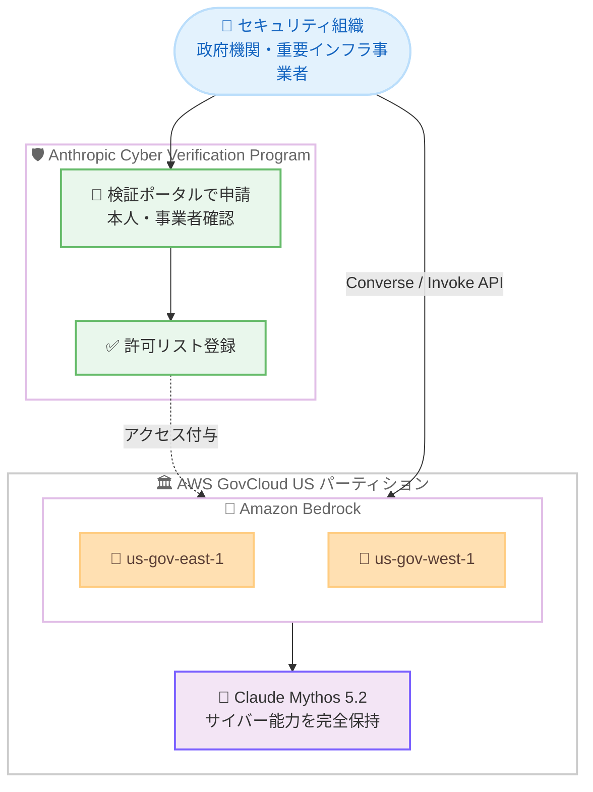

# Amazon Bedrock - Claude Mythos 5.2 が AWS GovCloud (US) の対象顧客向けに提供開始

**リリース日**: 2026 年 11 月 9 日
**サービス**: Amazon Bedrock、AWS GovCloud (US)
**機能**: Claude Mythos 5.2 の AWS GovCloud (US) リージョンでの提供開始 (対象顧客限定)

📊 [このアップデートのインフォグラフィックを見る](https://takech9203.github.io/aws-news-summary/20261109-bedrock-claude-mythos-5-2-govcloud.html)

## 概要

Amazon Bedrock が、Claude Mythos 5.2 を AWS GovCloud (US) の対象顧客向けに提供開始しました。Claude Mythos 5.2 は、サイバーセキュリティ、ソフトウェアコーディング、複雑な推論タスクにおける Anthropic の最も先進的な AI モデルです。ソフトウェアの高度なセキュリティ脆弱性を特定して悪用可能性を実証でき、大規模コードベースを理解し、従来の AI モデルより少ない手動ガイダンスで実用的な調査結果を提供します。

このモデルにより、セキュリティチームは防御的サイバーセキュリティ業務を加速し、世界で最も重要なソフトウェアのセキュリティ脆弱性を発見・修正して、脅威が顕在化する前に対処できます。Claude Mythos 5.2 は、強力なサイバーセキュリティ能力を持つ Anthropic の AI モデルとして AWS GovCloud (US) で利用可能になった最初のモデルです。

アクセスは許可リストに登録された組織に限定されており、利用を開始するには Anthropic の Cyber Verification Program への申請が必要です。なお、Claude Mythos 5.2 は同日発表された Claude Fable 5.2 と同一の基盤モデルであり、サイバーセキュリティおよびバイオ研究向けの能力を完全に保持したバージョンです。

**アップデート前の課題**

このアップデート以前に存在していた課題や制限は以下のとおりです。

- AWS GovCloud (US) では、強力なサイバーセキュリティ能力を持つ Anthropic の AI モデルが利用できなかった
- 一般提供モデルでは安全性分類器により高リスクなサイバーセキュリティ関連のリクエストがブロックされるため、脆弱性の悪用可能性の実証など正当な防御的セキュリティ業務に制約があった
- 政府機関や規制業界のセキュリティチームは、大規模コードベースの脆弱性調査に多くの手動ガイダンスと人的リソースを必要としていた

**アップデート後の改善**

今回のアップデートにより可能になったことは以下のとおりです。

- 対象顧客が AWS GovCloud (US) リージョンの Amazon Bedrock を通じて Claude Mythos 5.2 を利用できるようになった
- 高度なセキュリティ脆弱性の特定と悪用可能性の実証を、コンプライアンス要件を満たした環境内で実行できるようになった
- 大規模コードベースに対して、より少ない手動ガイダンスで実用的な調査結果を得られるようになり、防御的サイバーセキュリティ業務を加速できるようになった

## アーキテクチャ図



対象組織は Anthropic の Cyber Verification Program で検証を受けて許可リストに登録された後、AWS GovCloud (US) の Amazon Bedrock を通じて Claude Mythos 5.2 を呼び出す構成です。

## サービスアップデートの詳細

### 主要機能

1. **AWS GovCloud (US) での Claude Mythos 5.2 提供**
   - 強力なサイバーセキュリティ能力を持つ Anthropic の AI モデルとして、AWS GovCloud (US) で利用可能になった最初のモデル
   - 政府機関や規制業界のお客様が、コンプライアンス境界内で高度なセキュリティ業務に AI を活用可能
   - アクセスは許可リストに登録された組織に限定

2. **高度なセキュリティ脆弱性の特定と実証**
   - ソフトウェアの高度なセキュリティ脆弱性を特定し、悪用可能性を実証可能
   - 大規模コードベースを理解し、従来の AI モデルより少ない手動ガイダンスで実用的な調査結果を提供
   - 脅威が顕在化する前に、重要なソフトウェアの脆弱性を発見・修正する防御的業務を加速

3. **Claude Fable 5.2 と同一の基盤モデル**
   - 同日に GovCloud で提供開始された Claude Fable 5.2 と同じ基盤モデル
   - 一般提供版では安全性分類器により制限されるサイバーおよびバイオ研究向けの能力を完全に保持
   - コーディング、数学、科学分野における Fable 5.2 のフロンティア性能をそのまま利用可能

4. **Cyber Verification Program によるアクセス管理**
   - Anthropic の検証ポータルで組織単位の申請を行い、本人確認・事業者確認を経て許可リストに登録
   - Defense Access (防御業務向け)、Red Team Access (許可されたペネトレーションテスト向け)、Specialized Access (重要インフラの高リスクテスト向け) の 3 つのアクセスティアを提供
   - 利用には MFA や短期 API キーなどのセキュリティ統制が必要で、ティアが上がるほど要件が厳格化

## 技術仕様

### モデルとアクセス要件

| 項目 | 詳細 |
|------|------|
| モデル | Claude Mythos 5.2 (Claude Fable 5.2 と同一の基盤モデル) |
| 対象分野 | サイバーセキュリティ、ソフトウェアコーディング、複雑な推論 |
| 提供リージョン | AWS GovCloud (US) リージョン (Amazon Bedrock 経由) |
| アクセス形態 | 許可リスト制 (Cyber Verification Program での検証が必要) |
| アクセスティア | Defense Access / Red Team Access / Specialized Access |
| データ保持 | covered model のため安全性モニタリング目的のデータ保持が必須 (ZDR は既存の免除がある場合のみ) |
| 禁止事項 | 大規模なデータ・デバイス破壊、DoS 攻撃、物理的損害、恐喝、選挙干渉など (全ティア共通) |

### API 変更履歴

本アップデートは既存の Amazon Bedrock Runtime API (Converse、InvokeModel、Messages) に新しいモデルの提供範囲を追加するもので、新規 API の追加はありません。

## 設定方法

### 前提条件

1. AWS GovCloud (US) アカウントを保有していること
2. Anthropic の有料プランまたは API 利用契約があること (Cyber Verification Program の申請要件)
3. MFA や短期 API キーなど、申請するアクセスティアに応じたセキュリティ統制を実装していること

### 手順

#### ステップ 1: Cyber Verification Program に申請する

[Anthropic の検証ポータル](https://support.claude.com/en/articles/14604842-cyber-verification-program) から組織の Owner または Admin が申請します。業務内容に応じて Defense Access、Red Team Access、Specialized Access のいずれかのティアを選択し、本人確認と事業者確認を行います。Red Team Access では ISO 27001 / SOC 2 認証、OSCP などの資格、CVE クレジットといった証跡の提出が必要です。審査期間の目安は Defense Access が約 2 日、Red Team Access が約 2 週間です。

#### ステップ 2: AWS アカウントとの連携とモデルアクセスの有効化

検証完了後、許可リストに登録された組織として AWS GovCloud (US) アカウントを連携し、Amazon Bedrock コンソールで Claude Mythos 5.2 へのモデルアクセスを有効化します。管理者は承認後にワークスペースまたはカスタムロールへアクセスを割り当てる必要があります。

#### ステップ 3: モデルを呼び出す

```bash
aws bedrock list-inference-profiles \
  --region us-gov-west-1 \
  --query "inferenceProfileSummaries[?contains(inferenceProfileId, 'mythos')]"
```

GovCloud リージョンで利用可能な Claude Mythos 5.2 の推論プロファイルを確認します。確認したモデル ID を指定して、既存の Converse / InvokeModel API からモデルを呼び出します。

## メリット

### ビジネス面

- **規制環境での防御的セキュリティの加速**: 政府機関や重要インフラ事業者が、コンプライアンス境界内で最先端のサイバーセキュリティ AI を利用可能
- **脅威の先回り対応**: 脅威が顕在化する前に重要ソフトウェアの脆弱性を発見・修正でき、インシデント対応コストを削減
- **セキュリティ人材の生産性向上**: 少ない手動ガイダンスで実用的な調査結果が得られるため、限られた専門人材をより高度な判断業務に集中可能

### 技術面

- **悪用可能性の実証まで対応**: 脆弱性の指摘にとどまらず、実際に悪用可能かどうかの実証まで AI が支援し、修正の優先順位付けを高精度化
- **大規模コードベースの理解**: 複雑で大規模なコードベース全体を対象とした脆弱性調査が可能
- **既存 API との互換性**: Amazon Bedrock の既存の Converse / InvokeModel API をそのまま利用可能

## デメリット・制約事項

### 制限事項

- アクセスは許可リストに登録された組織に限定され、Cyber Verification Program での検証が必須
- Red Team Access と Specialized Access は組織のみ申請可能で、利用ユーザー数に上限がある (それぞれ最大 75 ユーザー、最大 25 ユーザー)
- covered model のため安全性モニタリング目的のデータ保持が必須で、ゼロデータ保持は既存の免除がある場合に限られる
- CVP はサイバー領域のセーフガードのみを調整するもので、バイオなど他領域の制限は維持される

### 考慮すべき点

- 顧客向けサービスとして外部提供する場合は、初回登録とは別の承認が必要 (未承認での顧客向け利用はプログラムからの除外事由)
- 全ティア共通で DoS 攻撃、大規模なデータ破壊、物理的損害を伴う行為などは禁止されており、Anthropic はいつでもアクセスを見直し・縮小・取り消しできる
- 2026 年 12 月 15 日以降、Defense Access では静的 API キーが廃止されるため、短期クレデンシャルへの移行が必要
- 申請ティアに応じて、フィッシング耐性のある MFA、管理対象デバイス、バックグラウンドチェックなどの統制強化が求められる

## ユースケース

### ユースケース 1: 政府機関の重要システムの脆弱性調査

**シナリオ**: 政府機関のセキュリティチームが、Defense Access を取得して重要システムの大規模コードベースの脆弱性調査を実施する。

**実装例**:
```text
1. Cyber Verification Program に Defense Access を申請し、許可リストに登録
2. GovCloud 上の Bedrock から Claude Mythos 5.2 を呼び出し、コードベース全体を解析
3. 悪用可能性の実証を含む調査結果をもとに、修正の優先順位を決定して対処
```

**効果**: 機密性の高いコードをコンプライアンス境界の外に出すことなく、脅威が顕在化する前に脆弱性を修正。

### ユースケース 2: 許可されたレッドチーム演習の高度化

**シナリオ**: 規制業界の組織が Red Team Access を取得し、許可されたペネトレーションテストと敵対者エミュレーションに Claude Mythos 5.2 を活用する。

**実装例**:
```text
1. ISO 27001 / SOC 2 認証や OSCP などの証跡を添えて Red Team Access を申請
2. 承認後、管理者が演習チームのワークスペースにアクセスを割り当て
3. GovCloud 内で攻撃シナリオの検証と防御策の評価を実施
```

**効果**: 安全性分類器による中断を減らしながら、現実的な攻撃シナリオに基づく防御力評価を実現。

### ユースケース 3: 重要インフラの高リスクテスト

**シナリオ**: 電力網や金融決済基盤などの重要インフラ事業者が、Specialized Access を通じて許可された高リスクテストを実施する。

**実装例**:
```text
1. Specialized Access を申請 (米国政府との連携のもとで詳細審査)
2. 管理対象デバイスやネットワーク統制など厳格なセキュリティ要件を整備
3. GovCloud 内で重要インフラ固有の脅威シナリオを検証
```

**効果**: 最も深刻な攻撃手法に対する耐性を、統制された環境で事前に検証。

## 料金

Amazon Bedrock の従量課金モデルに基づき、入出力トークン数に応じて課金されます。最新の料金は [Amazon Bedrock の料金ページ](https://aws.amazon.com/bedrock/pricing/) を参照してください。Cyber Verification Program の申請には、Anthropic の有料プランまたは API 利用契約が前提となります。

## 利用可能リージョン

- AWS GovCloud (US) リージョン (us-gov-east-1、us-gov-west-1)

商用リージョンを含むその他の提供状況は、Anthropic の検証プログラムを通じた許可リスト制で管理されます。

## 関連サービス・機能

- **Amazon Bedrock**: Claude Mythos 5.2 を提供する生成 AI アプリケーション構築のためのフルマネージドサービス
- **AWS GovCloud (US)**: 米国政府のコンプライアンス要件 (FedRAMP High、ITAR など) に対応した分離されたリージョン
- **Claude Fable 5.2**: Mythos 5.2 と同一の基盤モデルで、一般顧客向けに提供される技術作業向けフロンティアモデル (同日 GovCloud で提供開始)
- **Amazon Bedrock Guardrails**: アプリケーション固有のセーフガードを追加できる機能

## 参考リンク

- 📊 [インフォグラフィック](https://takech9203.github.io/aws-news-summary/20261109-bedrock-claude-mythos-5-2-govcloud.html)
- [公式発表 (What's New)](https://aws.amazon.com/about-aws/whats-new/2026/11/bedrock-claude-mythos-5-2-govcloud/)
- [Amazon Bedrock での Anthropic Claude](https://aws.amazon.com/bedrock/anthropic/)
- [Anthropic Cyber Verification Program](https://support.claude.com/en/articles/14604842-cyber-verification-program)
- [Amazon Bedrock abuse detection (データ保持の詳細)](https://docs.aws.amazon.com/bedrock/latest/userguide/abuse-detection.html)
- [Amazon Bedrock 料金ページ](https://aws.amazon.com/bedrock/pricing/)

## まとめ

Claude Mythos 5.2 の AWS GovCloud (US) 提供により、政府機関や重要インフラ事業者などの対象顧客が、強力なサイバーセキュリティ能力を持つ Anthropic の最先端モデルをコンプライアンス境界内で利用できるようになりました。脆弱性の特定から悪用可能性の実証までを AI が支援することで、防御的セキュリティ業務の大幅な加速が期待できます。利用を検討する組織は、まず Anthropic の Cyber Verification Program で自組織に適したアクセスティアを確認し、必要なセキュリティ統制を整備した上で申請することを推奨します。
