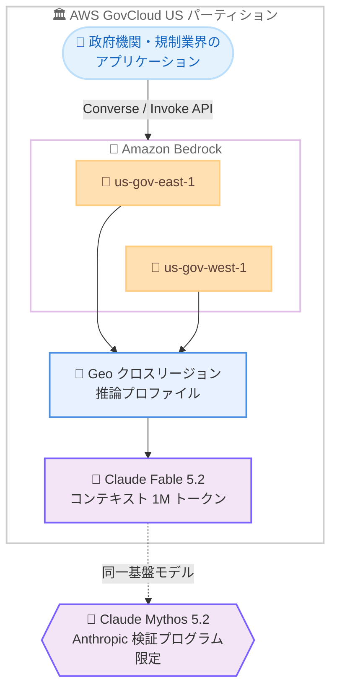

# Amazon Bedrock - Claude Fable 5.2 が AWS GovCloud (US) で利用可能に

**リリース日**: 2026 年 11 月 9 日
**サービス**: Amazon Bedrock、AWS GovCloud (US)
**機能**: Claude Fable 5.2 の AWS GovCloud (US) リージョンでの提供開始

📊 [このアップデートのインフォグラフィックを見る](https://takech9203.github.io/aws-news-summary/20261109-claude-fable-5-2-aws-govcloud.html)

## 概要

Anthropic の最も高性能な一般提供モデルである Claude Fable 5.2 が、AWS GovCloud (US) リージョンの Amazon Bedrock で利用可能になりました。これにより、米国政府機関や規制要件の厳しい業界のお客様が、コーディング、数学、科学分野で新しい水準を達成したフロンティアモデルをコンプライアンス要件を満たした環境で利用できます。Anthropic は、判断力、反復、正確性が重要なソフトウェアエンジニアリング、科学研究、金融などの分野での利用を推奨しています。

Claude Fable 5.2 は、数時間から数日に及ぶ無人での自律稼働が可能で、複数リポジトリやモノレポにまたがる大規模で曖昧なエンジニアリング課題に取り組み、作業しながら自己テストを行い、引き継いだ結論を疑う姿勢によって従来の Claude モデルが見逃していた根本原因を発見します。Anthropic のテストでは、リードエージェントとして数百のサブエージェントを調整し、再現しない結果にフラグを立てることが確認されています。

また、Claude Fable 5.2 と同じ基盤モデルでサイバーセキュリティおよびバイオ研究向けの能力を完全に保持した Claude Mythos 5.2 も、Anthropic の検証プログラムを通じて利用できます。なお、Anthropic は Fable 5.2 と Mythos 5.2 を「covered models」に指定しており、安全性モニタリングのためのデータ保持が必要です。Enterprise Frontier Safeguards が利用可能になるまで、対象のお客様はゼロデータ保持 (ZDR) で Fable 5.2 を利用できます。

**アップデート前の課題**

このアップデート以前に存在していた課題や制限は以下のとおりです。

- AWS GovCloud (US) では Claude Fable 5.2 が利用できず、政府機関や規制業界のお客様は Anthropic の最新フロンティアモデルを利用できなかった
- 最先端モデルを利用するには商用リージョンを使う必要があり、FedRAMP High や ITAR などの厳格なコンプライアンス要件を満たす環境との両立が困難だった
- 長時間の自律的なエージェント処理や大規模コードベースを対象とした技術作業では、従来モデルの能力に制約があった

**アップデート後の改善**

今回のアップデートにより可能になったことは以下のとおりです。

- AWS GovCloud (US) の 2 リージョン (us-gov-east-1、us-gov-west-1) で Claude Fable 5.2 を Geo クロスリージョン推論により利用可能になった
- 規制対象のワークロードでも、コーディング、数学、科学の最難関タスクに対応するフロンティアモデルを利用できるようになった
- サイバーセキュリティやバイオ研究向けの Claude Mythos 5.2 も、Anthropic の検証プログラムを通じて GovCloud で利用する道が開かれた

## アーキテクチャ図



AWS GovCloud (US) の 2 リージョンから Geo クロスリージョン推論プロファイルを通じて Claude Fable 5.2 を呼び出す構成です。リクエストは GovCloud パーティション内でルーティングされます。

## サービスアップデートの詳細

### 主要機能

1. **AWS GovCloud (US) での Claude Fable 5.2 提供**
   - us-gov-east-1 (GovCloud 東部) と us-gov-west-1 (GovCloud 西部) の両リージョンで利用可能
   - Geo クロスリージョン推論プロファイルを通じた提供 (In-Region 推論と Global 推論は非対応)
   - 規制対象のお客様が、商用リージョンと同じフロンティアモデルをコンプライアンス境界内で利用可能

2. **長時間の自律的な技術作業**
   - 数時間から数日に及ぶ無人稼働により、より大きく困難なプロジェクトに対応
   - 複数リポジトリやモノレポにまたがる、大規模で定義の曖昧なエンジニアリング課題に対応
   - 作業しながら自己テストを実施し、引き継いだ結論を疑うことで従来モデルが見逃した根本原因を発見
   - リードエージェントとして数百のサブエージェントを調整し、再現しない結果にフラグを立てる能力を確認済み

3. **コーディングを超えた適用領域**
   - 科学研究向けの新しい分析手法の開発
   - 定量的ファイナンス分野へのフロンティア推論の適用
   - 判断力、反復、正確性が重要な分野 (ソフトウェアエンジニアリング、科学研究、金融) を推奨用途として位置付け

4. **Claude Mythos 5.2 の提供 (検証プログラム限定)**
   - Claude Fable 5.2 と同一の基盤モデルで、サイバーセキュリティおよびバイオ研究向けの能力を完全に保持
   - Anthropic の検証プログラム (Cyber Verification Program など) を通じた許可リスト制で提供

5. **安全性分類器とデータ保持要件**
   - 高リスクなサイバーセキュリティ活動や研究バイオロジータスクをブロックする安全性分類器を搭載 (ブロック時は `stop_reason: "refusal"` と `stop_details` を返却)
   - covered model に指定されており、安全性モニタリングのため Data Retention API でデータ保持モードを `aws_review` に設定するオプトインが必要
   - Enterprise Frontier Safeguards の提供開始まで、対象のお客様はゼロデータ保持で利用可能

## 技術仕様

### モデル仕様

| 項目 | 詳細 |
|------|------|
| モデル ID | anthropic.claude-fable-5-2 |
| コンテキストウィンドウ | 1M トークン |
| 最大出力トークン | 128K |
| 知識カットオフ | 2026 年 6 月 |
| 入力モダリティ | テキスト、画像 |
| 出力モダリティ | テキスト |
| 推論 (Reasoning) | 適応的思考が常時有効 (無効化不可)。effort レベルは low / medium / high / xhigh / max (デフォルト: high) |
| サンプリングパラメータ | temperature は 1.0 または未指定。top_p は 0.99 または未指定。top_k は非対応 |
| 対応 API | Messages、Converse、Invoke (bedrock-runtime エンドポイント) |
| プロンプトキャッシュ | 対応 (最小 512 トークン、最大 4 チェックポイント、TTL は 5 分 / 1 時間) |
| 主な対応機能 | ストリーミング、Guardrails、Agents、Knowledge Base、Computer use、構造化出力 |
| サービスティア | Standard のみ (Priority / Flex / Reserved は非対応) |
| モデルライフサイクル | 2026 年 11 月 9 日提供開始、EOL は早くとも 2027 年 11 月 9 日以降 |

### API 変更履歴

本アップデートは既存の Amazon Bedrock Runtime API (Converse、InvokeModel、Messages) に新しいモデルを追加するもので、新規 API の追加はありません。既存のアプリケーションはモデル ID を変更するだけで移行できます。

### データ保持設定

Claude Fable 5.2 を利用するには、Data Retention API でデータ保持モードを `aws_review` に設定するオプトインが必要です。詳細は [Amazon Bedrock abuse detection](https://docs.aws.amazon.com/bedrock/latest/userguide/abuse-detection.html) を参照してください。

## 設定方法

### 前提条件

1. AWS GovCloud (US) アカウントを保有していること
2. Amazon Bedrock コンソールで Claude Fable 5.2 へのモデルアクセスを有効化していること
3. Data Retention API でデータ保持モードを設定していること (ゼロデータ保持の対象可否は AWS に確認)

### 手順

#### ステップ 1: 推論プロファイルの確認

```bash
aws bedrock list-inference-profiles \
  --region us-gov-west-1 \
  --query "inferenceProfileSummaries[?contains(inferenceProfileId, 'claude-fable-5-2')]"
```

GovCloud リージョンで利用可能な Claude Fable 5.2 の Geo クロスリージョン推論プロファイル ID を確認します。GovCloud では In-Region 推論ではなく推論プロファイル経由でモデルを呼び出します。

#### ステップ 2: Converse API でモデルを呼び出す

```bash
aws bedrock-runtime converse \
  --region us-gov-west-1 \
  --model-id "<ステップ 1 で確認した推論プロファイル ID>" \
  --messages '[{"role": "user", "content": [{"text": "Amazon Bedrock の特徴を説明してください"}]}]'
```

確認した推論プロファイル ID を指定して Converse API を呼び出します。既存の Converse / InvokeModel ベースのアプリケーションは、モデル ID の変更のみで移行できます。

#### ステップ 3: refusal 応答のハンドリングを実装する

Claude Fable 5.2 は安全性分類器により高リスクなリクエストをブロックすることがあります。その場合、HTTP 200 で `stop_reason: "refusal"` と制限カテゴリを含む `stop_details` が返却されるため、アプリケーション側で `stop_reason` を確認する処理を実装してください。サイバーセキュリティやバイオ研究の正当な用途では、Anthropic の検証プログラムを通じて制限の緩いアクセスを申請できます。

## メリット

### ビジネス面

- **規制対応とフロンティア AI の両立**: FedRAMP High などの厳格なコンプライアンス要件が求められる政府機関や規制業界でも、Anthropic の最も高性能な一般提供モデルを利用可能
- **商用リージョンとの同等性**: 2026 年 11 月 9 日に商用リージョンで提供開始されたモデルが同日に GovCloud でも利用可能となり、規制対象のお客様のモデル採用の遅延が解消
- **自律エージェントによる生産性向上**: 数時間から数日の無人稼働により、大規模プロジェクトを少ない人的介入で推進可能

### 技術面

- **1M トークンのコンテキストウィンドウ**: 複数リポジトリやモノレポ全体を対象とした大規模なコード理解・修正が可能
- **適応的思考と effort 制御**: low から max までの 5 段階の effort レベルで、タスクの難易度に応じた推論の深さとコストの調整が可能
- **プロンプトキャッシュ対応**: 繰り返し利用する大規模コンテキストのコストとレイテンシを削減 (TTL は 5 分 / 1 時間)
- **既存 API との互換性**: Converse / InvokeModel / Messages API をそのまま利用でき、移行はモデル ID の変更のみ

## デメリット・制約事項

### 制限事項

- GovCloud では Geo クロスリージョン推論のみの提供で、In-Region 推論と Global 推論は非対応
- サービスティアは Standard のみで、Priority / Flex / Reserved は非対応
- Count tokens API、Intelligent prompt routing、暗黙的プロンプトキャッシュは非対応
- temperature と top_p の自由な設定は不可 (temperature は 1.0 または未指定、top_k は非対応)
- 適応的思考は常時有効で無効化できない

### 考慮すべき点

- covered model のため、安全性モニタリング目的のデータ保持 (`aws_review` モード) へのオプトインが必要。ゼロデータ保持が必要な場合は、Enterprise Frontier Safeguards 提供までの対象顧客向け措置の適用可否を確認する
- 安全性分類器により高リスクなサイバーセキュリティ・バイオ関連リクエストはブロックされるため、`stop_reason: "refusal"` のハンドリング実装が必要
- サイバーセキュリティ研究などの正当な用途では、Claude Mythos 5.2 の利用に Anthropic の検証プログラムへの申請が必要
- 難しいタスクでは 1 リクエストが長時間になり得るため、タイムアウト設計とストリーミングの利用を検討する

## ユースケース

### ユースケース 1: 政府機関の大規模レガシーシステムのモダナイゼーション

**シナリオ**: 連邦政府機関が、複数リポジトリにまたがる大規模なレガシーコードベースのモダナイゼーションを、GovCloud のコンプライアンス境界内で実施する。

**実装例**:
```text
1. GovCloud 上の開発環境から Bedrock の Claude Fable 5.2 を呼び出すエージェントを構築
2. モノレポ全体を 1M トークンのコンテキストで解析し、依存関係と修正方針を特定
3. エージェントが修正、テスト、検証を自律的に反復し、人間はレビューに集中
```

**効果**: 機密性の高いコードを商用環境に出すことなく、フロンティアモデルによる長時間の自律的なエンジニアリング作業を実現。

### ユースケース 2: 規制業界における科学研究・定量分析

**シナリオ**: 政府系研究機関や金融規制対象の組織が、科学研究の分析手法開発や定量的ファイナンスの高度な推論に Claude Fable 5.2 を活用する。

**実装例**:
```text
1. 研究データや市場データを GovCloud 内の S3 と Bedrock Knowledge Base に配置
2. Claude Fable 5.2 に分析手法の設計と検証を依頼し、再現しない結果のフラグ付けを活用
3. effort レベルを high / xhigh に設定し、正確性が重要な分析の品質を確保
```

**効果**: データを規制境界内に保持したまま、新しい分析手法の開発とフロンティア水準の推論を利用可能。

### ユースケース 3: 防御的サイバーセキュリティへの Claude Mythos 5.2 の活用

**シナリオ**: 政府機関のセキュリティチームが、Anthropic の Cyber Verification Program を通じて Claude Mythos 5.2 を利用し、重要システムの脆弱性調査を実施する。

**実装例**:
```text
1. Anthropic の Cyber Verification Program に申請し、許可リストへの登録を受ける
2. GovCloud 上の Bedrock から Claude Mythos 5.2 を呼び出し、大規模コードベースの脆弱性を調査
3. 悪用可能性の実証を含む具体的な調査結果をもとに、脅威が顕在化する前に修正
```

**効果**: 完全なサイバー能力を保持したモデルにより、防御的セキュリティ業務を加速。

## 料金

Amazon Bedrock の Claude Fable 5.2 は、入出力トークン数に基づく従量課金です。プロンプトキャッシュを活用することで、繰り返し利用するコンテキストのコストを削減できます。最新の料金は [Amazon Bedrock の料金ページ](https://aws.amazon.com/bedrock/pricing/) を参照してください。

## 利用可能リージョン

- AWS GovCloud (US-East): us-gov-east-1 (Geo クロスリージョン推論)
- AWS GovCloud (US-West): us-gov-west-1 (Geo クロスリージョン推論)

商用リージョンでは、同日 (2026 年 11 月 9 日) に米国リージョンの Geo 推論および Global クロスリージョン推論での提供が開始されています。最新のリージョン対応状況は [リージョン別モデル対応表](https://docs.aws.amazon.com/bedrock/latest/userguide/models-region-compatibility.html#model-regions-anthropic) を参照してください。

## 関連サービス・機能

- **Amazon Bedrock**: Claude Fable 5.2 を提供する生成 AI アプリケーション構築のためのフルマネージドサービス
- **AWS GovCloud (US)**: 米国政府のコンプライアンス要件 (FedRAMP High、ITAR など) に対応した分離されたリージョン
- **Amazon Bedrock Guardrails**: Claude Fable 5.2 と組み合わせて利用できる、アプリケーション固有のセーフガード機能
- **Amazon Bedrock Agents / Knowledge Bases**: Claude Fable 5.2 を基盤としたエージェント構築と RAG 構成に対応

## 参考リンク

- 📊 [インフォグラフィック](https://takech9203.github.io/aws-news-summary/20261109-claude-fable-5-2-aws-govcloud.html)
- [公式発表 (What's New)](https://aws.amazon.com/about-aws/whats-new/2026/11/claude-fable-5-2-aws-govcloud/)
- [Claude Fable 5.2 モデルカード (Amazon Bedrock ドキュメント)](https://docs.aws.amazon.com/bedrock/latest/userguide/model-card-anthropic-claude-fable-5-2.html)
- [リージョン別モデル対応表](https://docs.aws.amazon.com/bedrock/latest/userguide/models-region-compatibility.html#model-regions-anthropic)
- [Amazon Bedrock abuse detection (データ保持の詳細)](https://docs.aws.amazon.com/bedrock/latest/userguide/abuse-detection.html)
- [Anthropic Cyber Verification Program](https://support.claude.com/en/articles/14604842-cyber-verification-program)
- [Amazon Bedrock 料金ページ](https://aws.amazon.com/bedrock/pricing/)

## まとめ

Claude Fable 5.2 の AWS GovCloud (US) 提供により、政府機関や規制業界のお客様が Anthropic の最も高性能な一般提供モデルをコンプライアンス境界内で利用できるようになりました。長時間の自律稼働と 1M トークンのコンテキストウィンドウにより、大規模なエンジニアリング、科学研究、金融分析での活用が期待できます。利用にあたっては、データ保持モードの設定 (covered model 要件) と `stop_reason: "refusal"` のハンドリングを確認した上で、まずは Bedrock コンソールでモデルアクセスを有効化して検証を開始することを推奨します。
