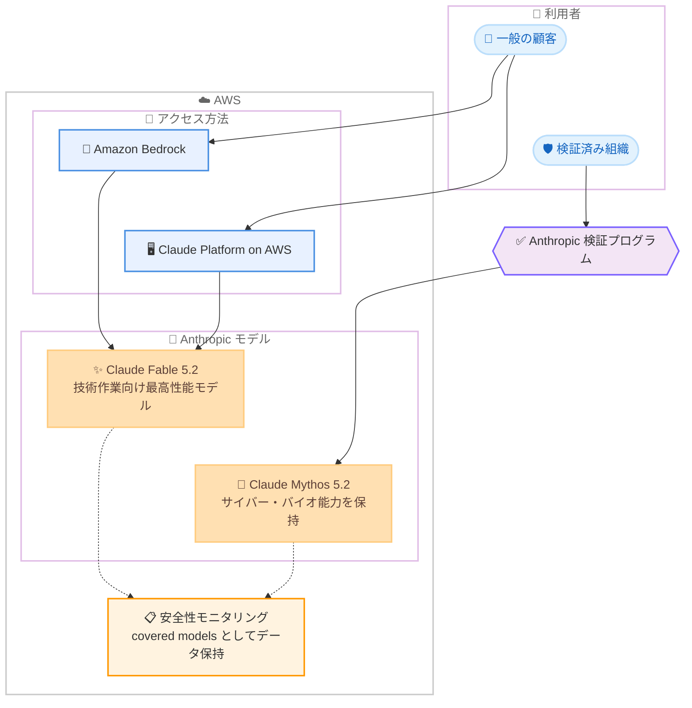

# Amazon Bedrock - Claude Fable 5.2 の AWS 提供開始

**リリース日**: 2026 年 11 月 9 日
**サービス**: Amazon Bedrock / Claude Platform on AWS
**機能**: Claude Fable 5.2 モデルの一般提供

📊 [このアップデートのインフォグラフィックを見る](https://takech9203.github.io/aws-news-summary/20261109-claude-fable-5-2-aws.html)

## 概要

Anthropic の Claude Fable 5.2 が AWS で利用可能になりました。Fable 5.2 は、技術的な作業向けとして Anthropic が一般提供する中で最も高性能なモデルであり、コーディング、数学、科学といった最難関のプロジェクトで新たな水準を達成しています。Anthropic は、判断力、反復、正確性が重要となるソフトウェアエンジニアリング、科学研究、金融などの分野での利用を推奨しています。

Fable 5.2 は数時間から最大数日間、無人で自律的に稼働でき、複数リポジトリやモノレポにまたがる大規模で定義が曖昧なエンジニアリング課題に取り組めます。作業しながら自身の成果をテストし、引き継いだ結論を疑う姿勢が強化されているため、従来の Claude モデルが見逃していた根本原因を発見できます。Anthropic のテストでは、リードエージェントとして数百のサブエージェントを調整し、再現しない結果にフラグを立てることが確認されています。

また、Fable 5.2 と同一の基盤モデルでありながら、サイバーセキュリティと生物学研究向けの完全なサイバー・バイオ能力を保持した Claude Mythos 5.2 も、Anthropic の検証プログラムを通じて利用可能です。顧客は Amazon Bedrock と Claude Platform on AWS の 2 つの方法で Claude Fable 5.2 にアクセスできます。

**アップデート前の課題**

- 以前の Claude モデルは、長時間の無人稼働や大規模プロジェクトの自律的な遂行に限界があった
- 複数リポジトリやモノレポにまたがる、定義が曖昧な大規模エンジニアリング課題への対応が難しかった
- 引き継いだ前提や結論をそのまま受け入れる傾向があり、根本原因の特定を見逃すケースがあった

**アップデート後の改善**

- 数時間から最大数日間の無人での自律稼働が可能になり、より大きく困難なプロジェクトに取り組めるようになった
- 作業中に自身の成果をテストし、リードエージェントとして数百のサブエージェントを調整できるようになった
- コーディング以外でも、科学研究向けの新しい分析手法の開発やクオンツ金融への最先端の推論適用が可能になった

## アーキテクチャ図



Claude Fable 5.2 へのアクセス経路と、検証プログラム経由でのみ利用できる Claude Mythos 5.2 の位置付けを示しています。両モデルは covered models として安全性モニタリングのためのデータ保持の対象です。

## サービスアップデートの詳細

### 主要機能

1. **長時間の自律稼働**
   - 数時間から最大数日間、無人で稼働し自律的に作業を推進
   - より大きく、より困難なプロジェクトへの対応が可能
   - 作業しながら自身の成果をテストし、品質を自己検証

2. **大規模エンジニアリング課題への対応**
   - 複数リポジトリやモノレポにまたがる、定義が曖昧な大規模課題に対応
   - 引き継いだ結論を疑う姿勢が強化され、従来モデルが見逃した根本原因を発見
   - リードエージェントとして数百のサブエージェントを調整し、再現しない結果にフラグを立てる能力を Anthropic のテストで確認

3. **コーディング以外の高度な活用**
   - 科学研究向けの新しい分析手法を開発
   - クオンツ金融に最先端の推論を適用
   - 判断力、反復、正確性が重要な分野 (ソフトウェアエンジニアリング、科学研究、金融) での利用を推奨

4. **Claude Mythos 5.2 の提供**
   - Fable 5.2 と同一の基盤モデル
   - サイバーセキュリティと生物学研究向けの完全なサイバー・バイオ能力を保持
   - Anthropic の検証プログラムを通じてのみ利用可能

## 技術仕様

### モデルとデータ保持ポリシー

| 項目 | 詳細 |
|------|------|
| モデル名 | Claude Fable 5.2 / Claude Mythos 5.2 |
| 推奨分野 | ソフトウェアエンジニアリング、科学研究、金融 |
| アクセス方法 | Amazon Bedrock、Claude Platform on AWS |
| Mythos 5.2 の利用条件 | Anthropic の検証プログラムによる許可 |
| データ保持 | covered models に指定され、安全性モニタリングのためのデータ保持が必要 |
| ゼロデータ保持 | Enterprise Frontier Safeguards の提供開始まで、対象顧客は zero data retention で Fable 5.2 を利用可能 |

データ保持の詳細は Amazon Bedrock の [abuse detection](https://docs.aws.amazon.com/bedrock/latest/userguide/abuse-detection.html) ページを参照してください。

## 設定方法

### 前提条件

1. AWS アカウントと Amazon Bedrock へのアクセス権限
2. Amazon Bedrock コンソールでの Anthropic モデルへのモデルアクセス有効化
3. 利用するリージョンでのモデル提供状況の確認 ([リージョン対応状況](https://docs.aws.amazon.com/bedrock/latest/userguide/models-region-compatibility.html#model-regions-anthropic))

### 手順

#### ステップ 1: モデルアクセスの有効化

Amazon Bedrock コンソールの [Model access] から Anthropic の Claude Fable 5.2 へのアクセスをリクエストします。モデルアクセスが有効になると、API 経由でモデルを呼び出せるようになります。

#### ステップ 2: 利用可能なモデルの確認

```bash
aws bedrock list-foundation-models \
  --by-provider anthropic \
  --query "modelSummaries[].modelId"
```

Amazon Bedrock で利用可能な Anthropic モデルの一覧を取得し、Claude Fable 5.2 のモデル ID を確認します。

#### ステップ 3: モデルの呼び出し

```bash
aws bedrock-runtime converse \
  --model-id <Claude Fable 5.2 のモデル ID> \
  --messages '[{"role":"user","content":[{"text":"こんにちは"}]}]'
```

Converse API を使用して Claude Fable 5.2 にリクエストを送信し、応答を確認します。モデル ID はモデルカードのドキュメントで確認してください。

## メリット

### ビジネス面

- **大規模プロジェクトの推進**: 数日間の無人稼働により、人手では時間のかかる大規模な技術プロジェクトを自律的に進められる
- **専門分野での活用**: 科学研究やクオンツ金融など、判断力と正確性が求められる分野で最先端の推論を活用できる
- **柔軟なアクセス方法**: Amazon Bedrock と Claude Platform on AWS の 2 つの経路から、既存の AWS 環境に合わせて選択できる

### 技術面

- **自己検証能力**: 作業しながら自身の成果をテストするため、成果物の品質が向上する
- **根本原因の発見**: 引き継いだ結論を疑う姿勢により、従来モデルが見逃した根本原因を特定できる
- **マルチエージェント構成**: リードエージェントとして数百のサブエージェントを調整でき、大規模なエージェントワークフローを構築できる

## デメリット・制約事項

### 制限事項

- Fable 5.2 と Mythos 5.2 は covered models に指定されており、安全性モニタリングのためのデータ保持が必要
- Claude Mythos 5.2 は Anthropic の検証プログラムで許可された組織のみ利用可能
- 利用可能なリージョンはモデルごとに異なるため、リージョン対応状況の確認が必要

### 考慮すべき点

- ゼロデータ保持を利用できるのは対象となる顧客のみで、Enterprise Frontier Safeguards の提供開始までの暫定措置である
- データ保持ポリシーの詳細は Amazon Bedrock の abuse detection ページで確認が必要
- 長時間の自律稼働を行う場合は、コスト管理とガードレールの設計を事前に検討する必要がある

## ユースケース

### ユースケース 1: 大規模コードベースの自律的なリファクタリング

**シナリオ**: 複数リポジトリやモノレポにまたがる大規模なエンジニアリング課題に対し、エージェントに長時間の自律作業を任せたい。

**実装例**:
```
1. Amazon Bedrock で Claude Fable 5.2 のモデルアクセスを有効化
2. エージェントフレームワークのモデルとして Fable 5.2 を指定
3. 複数リポジトリを対象とした改善タスクを定義し、テスト実行を含む作業を委任
```

**効果**: モデルが作業しながら自身の成果をテストし、根本原因を特定しながら大規模な課題を自律的に解決する。

### ユースケース 2: マルチエージェントによる調査・分析パイプライン

**シナリオ**: リードエージェントが多数のサブエージェントを調整し、調査や分析を並列に進める構成を構築したい。

**実装例**:
```
1. リードエージェントのモデルとして Claude Fable 5.2 を設定
2. サブエージェントにタスクを分配するオーケストレーションを実装
3. 再現性のない結果をフラグする検証ステップを組み込む
```

**効果**: Anthropic のテストで確認されたとおり、数百のサブエージェントの調整と結果の検証を単一のリードエージェントで実現できる。

### ユースケース 3: 科学研究・金融分野での高度な分析

**シナリオ**: 科学研究の分析手法開発や、クオンツ金融での高度な推論にフロンティアモデルを活用したい。

**実装例**:
```
1. Claude Platform on AWS または Amazon Bedrock で Fable 5.2 を利用
2. 研究データや金融データに対する分析タスクを定義
3. 反復的な検証を含むワークフローを構築
```

**効果**: 判断力、反復、正確性が重要な分野で、新しい分析手法の開発や最先端の推論を活用できる。

## 料金

今回の発表には具体的な料金情報は含まれていません。Claude Fable 5.2 の料金は Amazon Bedrock の料金ページで確認してください。

- [Amazon Bedrock 料金](https://aws.amazon.com/bedrock/pricing/)

## 利用可能リージョン

利用可能なリージョンは Amazon Bedrock のドキュメントで公開されています。詳細は [リージョン対応状況](https://docs.aws.amazon.com/bedrock/latest/userguide/models-region-compatibility.html#model-regions-anthropic) を参照してください。なお、同日に AWS GovCloud (US) での提供も別途発表されています。

## 関連サービス・機能

- **Amazon Bedrock**: Claude Fable 5.2 へのアクセス経路の 1 つで、フルマネージドな基盤モデルサービス
- **Claude Platform on AWS**: Claude Fable 5.2 へのもう 1 つのアクセス経路で、AWS 上で Claude Platform を利用できる
- **Claude Mythos 5.2**: Fable 5.2 と同一の基盤モデルで、サイバー・バイオ能力を保持。Anthropic の検証プログラム経由で利用可能

## 参考リンク

- 📊 [インフォグラフィック](https://takech9203.github.io/aws-news-summary/20261109-claude-fable-5-2-aws.html)
- [公式発表 (What's New)](https://aws.amazon.com/about-aws/whats-new/2026/11/claude-fable-5-2-aws/)
- [Amazon Bedrock モデルカード](https://docs.aws.amazon.com/bedrock/latest/userguide/model-card-anthropic-claude-fable-5-2.html)
- [リージョン対応状況](https://docs.aws.amazon.com/bedrock/latest/userguide/models-region-compatibility.html#model-regions-anthropic)
- [Claude Platform on AWS ドキュメント](https://docs.aws.amazon.com/claude-platform/latest/userguide/welcome.html)
- [Amazon Bedrock abuse detection](https://docs.aws.amazon.com/bedrock/latest/userguide/abuse-detection.html)

## まとめ

Claude Fable 5.2 は、長時間の自律稼働と大規模エンジニアリング課題への対応力を備えた、Anthropic の技術作業向け最高性能モデルです。Amazon Bedrock と Claude Platform on AWS の 2 つの経路で利用できるため、エージェントワークフローや高度な分析への活用を検討しているチームは、モデルカードとリージョン対応状況を確認した上で評価を開始することを推奨します。covered models としてのデータ保持ポリシーについても、abuse detection ページで事前に確認してください。
