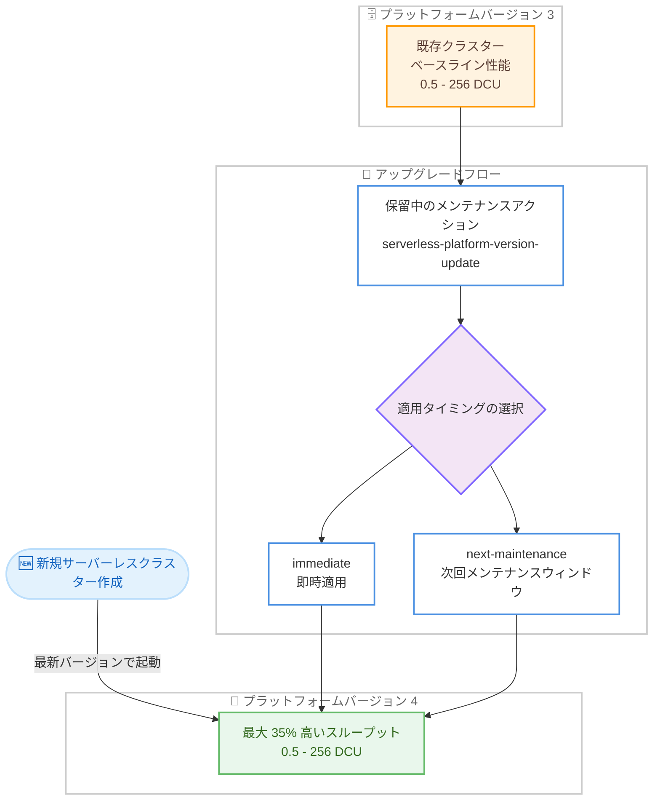

# Amazon DocumentDB - Serverless プラットフォームバージョン 4 による最大 35% のスループット向上

**リリース日**: 2026 年 11 月 9 日
**サービス**: Amazon DocumentDB (with MongoDB compatibility)
**機能**: Amazon DocumentDB Serverless プラットフォームバージョン 4

📊 [このアップデートのインフォグラフィックを見る](https://takech9203.github.io/aws-news-summary/20261109-documentdb-serverless-platform-version-4.html)

## 概要

Amazon DocumentDB Serverless に新しいプラットフォームバージョン 4 が登場し、プラットフォームバージョン 3 と比較して最大 35% 高いスループットを提供するようになりました。プラットフォームバージョンは、性能、スケーリング機能、または機能面での改善を表すもので、クラスターレベルで自動的に管理されます。

新規に作成するサーバーレスクラスターは、利用するリージョンで提供されている最新のプラットフォームバージョンで起動します。プラットフォームバージョン 3 で稼働中の既存クラスターは、保留中のメンテナンスアクション `serverless-platform-version-update` を適用することでバージョン 4 にアップグレードできます。適用タイミングは「即時」または「次回のメンテナンスウィンドウ」から選択でき、ユーザーがアップグレードのタイミングを制御できます。

変動の大きいワークロードを DocumentDB Serverless で運用しているユーザーにとって、アプリケーション側の変更なしに同じ DCU 容量レンジのままスループットが向上するため、コストパフォーマンスの改善が期待できるアップデートです。

**アップデート前の課題**

- プラットフォームバージョン 3 のベースライン性能が、サーバーレスクラスターのスループットの上限であった
- 同じワークロードをさばくために、より多くの DCU (DocumentDB Capacity Unit) を消費する必要があり、スパイク時のコストが増加しやすかった
- プラットフォームレベルの性能改善を既存クラスターに取り込む標準的な手段が提供されていなかった

**アップデート後の改善**

- プラットフォームバージョン 4 により、最大 35% 高いスループットを同じ DCU レンジ (0.5 - 256 DCU) で利用できるようになった
- 既存のバージョン 3 クラスターは、保留中のメンテナンスアクションを適用するだけでバージョン 4 にアップグレードできるようになった
- アップグレードの適用タイミング (即時または次回メンテナンスウィンドウ) をユーザーが制御できるようになった
- AWS Management Console の設定タブや `DescribeDBClusters` API の `ServerlessV2PlatformVersion` フィールドで、クラスターのプラットフォームバージョンを確認できるようになった

## アーキテクチャ図



新規クラスターは自動的に最新のプラットフォームバージョン 4 で起動し、既存のバージョン 3 クラスターはメンテナンスアクションの適用により任意のタイミングでアップグレードできる流れを示しています。

## サービスアップデートの詳細

### 主要機能

1. **最大 35% のスループット向上**
   - プラットフォームバージョン 4 は、バージョン 3 と比較して最大 35% 高いスループットを提供する
   - DCU のレンジはバージョン 3 と同じ 0.5 - 256 DCU のまま、性能のみが向上する
   - アプリケーションコードや接続文字列の変更は不要

2. **クラスターレベルでの自動管理**
   - プラットフォームバージョンは Amazon DocumentDB がクラスターレベルで自動的に管理する
   - 新規サーバーレスクラスターは、リージョンで利用可能な最新プラットフォームバージョンで起動する
   - クラスターのバージョンはコンソールの設定タブ、または `DescribeDBClusters` API の `ServerlessV2PlatformVersion` フィールドで確認できる

3. **ユーザー制御によるアップグレード**
   - 既存のバージョン 3 クラスターには `serverless-platform-version-update` という保留中のメンテナンスアクションが表示される
   - 適用タイミングは `immediate` (即時) または `next-maintenance` (次回メンテナンスウィンドウ) から選択できる
   - 一度新しいプラットフォームバージョンにアップグレードすると、以前のバージョンにダウングレードすることはできない

4. **プラットフォームバージョン確認用の新 API**
   - 新しい `DescribeServerlessV2PlatformVersions` API により、利用可能なプラットフォームバージョンとその機能 (DCU レンジ、デフォルトバージョンなど) を確認できる

## 技術仕様

### プラットフォームバージョンの比較

| プラットフォームバージョン | DCU レンジ | 性能 |
|------|------|------|
| 3 | 0.5 - 256 | ベースライン性能 |
| 4 | 0.5 - 256 | バージョン 3 比で最大 35% 高いスループット |

### DocumentDB Serverless の基本仕様

| 項目 | 詳細 |
|------|------|
| 容量の単位 | DCU (DocumentDB Capacity Unit)。1 DCU は約 2 GiB のメモリと対応する CPU、ネットワークの組み合わせ |
| 対応エンジンバージョン | Amazon DocumentDB 5.0 および 8.0 |
| 容量レンジ | 0.5 - 256 DCU |
| スケーリング単位 | 最小 0.5 DCU 単位の増分 |
| アイドル状態 | MinCapacity が 0.5 の場合、アイドル時に 0.5 DCU までスケールダウン |
| バージョン確認方法 | コンソールの設定タブ、または `DescribeDBClusters` の `ServerlessV2PlatformVersion` フィールド |

### API 変更履歴

| 日付 | サービス | 変更内容 |
|------|----------|----------|
| 2026/10/30 | [Amazon DocumentDB with MongoDB compatibility](https://awsapichanges.com/archive/changes/c2b1d5-rds.html) | 1 new 9 updated api methods - `DescribeServerlessV2PlatformVersions` API が追加され、`CreateDBCluster` や `DescribeDBClusters` などの DBCluster 関連 API レスポンスに `ServerlessV2PlatformVersion` フィールドが追加された |

## 設定方法

### 前提条件

1. Amazon DocumentDB Serverless クラスター (エンジンバージョン 5.0 または 8.0) が稼働していること
2. 利用リージョンでプラットフォームバージョン 4 が提供されていること
3. AWS CLI または AWS Management Console へのアクセス権限があること

### 手順

#### ステップ1: 現在のプラットフォームバージョンを確認する

```bash
aws docdb describe-db-clusters \
    --db-cluster-identifier sample-cluster \
    --query 'DBClusters[0].ServerlessV2PlatformVersion'
```

`describe-db-clusters` コマンドで、対象クラスターの現在のプラットフォームバージョンを確認します。出力が `"3"` の場合はアップグレード対象です。コンソールではクラスター詳細ページの設定タブに表示されます。

#### ステップ2: デフォルトのプラットフォームバージョンを確認する

```bash
aws docdb describe-serverless-v2-platform-versions \
    --engine docdb \
    --default-only
```

新しい `describe-serverless-v2-platform-versions` コマンドで、リージョンのデフォルトプラットフォームバージョンと、その DCU レンジや説明を確認します。バージョン 4 では「Version 4 offering scaling up to 256 DCUs, and performance improvement up to 35% compared to version 3」という説明が返されます。

#### ステップ3: 保留中のメンテナンスアクションを確認する

```bash
aws docdb describe-pending-maintenance-actions \
    --resource-identifier arn:aws:rds:ap-northeast-1:111122223333:cluster:sample-cluster
```

`describe-pending-maintenance-actions` コマンドで、クラスターに `serverless-platform-version-update` アクションが保留されているかを確認します。保留中の場合、`Upgrade to platform version 4` という説明が表示されます。

#### ステップ4: アップグレードを適用する

```bash
aws docdb apply-pending-maintenance-action \
    --resource-identifier arn:aws:rds:ap-northeast-1:111122223333:cluster:sample-cluster \
    --apply-action serverless-platform-version-update \
    --opt-in-type immediate
```

`apply-pending-maintenance-action` コマンドでプラットフォームバージョンのアップグレードを適用します。`--opt-in-type` に `immediate` を指定すると即時適用、`next-maintenance` を指定すると次回のメンテナンスウィンドウで適用されます。

## メリット

### ビジネス面

- **コスト効率の向上**: 同じ DCU 消費でより多くのスループットを処理できるため、スパイク時の DCU 消費が抑えられ、DCU 時間ベースの課金コストの削減が期待できる
- **追加料金なしの性能向上**: プラットフォームバージョンのアップグレードに追加料金は発生せず、既存の料金体系のまま性能改善を享受できる
- **計画的な適用が可能**: 即時適用と次回メンテナンスウィンドウ適用を選択できるため、業務影響を考慮した計画的なアップグレードができる

### 技術面

- **アプリケーション変更不要**: 接続文字列やアプリケーションコードの変更なしに、最大 35% のスループット向上を得られる
- **運用の自動化**: 新規クラスターは自動的に最新プラットフォームバージョンで起動するため、個別の設定が不要
- **可視性の向上**: `ServerlessV2PlatformVersion` フィールドと `DescribeServerlessV2PlatformVersions` API により、バージョン管理の状態を API で把握できる

## デメリット・制約事項

### 制限事項

- 一度新しいプラットフォームバージョンにアップグレードすると、以前のバージョンへのダウングレードはできない
- プラットフォームバージョン 4 は一部のリージョンでは提供されていない (バージョン 3 は DocumentDB Serverless 対応の全リージョンで提供)
- スループット向上は「最大 35%」であり、実際の向上幅はワークロードの特性に依存する

### 考慮すべき点

- アップグレードはメンテナンスアクションとして適用されるため、本番環境では事前にステージング環境での動作確認と、メンテナンスウィンドウでの適用を検討する
- ダウングレードできないため、適用前にアプリケーションの互換性テストを実施しておくことが望ましい
- アップグレード後は CloudWatch メトリクスの `ServerlessDatabaseCapacity` と `DCUUtilization` を監視し、DCU 消費の変化を確認するとよい

## ユースケース

### ユースケース1: 高トラフィックな EC サイトのピーク対策

**シナリオ**: プロモーションイベント時にアクセスが急増する EC サイトで、DocumentDB Serverless がピーク時に MaxCapacity 付近まで頻繁にスケールアップしている。

**実装例**:
```bash
# バージョン 4 へアップグレード後、DCU 使用率を監視
aws cloudwatch get-metric-statistics \
    --namespace AWS/DocDB \
    --metric-name DCUUtilization \
    --dimensions Name=DBClusterIdentifier,Value=sample-cluster \
    --start-time 2026-11-09T00:00:00Z \
    --end-time 2026-11-10T00:00:00Z \
    --period 3600 \
    --statistics Average Maximum
```

**効果**: 最大 35% のスループット向上により、同じ DCU 容量でより多くのリクエストを処理でき、ピーク時の MaxCapacity 到達によるパフォーマンス低下リスクを軽減できる。

### ユースケース2: DCU コストの最適化

**シナリオ**: 変動の大きい分析系ワークロードを DocumentDB Serverless で運用しており、月間の DCU 時間コストを削減したい。

**実装例**:
```bash
# メンテナンスウィンドウでの計画的なアップグレード
aws docdb apply-pending-maintenance-action \
    --resource-identifier arn:aws:rds:ap-northeast-1:111122223333:cluster:analytics-cluster \
    --apply-action serverless-platform-version-update \
    --opt-in-type next-maintenance
```

**効果**: 同一ワークロードをより少ない DCU で処理できるようになり、DCU 時間ベースの課金コストの削減が期待できる。業務時間外のメンテナンスウィンドウで適用することで、業務影響も最小化できる。

### ユースケース3: 複数クラスターの一括バージョン管理

**シナリオ**: 複数の DocumentDB Serverless クラスターを運用しており、各クラスターのプラットフォームバージョンの状態を把握して計画的にアップグレードしたい。

**実装例**:
```bash
# 全クラスターのプラットフォームバージョンを一覧表示
aws docdb describe-db-clusters \
    --query 'DBClusters[?ServerlessV2PlatformVersion!=`null`].{Cluster:DBClusterIdentifier,PlatformVersion:ServerlessV2PlatformVersion}' \
    --output table

# 保留中のメンテナンスアクションを一覧表示
aws docdb describe-pending-maintenance-actions
```

**効果**: 組織内のクラスターのバージョン状態を API で可視化し、アップグレード計画の立案と進捗管理を効率化できる。

## 料金

プラットフォームバージョン 4 の利用に追加料金は発生しません。DocumentDB Serverless の料金は従来どおり DCU 時間 (DCU-hour) ベースで課金されます。クラスター内のライターとリーダーの合計数を n とすると、無負荷時はおよそ n × MinCapacity、フル稼働時でも最大 n × MaxCapacity の DCU を消費します。

スループット向上により同じワークロードを少ない DCU で処理できる場合、実質的なコスト削減につながる可能性があります。詳細は [Amazon DocumentDB 料金ページ](https://aws.amazon.com/documentdb/pricing/) を参照してください。

## 利用可能リージョン

プラットフォームバージョン 4 は以下の AWS リージョンで利用できます (2026 年 11 月時点のドキュメント記載)。

米国東部 (バージニア北部)、米国東部 (オハイオ)、米国西部 (オレゴン)、アフリカ (ケープタウン)、アジアパシフィック (香港)、アジアパシフィック (ハイデラバード)、アジアパシフィック (ジャカルタ)、アジアパシフィック (マレーシア)、アジアパシフィック (ムンバイ)、アジアパシフィック (ニュージーランド)、アジアパシフィック (大阪)、アジアパシフィック (ソウル)、アジアパシフィック (シンガポール)、アジアパシフィック (シドニー)、アジアパシフィック (タイ)、アジアパシフィック (東京)、カナダ (中部)、中国 (北京)、中国 (寧夏)、欧州 (フランクフルト)、欧州 (アイルランド)、欧州 (ロンドン)、欧州 (ミラノ)、欧州 (パリ)、欧州 (スペイン)、欧州 (ストックホルム)、欧州 (チューリッヒ)、メキシコ (中部)、南米 (サンパウロ)、AWS GovCloud (米国東部)、AWS GovCloud (米国西部)

プラットフォームバージョン 3 は、DocumentDB Serverless がサポートされるすべての AWS リージョンで利用できます。

## 関連サービス・機能

- **Amazon DocumentDB Serverless**: 変動の大きいワークロード向けに、0.5 - 256 DCU の範囲で自動的にコンピューティング容量をスケーリングするデプロイオプション。今回のアップデートの対象機能
- **Amazon Aurora Serverless v2**: 同様のプラットフォームバージョンの概念を持つリレーショナルデータベースのサーバーレスオプション。DocumentDB Serverless と同じ設計思想に基づく
- **Amazon CloudWatch**: `ServerlessDatabaseCapacity` および `DCUUtilization` メトリクスにより、アップグレード前後の DCU 消費の変化を監視できる

## 参考リンク

- 📊 [インフォグラフィック](https://takech9203.github.io/aws-news-summary/20261109-documentdb-serverless-platform-version-4.html)
- [公式発表 (What's New)](https://aws.amazon.com/about-aws/whats-new/2026/11/documentdb-serverless-platform-version-4/)
- [ドキュメント: Amazon DocumentDB serverless scaling capacity](https://docs.aws.amazon.com/documentdb/latest/developerguide/docdb-serverless-how-it-works.html#docdb-serverless-scaling-capacity)
- [ドキュメント: Checking and upgrading the platform version of a serverless cluster](https://docs.aws.amazon.com/documentdb/latest/developerguide/docdb-serverless-managing.html#docdb-serverless-platform-version)
- [料金ページ](https://aws.amazon.com/documentdb/pricing/)

## まとめ

Amazon DocumentDB Serverless のプラットフォームバージョン 4 は、追加料金なし・アプリケーション変更なしで最大 35% のスループット向上をもたらすアップデートです。既存のバージョン 3 クラスターを運用している場合は、まず `describe-pending-maintenance-actions` で保留中のアップグレードを確認し、ステージング環境での検証を経て、メンテナンスウィンドウでの計画的な適用を推奨します。ダウングレードはできないため、適用前の互換性確認を忘れずに実施してください。
