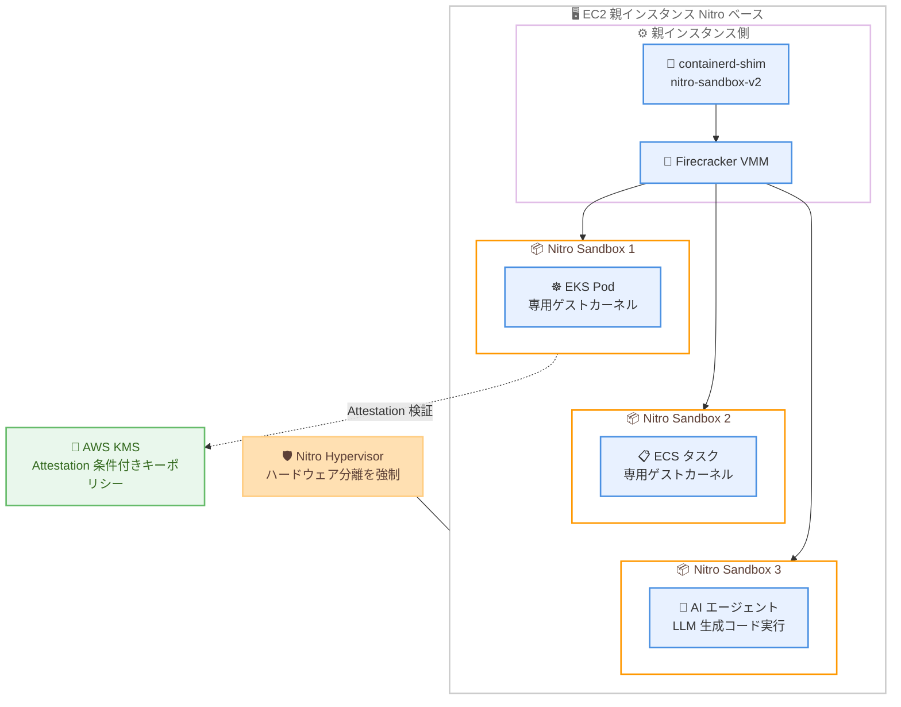

# AWS Nitro Sandboxes - Amazon EKS、ECS、EC2 でのハードウェア分離された Pod、タスク、VM

**リリース日**: 2026 年 11 月 9 日
**サービス**: Amazon EC2 / Amazon EKS / Amazon ECS (AWS Nitro System)
**機能**: AWS Nitro Sandboxes (ハードウェア分離された軽量 VM)

📊 [このアップデートのインフォグラフィックを見る](https://takech9203.github.io/aws-news-summary/20261109-nitro-sandboxes-eks-ecs-ec2.html)

## 概要

AWS Nitro Sandboxes が、Nitro Hypervisor によって管理される軽量 VM として利用可能になりました。Amazon EKS の Pod、Amazon ECS のタスク、または軽量 VM (その中で動作する AI エージェントを含む) を、AWS Nitro System によるハードウェア分離された専用の仮想マシン内で実行できます。各ワークロードは Nitro の分離された仮想マシンと同等の分離境界を持つため、信頼できないコード、マルチテナント、または規制対象のワークロードを単一の EC2 インスタンスのリソース内で安全に実行できます。

Nitro Sandboxes は EC2 インスタンス上でネイティブに近い EC2 パフォーマンスで動作し、Nitro Hypervisor の分離を継承します。さらに暗号学的な Attestation (構成証明) によってワークロードの完全性を検証できるため、整合性を証明した Nitro Sandbox にのみシークレットを解放する構成が可能です。LLM が生成したコードを専用の分離環境で安全に実行しながら、単一の EC2 インスタンスを複数のエージェントワークロードで安全に共有することで、使用率の向上とコンピューティングコストの削減を両立できます。

EKS または ECS での Nitro Sandboxes の有効化は 1 行の変更で済み、各 Pod やタスクが専用の VM を取得します。ワークロードは完全にネイティブのままで、Pod Identity、VPC CNI、EBS/EFS/S3 ストレージ、CloudWatch がそのまま動作します。完全な制御が必要な場合は、独自の AMI、オーケストレーション、仮想マシンモニター (VMM) を使って EC2 上で直接 Nitro Sandboxes を実行できます。Amazon Linux と Firecracker がネイティブにサポートされており、その他の選択肢向けのパッチも提供されています。マルチテナント SaaS、AI エージェント基盤、規制産業のワークロードを運用するユーザーが主な対象です。

**アップデート前の課題**

- コンテナや Pod は同一ノード上で Linux カーネルを共有するため、コンテナエスケープやカーネル脆弱性によって別のワークロードへ影響が波及するリスクがあった
- VM レベルの分離が必要な場合、ワークロードごとに個別の EC2 インスタンスを割り当てるか、オーバーヘッドの大きいネスト仮想化を使う必要があり、コストと使用率の面で非効率だった
- LLM が生成したコードや信頼できないコードを実行する際、ハードウェアレベルの分離境界をコンテナ単位で手軽に適用する手段がなかった

**アップデート後の改善**

- EKS Pod、ECS タスク、軽量 VM のそれぞれに、Nitro Hypervisor が強制するハードウェア分離境界を付与できるようになった
- 単一の EC2 インスタンスを複数のワークロードで安全に共有できるため、分離性を保ちながら使用率向上とコスト削減が可能になった
- 暗号学的な Attestation により、完全性を証明したワークロードにのみシークレットを解放する構成 (AWS KMS キーポリシー条件) が可能になった
- EKS / ECS では 1 行の変更で有効化でき、Pod Identity、VPC CNI、EBS/EFS/S3、CloudWatch などの既存機能がそのまま動作する

## アーキテクチャ図



単一の EC2 親インスタンス上で、各 Pod、タスク、エージェントがそれぞれ専用の Nitro Sandbox (軽量 VM) 内で動作し、Nitro Hypervisor がサンドボックス間および親インスタンスとの間のハードウェア分離を強制する構成です。Confidential モードでは、Attestation の測定値を AWS KMS キーポリシーで検証し、整合性を証明したサンドボックスにのみシークレットを解放できます。

## サービスアップデートの詳細

### 主要機能

1. **Nitro Hypervisor によるハードウェア分離**
   - 各 Nitro Sandbox は親インスタンスと並行して動作する第 1 レベルのハードウェア仮想化ゲスト (子 VM) として実行され、エミュレーションやネスト仮想化を使用しない
   - 親インスタンスが vCPU、メモリ、I/O を提供し、Nitro System が分離境界を強制する。サンドボックス内で何が実行されても、他のサンドボックスや親インスタンスにはアクセスできない
   - ゲスト OS に境界の維持を依存せず、AWS が維持・パッチ適用する最小化されたハイパーバイザーである Nitro を信頼モデルの基盤とする。親インスタンスの運用者 (自組織のオペレーター) からもワークロードを分離できる
   - Intel、AMD、AWS Graviton プロセッサで動作する

2. **Confidential モードと Direct モード**
   - **Confidential モード (デフォルト)**: Nitro System がサンドボックスのメモリを親インスタンスの外に移動し、親からメモリを読み取れない。Nitro Security Module (NSM) による Attestation を提供し、virtio デバイスキューは専用の共有メモリ領域を使用する。シークレットを扱うワークロードに推奨
   - **Direct モード**: 親がサンドボックスのメモリを共有し、Attestation はない。構成がシンプルで I/O スループットが高く、信頼モデルは標準的なネスト VM と同等。親とサンドボックスを同一の信頼できる主体が運用する場合に使用
   - モードはサンドボックス作成時に選択し、実行中は変更できない

3. **暗号学的 Attestation によるシークレット保護**
   - サンドボックスは起動時に内容を NSM に測定し、ワークロードが改変されていないコードを実行していることを証明できる
   - AWS KMS キーポリシーに `kms:RecipientAttestation:PCR<PCR_ID>` 条件を追加することで、測定値が期待値と一致するサンドボックスにのみデータキーを解放できる。親インスタンスは測定値を偽造できない

4. **EKS の Isolated / Confidential Pod**
   - Pod spec の `runtimeClassName` に `isolated-sandbox` または `confidential-sandbox` を設定するだけで Pod 単位でオプトイン有効化できる
   - 親インスタンス上のシム (`containerd-shim-nitro-sandbox-v2`) が Pod 用の Firecracker microVM を起動し、サンドボックス内のエージェントが専用の `containerd` でコンテナを管理する
   - Cedar ポリシーによりコンテナの受け入れ、`exec` アクセス、ログストリーミングなどのランタイム操作を制御。ポリシーは Attestation レジスタに測定される
   - OCI 仕様に準拠したコンテナイメージ暗号化 (サンドボックス内で AWS KMS により復号) と、AWS Signer によるイメージ署名検証をサポート
   - Pod Identity、VPC CNI、EBS/EFS CSI ドライバー、CloudWatch などの EKS ネイティブ機能がそのまま動作する
   - `sandbox.amazonaws.com/network-isolated: "true"` アノテーションにより、ネットワークデバイスを持たないサンドボックスを起動し、生成コードのネットワークアクセスを遮断できる

5. **ECS Managed Instances の Isolated / Confidential タスク**
   - Amazon ECS Managed Instances の信頼実行機能として提供され、各タスクが Nitro Hypervisor 管理の専用軽量 VM 内で動作する
   - 侵害されたタスクが別のタスクのデータにアクセスできないという AWS Fargate と同様の分離保証を実現しつつ、EC2 インスタンスタイプの選択、ビンパッキングによる複数タスクの集約、キャパシティ予約といった Managed Instances の柔軟性を維持できる

6. **EC2 での直接利用 (セルフマネージド)**
   - 独自の AMI、オーケストレーション、VMM で Nitro Sandboxes を直接制御できる。Amazon Linux と Firecracker がネイティブサポートされ、QEMU などその他の VMM 向けパッチも提供されている
   - Firecracker は KVM microVM の代替として、親インスタンスの Nitro Enclaves ドライバーを使って標準の virtio-pci デバイスモデルを持つサンドボックスを作成・起動する
   - ゲストは通常の virtio-pci デバイスを認識するため、サンドボックス固有のコードは不要

## 技術仕様

### Nitro Sandboxes の主な仕様

| 項目 | 詳細 |
|------|------|
| 分離方式 | Nitro Hypervisor による第 1 レベルのハードウェア仮想化 (ネスト仮想化ではない) |
| モード | Confidential (デフォルト、Attestation あり) / Direct (Attestation なし、高 I/O スループット) |
| 対応プロセッサ | Intel、AMD、AWS Graviton |
| 対応インスタンス | AWS Nitro Enclaves をサポートするインスタンスタイプ (M5 - M9g、C5 - C9gd、R5 - R9gd、X2 系、I 系、G5/G6/G7 系など。最小サイズと metal は除外が多い) |
| vCPU 上限 | 全サンドボックスの合計 vCPU がインスタンスの vCPU 数の 5 倍まで (例: 4 vCPU インスタンスなら合計 20 vCPU) |
| メモリ | 起動時に親から全量を提供 (オーバーコミットなし)。終了時に親へ返却 |
| ブロックストレージ | virtio-blk (インスタンスストア / Amazon EBS)。実行中のリサイズ可。同時にアタッチできるのは 1 サンドボックスのみ |
| ネットワーク | virtio-net による VPC 接続と IMDS アクセス。サンドボックスごとに独立したネットワークスタック |
| ホスト通信 | virtio-vsock (Attestation トラフィックの中継などに使用) |
| デバイスホットプラグ | 有効化時にブロック / ネットワークデバイスの追加が可能 (取り外しは不可)。インスタンスのデバイス上限を消費 |
| GPU パススルー | 現時点では利用不可 |
| サイズ変更 | 実行中の vCPU / メモリ変更は不可 (終了して再作成が必要) |

### EKS Isolated / Confidential Pod のモード比較

| 項目 | Isolated モード | Confidential モード |
|------|----------------|---------------------|
| RuntimeClass | `isolated-sandbox` | `confidential-sandbox` |
| 信頼モデル | 親インスタンスを信頼し、ゲストを信頼しない | 親インスタンスを信頼せず、ゲストが信頼境界 |
| 保護対象 | 侵害されたコンテナからノードと他の Pod を保護 | ノード運用者や侵害された親インスタンスからワークロードデータを保護 |
| exec / stdin / ログ | すべて許可 (親から完全な可観測性) | `exec`、`stdin`、プロセス一覧は拒否 |
| ポリシー | コンテナ受け入れフィールドを固定しない | イメージダイジェスト、引数、環境変数、マウントなど全フィールドを固定 |
| オーバーレイ FS | 非暗号化 (起動高速化) | 暗号化イメージを KMS で復号 |

### API 変更履歴

今回のアップデートは EKS の RuntimeClass、ECS Managed Instances のタスク設定、および EC2 インスタンスの既存の Enclave オプションを通じて提供されており、awsapichanges.com では本アップデートに対応する API 変更エントリは確認できませんでした (2026 年 11 月 10 日時点)。

### KMS キーポリシーでの Attestation 条件の例

```json
{
  "Effect": "Allow",
  "Principal": { "AWS": "arn:aws:iam::123456789012:role/sandbox-workload-role" },
  "Action": "kms:Decrypt",
  "Resource": "*",
  "Condition": {
    "StringEqualsIgnoreCase": {
      "kms:RecipientAttestation:PCR0": "<期待する PCR0 測定値>"
    }
  }
}
```

PCR (Platform Configuration Register) の測定値が期待値と一致するサンドボックスにのみ復号を許可するキーポリシー条件の例です。Confidential モードの機密性保証を完結させるには、この検証の構成が必須です。

## 設定方法

### 前提条件

1. Nitro Sandboxes をサポートするインスタンスタイプ (AWS Nitro Enclaves 対応タイプ) を使用すること
2. EKS の場合: Isolated / Confidential Pod に対応したクラスターとノード設定
3. ECS の場合: Amazon ECS Managed Instances を使用すること
4. EC2 直接利用の場合: インスタンスの Enclave オプションを有効化し、ゲストイメージと VMM (Firecracker 推奨) を準備すること

### 手順

#### ステップ 1: EKS Pod でサンドボックスを有効化

```yaml
apiVersion: v1
kind: Pod
metadata:
  name: sandboxed-pod
spec:
  runtimeClassName: isolated-sandbox  # または confidential-sandbox
  containers:
    - name: app
      image: 123456789012.dkr.ecr.ap-northeast-1.amazonaws.com/app:latest
```

Pod spec に `runtimeClassName` を 1 行追加するだけで、この Pod が専用の Nitro Sandbox 内で起動します。`isolated-sandbox` は親インスタンスを信頼するモード、`confidential-sandbox` は親インスタンスからもデータを保護するモードです。この設定がない Pod は従来どおりデフォルトのコンテナランタイムで動作します。

#### ステップ 2: EC2 で直接利用する場合のインスタンス起動

```bash
aws ec2 run-instances \
  --image-id ami-xxxxxxxxxxxxxxxxx \
  --instance-type m7i.xlarge \
  --enclave-options Enabled=true
```

Nitro Enclaves を有効化するのと同じ `--enclave-options Enabled=true` パラメータで、Nitro Sandboxes を利用可能なインスタンスを起動します。

#### ステップ 3: Firecracker でサンドボックスを起動

```json
{
    "boot-source": { "kernel_image_path": "sandbox-image" },
    "machine-config": { "vcpu_count": 2, "mem_size_mib": 2048 },
    "drives": [
        { "drive_id": "rootfs", "path_on_host": "rootfs.ext4",
          "is_root_device": true, "is_read_only": false }
    ],
    "network-interfaces": [
        { "iface_id": "eth0", "host_dev_name": "tap0" }
    ],
    "enclave": {}
}
```

```bash
firecracker --config-file sandbox.json
```

Firecracker の設定ファイルに空の `"enclave": {}` オブジェクトを指定すると、この VM が Nitro Sandbox としてマークされます (デフォルトは Confidential モード)。`vcpu_count` と `mem_size_mib` でサイズを指定し、設定ファイルを渡して起動します。Direct モードを使う場合は `"enclave": { "direct_mode": true }` を設定します。

#### ステップ 4: Attestation によるシークレット解放の構成

Confidential モードのワークロードがシークレットを受け取る前に、AWS KMS キーポリシーの `kms:RecipientAttestation:PCR<PCR_ID>` 条件で Attestation ドキュメントを検証するように構成します。サンドボックスが `kms:Decrypt` を呼び出すと、KMS は測定値が一致する場合にのみキーを解放します。

## メリット

### ビジネス面

- **コスト効率と分離の両立**: ワークロードごとに個別の EC2 インスタンスを用意せずに VM 相当の分離境界を実現でき、単一インスタンスの共有により使用率向上とコンピューティングコスト削減が可能
- **追加料金なし**: Nitro Sandboxes 自体は追加料金なしで利用でき、既存の EC2 インスタンス料金の範囲内で分離を強化できる
- **規制対応の強化**: Attestation と KMS の組み合わせにより、規制対象ワークロードやサードパーティモデルが分離性と完全性を証明してからシークレットを受け取る構成を実現できる

### 技術面

- **導入の容易さ**: EKS / ECS では 1 行の変更で有効化でき、Pod Identity、VPC CNI、EBS/EFS/S3、CloudWatch などの既存機能がそのまま動作する
- **ネイティブに近いパフォーマンス**: 第 1 レベルのハードウェア仮想化により、エミュレーションやネスト仮想化のオーバーヘッドなしで動作する
- **自組織の運用者からの保護**: Confidential モードでは親インスタンスがサンドボックスのメモリを読み取れず、ノード運用者や侵害された親インスタンスからもワークロードデータを保護できる
- **ゲスト側の変更不要**: 標準の virtio-pci デバイスモデルを提供するため、ワークロードにサンドボックス固有のコードは不要

## デメリット・制約事項

### 制限事項

- Nitro Enclaves をサポートするインスタンスタイプでのみ利用可能 (各ファミリーの最小サイズや metal インスタンスは対象外が多い)
- GPU パススルーは現時点では利用不可
- 全サンドボックスの合計 vCPU はインスタンスの vCPU 数の 5 倍まで。メモリはオーバーコミットされず、起動時に全量が親から確保される
- 実行中のサンドボックスの vCPU / メモリ変更は不可 (終了して再作成が必要)。デバイスのホットアンプラグも不可
- ブロックデバイスは同時に 1 つのサンドボックスにのみアタッチ可能
- Confidential モードではエントロピーデバイス (virtio-rng) を利用できず、ゲスト自身のエントロピーソースを使用する
- QEMU など Firecracker 以外の VMM で Attestation や Confidential モードを使うには、Nitro Sandbox 互換性の追加 (パッチ適用) が必要

### 考慮すべき点

- 親インスタンスのネットワークスタックは共有リソースであり、1 つのサンドボックスが conntrack テーブルや DNS リゾルバーを使い尽くすと他のサンドボックスに影響するため、親オペレーターはサンドボックスごとの上限やレート制限を設定する必要がある
- EKS のサンドボックス分離はセキュリティ境界でありパフォーマンス予約ではない。vCPU はノード上のサンドボックス間でタイムシェアされ、オーバーサブスクリプションが発生し得るため、密度とサイジングの設計が必要
- Confidential モードで KMS キーポリシーによる PCR 検証を構成しない場合、Attestation の測定値は記録されるだけで検証されず、機密性保証が不完全になる
- EKS のネットワーク分離アノテーションは、vsock チャネル経由のゲスト側ポートへの到達は遮断しないため、絶対的な分離ではない点に注意が必要
- 責任共有モデルとして、AWS は Nitro Hypervisor、サンドボックス境界、ゲストシステムイメージに責任を持ち、顧客はコンテナイメージ、Cedar ポリシー、KMS キーポリシー、アプリケーションコードに責任を持つ

## ユースケース

### ユースケース 1: AI エージェントの LLM 生成コードの安全な実行

**シナリオ**: AI エージェント基盤で、LLM が生成したコードを実行する必要があるが、生成コードは信頼できないため、他のエージェントセッションや基盤自体への影響を遮断したい。

**実装例**:
```
1. EKS クラスターでエージェントセッションごとの Pod に runtimeClassName: isolated-sandbox を設定
2. ネットワークアクセスが不要なコード実行 Pod には
   sandbox.amazonaws.com/network-isolated: "true" アノテーションを付与
3. 単一の EC2 インスタンス上で多数のセッションをビンパッキングして集約
```

**効果**: 各エージェントセッションがハードウェア分離境界を持ち、生成コードが暴走や悪意ある挙動を示しても他のセッションや親インスタンスに影響しない。インスタンス共有によりコストも削減できる。

### ユースケース 2: マルチテナント SaaS のテナント間分離

**シナリオ**: マルチテナント SaaS でテナントごとのワークロードを同一クラスターで実行しており、コンテナエスケープやカーネル脆弱性によるテナント間のデータ漏えいリスクを排除したい。

**実装例**:
```
1. テナントワークロードの Pod / タスクにサンドボックスランタイムを適用
   - EKS: runtimeClassName: isolated-sandbox
   - ECS: Managed Instances の Isolated タスクとして実行
2. 既存の Pod Identity、VPC CNI、EBS/EFS ストレージ構成はそのまま維持
3. テナントごとに専用インスタンスを割り当てる構成から、サンドボックスによる
   共有インスタンス構成へ移行
```

**効果**: 各テナントの Pod / タスクが専用 VM の分離境界を持ち、Fargate 相当の分離保証を得ながら、インスタンスタイプの選択やビンパッキングによるコスト効率を維持できる。

### ユースケース 3: 規制対象ワークロードの Attestation 付き実行

**シナリオ**: 金融・医療などの規制産業で、機密データを処理するワークロードについて、ノード運用者 (自組織のオペレーター) からもデータを保護し、改変されていないコードだけがシークレットにアクセスできることを証明したい。

**実装例**:
```
1. EKS Pod に runtimeClassName: confidential-sandbox を設定
2. コンテナイメージを OCI イメージ暗号化仕様で暗号化し、AWS Signer で署名
3. KMS キーポリシーに kms:RecipientAttestation:PCR 条件を設定し、
   期待する測定値と一致するサンドボックスにのみ復号を許可
4. Cedar ポリシーでイメージダイジェスト、引数、マウントなどを固定
```

**効果**: 親インスタンスからメモリを読み取れず、Attestation によって完全性を証明したワークロードにのみシークレットが解放されるため、内部者リスクを含む脅威モデルに対応した監査可能な実行環境を実現できる。

## 料金

AWS Nitro Sandboxes は追加料金なしで利用できます。通常の EC2 インスタンス、EKS クラスター、ECS の利用料金のみが発生します。親インスタンスの vCPU とメモリをサンドボックスに割り当てる方式のため、インスタンスサイズの設計がコストに直結します。

## 利用可能リージョン

すべての AWS 商用リージョンで、Nitro ベースのほとんどの EC2 インスタンス (Nitro Enclaves 対応インスタンスタイプ) において利用可能です。

## 関連サービス・機能

- **AWS Nitro System**: Nitro Sandboxes の分離境界と Attestation を提供する基盤技術。すべての EC2 インスタンスを分離しているのと同じ技術の上に構築されている
- **AWS Nitro Enclaves**: 同じ基盤技術の上に構築された機能。単一の vsock チャネルのみで親と接続する、小さく絞り込まれたジョブに適する。Nitro Sandboxes は仮想ネットワークや仮想ブロックデバイスなど幅広い仮想ハードウェアを利用できる点が異なる
- **Firecracker**: 推奨 VMM。KVM microVM の代替として Nitro Sandbox の作成・起動・管理を行う
- **AWS KMS**: Attestation 条件付きキーポリシーにより、完全性を証明したサンドボックスにのみシークレットを解放する
- **AWS Lambda MicroVMs**: テナント間分離を保ちつつサーバーやネットワークの管理をオフロードしたい場合の選択肢
- **EC2 ネスト仮想化**: 独自のハイパーバイザーを完全に制御して実行する必要があるワークロード向けの選択肢
- **Amazon ECS Managed Instances**: ECS で Isolated / Confidential タスクを利用するための前提となるコンピューティング管理機能

## 参考リンク

- 📊 [インフォグラフィック](https://takech9203.github.io/aws-news-summary/20261109-nitro-sandboxes-eks-ecs-ec2.html)
- [公式発表 (What's New)](https://aws.amazon.com/about-aws/whats-new/2026/11/nitro-sandboxes-eks-ecs-ec2/)
- [ドキュメント: Isolate workloads with AWS Nitro Sandboxes (EC2 User Guide)](https://docs.aws.amazon.com/AWSEC2/latest/UserGuide/amazon-ec2-nitro-sandboxes.html)
- [ドキュメント: Sandboxing on Amazon EKS with isolated and confidential pods (EKS User Guide)](https://docs.aws.amazon.com/eks/latest/userguide/sandboxing.html)
- [ドキュメント: Isolated and confidential tasks (ECS Developer Guide)](https://docs.aws.amazon.com/AmazonECS/latest/developerguide/isolated-confidential-tasks.html)
- [AWS Nitro System](https://aws.amazon.com/ec2/nitro/)
- [Confidential computing on AWS](https://aws.amazon.com/confidential-computing/)

## まとめ

AWS Nitro Sandboxes により、EKS Pod、ECS タスク、軽量 VM のそれぞれに Nitro Hypervisor が強制するハードウェア分離境界を、追加料金なし・1 行の変更で適用できるようになりました。LLM 生成コードの実行やマルチテナント環境など、これまで専用インスタンスやネスト仮想化が必要だったシナリオで、分離性とコスト効率を両立できる重要なアップデートです。AI エージェント基盤やマルチテナントワークロードを運用している場合は、対応インスタンスタイプと vCPU / メモリのサイジング制約を確認したうえで、Isolated モードからの導入を検討してください。
