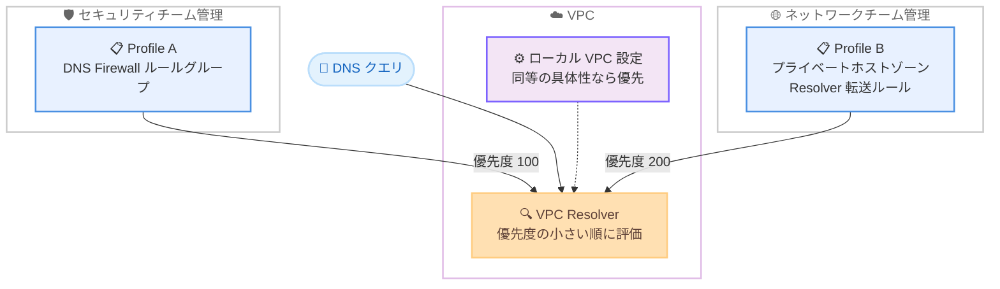

# Amazon Route 53 - Profiles の VPC あたり複数 Profile サポート

**リリース日**: 2026 年 11 月 9 日
**サービス**: Amazon Route 53 (Route 53 Profiles)
**機能**: VPC あたり複数 Profile の関連付け (Multiple Profiles per VPC)

📊 [このアップデートのインフォグラフィックを見る](https://takech9203.github.io/aws-news-summary/20261109-route-53-profiles-multiple-per-vpc.html)

## 概要

Amazon Route 53 Profiles で、1 つの VPC に複数の Profile を関連付けられるようになりました。Route 53 Profiles は、プライベートホストゾーン、Resolver 転送ルール、DNS Firewall ルールグループなどの DNS 関連設定をまとめて多数の VPC やアカウントに適用できる機能です。これまで 1 つの VPC には 1 つの Profile しか関連付けられませんでしたが、今回のアップデートにより最大 2 つの Profile を優先度付きで関連付けられるようになりました。

各 Profile と VPC の関連付けには 100 から 9900 の優先度を設定でき、Route 53 の VPC Resolver は優先度の値が小さい関連付けから順に Profile を評価します。これにより、組織共通の Route 53 設定を 1 つの Profile に、チーム固有の設定を別の Profile に分けたまま、マージせずに同じ VPC へ適用できます。

2026 年 3 月にリリースされた Route 53 Profiles のきめ細かな IAM 権限と組み合わせることで、セキュリティチームは DNS Firewall ルールグループを管理する Profile を、ネットワーク管理チームはプライベートホストゾーンや Resolver 転送ルールを管理する Profile を、それぞれ最小権限で所有・管理できるようになり、セキュリティ態勢が向上します。複数のチームで DNS 設定の管理責任を分担している組織が主な対象ユーザーです。

**アップデート前の課題**

- 1 つの VPC には 1 つの Profile しか関連付けられなかった
- セキュリティチームが DNS Firewall ルールグループを、クラウドインフラチームやネットワーク管理チームがプライベートホストゾーンと Resolver 転送ルールを管理するような体制でも、全チームが単一の Profile を共有する必要があった
- 各チームのプライベートホストゾーン、Resolver ルール、DNS Firewall ルールグループをすべて同じ Profile に関連付ける必要があり、チームごとの所有権分離や最小権限での管理が難しかった

**アップデート後の改善**

- 同じ VPC に複数の Profile を関連付け、それぞれに優先度を設定できるようになった
- 共通の Route 53 設定とチーム固有の設定を別々の Profile に保持したまま、マージせずに適切な優先度で同じ VPC に適用できるようになった
- きめ細かな IAM 権限と組み合わせることで、各チームが自分の Profile を最小権限で所有・管理できるようになり、セキュリティ態勢が向上した

## アーキテクチャ図



各チームが所有する Profile を同じ VPC に優先度付きで関連付け、VPC Resolver が優先度の値が小さい Profile から順に評価する構成です。ローカル VPC 設定と Profile の設定が同等の具体性で競合する場合は、ローカル VPC 設定が優先されます。

## サービスアップデートの詳細

### 主要機能

1. **VPC あたり最大 2 つの Profile の関連付け**
   - 1 つの VPC に最大 2 つの Profile を関連付けられる
   - 1 つの Profile は最大 1,000 の VPC に関連付け可能で、VPC 数のクォータは引き上げ申請が可能
   - 共通設定用の Profile とチーム固有設定用の Profile を分離したまま同じ VPC に適用できる

2. **優先度による評価順序の制御**
   - 各 Profile と VPC の関連付けに 100 から 9900 の優先度を設定でき、値が小さいほど優先度が高い
   - VPC Resolver は優先度の値が小さい関連付けから順に Profile を評価する
   - VPC に他の Profile 関連付けがない場合は優先度を省略でき、その場合は優先度 100 が設定される
   - VPC にすでに Profile が関連付けられている場合は優先度の指定が必須で、VPC 内で一意である必要がある
   - 優先度は `UpdateProfileAssociation` API で後から変更できる

3. **リソースタイプごとの評価ルール**
   - **Resolver ルールとプライベートホストゾーン**: クエリのドメイン名に一致するルールまたはゾーンを持つ、優先度が最も高い Profile のみが使用される。他の Profile により具体的な一致があっても評価されない。その後、選ばれた Profile の設定とローカル VPC 設定を比較し、より具体的なドメイン名が勝ち、具体性が同等ならローカル VPC 設定が優先される
   - **DNS Firewall ルールグループ**: VPC に直接関連付けられたルールグループと、クエリに一致するルールを持つ最も優先度の高い Profile のルールグループが一緒に評価される。ルールグループ優先度が同じ場合は VPC 直接関連付けが優先される
   - **Resolver クエリログ設定**: 優先度に関係なく、VPC に関連付けられたすべての Profile のクエリログ設定にログが記録される
   - **Profile 構成設定**: Resolver ルールの逆引き DNS 設定、DNS Firewall 障害モード設定、DNSSEC 検証設定は、その設定を指定している最も優先度の高い Profile の値が適用される。どの Profile も設定していない場合は VPC 自身の設定が適用される

4. **きめ細かな IAM 権限との組み合わせ**
   - 2026 年 3 月にリリースされた Route 53 Profiles のきめ細かな IAM 権限と組み合わせて、チームごとに Profile の所有と管理を分離できる
   - 各チームが最小権限で自チームの Profile のみを管理でき、セキュリティ態勢が向上する

## 技術仕様

### 複数 Profile 関連付けの仕様

| 項目 | 詳細 |
|------|------|
| VPC あたりの Profile 数 | 最大 2 |
| Profile あたりの VPC 数 | 最大 1,000 (クォータ引き上げ申請可能) |
| 優先度の範囲 | 100 - 9900 (値が小さいほど優先度が高い) |
| 優先度の省略 | VPC に他の関連付けがない場合のみ可能 (優先度 100 が設定される) |
| 優先度の一意性 | 同じ VPC 内の各 Profile 関連付けで一意の優先度が必要 |
| 既存の関連付け | 本機能リリース前に作成された関連付けは優先度 100 |
| 優先度の変更 | `UpdateProfileAssociation` API で変更可能 |
| Profile に関連付け可能なリソース | プライベートホストゾーン、Resolver ルール (転送・システム)、DNS Firewall ルールグループ、インターフェイス VPC エンドポイント、Resolver クエリログ設定 |
| クォータへのカウント | `FAILED` や `DELETING` 状態の関連付けも削除されるまで優先度を保持し、VPC あたりの Profile 数クォータにカウントされる |

### API 変更履歴

今回のアップデートは既存の `AssociateProfile` API への `Priority` パラメータ追加と `UpdateProfileAssociation` API で実現されており、awsapichanges.com では本アップデートに対応する Route 53 Profiles の API 変更エントリは確認できませんでした (2026 年 11 月 10 日時点)。

### AssociateProfile API のパラメータ

| パラメータ | 必須 | 説明 |
|------------|------|------|
| `Name` | はい | 関連付けの名前 |
| `ProfileId` | はい | Profile の ID |
| `ResourceId` | はい | VPC の ID |
| `Priority` | いいえ | 関連付けの優先度 (100 - 9900)。VPC に既存の関連付けがある場合は必須 |
| `Tags` | いいえ | 関連付けを識別するタグ |

優先度の省略時に VPC に既存の関連付けがある場合、指定した優先度が他の関連付けと重複する場合、優先度が 100 - 9900 の範囲外の場合は `ValidationException` が返されます。VPC がすでに最大数の Profile 関連付けを持つ場合は `LimitExceededException` が返されます。

## 設定方法

### 前提条件

1. Route 53 Profiles が利用可能なリージョンで Profile を作成済みであること
2. `route53profiles:AssociateProfile` などの必要な IAM 権限を持っていること
3. 関連付け対象の VPC が存在すること

### 手順

#### ステップ 1: 1 つ目の Profile を VPC に関連付け

```bash
aws route53profiles associate-profile \
  --name shared-base-association \
  --profile-id rp-1111111111example \
  --resource-id vpc-0af3b96b3example \
  --priority 100
```

組織共通の設定を含む Profile を優先度 100 で VPC に関連付けます。VPC に他の Profile 関連付けがない場合は `--priority` を省略でき、その場合は自動的に優先度 100 が設定されます。

#### ステップ 2: 2 つ目の Profile を同じ VPC に関連付け

```bash
aws route53profiles associate-profile \
  --name team-specific-association \
  --profile-id rp-2222222222example \
  --resource-id vpc-0af3b96b3example \
  --priority 200
```

チーム固有の設定を含む Profile を優先度 200 で同じ VPC に関連付けます。VPC にすでに Profile が関連付けられているため、優先度の指定は必須であり、既存の関連付けと重複しない値を指定します。

#### ステップ 3: 関連付けの確認と優先度の変更

```bash
# VPC に関連付けられた Profile の一覧を確認
aws route53profiles list-profile-associations \
  --resource-id vpc-0af3b96b3example

# 関連付けの優先度を変更
aws route53profiles update-profile-association \
  --id rpassoc-489ce212fexample \
  --priority 150
```

1 つ目のコマンドで VPC に関連付けられた Profile と優先度を確認します。2 つ目のコマンドは、既存の関連付けの優先度を変更します。優先度の変更には関連付けの ID を使用します。

## メリット

### ビジネス面

- **チーム間の責任分界の明確化**: セキュリティチーム、ネットワークチームなどが各自の Profile を所有でき、DNS 設定の管理責任を明確に分離できる
- **セキュリティ態勢の向上**: きめ細かな IAM 権限と組み合わせて、各チームに最小権限で Profile の管理を委任できる
- **運用の俊敏性向上**: チーム固有の設定変更が他チームの Profile に影響しないため、調整コストを削減して変更を迅速に展開できる

### 技術面

- **設定のマージが不要**: 共通設定とチーム固有設定を別々の Profile に保持したまま、同じ VPC に適用できる
- **優先度による明示的な制御**: 100 - 9900 の優先度により、Profile の評価順序を明示的に制御でき、優先度は後から変更も可能
- **既存環境への影響なし**: 本機能リリース前に作成された既存の関連付けは優先度 100 として扱われ、動作は変わらない

## デメリット・制約事項

### 制限事項

- 1 つの VPC に関連付けられる Profile は最大 2 つまで
- 同じ VPC 内の各 Profile 関連付けには一意の優先度が必要
- `FAILED` や `DELETING` 状態の関連付けも、削除されるまで VPC あたりの Profile 数クォータにカウントされる

### 考慮すべき点

- Resolver ルールとプライベートホストゾーンの評価では、クエリに一致する最初の Profile (優先度順) のみが使用され、優先度の低い Profile により具体的な一致があっても評価されない。意図しない解決結果を避けるため、Profile 間のドメイン設計と優先度設計を事前に検討する必要がある
- ローカル VPC 設定と Profile 設定が同等の具体性で競合する場合はローカル VPC 設定が優先されるため、移行時は既存のローカル設定との関係を確認する必要がある
- Resolver クエリログ設定は優先度に関係なくすべての Profile のログ設定に記録されるため、複数 Profile でログ設定を持つ場合はログの重複と保存コストを考慮する
- Profile と VPC の関連付けごとに標準の Route 53 Profiles 料金が発生するため、2 つ目の Profile の関連付けは課金対象の関連付け数を増加させる

## ユースケース

### ユースケース 1: セキュリティチームとネットワークチームの管理分離

**シナリオ**: セキュリティチームが全社標準の DNS Firewall ルールグループを管理し、ネットワーク管理チームがプライベートホストゾーンと Resolver 転送ルールを管理している。これまでは単一の Profile を共有していたため、変更のたびにチーム間の調整が必要だった。

**実装例**:
```
1. セキュリティチームが DNS Firewall ルールグループ用の Profile A を作成し、優先度 100 で VPC に関連付け
2. ネットワークチームがプライベートホストゾーンと Resolver 転送ルール用の Profile B を作成し、
   優先度 200 で同じ VPC に関連付け
3. きめ細かな IAM 権限で、各チームに自チームの Profile のみの管理権限を付与
```

**効果**: 各チームが自分の Profile を最小権限で独立して管理でき、チーム間の調整なしに設定変更を展開できる。

### ユースケース 2: 組織共通設定とアプリケーション固有設定の階層化

**シナリオ**: 中央のプラットフォームチームが AWS RAM で共有する組織共通の DNS 設定 (オンプレミスへの転送ルールなど) を維持しつつ、アプリケーションチームが自チームの VPC にアプリケーション固有のプライベートホストゾーンを適用したい。

**実装例**:
```
1. プラットフォームチームが組織共通の Profile を AWS RAM で各アカウントに共有
2. アプリケーションチームは共有された共通 Profile を優先度 100 で VPC に関連付け
3. アプリケーション固有の Profile を優先度 200 で同じ VPC に関連付け
4. 共通設定の更新はプラットフォームチームの Profile 更新だけで全 VPC に伝播
```

**効果**: 共通設定とアプリケーション固有設定をマージせずに階層化でき、共通設定の一元管理とチームの自律性を両立できる。

### ユースケース 3: DNS 設定の段階的な移行

**シナリオ**: 既存の Profile で運用中の環境に新しい DNS 設計を導入するにあたり、既存設定を維持したまま新しい Profile の設定を段階的に検証したい。

**実装例**:
```
1. 既存の Profile (優先度 100) はそのまま維持
2. 新しい DNS 設計を含む Profile を優先度 200 で同じ VPC に関連付け
3. 既存 Profile でカバーされないドメインから新 Profile の動作を検証
4. 検証完了後、update-profile-association で優先度を入れ替えて切り替え
```

**効果**: 既存の運用を止めずに新しい DNS 設定を検証でき、優先度の変更だけで切り替えとロールバックが可能になる。

## 料金

各 Profile と VPC の関連付けは、標準の Route 53 Profiles 料金で課金されます。

- 1 アカウントあたり 1 時間あたり 0.75 USD で、リージョンごとに最大 100 の Profile-VPC 関連付けをカバー
- 100 を超える関連付けは、1 関連付けあたり 1 時間あたり 0.0014 USD (リージョンごと)
- AWS RAM で共有された Profile を他アカウントが VPC に関連付けた場合、その関連付けは Profile 所有アカウントの合計にカウントされる

### 料金例

| 使用量 | 月額料金 (30 日 = 720 時間の概算) |
|--------|----------------------------------|
| 100 関連付けまで | 0.75 USD x 720 時間 = 540 USD |
| 200 関連付け | [0.75 USD + 100 x 0.0014 USD] x 720 時間 = 640.80 USD |

同じ VPC に 2 つの Profile を関連付けると、関連付け数は 2 としてカウントされる点に注意してください。

## 利用可能リージョン

Route 53 Profiles が利用可能なすべての AWS リージョンで利用できます。リージョンごとの提供状況は AWS General Reference の Route 53 サービスエンドポイントを参照してください。

## 関連サービス・機能

- **Amazon Route 53 Resolver**: Profile に関連付けた転送ルールやシステムルールにより、VPC からの DNS クエリの解決動作を制御する
- **Route 53 Resolver DNS Firewall**: Profile 経由で DNS Firewall ルールグループを VPC に適用し、DNS レベルの脅威からワークロードを保護する
- **AWS Resource Access Manager (AWS RAM)**: Profile を同一リージョン内の他の AWS アカウントと共有し、マルチアカウント環境で一貫した DNS 設定を実現する
- **AWS IAM**: 2026 年 3 月リリースのきめ細かな IAM 権限により、Profile 単位での最小権限の管理委任を実現する
- **AWS CloudFormation**: 新規プロビジョニングする VPC への一貫した DNS 設定の適用に利用できる

## 参考リンク

- 📊 [インフォグラフィック](https://takech9203.github.io/aws-news-summary/20261109-route-53-profiles-multiple-per-vpc.html)
- [公式発表 (What's New)](https://aws.amazon.com/about-aws/whats-new/2026/11/route-53-profiles-multiple-per-vpc/)
- [ドキュメント: What are Amazon Route 53 Profiles?](https://docs.aws.amazon.com/Route53/latest/DeveloperGuide/profiles.html)
- [API リファレンス: AssociateProfile](https://docs.aws.amazon.com/Route53/latest/APIReference/API_route53profiles_AssociateProfile.html)
- [API リファレンス: UpdateProfileAssociation](https://docs.aws.amazon.com/Route53/latest/APIReference/API_route53profiles_UpdateProfileAssociation.html)
- [関連発表: Route 53 Profiles のきめ細かな IAM 権限 (2026 年 3 月)](https://aws.amazon.com/about-aws/whats-new/2026/03/amazon-route-53-profiles-granular-iam/)
- [料金ページ](https://aws.amazon.com/route53/pricing/)

## まとめ

Route 53 Profiles の VPC あたり複数 Profile サポートにより、組織共通の DNS 設定とチーム固有の設定をマージせずに同じ VPC へ優先度付きで適用できるようになりました。きめ細かな IAM 権限と組み合わせることで、セキュリティチームとネットワークチームがそれぞれの Profile を最小権限で所有・管理でき、マルチチーム体制での DNS 運用が大きく改善されます。複数チームで単一の Profile を共有している組織は、リソースタイプごとの評価ルールと優先度設計を確認したうえで、Profile の分割を検討してください。
