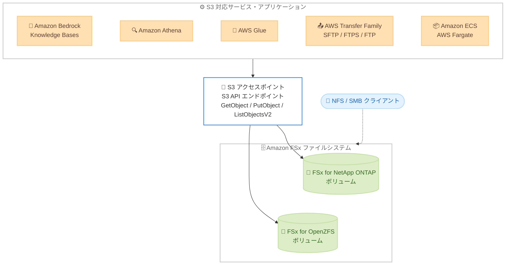

# Amazon FSx - Amazon S3 Access Points for Amazon FSx の利用可能リージョン拡大

**リリース日**: 2026 年 11 月 9 日
**サービス**: Amazon FSx for NetApp ONTAP / Amazon FSx for OpenZFS / Amazon S3
**機能**: Amazon S3 Access Points for Amazon FSx の追加リージョン対応

📊 [このアップデートのインフォグラフィックを見る](https://takech9203.github.io/aws-news-summary/20261109-s3-access-points-fsx-regions.html)

## 概要

Amazon S3 Access Points for Amazon FSx が追加の AWS リージョンで利用可能になりました。今回の拡大により、Amazon FSx for NetApp ONTAP ファイルシステムでは 4 つの追加リージョン、Amazon FSx for OpenZFS ファイルシステムでは 20 の追加リージョンで S3 アクセスポイントをアタッチできるようになります。追加されたリージョンは北米、南米、欧州、アジアパシフィック、アフリカの各地域にまたがります。

S3 Access Points for Amazon FSx は、FSx ファイルシステム上のデータに Amazon S3 API 経由でアクセスできるようにする S3 エンドポイントです。データをコピーや移動することなく、S3 と連携する幅広い AI / ML、分析サービスやアプリケーションから FSx 上のファイルデータをそのまま利用できます。データは引き続き FSx ファイルシステム上に保持され、NFS や SMB などのファイルプロトコルによるアクセスと S3 API によるアクセスを併用できます。

これまで本機能を利用できなかったリージョンでファイルデータを運用している企業にとって、生成 AI や分析ワークロードとファイルストレージの統合がデータ移動なしで実現できるようになる重要なアップデートです。

**アップデート前の課題**

このアップデート以前には、以下の課題がありました。

- S3 Access Points for FSx が利用できないリージョンでは、FSx 上のファイルデータを S3 対応サービスで利用するために、データを S3 バケットへコピーまたは移動する必要があった
- データの二重管理により、ストレージコストの増加や同期の運用負荷が発生していた
- データレジデンシー要件により特定リージョンから出せないデータは、S3 ベースの AI / ML、分析サービスと連携させることが困難だった

**アップデート後の改善**

今回のアップデートにより、以下が可能になりました。

- FSx for NetApp ONTAP では 4 つ、FSx for OpenZFS では 20 の追加リージョンで S3 アクセスポイントをアタッチ可能になった
- 追加リージョンでも、FSx 上のファイルデータをコピーせずに Amazon Bedrock Knowledge Bases、Amazon Athena、AWS Glue、AWS Transfer Family などから直接利用できるようになった
- より多くのリージョンで、データレジデンシー要件を満たしながら S3 ベースのワークロードとファイルストレージを統合できるようになった

## アーキテクチャ図



S3 対応サービスやアプリケーションは、S3 アクセスポイント経由で FSx ファイルシステム上のデータに S3 API でアクセスします。データは FSx 上に保持されたまま、NFS / SMB クライアントからのファイルアクセスと併用できます。

## サービスアップデートの詳細

### 主要機能

1. **FSx for NetApp ONTAP の対応リージョン拡大**
   - 4 つの追加リージョンで S3 アクセスポイントのアタッチが可能になった
   - 公式ドキュメントのサポートリージョン一覧によると、商用リージョンの大部分 (本記事執筆時点で 33 リージョン) がサポート対象
   - UNIX または Windows のファイルシステムユーザーと IAM アクセスポイントポリシーによる二段階の認可を実施

2. **FSx for OpenZFS の対応リージョン拡大**
   - 20 の追加リージョンで S3 アクセスポイントのアタッチが可能になった
   - 公式ドキュメントのサポートリージョン一覧によると、本記事執筆時点で 30 リージョンがサポート対象
   - POSIX ファイルシステムユーザーと IAM アクセスポイントポリシーによる二段階の認可を実施

3. **S3 API によるインプレースアクセス**
   - GetObject、PutObject、ListObjectsV2 などの S3 オブジェクト操作で FSx 上のファイルデータを読み書き可能
   - データのコピーや移動は不要で、データは FSx ファイルシステム上に保持される
   - NFS (OpenZFS の場合は v3 / v4.0 / v4.1 / v4.2)、SMB (ONTAP の場合) によるファイルアクセスと同時利用が可能

## 技術仕様

### S3 Access Points for Amazon FSx の主な仕様

| 項目 | 詳細 |
|------|------|
| 対応ファイルシステム | FSx for NetApp ONTAP、FSx for OpenZFS |
| アクセス方法 | S3 API (GetObject、PutObject、ListObjectsV2 など) |
| 認可の仕組み | IAM アクセスポイントポリシーによる S3 側の認可 + ファイルシステムユーザーによるファイルシステム側の認可 |
| ネットワーク制御 | VPC からのリクエストのみ受け付ける設定が可能 |
| パブリックアクセス | ブロックパブリックアクセスがデフォルトで強制され、無効化は不可 |
| レイテンシー | 数十ミリ秒程度 (S3 バケットアクセスと同等) |
| スループット | FSx ファイルシステムのプロビジョンドスループットに依存 |
| 作成・管理方法 | Amazon FSx コンソール、AWS CLI、AWS SDK |

### 追加リージョンの内訳

What's New の発表によると、追加リージョンの内訳は以下のとおりです。

| ファイルシステム | 追加リージョン数 | 追加対象の地域 |
|------------------|------------------|----------------|
| FSx for NetApp ONTAP | 4 リージョン | 北米、南米、欧州、アジアパシフィック、アフリカのいずれか |
| FSx for OpenZFS | 20 リージョン | 北米、南米、欧州、アジアパシフィック、アフリカにまたがる |

個々の追加リージョン名は発表内で明示されていないため、最新のサポート状況は後述の「利用可能リージョン」および公式ドキュメントのリージョン一覧を参照してください。

## 設定方法

### 前提条件

1. FSx for NetApp ONTAP または FSx for OpenZFS のファイルシステムとボリュームが作成済みであること
2. サポート対象リージョンでファイルシステムを運用していること
3. アクセスポイントの作成とアタッチに必要な IAM 権限があること

### 手順

#### ステップ 1: S3 アクセスポイントの作成とアタッチ

```bash
aws fsx create-and-attach-s3-access-point \
  --name my-fsx-s3-access-point \
  --type OPENZFS \
  --open-zfs-configuration '{
    "VolumeId": "fsvol-0123456789abcdef0",
    "FileSystemIdentity": {
      "Type": "POSIX",
      "PosixUser": {"Uid": 1000, "Gid": 1000}
    }
  }'
```

FSx for OpenZFS ボリュームに S3 アクセスポイントを作成してアタッチします。FileSystemIdentity で指定したファイルシステムユーザーの権限で、アクセスポイント経由のすべてのリクエストが認可されます。

#### ステップ 2: アクセスポイント経由でのデータアクセス

```bash
aws s3api list-objects-v2 \
  --bucket arn:aws:s3:ap-northeast-1:123456789012:accesspoint/my-fsx-s3-access-point
```

作成したアクセスポイントの ARN をバケット名として指定し、S3 API で FSx 上のファイル一覧を取得します。GetObject や PutObject も同様にアクセスポイント ARN またはエイリアスを指定して実行できます。

#### ステップ 3: S3 対応サービスとの連携

アクセスポイントのエイリアスを S3 バケット名の代わりに指定することで、Amazon Bedrock Knowledge Bases のデータソース、Amazon Athena のクエリ対象、AWS Glue の ETL ソースなどとして FSx 上のデータを利用できます。

## メリット

### ビジネス面

- **データ活用範囲の拡大**: より多くのリージョンで、既存のファイルデータを生成 AI や分析ワークロードにそのまま活用できる
- **コスト削減**: データの二重保持やコピー用パイプラインの構築・運用が不要になる
- **データレジデンシー要件への対応**: データを特定リージョンの FSx 上に保持したまま S3 ベースのサービスと連携できる

### 技術面

- **データ移動の排除**: ETL やレプリケーションなしで S3 API からファイルデータへアクセス可能
- **マルチプロトコルアクセス**: NFS / SMB によるファイルアクセスと S3 API によるオブジェクトアクセスを同一データに対して併用できる
- **きめ細かいアクセス制御**: IAM アクセスポイントポリシーとファイルシステム権限の二段階で認可され、VPC 限定アクセスも設定可能

## デメリット・制約事項

### 制限事項

- FSx for ONTAP ではアジアパシフィック (タイ) と AWS GovCloud (US) リージョンは本記事執筆時点で未サポート
- FSx for OpenZFS では中東 (バーレーン)、中東 (UAE)、イスラエル (テルアビブ)、アジアパシフィック (タイ)、AWS GovCloud (US) リージョンは本記事執筆時点で未サポート
- ブロックパブリックアクセスが常に強制されるため、アクセスポイントのパブリック公開はできない

### 考慮すべき点

- S3 API 経由のスループットとリクエストレートは FSx ファイルシステムのプロビジョンドスループットに依存するため、ワークロードに応じた性能設計が必要
- アクセスポイント経由のリクエストは S3 側と FSx 側の両方で認可されるため、IAM ポリシーとファイルシステム権限の両方を整合させる設計が必要

## ユースケース

### ユースケース 1: 生成 AI アプリケーションへのファイルデータ活用

**シナリオ**: 社内のドキュメントやナレッジが FSx for ONTAP 上に蓄積されており、これらを RAG ベースの生成 AI アプリケーションで活用したい。

**実装例**:
```
1. FSx ボリュームに S3 アクセスポイントを作成してアタッチ
2. Amazon Bedrock Knowledge Bases のデータソースとしてアクセスポイントを指定
3. エージェントや生成 AI アプリケーションから Knowledge Bases 経由で検索・回答生成
```

**効果**: ファイルデータをコピーせずに、関連性の高いコンテキストに基づく回答を生成 AI から得られる。

### ユースケース 2: ファイルデータのインプレース分析

**シナリオ**: FSx for OpenZFS 上に保存されたログやレポートファイルを、データ移動なしで SQL 分析したい。

**実装例**:
```
1. FSx ボリュームに S3 アクセスポイントを作成してアタッチ
2. Amazon Athena のクエリ対象としてアクセスポイントのエイリアスを指定
3. 必要に応じて AWS Glue でデータ変換を実施
```

**効果**: ETL パイプラインを構築せずに、ファイルデータをその場で分析できる。

### ユースケース 3: パートナーとのセキュアなファイル共有

**シナリオ**: FSx 上のファイルを外部パートナーと SFTP で共有したいが、S3 バケットへの複製は避けたい。

**実装例**:
```
1. FSx ボリュームに S3 アクセスポイントを作成してアタッチ
2. AWS Transfer Family のサーバーを作成し、アクセスポイントをストレージとして指定
3. パートナーに SFTP / FTPS / FTP のエンドポイントを提供
```

**効果**: データを FSx 上に保持したまま、標準プロトコルで安全にファイル共有できる。

## 料金

S3 Access Points for Amazon FSx の利用では、アクセスポイント経由の S3 リクエストに対する料金と、基盤となる Amazon FSx ファイルシステムの料金が適用されます。詳細は Amazon S3 および Amazon FSx の料金ページを参照してください。

## 利用可能リージョン

今回の拡大により、FSx for NetApp ONTAP では 4 つ、FSx for OpenZFS では 20 の追加リージョンで利用可能になりました。公式ドキュメントのサポートリージョン一覧 (本記事執筆時点) に基づく利用可能リージョンは以下のとおりです。

**FSx for NetApp ONTAP (33 リージョン)**

- 米国東部 (バージニア北部)、米国東部 (オハイオ)、米国西部 (北カリフォルニア)、米国西部 (オレゴン)
- カナダ (中部)、カナダ西部 (カルガリー)、メキシコ (中部)、南米 (サンパウロ)
- 欧州 (フランクフルト)、欧州 (チューリッヒ)、欧州 (ストックホルム)、欧州 (ミラノ)、欧州 (スペイン)、欧州 (アイルランド)、欧州 (ロンドン)、欧州 (パリ)
- アジアパシフィック (東京)、アジアパシフィック (大阪)、アジアパシフィック (ソウル)、アジアパシフィック (香港)、アジアパシフィック (ムンバイ)、アジアパシフィック (ハイデラバード)、アジアパシフィック (シンガポール)、アジアパシフィック (シドニー)、アジアパシフィック (ジャカルタ)、アジアパシフィック (メルボルン)、アジアパシフィック (マレーシア)、アジアパシフィック (ニュージーランド)、アジアパシフィック (台北)
- 中東 (UAE)、中東 (バーレーン)、イスラエル (テルアビブ)、アフリカ (ケープタウン)

**FSx for OpenZFS (30 リージョン)**

- 米国東部 (バージニア北部)、米国東部 (オハイオ)、米国西部 (北カリフォルニア)、米国西部 (オレゴン)
- カナダ (中部)、カナダ西部 (カルガリー)、メキシコ (中部)、南米 (サンパウロ)
- 欧州 (フランクフルト)、欧州 (チューリッヒ)、欧州 (ストックホルム)、欧州 (ミラノ)、欧州 (スペイン)、欧州 (アイルランド)、欧州 (ロンドン)、欧州 (パリ)
- アジアパシフィック (東京)、アジアパシフィック (大阪)、アジアパシフィック (ソウル)、アジアパシフィック (香港)、アジアパシフィック (ムンバイ)、アジアパシフィック (ハイデラバード)、アジアパシフィック (シンガポール)、アジアパシフィック (シドニー)、アジアパシフィック (ジャカルタ)、アジアパシフィック (メルボルン)、アジアパシフィック (マレーシア)、アジアパシフィック (ニュージーランド)、アジアパシフィック (台北)
- アフリカ (ケープタウン)

最新のサポート状況は、FSx for ONTAP および FSx for OpenZFS のユーザーガイドにあるリージョン一覧を参照してください。

## 関連サービス・機能

- **Amazon Bedrock Knowledge Bases**: FSx 上のファイルデータを生成 AI アプリケーションの RAG データソースとして利用可能
- **Amazon Athena / AWS Glue**: FSx 上のデータをインプレースでクエリ・変換可能
- **AWS Transfer Family**: SFTP / FTPS / FTP による FSx 上のファイル共有に利用可能
- **Amazon ECS / AWS Fargate**: サーバーレスコンピューティングから S3 API 経由で FSx 上のファイルにアクセス可能

## 参考リンク

- 📊 [インフォグラフィック](https://takech9203.github.io/aws-news-summary/20261109-s3-access-points-fsx-regions.html)
- [公式発表 (What's New)](https://aws.amazon.com/about-aws/whats-new/2026/11/s3-access-points-fsx-regions/)
- [FSx for ONTAP ユーザーガイド: S3 アクセスポイントによるデータアクセス](https://docs.aws.amazon.com/fsx/latest/ONTAPGuide/accessing-data-via-s3-access-points.html)
- [FSx for OpenZFS ユーザーガイド: S3 アクセスポイントによるデータアクセス](https://docs.aws.amazon.com/fsx/latest/OpenZFSGuide/s3accesspoints-for-FSx.html)
- [Amazon FSx for NetApp ONTAP 製品ページ](https://aws.amazon.com/fsx/netapp-ontap/)
- [Amazon FSx for OpenZFS 製品ページ](https://aws.amazon.com/fsx/openzfs/)
- [Amazon S3 Access Points](https://aws.amazon.com/s3/features/access-points/)

## まとめ

Amazon S3 Access Points for Amazon FSx のリージョン拡大により、FSx for ONTAP では 4 つ、FSx for OpenZFS では 20 の追加リージョンで、ファイルデータを移動せずに S3 ベースの AI / ML、分析サービスと連携できるようになりました。これまで対象外だったリージョンで FSx を運用しているお客様は、公式ドキュメントのリージョン一覧で利用可否を確認し、生成 AI や分析ワークロードとのデータ統合の簡素化を検討することを推奨します。
