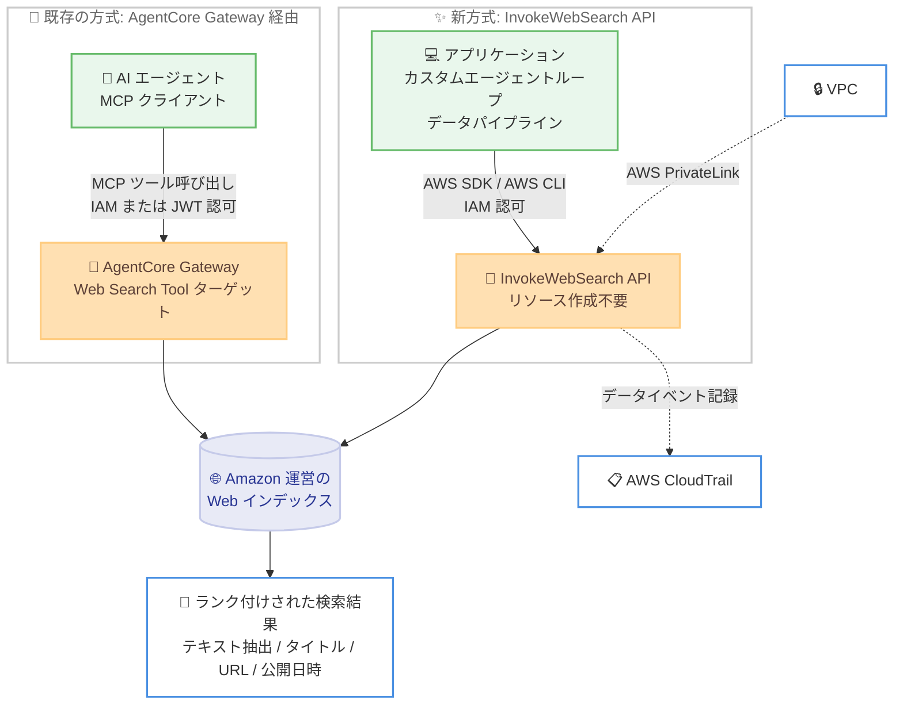

# Amazon Bedrock AgentCore - Web Search API

**リリース日**: 2026 年 11 月 10 日
**サービス**: Amazon Bedrock AgentCore
**機能**: Web Search API (InvokeWebSearch API)

📊 [このアップデートのインフォグラフィックを見る](https://takech9203.github.io/aws-news-summary/20261110-amazon-bedrock-agentcore-web-search-api.html)

## 概要

AWS は、Amazon Bedrock AgentCore の Web Search API の一般提供を発表しました。新しい `InvokeWebSearch` API を使用すると、単一の API 呼び出しだけで Web 検索を実行できます。これまで AgentCore の Web 検索機能は、AgentCore Gateway を通じた MCP ツールとしてのみ提供されていましたが、今回のアップデートにより、アプリケーション、カスタムエージェントループ、データパイプラインから、リソースを一切作成することなく検索結果を取得できるようになりました。

API は、AgentCore の Web Search を支える Amazon 運営の Web インデックスから、ランク付けされた検索結果を返します。各結果にはページ本文のテキスト抽出が含まれ、取得可能な場合はページタイトル、URL、公開日時も含まれます。リクエストごとにドメインと公開日時でフィルタリングできるため、最近の製品発表の検索や、信頼できるドメインに限定した事実確認などに活用できます。

呼び出しは AWS SDK または AWS CLI で行い、認可は AWS Identity and Access Management (IAM) で制御します。AWS PrivateLink を通じて VPC 内から呼び出すことも、AWS CloudTrail のデータイベントとしてリクエストを記録することも可能です。

**アップデート前の課題**

- Web Search on AgentCore は AgentCore Gateway 経由の MCP ツールとしてのみ利用可能で、利用には Gateway リソースの作成と管理が必要だった
- MCP クライアントを持たない通常のアプリケーションやデータパイプラインから Web 検索を利用するには、MCP プロトコルへの対応や追加の実装が必要だった
- 独自に Web 検索機能を組み込む場合、サードパーティの検索 API との契約や API キーの管理が必要だった

**アップデート後の改善**

- 単一の API 呼び出し (`InvokeWebSearch`) だけで Web 検索を実行でき、作成・管理すべきリソースが不要になった
- AWS SDK / AWS CLI と IAM による認可で呼び出せるため、既存の AWS アプリケーションに自然に統合できるようになった
- AWS PrivateLink による VPC からのプライベート接続と、CloudTrail データイベントによる監査が可能になった
- Gateway 利用料なしで、Gateway 経由の Web Search と同じ料金 (1,000 クエリあたり 7 USD) で利用できるようになった

## アーキテクチャ図



MCP クライアントを使うエージェントは従来どおり AgentCore Gateway 経由で Web 検索を利用し、通常のアプリケーションやデータパイプラインは新しい `InvokeWebSearch` API を直接呼び出して、同じ Amazon 運営の Web インデックスから検索結果を取得します。

## サービスアップデートの詳細

### 主要機能

1. **単一 API 呼び出しによる Web 検索**
   - `InvokeWebSearch` API を AWS SDK または AWS CLI から呼び出すだけで Web 検索を実行できる
   - Gateway などのリソースを作成・管理する必要がない
   - AWS マネージドの Web 検索ツール ID `web-search.v1` を指定して呼び出す

2. **ランク付けされた検索結果**
   - Amazon 運営の Web インデックスからランク付けされた結果を返す
   - 各結果にはページのテキスト抽出 (`text`) が必ず含まれ、取得可能な場合はタイトル (`title`)、URL (`url`)、公開日時 (`publishedAt`) も含まれる
   - 1 回のレスポンスで最大 25 件の結果を返す (ページネーションなし)

3. **ドメインと公開日時によるフィルタリング**
   - `domainFilter` の `include` / `exclude` で結果の対象ドメインをリクエストごとに制御できる (各リスト 1~100 ドメイン、ルートドメインはサブドメインにもマッチ)
   - `publishedDateFilter` の `publishedAfter` / `publishedBefore` で公開日時の範囲を指定できる (両端は包含)

4. **エンタープライズ向けのセキュリティと監査**
   - IAM による認可 (アクション: `bedrock-agentcore:InvokeWebSearch`)
   - AWS PrivateLink を通じた VPC からのプライベートな呼び出しに対応
   - AWS CloudTrail のデータイベントとしてリクエストを記録可能

## 技術仕様

### InvokeWebSearch API のリクエストフィールド

| フィールド | 型 | 必須 | 説明 |
|------|------|------|------|
| `webSearchId` | string | はい | 呼び出す Web 検索ツールの識別子。AWS マネージドツールは `web-search.v1` |
| `searchQuery` | string | はい | 検索テキスト (1~200 文字) |
| `maxResults` | integer | いいえ | 返す結果の最大数 (1~25)。未指定の場合は最大 25 件 |
| `filters.domainFilter.include` | array | いいえ | 結果を返す対象ドメイン (1~100 件) |
| `filters.domainFilter.exclude` | array | いいえ | 結果から除外するドメイン (1~100 件) |
| `filters.publishedDateFilter.publishedAfter` | timestamp | いいえ | 公開日時の範囲の開始 (包含) |
| `filters.publishedDateFilter.publishedBefore` | timestamp | いいえ | 公開日時の範囲の終了 (包含) |

### API と Gateway コネクタの比較

| 項目 | InvokeWebSearch API | Web Search Tool コネクタ (Gateway) |
|------|------|------|
| 呼び出し方法 | AgentCore データプレーンエンドポイントへの API 呼び出し | Gateway 経由の MCP ツール呼び出し |
| 認可 | IAM のみ | IAM に加えて JWT も利用可能 |
| ドメインリスト | リクエストごとにフィルタを指定 | ターゲットレベルのドメインリストを全リクエストに適用可能 |
| 検索テキストのフィールド名 | `searchQuery` | `query` |
| デフォルトの最大結果数 | 最大 25 件 | 最大 10 件 |
| 公開日時フィルタ | `publishedAfter` / `publishedBefore` | `from` / `to` |
| AWS GovCloud (US-West) | 非対応 | 対応 |

### クォータ

| 項目 | 詳細 |
|------|------|
| リクエストレート | デフォルトでアカウントごと、リージョンごとに 10 リクエスト/秒 (AWS Support への申請で引き上げ可能) |
| リクエストボディサイズ | 最大 32 KiB |

### IAM ポリシー例

呼び出し元のプリンシパルには、AWS マネージド Web 検索ツールに対する `bedrock-agentcore:InvokeWebSearch` 権限が必要です。ARN のアカウント部分は、AWS がツールを所有するため、自分のアカウント ID ではなくリテラル値 `aws` になる点に注意してください。

```json
{
    "Version": "2012-10-17",
    "Statement": [
        {
            "Sid": "AllowInvokeWebSearch",
            "Effect": "Allow",
            "Action": "bedrock-agentcore:InvokeWebSearch",
            "Resource": "arn:aws:bedrock-agentcore:<Region>:aws:tool/web-search.v1"
        }
    ]
}
```

## 設定方法

### 前提条件

1. AWS アカウントと、AWS SDK または AWS CLI が使用できる認証情報
2. API が利用可能な AWS リージョン (下記「利用可能リージョン」を参照)
3. `InvokeWebSearch` オペレーションを含む最新バージョンの AWS SDK for Python (Boto3) または AWS CLI
4. 上記 IAM ポリシーによる `bedrock-agentcore:InvokeWebSearch` 権限

### 手順

#### ステップ 1: IAM 権限の付与

前述の IAM ポリシーを呼び出し元のプリンシパル (IAM ロールなど) にアタッチします。`<Region>` を利用するリージョンコードに置き換えるか、すべてのリージョンを許可する場合は `*` を指定します。

#### ステップ 2: AWS CLI で Web 検索を実行

```bash
aws bedrock-agentcore invoke-web-search \
  --region us-east-1 \
  --web-search-id web-search.v1 \
  --search-query "Amazon Bedrock AgentCore release announcements" \
  --max-results 5 \
  --filters '{
    "domainFilter": {"include": ["example.net", "example.org"]},
    "publishedDateFilter": {
      "publishedAfter": "2026-01-01T00:00:00Z",
      "publishedBefore": "2026-01-31T23:59:59Z"
    }
  }'
```

AWS マネージドツール `web-search.v1` に対して検索クエリを実行し、指定した 2 つのドメインから、2026 年 1 月中に公開されたページを最大 5 件取得するコマンドです。

#### ステップ 3: Python (Boto3) から呼び出し

```python
import boto3

client = boto3.client("bedrock-agentcore", region_name="us-east-1")

response = client.invoke_web_search(
    webSearchId="web-search.v1",
    searchQuery="Amazon Bedrock AgentCore release announcements",
    maxResults=5,
    filters={
        "domainFilter": {"include": ["example.net", "example.org"]},
        "publishedDateFilter": {
            "publishedAfter": "2026-01-01T00:00:00Z",
            "publishedBefore": "2026-01-31T23:59:59Z"
        }
    }
)

for result in response["results"]:
    print(result.get("title"), result.get("url"))
    print(result["text"])
```

Boto3 の `bedrock-agentcore` クライアントで `invoke_web_search` を呼び出し、返された結果のタイトル、URL、テキスト抽出を表示するコードです。

## メリット

### ビジネス面

- **導入コストの削減**: リソース作成や Gateway の管理が不要で、サードパーティ検索 API との契約や API キー管理も必要ないため、Web 検索機能を迅速に組み込める
- **明確な料金体系**: 1,000 クエリあたり 7 USD の従量課金のみで、Gateway 利用料などの追加費用が発生しない
- **信頼性の高い情報取得**: ドメインフィルタにより信頼できる情報源に限定した検索が可能で、AI アプリケーションの回答品質とファクトチェックの精度を高められる

### 技術面

- **シンプルな統合**: AWS SDK / AWS CLI と IAM だけで利用でき、MCP クライアントを持たないアプリケーションやデータパイプラインにも容易に組み込める
- **セキュアな接続と監査**: AWS PrivateLink による VPC からのプライベート接続と、CloudTrail データイベントによるリクエスト記録に対応
- **柔軟なフィルタリング**: リクエスト単位でドメインの包含・除外と公開日時範囲を指定でき、ユースケースごとに検索範囲を細かく制御できる

## デメリット・制約事項

### 制限事項

- 検索クエリは 1~200 文字、結果は 1 回のレスポンスで最大 25 件 (ページネーションなし)
- デフォルトのリクエストレートはアカウント・リージョンごとに 10 リクエスト/秒 (引き上げには AWS Support への申請が必要)
- 利用可能リージョンは 6 リージョンに限定され、AWS GovCloud (US-West) では API は利用できない (GovCloud では Gateway 経由の Web Search Tool コネクタを使用)

### 考慮すべき点

- 各結果に付属するソースの引用とリンクを保持・表示することが利用規約 (Acceptable Use) で求められる
- MCP 経由でツールを発見・呼び出すエージェントには、引き続き AgentCore Gateway の Web Search Tool コネクタが適している
- API と MCP ツールではフィールド名やデフォルト値が異なる (`searchQuery` と `query`、最大 25 件と 10 件など) ため、両方を併用する場合は実装時に注意が必要

## ユースケース

### ユースケース 1: カスタムエージェントループへの Web 検索組み込み

**シナリオ**: フレームワークに依存しない独自のエージェントループを実装しており、LLM のツールとして最新の Web 情報を取得させたい。

**実装例**:
```python
def web_search_tool(query: str) -> list:
    response = client.invoke_web_search(
        webSearchId="web-search.v1",
        searchQuery=query,
        maxResults=10
    )
    return response["results"]
```

**効果**: MCP サーバーや Gateway を用意することなく、数行のコードでエージェントに最新の Web 情報へのアクセスを提供できます。

### ユースケース 2: 信頼できるドメインに限定したファクトチェック

**シナリオ**: 生成 AI の回答に含まれる主張を、公式ドキュメントや信頼できるニュースソースのみと照合して検証したい。

**実装例**:
```python
response = client.invoke_web_search(
    webSearchId="web-search.v1",
    searchQuery="AgentCore Web Search API pricing",
    filters={
        "domainFilter": {"include": ["aws.amazon.com", "docs.aws.amazon.com"]}
    }
)
```

**効果**: 検索対象を信頼できるドメインに限定することで、ハルシネーションの検出や回答の根拠提示の精度を高められます。

### ユースケース 3: データパイプラインでの最新情報収集

**シナリオ**: 日次バッチで特定トピックの最新発表を収集し、社内レポートやナレッジベースを更新したい。

**実装例**:
```python
response = client.invoke_web_search(
    webSearchId="web-search.v1",
    searchQuery="competitor product announcements",
    maxResults=25,
    filters={
        "publishedDateFilter": {"publishedAfter": "2026-11-03T00:00:00Z"}
    }
)
```

**効果**: 公開日時フィルタで直近の情報のみを取得でき、ETL パイプラインやナレッジベース更新ジョブに最新の Web 情報を安定的に供給できます。

## 料金

Web Search API のクエリは 1,000 クエリあたり 7 USD で課金されます。これは AgentCore Gateway 経由の Web Search と同じレートで、Gateway 利用料は発生しません。

### 料金例

| 使用量 | 月額料金 (概算) |
|--------|------------------|
| 10,000 クエリ/月 | 70 USD |
| 100,000 クエリ/月 | 700 USD |

## 利用可能リージョン

- 米国東部 (バージニア北部) `us-east-1`
- 米国東部 (オハイオ) `us-east-2`
- 米国西部 (オレゴン) `us-west-2`
- アジアパシフィック (シドニー) `ap-southeast-2`
- アジアパシフィック (東京) `ap-northeast-1`
- 欧州 (アイルランド) `eu-west-1`

AWS GovCloud (US-West) では API は利用できませんが、Gateway 経由の Web Search Tool コネクタを利用できます。

## 関連サービス・機能

- **Amazon Bedrock AgentCore Gateway**: Web Search を MCP ツールとしてエージェントに公開する既存の方式。JWT 認可やターゲットレベルのドメインリストが必要な場合に適する
- **AWS PrivateLink**: VPC からインターネットを経由せずに InvokeWebSearch API を呼び出すためのプライベート接続を提供
- **AWS CloudTrail**: InvokeWebSearch のリクエストをデータイベントとして記録し、監査やコンプライアンス対応を支援
- **AWS IAM**: `bedrock-agentcore:InvokeWebSearch` アクションによる呼び出しの認可を提供

## 参考リンク

- 📊 [インフォグラフィック](https://takech9203.github.io/aws-news-summary/20261110-amazon-bedrock-agentcore-web-search-api.html)
- [公式発表 (What's New)](https://aws.amazon.com/about-aws/whats-new/2026/11/amazon-bedrock-agentcore-web-search-api/)
- [ドキュメント: Search the web with the InvokeWebSearch API](https://docs.aws.amazon.com/bedrock-agentcore/latest/devguide/web-search-api.html)
- [API リファレンス: InvokeWebSearch](https://docs.aws.amazon.com/bedrock-agentcore/latest/APIReference/API_InvokeWebSearch.html)
- [Web Search 製品ページ](https://aws.amazon.com/bedrock/grounding/web-search/)
- [AgentCore 料金ページ](https://aws.amazon.com/bedrock/agentcore/pricing/)

## まとめ

InvokeWebSearch API により、Gateway や MCP クライアントを用意することなく、単一の API 呼び出しで Amazon 運営の Web インデックスを検索できるようになりました。IAM、PrivateLink、CloudTrail といった AWS 標準のセキュリティ・監査機構と統合されているため、エンタープライズ環境のアプリケーションやデータパイプラインに Web 検索を組み込む際の第一候補になります。東京リージョンでも利用可能なため、エージェントやアプリケーションに最新の Web 情報を取り込みたい場合は、まず IAM 権限を設定して AWS CLI から試すことを推奨します。
