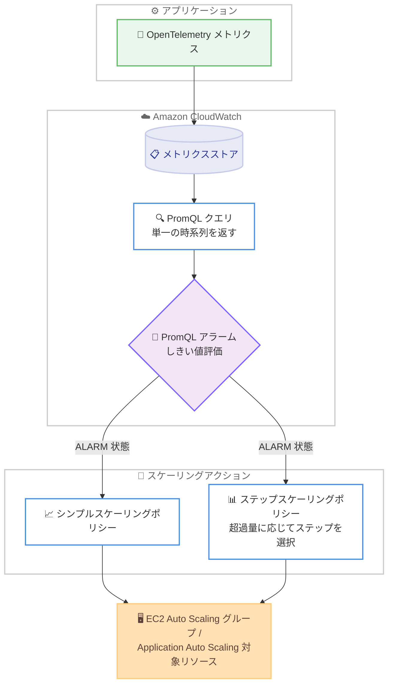

# Amazon CloudWatch - PromQL アラームによる EC2 / Application Auto Scaling アクションのサポート

**リリース日**: 2026 年 11 月 10 日
**サービス**: Amazon CloudWatch
**機能**: CloudWatch PromQL alarms support for EC2 and Application Auto Scaling

📊 [このアップデートのインフォグラフィックを見る](https://takech9203.github.io/aws-news-summary/20261110-amazon-cloudwatch-alarms-autoscaling-group-actions.html)

## 概要

Prometheus Query Language (PromQL) を使用する Amazon CloudWatch アラームが、Amazon EC2 Auto Scaling および Application Auto Scaling のステップスケーリングポリシーとシンプルスケーリングポリシーをトリガーできるようになりました。これにより、ダッシュボードやアラートで使用しているものと同じ PromQL クエリを使って、CloudWatch 上の OpenTelemetry メトリクスに基づいて EC2 Auto Scaling グループをスケーリングできます。

OpenTelemetry を採用しているチームは、モニタリングとスケーリングを同一のメトリクスとクエリ言語に統合できるため、スケーリング用に従来形式のメトリクスアラームを別途維持する必要がなくなります。アラームは CloudWatch コンソール、PutMetricAlarm API、AWS CLI、AWS SDK、AWS CloudFormation から設定できます。

**アップデート前の課題**

PromQL アラームは通知などのアクションには対応していましたが、Auto Scaling との連携に制限がありました。

- PromQL アラームから EC2 Auto Scaling や Application Auto Scaling のスケーリングポリシーを直接トリガーできなかった
- OpenTelemetry メトリクスに基づくスケーリングを行うには、従来形式の CloudWatch メトリクスアラームを別途作成・維持する必要があった
- モニタリング用の PromQL クエリとスケーリング用のアラーム定義が分離し、運用が二重化していた

**アップデート後の改善**

今回のアップデートにより、PromQL アラームを Auto Scaling の起点として利用できるようになりました。

- PromQL アラームから EC2 Auto Scaling および Application Auto Scaling のステップ / シンプルスケーリングポリシーを直接トリガーできるようになった
- ダッシュボードやアラートと同じ PromQL クエリをスケーリング判断に再利用できるようになった
- OpenTelemetry メトリクスを採用するチームが、モニタリングとスケーリングを単一のメトリクス基盤に統合できるようになった

## アーキテクチャ図



OpenTelemetry メトリクスを PromQL クエリで評価する CloudWatch アラームが、ALARM 状態になるとスケーリングポリシーをトリガーし、EC2 Auto Scaling グループなどのリソースをスケーリングする流れを示しています。

## サービスアップデートの詳細

### 主要機能

1. **PromQL アラームからの Auto Scaling アクション**
   - PromQL アラームのアクションとして、EC2 Auto Scaling および Application Auto Scaling のスケーリングポリシーを指定可能
   - サポートされるポリシータイプはシンプルスケーリングとステップスケーリング
   - ターゲット追跡 (Target Tracking) は現時点で PromQL アラームのサポート対象外

2. **ステップスケーリングでのしきい値超過量に基づく制御**
   - しきい値をどの程度超過したかに応じて、適用されるステップ (スケーリング調整量) が決定される
   - クエリは単一の時系列を返す必要があり、その値をしきい値と比較して評価する

3. **複数の設定方法**
   - CloudWatch コンソールでのアラーム作成・編集時に設定可能
   - PutMetricAlarm API、AWS CLI、AWS SDK、AWS CloudFormation にも対応

## 技術仕様

### PromQL アラームと Auto Scaling 連携の仕様

| 項目 | 詳細 |
|------|------|
| クエリ言語 | PromQL (Prometheus Query Language) |
| 対象メトリクス | CloudWatch 上の OpenTelemetry メトリクスなど |
| クエリ要件 | スケーリング用途では単一の時系列を返し、しきい値と比較すること |
| 対応スケーリングポリシー | シンプルスケーリング、ステップスケーリング |
| 非対応スケーリングポリシー | ターゲット追跡スケーリング |
| 対応ターゲット | EC2 Auto Scaling グループ、Application Auto Scaling 対象リソース |
| 設定方法 | CloudWatch コンソール、PutMetricAlarm API、AWS CLI、AWS SDK、AWS CloudFormation |

## 設定方法

### 前提条件

1. CloudWatch にメトリクス (OpenTelemetry メトリクスなど) が送信されていること
2. EC2 Auto Scaling グループまたは Application Auto Scaling の対象リソースが存在すること
3. シンプルスケーリングまたはステップスケーリングポリシーが作成済みであること

### 手順

#### ステップ 1: スケーリングポリシーの作成

```bash
aws autoscaling put-scaling-policy \
  --auto-scaling-group-name my-asg \
  --policy-name my-step-scaling-policy \
  --policy-type StepScaling \
  --adjustment-type ChangeInCapacity \
  --step-adjustments "MetricIntervalLowerBound=0,MetricIntervalUpperBound=20,ScalingAdjustment=1" \
                     "MetricIntervalLowerBound=20,ScalingAdjustment=2"
```

EC2 Auto Scaling グループに対してステップスケーリングポリシーを作成しています。しきい値の超過量が 0〜20 の場合は 1 台、20 以上の場合は 2 台を追加する設定です。実行結果として返される PolicyARN を次のステップで使用します。

#### ステップ 2: PromQL アラームの作成とスケーリングアクションの関連付け

CloudWatch コンソールでアラームを作成する際に、[Select metric] から PromQL タブを選択して PromQL クエリを入力します。クエリはアラームが評価できるよう単一の時系列を返す必要があります。しきい値と評価期間を設定した後、アラームアクションとしてステップ 1 で作成したスケーリングポリシーを指定します。

API や CLI を使用する場合は、PutMetricAlarm の AlarmActions にスケーリングポリシーの ARN を指定します。

#### ステップ 3: 動作確認

アラームが ALARM 状態に遷移した際に、Auto Scaling グループのアクティビティ履歴でスケーリングアクションが実行されたことを確認します。CloudWatch コンソールのアラーム履歴と、EC2 Auto Scaling コンソールのアクティビティタブの両方で動作を検証できます。

## メリット

### ビジネス面

- **運用の統合**: モニタリング、アラート、スケーリングを同一のメトリクスとクエリ言語に統合でき、運用コストを削減できる
- **OpenTelemetry 採用の促進**: OpenTelemetry への移行時にスケーリング用の従来形式アラームを別途維持する必要がなくなり、移行の障壁が下がる
- **追加コストなし**: 標準の CloudWatch アラーム料金が適用され、新たな料金体系の学習や予算確保が不要

### 技術面

- **PromQL の表現力をスケーリングに活用**: レート計算やラベルベースの集計など、PromQL の柔軟なクエリをスケーリング判断に利用できる
- **ステップスケーリングによるきめ細かな制御**: しきい値の超過量に応じて段階的にキャパシティを調整できる
- **IaC 対応**: AWS CloudFormation に対応しており、アラームとスケーリング設定をコードとして管理できる

## デメリット・制約事項

### 制限事項

- ターゲット追跡 (Target Tracking) ポリシーは現時点で PromQL アラームのサポート対象外
- スケーリング用途の PromQL クエリは単一の時系列を返す必要がある
- CloudWatch PromQL アラームが利用可能なリージョンに限定される

### 考慮すべき点

- 複数の時系列を返すクエリはスケーリングアラームとして使用できないため、集計関数などで単一系列に絞り込む設計が必要
- ターゲット追跡が必要なワークロードでは、引き続き従来形式のメトリクスアラームまたはターゲット追跡ポリシーの構成を検討する必要がある

## ユースケース

### ユースケース 1: OpenTelemetry メトリクスに基づく EC2 Auto Scaling

**シナリオ**: アプリケーションが OpenTelemetry でリクエストレイテンシーやキュー長などのカスタムメトリクスを CloudWatch に送信しており、これらの値に基づいて EC2 Auto Scaling グループをスケーリングしたい。

**実装例**:
```
PromQL クエリ例: アプリケーションの処理待ちキュー長の平均を評価
avg({"app.worker.queue_depth"})

アラーム条件: queue_depth > 100 でステップスケーリングポリシーをトリガー
```

**効果**: ダッシュボードで監視している OpenTelemetry メトリクスをそのままスケーリング判断に使用でき、従来形式のメトリクス変換やアラームの二重管理が不要になります。

### ユースケース 2: ステップスケーリングによる負荷急増時の段階的な増強

**シナリオ**: トラフィックの急増時には一度に複数台のインスタンスを追加し、緩やかな増加時には 1 台ずつ追加したい。

**実装例**:
```
ステップスケーリング設定の例。
- しきい値超過量 0〜20: インスタンスを 1 台追加
- しきい値超過量 20 以上: インスタンスを 2 台追加

PromQL アラームのしきい値超過量に応じて適用ステップが決定される
```

**効果**: 負荷の程度に応じた段階的なキャパシティ調整が可能になり、過剰なスケールアウトを抑制しつつ急増時の応答性を確保できます。

### ユースケース 3: Application Auto Scaling による EC2 以外のリソースのスケーリング

**シナリオ**: ECS サービスや DynamoDB テーブルなど、Application Auto Scaling がサポートするリソースを、PromQL で評価したメトリクスに基づいてスケーリングしたい。

**実装例**:
```
1. Application Auto Scaling でスケーラブルターゲットを登録
2. ステップスケーリングポリシーを作成
3. PromQL アラームのアクションにポリシー ARN を指定
```

**効果**: EC2 以外のリソースについても、OpenTelemetry メトリクスと PromQL を活用した統一的なスケーリング運用が実現できます。

## 料金

標準の CloudWatch アラーム料金が適用されます。PromQL アラームから Auto Scaling アクションをトリガーすること自体に追加料金は発生しません。詳細は CloudWatch の料金ページを参照してください。

## 利用可能リージョン

CloudWatch PromQL アラームが利用可能なすべての AWS リージョンで利用できます。

## 関連サービス・機能

- **Amazon EC2 Auto Scaling**: PromQL アラームからシンプル / ステップスケーリングポリシーをトリガーできる対象サービス
- **Application Auto Scaling**: ECS、DynamoDB など EC2 以外のリソースのスケーリングを管理するサービスで、同様に PromQL アラームと連携可能
- **OpenTelemetry**: CloudWatch に送信したメトリクスを PromQL で照会でき、今回のアップデートによりスケーリングにも活用可能
- **AWS CloudFormation**: PromQL アラームとスケーリングアクションの構成をコードとして管理可能

## 参考リンク

- 📊 [インフォグラフィック](https://takech9203.github.io/aws-news-summary/20261110-amazon-cloudwatch-alarms-autoscaling-group-actions.html)
- [公式発表 (What's New)](https://aws.amazon.com/about-aws/whats-new/2026/11/amazon-cloudwatch-alarms-autoscaling-group-actions)
- [ドキュメント: Using PromQL in alarms](https://docs.aws.amazon.com/AmazonCloudWatch/latest/monitoring/CloudWatch-PromQL-Alarms.html)
- [ドキュメント: Alarm actions](https://docs.aws.amazon.com/AmazonCloudWatch/latest/monitoring/alarm-actions.html)
- [料金ページ: Amazon CloudWatch](https://aws.amazon.com/cloudwatch/pricing/)

## まとめ

PromQL アラームが EC2 Auto Scaling および Application Auto Scaling のシンプル / ステップスケーリングポリシーをトリガーできるようになり、OpenTelemetry メトリクスを中心としたモニタリングとスケーリングの統合が可能になりました。OpenTelemetry を採用している、または採用を検討しているチームは、スケーリング用の従来形式アラームを PromQL アラームに統合できるか確認することを推奨します。ターゲット追跡ポリシーは現時点で非対応のため、ワークロードごとに適切なポリシータイプを選択してください。
