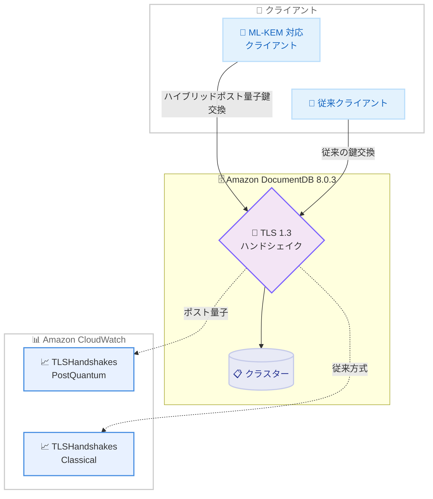

# Amazon DocumentDB - バージョン 8.0.3 でポスト量子 TLS、ワイルドカードインデックス、$unionWith をサポート

**リリース日**: 2026 年 11 月 10 日
**サービス**: Amazon DocumentDB (with MongoDB compatibility)
**機能**: ポスト量子 TLS、ワイルドカードインデックス、$unionWith 集計ステージなど (バージョン 8.0.3)

📊 [このアップデートのインフォグラフィックを見る](https://takech9203.github.io/aws-news-summary/20261110-amazon-documentdb-8-0-3.html)

## 概要

Amazon DocumentDB (with MongoDB compatibility) のバージョン 8.0.3 がリリースされ、TLS 1.3 接続におけるハイブリッドポスト量子鍵交換、ワイルドカードインデックス、`$unionWith` 集計ステージ、新しい変更ストリームイベントのサポートが追加された。

ポスト量子 TLS は、ML-KEM (Module-Lattice-Based Key-Encapsulation Mechanism) に基づくハイブリッド鍵交換を使用し、「今記録しておいて、将来量子コンピュータで復号する」という Harvest Now, Decrypt Later 型の脅威から転送中のデータを保護する。ML-KEM をサポートするクライアントは自動的にポスト量子鍵交換を使用し、それ以外のクライアントは従来の鍵交換を継続するため、アプリケーション側の互換性を損なわない。

また、ワイルドカードインデックスや `$unionWith` などの MongoDB API への対応拡大により、アプリケーションコードを変更することなく、より多くの MongoDB ワークロードを Amazon DocumentDB へ移行できるようになった。

**アップデート前の課題**

- TLS 接続は従来の鍵交換のみで、将来の量子コンピュータによる復号リスク (Harvest Now, Decrypt Later) への備えがなかった
- スキーマが動的に変化するドキュメントでは、フィールドごとに個別のインデックスを作成する必要があり、未知のフィールドへのクエリを効率化できなかった
- 複数のコレクションの結果を 1 つのパイプラインで統合する `$unionWith` が未サポートで、アプリケーション側でのマージ処理や移行時のコード変更が必要だった
- `dropIndex()` / `dropIndexes()` によるインデックス削除が変更ストリームのイベントとして通知されなかった

**アップデート後の改善**

- TLS 1.3 接続で ML-KEM ベースのハイブリッドポスト量子鍵交換が利用可能になり、転送中データの長期的な機密性を確保できるようになった
- 新しい CloudWatch メトリクス `TLSHandshakesClassical` と `TLSHandshakesPostQuantum` により、鍵交換方式ごとのハンドシェイク数を可視化できるようになった
- ワイルドカードインデックスにより、すべてのフィールド、または特定パス配下のすべてのフィールドをインデックス化し、動的スキーマのドキュメントを効率的にクエリできるようになった
- `$unionWith` により、単一の集計パイプライン内で複数コレクションの結果を統合できるようになった
- `$lookup` と `$graphLookup` がビューで利用可能になり、相関 `$lookup` のサブパイプラインで `$unionWith` と `$facet` が使用可能になった
- インデックス削除が `dropIndexes` イベントとして変更ストリームに通知されるようになった

## アーキテクチャ図



ポスト量子 TLS の動作概要。ML-KEM をサポートするクライアントは自動的にハイブリッドポスト量子鍵交換を使用し、それ以外のクライアントは従来の鍵交換で接続を継続する。ハンドシェイク数は方式ごとに CloudWatch メトリクスで追跡できる。

## サービスアップデートの詳細

### 主要機能

1. **ポスト量子 TLS (ハイブリッドポスト量子鍵交換)**
   - TLS 1.3 接続で ML-KEM に基づくハイブリッド鍵交換を使用
   - ML-KEM をサポートするクライアントは自動的にポスト量子鍵交換を使用し、その他のクライアントは従来の鍵交換を継続
   - 現在記録された通信が将来量子コンピュータで復号される脅威 (Harvest Now, Decrypt Later) から転送中のデータを保護
   - インスタンスごとの成功ハンドシェイク数を `TLSHandshakesClassical` と `TLSHandshakesPostQuantum` の 2 つの CloudWatch メトリクスで追跡可能

2. **ワイルドカードインデックス**
   - すべてのフィールド、または特定パス配下のすべてのフィールドをまとめてインデックス化
   - フィールド構成が事前に決まっていない動的スキーマのドキュメントに対するクエリを効率化

3. **集計機能の強化**
   - `$unionWith` 集計ステージにより、単一パイプライン内で複数コレクションの結果を統合可能
   - `createView` で作成したビュー内で `$lookup` と `$graphLookup` が利用可能
   - 相関 `$lookup` のサブパイプラインで使用できるステージに `$unionWith` と `$facet` を追加
   - `$facet` 集計ステージの機能強化

4. **変更ストリームの拡張**
   - `dropIndex()` および `dropIndexes()` によるインデックス削除の成功が `dropIndexes` イベントとして通知されるように変更

5. **コレクション単位の圧縮メトリクス**
   - `collStats` および `stats()` の出力に、コレクション単位の圧縮メトリクス (`input_bytes`、`output_bytes`、`compression_operations`、`compression_ratio`) を追加

6. **バグ修正**
   - `findAndModify` が返す retryable write エラーラベルを修正
   - クエリプランが disjoint インデックススキャンを使用する場合のソートに関する問題を修正

## 技術仕様

### バージョン情報

| 項目 | 詳細 |
|------|------|
| エンジンバージョン | Amazon DocumentDB 8.0.3 (エンジンバージョン: 4.0.13572) |
| 対象メジャーバージョン | Amazon DocumentDB 8.0 (MongoDB 8.0 互換) |
| ポスト量子鍵交換 | TLS 1.3 + ML-KEM によるハイブリッド鍵交換 |
| 新規 CloudWatch メトリクス | `TLSHandshakesClassical`、`TLSHandshakesPostQuantum` |
| バージョン確認コマンド | `db.runCommand({getEngineVersion: 1})` |

### 新しい CloudWatch メトリクス

| メトリクス名 | 説明 |
|------|------|
| `TLSHandshakesClassical` | 従来の鍵交換を使用した成功 TLS ハンドシェイク数 (インスタンス単位) |
| `TLSHandshakesPostQuantum` | ハイブリッドポスト量子鍵交換を使用した成功 TLS ハンドシェイク数 (インスタンス単位) |

## 設定方法

### 前提条件

1. Amazon DocumentDB 8.0 クラスターを運用していること
2. ポスト量子鍵交換を利用する場合は、ML-KEM をサポートする TLS 1.3 対応クライアントであること
3. クラスターで TLS が有効化されていること (ポスト量子 TLS を利用する場合)

### 手順

#### ステップ 1: エンジンバージョンの確認

```javascript
db.runCommand({getEngineVersion: 1})
```

mongo シェルでクラスターに接続し、現在のエンジンバージョンを確認する。8.0.3 のクラスターは `8.0.3+4.0.13572` のような形式でバージョンを返す。保留中のメンテナンスがある場合は、メンテナンスウィンドウまたは手動適用でパッチを適用する。

#### ステップ 2: ワイルドカードインデックスの作成

```javascript
// すべてのフィールドをインデックス化
db.products.createIndex({ "$**": 1 })

// 特定パス配下のフィールドのみインデックス化
db.products.createIndex({ "attributes.$**": 1 })
```

ワイルドカードインデックスを作成する。1 つ目の例はドキュメント内のすべてのフィールドを、2 つ目の例は `attributes` 配下のすべてのフィールドをインデックス化し、動的スキーマに対するクエリを効率化する。

#### ステップ 3: $unionWith による複数コレクションの統合

```javascript
db.orders.aggregate([
  { $match: { status: "completed" } },
  { $unionWith: {
      coll: "archivedOrders",
      pipeline: [ { $match: { status: "completed" } } ]
  } }
])
```

`$unionWith` ステージを使用して、`orders` コレクションと `archivedOrders` コレクションの結果を単一のパイプラインで統合する。アプリケーション側でのマージ処理が不要になる。

#### ステップ 4: ポスト量子ハンドシェイクのモニタリング

```bash
aws cloudwatch get-metric-statistics \
  --namespace AWS/DocDB \
  --metric-name TLSHandshakesPostQuantum \
  --dimensions Name=DBInstanceIdentifier,Value=my-instance \
  --start-time 2026-11-10T00:00:00Z \
  --end-time 2026-11-11T00:00:00Z \
  --period 3600 \
  --statistics Sum
```

CloudWatch からポスト量子鍵交換によるハンドシェイク数を取得する。`TLSHandshakesClassical` と比較することで、クライアントのポスト量子対応状況を把握できる。

## メリット

### ビジネス面

- **長期的なデータ保護**: Harvest Now, Decrypt Later 型の脅威に備え、機密性の高いデータを扱う金融・医療・公共分野などで将来の量子コンピュータ時代を見据えたセキュリティ対策を先行して実施できる
- **移行コストの削減**: ワイルドカードインデックスや `$unionWith` などの MongoDB API 対応拡大により、アプリケーションコードを変更せずに MongoDB ワークロードを移行できる
- **追加コスト不要**: ポスト量子 TLS は対応クライアントで自動的に有効化され、追加の設定や料金なしで利用できる

### 技術面

- **互換性を維持した段階的移行**: ML-KEM 非対応のクライアントは従来の鍵交換で接続を継続できるため、クライアントの更新を段階的に進められる
- **可観測性の向上**: 鍵交換方式ごとの CloudWatch メトリクスにより、ポスト量子対応クライアントへの移行状況を定量的に追跡できる
- **動的スキーマへの対応**: ワイルドカードインデックスにより、フィールド構成が頻繁に変化するドキュメントでもインデックス設計の負担を軽減できる
- **ストレージ効率の可視化**: コレクション単位の圧縮メトリクスにより、圧縮効果を詳細に把握しストレージコストの分析に活用できる

## デメリット・制約事項

### 制限事項

- ポスト量子鍵交換は TLS 1.3 接続かつ ML-KEM をサポートするクライアントでのみ使用される
- 本機能はバージョン 8.0.3 (エンジンバージョン 4.0.13572) 以降が必要で、既存クラスターはパッチ適用が必要
- 変更ストリームの `dropIndexes` イベントなど、挙動の変更に依存する処理はアプリケーション側での確認が必要

### 考慮すべき点

- クライアントドライバーや TLS ライブラリが ML-KEM をサポートしているかの確認が必要 (`TLSHandshakesPostQuantum` メトリクスで実際の利用状況を検証できる)
- ワイルドカードインデックスは利便性が高い一方、書き込みオーバーヘッドやインデックスサイズへの影響を考慮し、対象パスを絞るなどの設計が推奨される
- パッチ適用のタイミングはメンテナンスウィンドウの設定に依存するため、適用計画の確認を推奨

## ユースケース

### ユースケース 1: 量子時代を見据えた機密データの保護

**シナリオ**: 金融機関が顧客の取引データを Amazon DocumentDB で管理しており、長期間機密性を維持する必要があるため、Harvest Now, Decrypt Later 型の脅威への対策を求めている。

**実装例**:
```
クラスターを 8.0.3 へ更新
→ ML-KEM 対応クライアントから TLS 1.3 で接続 (自動的にポスト量子鍵交換を使用)
→ TLSHandshakesPostQuantum / TLSHandshakesClassical メトリクスで移行状況を監視
→ 非対応クライアントを段階的に更新
```

**効果**: アプリケーション変更なしで転送中データの長期的な機密性を強化し、コンプライアンス要件や将来の量子脅威への対応を先行して実現できる。

### ユースケース 2: 動的スキーマを持つ商品カタログの検索

**シナリオ**: EC サイトの商品カタログで、商品カテゴリごとに属性フィールドが異なり、事前にすべてのフィールドへ個別インデックスを作成することが困難。

**実装例**:
```javascript
// 商品属性配下をまとめてインデックス化
db.products.createIndex({ "attributes.$**": 1 })

// 任意の属性でクエリ
db.products.find({ "attributes.color": "red" })
db.products.find({ "attributes.screenSize": { $gte: 15 } })
```

**効果**: 新しい属性フィールドが追加されてもインデックスの再設計が不要になり、動的スキーマに対するクエリ性能を維持できる。

### ユースケース 3: アクティブデータとアーカイブデータの横断集計

**シナリオ**: 直近の注文を保持するコレクションと、過去の注文をアーカイブしたコレクションに対し、期間をまたいだレポートを 1 回のクエリで生成したい。

**実装例**:
```javascript
db.orders.aggregate([
  { $match: { orderDate: { $gte: ISODate("2026-01-01") } } },
  { $unionWith: {
      coll: "archivedOrders",
      pipeline: [ { $match: { orderDate: { $gte: ISODate("2026-01-01") } } } ]
  } },
  { $group: { _id: "$category", total: { $sum: "$amount" } } }
])
```

**効果**: アプリケーション側でのデータマージ処理が不要になり、複数コレクションにまたがるレポート生成をデータベース側の単一パイプラインで完結できる。

## 料金

本アップデートに伴う追加料金の記載はない。Amazon DocumentDB の標準料金 (インスタンス、ストレージ、I/O、バックアップ) が適用される。詳細は料金ページを参照。

## 利用可能リージョン

Amazon DocumentDB が提供されているすべての AWS リージョンでバージョン 8.0.3 を利用可能。

## 関連サービス・機能

- **Amazon CloudWatch**: 新メトリクス `TLSHandshakesClassical` / `TLSHandshakesPostQuantum` による鍵交換方式のモニタリング
- **AWS KMS / 保管時の暗号化**: 転送中のポスト量子 TLS と組み合わせることで、保管時と転送中の両方でデータを保護
- **Amazon DocumentDB 変更ストリーム**: `dropIndexes` イベントの追加により、インデックス操作の追跡やイベント駆動処理の対象が拡大

## 参考リンク

- 📊 [インフォグラフィック](https://takech9203.github.io/aws-news-summary/20261110-amazon-documentdb-8-0-3.html)
- [公式発表 (What's New)](https://aws.amazon.com/about-aws/whats-new/2026/11/amazon-documentdb-8-0-3/)
- [ドキュメント: リリースノート](https://docs.aws.amazon.com/documentdb/latest/developerguide/release-notes.html)
- [ドキュメント: Encrypting data in transit (ポスト量子鍵交換)](https://docs.aws.amazon.com/documentdb/latest/developerguide/security.encryption.ssl.html)
- [ドキュメント: Amazon DocumentDB メトリクス](https://docs.aws.amazon.com/documentdb/latest/developerguide/cloud_watch.html)
- [料金ページ](https://aws.amazon.com/documentdb/pricing/)

## まとめ

Amazon DocumentDB 8.0.3 は、ML-KEM によるポスト量子 TLS という将来を見据えたセキュリティ強化と、ワイルドカードインデックスや `$unionWith` などの MongoDB API 対応拡大を同時に提供するアップデートである。機密性の高いデータを長期間扱うワークロードでは、クライアントの ML-KEM 対応状況を確認した上で 8.0.3 への更新とメトリクスによる移行状況の監視を開始することを推奨する。MongoDB からの移行を検討しているワークロードにとっても、互換性の向上により移行の選択肢が広がった。
