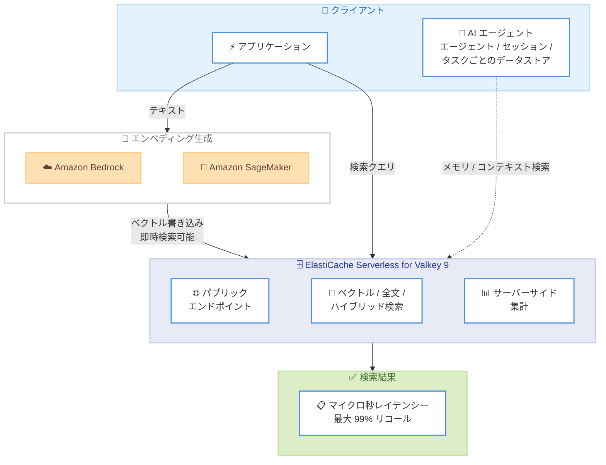

# Amazon ElastiCache Serverless - ベクトル検索・全文検索・ハイブリッド検索と集計のサポート

**リリース日**: 2026 年 11 月 10 日
**サービス**: Amazon ElastiCache
**機能**: ElastiCache Serverless におけるベクトル検索、全文検索、ハイブリッド検索、サーバーサイド集計

📊 [このアップデートのインフォグラフィックを見る](https://takech9203.github.io/aws-news-summary/20261110-amazon-elasticache-serverless-search-aggregations.html)

## 概要

Amazon ElastiCache Serverless for Valkey が、ベクトル検索、全文検索、ハイブリッド検索、およびサーバーサイド集計をサポートした。これまでノードベースのクラスター (Valkey 8.2 以降) で提供されていた検索機能が、インフラストラクチャ管理が不要なサーバーレス構成でも利用可能になった。ElastiCache バージョン 9 for Valkey で動作する。

本機能は、ライブデータの検索において一般的なトレードオフであるレイテンシーとリコール率の両立、および書き込みが検索可能になるまでの遅延という課題に対応する。ベクトル検索ではマイクロ秒レベルのレイテンシーと最大 99% のリコール率を実現し、1 日あたり数十億クエリの処理に対応する。書き込みは完了直後のマイクロ秒単位で検索可能になるため、常に最新のデータに対して検索を実行できる。

各データストアは数秒で起動し、ネットワーク設定なしでパブリックエンドポイント経由でアクセスできるため、トラフィックが予測困難なレイテンシーセンシティブなアプリケーションや、AI エージェントのメモリ・コンテキスト検索基盤として適している。

**アップデート前の課題**

- ElastiCache の検索機能はノードベースのクラスターでのみ利用可能で、サーバーレス構成では検索を実行できなかった
- 検索ワークロードのためにノードタイプの選定やキャパシティ管理などのインフラストラクチャ運用が必要だった
- AI エージェントごと、セッションごとに検索可能なデータストアを用意するには、事前のクラスター構築と管理の負担が大きかった

**アップデート後の改善**

- ElastiCache Serverless 上でベクトル検索、全文検索、ハイブリッド検索、サーバーサイド集計を実行可能になった
- データストアが数秒で起動し、ネットワーク設定なしでパブリックエンドポイントからアクセスできるため、インフラストラクチャ管理が不要になった
- 複数の検索タイプを単一クエリで組み合わせ、リコール率のチューニングと結果のサーバーサイド集計が可能になった
- 使用量ベースの課金により、利用した分だけの支払いで検索ワークロードを運用できるようになった

## アーキテクチャ図



ElastiCache Serverless for Valkey 9 における検索アーキテクチャ。アプリケーションや AI エージェントが、数秒で起動するサーバーレスデータストアに対して、パブリックエンドポイント経由でベクトル検索・全文検索・ハイブリッド検索と集計を実行する流れを示している。

## サービスアップデートの詳細

### 主要機能

1. **ベクトル検索**
   - マイクロ秒レベルのレイテンシーと最大 99% のリコール率を実現
   - Amazon Bedrock、Amazon SageMaker、Anthropic、OpenAI などの主要プロバイダーが生成する高次元ベクトルエンベディングを数十億件規模でインデックス化・検索・更新可能
   - リコール率をチューニング可能で、性能と精度のバランスをワークロードに合わせて調整できる

2. **全文検索とハイブリッド検索**
   - 全文検索、完全一致 (タグ) 検索、数値範囲検索をサポート
   - 複数の検索タイプを単一クエリで組み合わせるハイブリッド検索により、セマンティックな類似性とキーワードマッチングを統合した関連性の高い結果を取得可能

3. **サーバーサイド集計**
   - 検索結果の集計処理をサーバー側で実行し、クライアントへのデータ転送量と処理負荷を削減
   - 分析やレコメンデーションなどのワークロードで効率的な結果処理が可能

4. **リアルタイムインデックス**
   - 書き込みは完了直後のマイクロ秒単位で検索可能になる
   - データ同期の遅延がなく、常に最新のライブデータに対して検索を実行できる

5. **サーバーレスの俊敏性**
   - 各データストアは数秒で起動し、ネットワーク設定なしでパブリックエンドポイント経由でアクセス可能
   - インフラストラクチャ管理が不要で、使用量に応じた課金のみで利用できる

## 技術仕様

### 検索機能の利用条件

| 項目 | 詳細 |
|------|------|
| 対象構成 | ElastiCache Serverless |
| 必要エンジンバージョン | Valkey 9.0 以降 (ElastiCache バージョン 9 for Valkey) |
| ノードベースクラスターでの検索 | Valkey 8.2 以降で利用可能 (既存機能) |
| 検索タイプ | ベクトル検索、全文検索、完全一致 (タグ) 検索、数値範囲検索、ハイブリッド検索 |
| 集計 | サーバーサイド集計をサポート |
| インデックス反映 | 書き込み完了直後 (マイクロ秒単位) に検索可能 |
| アクセス | パブリックエンドポイント対応 (ネットワーク設定不要) |

### ユースケース

公式発表では以下のユースケースが挙げられている。

- トラフィックが予測困難なレイテンシーセンシティブアプリケーション
- AI エージェント: エージェント、セッション、タスクごとに専用データストアを割り当て、メモリとコンテキスト検索に使用。本番環境や他のエージェントに影響を与えずに試行・失敗・リトライが可能
- 商品検索 (プロダクトディスカバリー)、レコメンデーションシステム、検索拡張生成 (RAG)

## 設定方法

### 前提条件

1. AWS アカウントと ElastiCache を操作できる IAM 権限
2. ElastiCache Serverless for Valkey 9 のキャッシュ (新規作成または既存キャッシュのアップグレード)
3. ベクトル検索を行う場合は、エンベディングを生成する仕組み (Amazon Bedrock など)

### 手順

#### ステップ 1: サーバーレスキャッシュの作成

```bash
aws elasticache create-serverless-cache \
  --serverless-cache-name my-search-cache \
  --engine valkey \
  --major-engine-version 9
```

Valkey 9 を指定して ElastiCache Serverless キャッシュを作成する。既存のキャッシュを利用する場合は、AWS Management Console、AWS SDK、AWS CLI から Valkey 9 へアップグレードできる。

#### ステップ 2: 検索インデックスの作成

```bash
FT.CREATE idx:products ON HASH PREFIX 1 product: SCHEMA \
  name TEXT \
  category TAG \
  price NUMERIC \
  embedding VECTOR HNSW 6 TYPE FLOAT32 DIM 1024 DISTANCE_METRIC COSINE
```

Valkey クライアントからキャッシュに接続し、テキスト、タグ、数値、ベクトルの各フィールドを持つ検索インデックスを定義する。データを書き込むと即座にインデックスへ反映される。

#### ステップ 3: 検索の実行

```bash
FT.SEARCH idx:products "@name:wireless @category:{electronics}" \
  "=>[KNN 10 @embedding $vec]" PARAMS 2 vec "<エンベディングのバイナリ>"
```

全文検索・タグ検索とベクトル類似検索を単一クエリで組み合わせたハイブリッド検索を実行する。利用可能なコマンドの詳細は公式ドキュメントのコマンドリファレンスを参照。

## メリット

### ビジネス面

- **運用負荷の削減**: インフラストラクチャ管理が不要なサーバーレス構成で検索ワークロードを運用でき、キャパシティ設計や管理コストを削減できる
- **コスト効率**: 使用量ベースの課金により、利用した分だけの支払いで済み、過剰なプロビジョニングが不要
- **開発スピードの向上**: データストアが数秒で起動しネットワーク設定も不要なため、プロトタイプから本番まで迅速に展開できる

### 技術面

- **低レイテンシーと高リコールの両立**: マイクロ秒レベルのレイテンシーと最大 99% のリコール率を実現し、1 日あたり数十億クエリに対応
- **リアルタイム性**: 書き込み直後にデータが検索可能になり、データ同期遅延のない検索体験を提供
- **AI エージェントとの親和性**: エージェントやセッション単位で独立したデータストアを即座に用意でき、本番環境に影響を与えない試行錯誤が可能

## デメリット・制約事項

### 制限事項

- ElastiCache Serverless での検索機能は Valkey 9.0 以降が必要 (ノードベースクラスターは Valkey 8.2 以降)
- Redis OSS および Memcached エンジンは対象外
- 既存のサーバーレスキャッシュで利用するには Valkey 9 へのアップグレードが必要

### 考慮すべき点

- エンジンバージョンごとの検索機能の違いは、公式ドキュメントの「Search features and limits」で確認が必要
- 大量の書き込みを伴うワークロードでは、検索の書き込みスロットリングに関するドキュメントの確認を推奨
- パブリックエンドポイントを利用する場合は、認証・アクセス制御の設計を適切に行う必要がある

## ユースケース

### ユースケース 1: AI エージェントのメモリ・コンテキスト検索

**シナリオ**: 複数の AI エージェントがそれぞれ独立したメモリを持ち、過去の対話やタスクのコンテキストをベクトル検索で取り出す。

**実装例**:
```
エージェント / セッションごとにサーバーレスデータストアを作成
→ 対話履歴をエンベディング化して書き込み (即時検索可能)
→ FT.SEARCH の KNN 検索で関連コンテキストを取得
```

**効果**: 各エージェントが本番環境や他のエージェントに影響を与えずに試行・失敗・リトライでき、数秒で起動するデータストアによりエージェントのライフサイクルに合わせた柔軟な運用が可能。

### ユースケース 2: RAG (検索拡張生成)

**シナリオ**: ドキュメントのエンベディングを ElastiCache Serverless に格納し、LLM の回答生成前に関連ドキュメントをマイクロ秒レイテンシーで検索する。

**実装例**:
```
Amazon Bedrock でドキュメントをエンベディング化
→ ElastiCache Serverless にベクトルとメタデータを格納
→ ハイブリッド検索でセマンティック類似性 + キーワード条件を適用
→ 取得したコンテキストを LLM プロンプトに注入
```

**効果**: 最大 99% のリコール率と低レイテンシーにより、応答品質と速度を両立した RAG パイプラインを構築できる。

### ユースケース 3: 商品検索とレコメンデーション

**シナリオ**: EC サイトで商品名のキーワード検索、カテゴリフィルタ、ベクトル類似検索を組み合わせ、検索結果をサーバーサイドで集計して表示する。

**実装例**:
```
商品データをハッシュとして書き込み (name, category, price, embedding)
→ ハイブリッド検索で「キーワード + カテゴリ + 類似ベクトル」を単一クエリで実行
→ サーバーサイド集計でカテゴリ別件数や価格帯の統計を取得
```

**効果**: 別途検索サービスを構築することなく、トラフィック変動の大きいセールイベントにもサーバーレスで追従し、関連性の高い検索結果と集計を低レイテンシーで提供できる。

## 料金

ElastiCache Serverless は使用量ベースの課金で、利用した分のみ支払う。検索機能の利用に伴う詳細な料金は、料金ページを参照。

## 利用可能リージョン

- すべての商用 AWS リージョン
- AWS GovCloud (US) リージョン
- AWS European Sovereign Cloud リージョン

## 関連サービス・機能

- **Amazon Bedrock**: エンベディング生成や RAG、エージェントワークロードでの組み合わせに使用
- **Amazon SageMaker**: 独自モデルによるエンベディング生成との連携
- **Amazon OpenSearch Service**: 高度な分析・検索が必要な場合の代替・補完となるマネージド検索サービス
- **ElastiCache Serverless パブリックエンドポイント**: ネットワーク設定なしでのアクセスを実現する機能 (2026 年 9 月発表)

## 参考リンク

- 📊 [インフォグラフィック](https://takech9203.github.io/aws-news-summary/20261110-amazon-elasticache-serverless-search-aggregations.html)
- [公式発表 (What's New)](https://aws.amazon.com/about-aws/whats-new/2026/11/amazon-elasticache-serverless-search-aggregations/)
- [ドキュメント: Getting started with Search](https://docs.aws.amazon.com/AmazonElastiCache/latest/dg/search.html)
- [ドキュメント: Endpoints](https://docs.aws.amazon.com/AmazonElastiCache/latest/dg/Endpoints.html)
- [Amazon ElastiCache 製品ページ](https://aws.amazon.com/elasticache/)
- [料金ページ](https://aws.amazon.com/elasticache/pricing/)

## まとめ

ElastiCache Serverless for Valkey 9 で、ベクトル検索・全文検索・ハイブリッド検索とサーバーサイド集計が利用可能になり、インフラストラクチャ管理なしで低レイテンシー・高リコールの検索基盤を数秒で用意できるようになった。AI エージェントのメモリや RAG、レコメンデーションなどの用途で検索サービスを別途構築していた場合は、ElastiCache Serverless への統合を検討する価値がある。まずは新規サーバーレスキャッシュの作成、または既存キャッシュの Valkey 9 へのアップグレードから始めることを推奨する。
