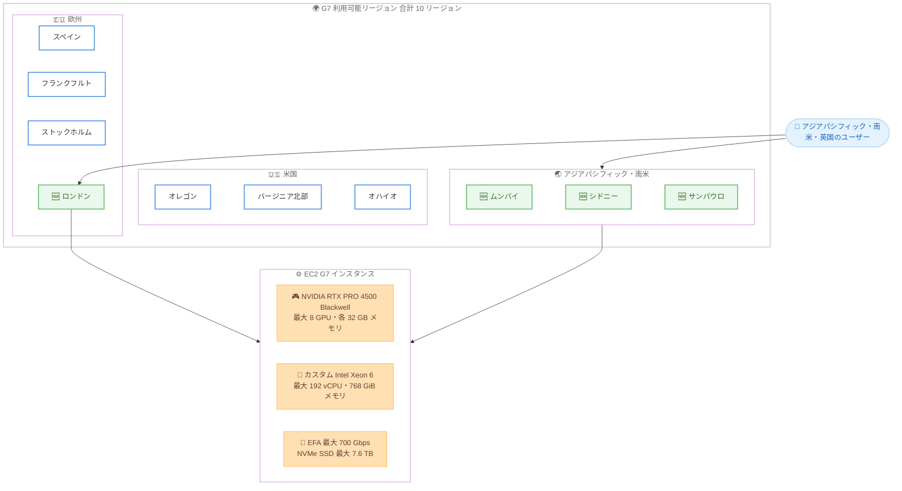

# Amazon EC2 - G7 インスタンスがロンドン、ムンバイ、シドニー、サンパウロの 4 リージョンで利用可能に

**リリース日**: 2026 年 11 月 10 日
**サービス**: Amazon EC2
**機能**: Amazon EC2 G7 インスタンスのリージョン拡大

📊 [このアップデートのインフォグラフィックを見る](https://takech9203.github.io/aws-news-summary/20261110-amazon-g7-additional-regions.html)

## 概要

NVIDIA RTX PRO 4500 Blackwell Server Edition GPU を搭載した Amazon EC2 G7 インスタンスが、欧州 (ロンドン)、アジアパシフィック (ムンバイ、シドニー)、南米 (サンパウロ) の 4 リージョンで新たに利用可能になりました。今回の拡大により、G7 インスタンスはアジアパシフィックと南米で初めて利用可能になり、合計 10 リージョンに拡大しました。

G7 インスタンスは、前世代の G6 インスタンスと比較して最大 4.6 倍の AI 推論性能、最大 2.1 倍のグラフィックス性能を提供します。言語翻訳、動画・画像分析、音声認識、レコメンダーシステムなどの AI モデルのデプロイや、リアルタイムの映画品質レンダリング、ゲームストリーミングといったグラフィックスワークロードに適しています。

**アップデート前の課題**

このアップデート以前に存在していた課題や制限は以下のとおりです。

- G7 インスタンスは米国 3 リージョンと欧州 3 リージョン (スペイン、フランクフルト、ストックホルム) に限定されており、アジアパシフィックと南米では利用できなかった
- インド、オーストラリア、ブラジルなどのユーザーが G7 を利用するには、米国や欧州のリージョンを使用する必要があり、レイテンシーが増加していた
- 英国のデータレジデンシー要件があるワークロードでは、最新世代 GPU インスタンスの選択肢が限られていた

**アップデート後の改善**

今回のアップデートにより可能になったことは以下のとおりです。

- ロンドン、ムンバイ、シドニー、サンパウロの各リージョンで G7 インスタンスを起動できるようになった
- アジアパシフィックと南米のエンドユーザーに近い場所で低レイテンシーの AI 推論やグラフィックス処理を実行できるようになった
- 英国、インド、オーストラリア、ブラジルのデータレジデンシー要件を満たしながら、最新世代 GPU の性能を活用できるようになった

## アーキテクチャ図



G7 インスタンスの利用可能リージョンと主要ハードウェア構成を示した図です。今回ロンドン、ムンバイ、シドニー、サンパウロの 4 リージョンが新たに追加され、合計 10 リージョンに拡大しました。

## サービスアップデートの詳細

### 主要機能

1. **4 リージョンへの拡大 (3 大陸をカバー)**
   - 欧州 (ロンドン) リージョンで G7 インスタンスが利用可能に
   - アジアパシフィック (ムンバイ、シドニー) リージョンで G7 インスタンスが利用可能に
   - 南米 (サンパウロ) リージョンで G7 インスタンスが利用可能に
   - アジアパシフィックと南米では今回が初の G7 提供であり、既存の 6 リージョンと合わせて合計 10 リージョンに拡大

2. **NVIDIA RTX PRO 4500 Blackwell Server Edition GPU**
   - 最新の Blackwell アーキテクチャを採用した GPU を最大 8 基搭載
   - GPU あたり 32 GB の GPU メモリを搭載
   - G6 比で最大 4.6 倍の AI 推論性能、最大 2.1 倍のグラフィックス性能を実現
   - GPU アクセラレーションによるデータ分析処理も高速化

3. **幅広いワークロードへの対応**
   - AI モデルのデプロイ: 言語翻訳、動画・画像分析、音声認識、レコメンダーシステム
   - グラフィックス: リアルタイムの映画品質レンダリング、ゲームストリーミング
   - その他: 動画トランスコーディング、空間コンピューティング、データ分析

## 技術仕様

### G7 インスタンスの主要スペック

| 項目 | 詳細 |
|------|------|
| GPU | NVIDIA RTX PRO 4500 Blackwell Server Edition を最大 8 基 |
| GPU メモリ | GPU あたり 32 GB |
| CPU | カスタム Intel Xeon 6 プロセッサ |
| vCPU | 最大 192 |
| システムメモリ | 最大 768 GiB |
| ネットワーク | 最大 700 Gbps の Elastic Fabric Adapter (EFA) 帯域幅 |
| ローカルストレージ | 最大 7.6 TB の NVMe SSD |

### 性能比較 (G6 比)

| ワークロード | 性能向上 |
|------|------|
| AI 推論 | 最大 4.6 倍 |
| グラフィックス | 最大 2.1 倍 |

## 設定方法

### 前提条件

1. AWS アカウントを保有していること
2. 利用するリージョン (ロンドン: eu-west-2、ムンバイ: ap-south-1、シドニー: ap-southeast-2、サンパウロ: sa-east-1) で G7 インスタンスの vCPU クォータが十分であること
3. GPU ドライバーを含む AMI (NVIDIA ドライバー入り Deep Learning AMI など) を選択していること

### 手順

#### ステップ 1: 利用可能なインスタンスタイプの確認

```bash
aws ec2 describe-instance-type-offerings \
  --region ap-southeast-2 \
  --filters "Name=instance-type,Values=g7.*" \
  --query "InstanceTypeOfferings[].InstanceType"
```

シドニーリージョンで利用可能な G7 インスタンスタイプの一覧を取得します。他のリージョンの場合は `--region` に対象リージョンコードを指定します。

#### ステップ 2: G7 インスタンスの起動

```bash
aws ec2 run-instances \
  --region ap-southeast-2 \
  --instance-type g7.xlarge \
  --image-id ami-xxxxxxxxxxxxxxxxx \
  --key-name my-key-pair \
  --subnet-id subnet-xxxxxxxx \
  --security-group-ids sg-xxxxxxxx
```

シドニーリージョンで G7 インスタンスを起動します。AMI には NVIDIA GPU ドライバーを含むイメージを指定してください。

#### ステップ 3: GPU の認識確認

```bash
nvidia-smi
```

インスタンスに SSH 接続後、NVIDIA RTX PRO 4500 Blackwell GPU が正しく認識されていることを確認します。

## メリット

### ビジネス面

- **低レイテンシー**: アジアパシフィック、南米、英国のエンドユーザーに近いリージョンで AI 推論やゲームストリーミングを提供でき、ユーザー体験が向上する
- **データレジデンシー対応**: 英国、インド、オーストラリア、ブラジルの規制・コンプライアンス要件を満たしながら最新 GPU を利用できる
- **柔軟な購入オプション**: オンデマンド、スポットインスタンス、Savings Plans から選択でき、コストを最適化できる

### 技術面

- **大幅な性能向上**: G6 比で最大 4.6 倍の AI 推論性能により、同一コストでより高いスループットを実現できる
- **大容量 GPU メモリ**: GPU あたり 32 GB のメモリにより、より大きな AI モデルのデプロイが可能
- **高速ネットワーク**: 最大 700 Gbps の EFA 帯域幅により、分散推論やマルチノード処理にも対応

## デメリット・制約事項

### 制限事項

- 利用可能リージョンは米国 3 リージョン、欧州 4 リージョン、アジアパシフィック 2 リージョン、南米 1 リージョンの合計 10 リージョンに限定される (2026 年 11 月時点)
- 東京・大阪リージョンではまだ利用できない
- RTX PRO 4500 は GPU あたり 32 GB のメモリであるため、超大規模モデルの学習には P 系インスタンスなどの検討が必要

### 考慮すべき点

- 新しいリージョンでの提供開始直後はキャパシティが限られる場合があるため、大規模利用時はキャパシティ予約の検討を推奨
- G7 インスタンスの vCPU クォータが不足している場合は、事前にクォータの引き上げ申請が必要
- 既存の G6 ワークロードを移行する際は、ドライバーや CUDA バージョンの互換性を確認する必要がある

## ユースケース

### ユースケース 1: インド向け多言語 AI 推論サービスの提供

**シナリオ**: インドの企業が、多言語翻訳や音声認識の API をインド国内のユーザーに提供する。

**実装例**:
```
1. ムンバイリージョンに G7 インスタンスで推論クラスターを構築
2. Auto Scaling グループで需要に応じて GPU インスタンスをスケール
3. Application Load Balancer 経由で推論 API を提供
```

**効果**: データをインド国内に保持しながら、G6 比最大 4.6 倍の推論性能で高スループットな AI サービスを低レイテンシーで提供できる。

### ユースケース 2: オセアニアユーザー向けゲームストリーミング

**シナリオ**: ゲーム企業がオーストラリア・ニュージーランドのプレイヤー向けにクラウドゲームストリーミングサービスを展開する。

**実装例**:
```
1. シドニーリージョンに G7 インスタンスでストリーミング基盤を構築
2. RTX PRO 4500 Blackwell GPU でリアルタイムレンダリングを実行
3. 低レイテンシーで映像をプレイヤーにストリーミング配信
```

**効果**: 従来は米国西部リージョンなどを利用する必要があったオセアニアのプレイヤーに対して、低レイテンシーかつ映画品質のレンダリングによる高品質なゲーム体験を提供できる。

### ユースケース 3: 南米での動画・画像分析パイプライン

**シナリオ**: ブラジルのメディア企業が、大量の動画コンテンツの分析とトランスコーディングを GPU アクセラレーションで処理する。

**実装例**:
```
1. サンパウロリージョンで G7 のスポットインスタンスを利用
2. SQS キューに動画分析・トランスコードジョブを登録
3. スポット中断に備えてチェックポイント機構を実装し、バッチ処理を実行
```

**効果**: 南米リージョン内でデータを完結させながら、スポットインスタンスの活用によりオンデマンド比で大幅にコストを削減し、高速な GPU 処理を実現できる。

## 料金

G7 インスタンスは以下の購入オプションで利用できます。

- **オンデマンドインスタンス**: 初期費用なし、秒単位の従量課金
- **スポットインスタンス**: 中断を許容できるワークロードで大幅なコスト削減が可能
- **Savings Plans**: 1 年または 3 年のコミットメントによる割引

リージョンおよびインスタンスサイズごとの最新料金は [EC2 料金ページ](https://aws.amazon.com/ec2/pricing/) を参照してください。

## 利用可能リージョン

2026 年 11 月時点で、G7 インスタンスは以下の 10 リージョンで利用可能です。

- 米国西部 (オレゴン)
- 米国東部 (バージニア北部)
- 米国東部 (オハイオ)
- 欧州 (スペイン)
- 欧州 (フランクフルト)
- 欧州 (ストックホルム)
- 欧州 (ロンドン) 🆕
- アジアパシフィック (ムンバイ) 🆕
- アジアパシフィック (シドニー) 🆕
- 南米 (サンパウロ) 🆕

## 関連サービス・機能

- **Amazon EC2 G6 インスタンス**: 前世代の NVIDIA L4 GPU 搭載インスタンス。G7 への移行で最大 4.6 倍の AI 推論性能向上が見込める
- **Amazon EC2 G7e インスタンス**: NVIDIA RTX PRO 6000 Blackwell GPU を搭載した上位モデル。より大きな GPU メモリが必要な場合に検討
- **Elastic Fabric Adapter (EFA)**: G7 では最大 700 Gbps の帯域幅をサポートし、分散ワークロードの通信を高速化
- **Amazon EC2 Capacity Blocks / キャパシティ予約**: GPU キャパシティを確実に確保したい場合に活用

## 参考リンク

- 📊 [インフォグラフィック](https://takech9203.github.io/aws-news-summary/20261110-amazon-g7-additional-regions.html)
- [公式発表 (What's New)](https://aws.amazon.com/about-aws/whats-new/2026/11/amazon-g7-additional-regions/)
- [AWS Blog - Announcing Amazon EC2 G7 instances](https://aws.amazon.com/blogs/aws/announcing-amazon-ec2-g7-instances-accelerated-by-nvidia-rtx-pro-4500-blackwell-server-edition-gpus/)
- [Amazon EC2 G7 インスタンス](https://aws.amazon.com/ec2/instance-types/g7/)
- [EC2 料金ページ](https://aws.amazon.com/ec2/pricing/)

## まとめ

NVIDIA RTX PRO 4500 Blackwell GPU を搭載した EC2 G7 インスタンスがロンドン、ムンバイ、シドニー、サンパウロに拡大し、アジアパシフィックと南米で初めて利用可能になりました。これらの地域で AI 推論やグラフィックスワークロードを運用している場合は、エンドユーザーに近いリージョンへの移行による低レイテンシー化と、G6 からの移行による性能向上 (AI 推論で最大 4.6 倍) を評価することを推奨します。
