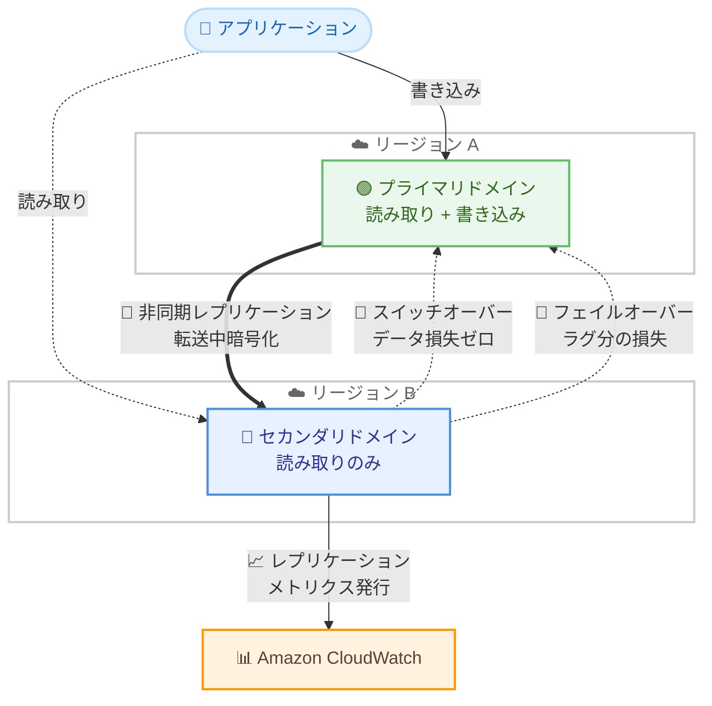

# Amazon OpenSearch Service - マネージドクロスリージョンディザスタリカバリ

**リリース日**: 2026 年 11 月 10 日
**サービス**: Amazon OpenSearch Service
**機能**: マネージドクロスリージョンディザスタリカバリ (DR)

📊 [このアップデートのインフォグラフィックを見る](https://takech9203.github.io/aws-news-summary/20261110-amazon-opensearch-service-managed-cross-region-disaster-recovery.html)

## 概要

Amazon OpenSearch Service が、マネージド型のクロスリージョンディザスタリカバリ (DR) 機能を発表しました。単一の API 呼び出し、またはマネジメントコンソールでの数ステップの操作だけで、2 つの AWS リージョンにあるドメインをペアリングし、1 分未満の RPO (目標復旧時点) と 20 分未満の RTO (目標復旧時間) を実現できます。

本機能はアクティブ/パッシブモデルを採用しており、プライマリドメインへの書き込みがセカンダリドメインへ非同期に継続レプリケーションされます。ドメイン間の接続はサービス側が管理し、レプリケーションデータは転送中に暗号化されるため、VPC ピアリングなどのネットワーク設定をユーザーが構築する必要はありません。計画的な「スイッチオーバー」ではデータ損失ゼロでロールを交換でき、障害時の「フェイルオーバー」ではレプリケーションラグの範囲内の損失でセカンダリを昇格できます。

検索、AI、分析といったミッションクリティカルなワークロードを OpenSearch Service 上で運用し、リージョン障害に備えた事業継続性 (BCP) 要件を持つユーザーにとって重要なアップデートです。

**アップデート前の課題**

このアップデート以前は、OpenSearch Service でクロスリージョン DR を実現するには自前での構築・運用が必要でした。

- クロスクラスターレプリケーションの設定やスナップショットベースの復旧手順を自分で設計・構築・保守する必要があった
- フェイルオーバーやフェイルバックの手順が複雑で、運用負荷と人為的ミスのリスクが高かった
- レプリケーションの健全性やラグを監視する仕組みを独自に用意する必要があった

**アップデート後の改善**

- 単一の API 呼び出しまたはコンソールの数ステップで、別リージョンのドメインとペアリングして DR を構成できるようになった
- RPO 1 分未満、RTO 20 分未満というマネージドな目標値が提供されるようになった
- 計画メンテナンスやリージョンローテーション時は、データ損失ゼロのスイッチオーバーでロールを交換できるようになった
- レプリケーションの健全性とラグを Amazon CloudWatch メトリクスで標準的に監視できるようになった

## アーキテクチャ図



プライマリドメインの変更がセカンダリドメインへ非同期にレプリケーションされ、セカンダリ側が CloudWatch にレプリケーションメトリクスを発行します。計画時はスイッチオーバー、障害時はフェイルオーバーによってセカンダリをプライマリへ昇格できます。

## サービスアップデートの詳細

### 主要機能

1. **シンプルなドメインペアリング**
   - プライマリドメインのリージョンで `AddReplicationPeer` API を呼び出すか、コンソールの数ステップで DR を構成
   - `--dry-run` オプションにより、レプリケーション関係を作成せずに前提条件の検証のみを実行可能
   - ドメイン間の接続はサービスが管理し、VPC ピアリングなどのネットワーク設定は不要
   - レプリケーションデータは転送中に暗号化される

2. **継続的な非同期レプリケーション**
   - DR 設定時に既存のすべてのインデックスをセカンダリドメインへ初期コピー
   - 初期コピー後は、新しい変更を非同期にレプリケーションし、セカンダリ側でインデックス化
   - インデックス、ドキュメント、インデックス設定、エイリアス、データストリームをレプリケーション
   - インデックステンプレート、インジェストパイプライン、ISM ポリシー、ロール、クラスター設定はレプリケーション対象外のため、IaC での同期が推奨される

3. **計画的スイッチオーバー**
   - メンテナンスやリージョンローテーションなどの計画イベント向け
   - 保留中の変更をすべてレプリケーションしてから、データ損失ゼロでプライマリとセカンダリのロールを交換
   - スイッチオーバー後は旧プライマリがセカンダリとなり、逆方向にレプリケーションを継続
   - スイッチオーバー中は短時間、両ドメインとも書き込みを受け付けないため、アプリケーション側でリトライ設定が必要

4. **障害時のフェイルオーバー**
   - プライマリドメインが利用不可になった場合、`FailoverReplication` でセカンダリを一方的に昇格
   - データ損失はフェイルオーバー時点のレプリケーションラグの範囲に限定される
   - フェイルオーバーは手動であり、自動化する場合は CloudWatch アラームなどを契機に API を呼び出す仕組みを独自に構築する
   - フェイルオーバー後は、新しいプライマリを空のセカンダリドメインと再ペアリングして保護を回復する

5. **CloudWatch によるレプリケーション監視**
   - セカンダリドメインが 1 分ごとに DR メトリクスを CloudWatch に発行
   - ラグ時間、未適用の変更数、初期コピー中・劣化・失敗したインデックス数を監視可能

## 技術仕様

### 機能仕様

| 項目 | 詳細 |
|------|------|
| RPO | 1 分未満 |
| RTO | 20 分未満 |
| レプリケーション方式 | 非同期 (アクティブ/パッシブモデル) |
| 読み取り | 両ドメインで可能 |
| 書き込み | プライマリドメインのみ |
| 必要バージョン | OpenSearch 3.7 以降 (両ドメインで同一バージョン) |
| アカウント要件 | 両ドメインが同一 AWS アカウント、異なるリージョン |
| セキュリティ要件 | きめ細かなアクセスコントロールとノード間暗号化が両ドメインで有効 |
| KMS | カスタマーマネージド AWS KMS キーで暗号化されたドメインをサポート |
| 非サポート | UltraWarm、コールドストレージ、マルチティアストレージの書き込み可能ウォーム層、OR1/OR2 インスタンス、ログ分析向け最適化エンジン、自動セマンティックエンリッチメント |

### CloudWatch メトリクス

| メトリクス | 説明 | 単位 |
|------|------|------|
| DisasterRecoveryReplicationLagTime | セカンダリがプライマリから遅延しているおおよその時間 | ミリ秒 |
| DisasterRecoveryReplicationLagOps | セカンダリが未適用の変更数 (0 で完全に追従) | 件数 |
| DisasterRecoveryBootstrappingIndices | 初回フルコピー実行中のインデックス数 | 件数 |
| DisasterRecoveryDegradedIndices | レプリケーション中だが完全に正常でないインデックス数 (0 が正常) | 件数 |
| DisasterRecoveryFailedIndices | エラーによりレプリケーションが停止したインデックス数 (0 が正常) | 件数 |

### DR 関連 API オペレーション

| API | 説明 |
|------|------|
| AddReplicationPeer | セカンダリドメインをレプリケーションピアとして追加 |
| RemoveReplicationPeer | レプリケーション関係を削除 (両ドメインはデータを保持) |
| SwitchoverReplication | データ損失ゼロの計画的スイッチオーバーを実行 |
| FailoverReplication | セカンダリドメインをプライマリへ一方的に昇格 |
| DescribeDomainReplication | 各ドメインのロールとレプリケーションステータスを取得 |
| CompareDomainConfiguration | 2 つのドメイン間の主要な設定カテゴリの差分を比較 |

### API変更履歴

| 日付 | サービス | 変更内容 |
|------|----------|----------|
| 2026/11/09 | [Amazon OpenSearch Service](https://awsapichanges.com/archive/changes/588ec7-es.html) | 1 new 2 updated api methods - クローンベースのブルーグリーンアップグレードを追加。`UpgradeDomain` が `DeploymentStrategyOptions` を受け付け、新しい `UpdateClone` API でトラフィック移行・カットオーバー・保持期間を制御。3.7 へのアップグレードパスとして本 DR 機能と組み合わせて利用可能 |

## 設定方法

### 前提条件

1. プライマリ・セカンダリの両ドメインが OpenSearch 3.7 以降の同一バージョンで稼働していること
2. 両ドメインが同一 AWS アカウント内の異なるリージョンに存在すること
3. 両ドメインできめ細かなアクセスコントロールとノード間暗号化が有効であること
4. セカンダリドメインが空であること (システムインデックス以外のインデックスを含まない)
5. セカンダリドメインがプライマリと同等以上のストレージ容量を持つこと

### 手順

#### ステップ1: 前提条件の検証

```bash
aws opensearch add-replication-peer \
  --domain-name my-primary-domain \
  --peer-domain-arn arn:aws:es:us-west-2:123456789012:domain/my-secondary-domain \
  --region us-east-1 \
  --dry-run
```

`--dry-run` オプション付きで `AddReplicationPeer` を呼び出し、レプリケーション関係を作成せずに、2 つのドメインがペアリング可能かどうかの前提条件を検証します。

#### ステップ2: レプリケーション関係の作成

```bash
aws opensearch add-replication-peer \
  --domain-name my-primary-domain \
  --peer-domain-arn arn:aws:es:us-west-2:123456789012:domain/my-secondary-domain \
  --region us-east-1
```

プライマリドメインのリージョンで `AddReplicationPeer` を呼び出し、セカンダリドメインをレプリケーションピアとして追加します。レプリケーション関係は非同期に作成され、既存インデックスの初期コピーが開始されます。

#### ステップ3: レプリケーションステータスの確認

```bash
aws opensearch describe-domain-replication \
  --domain-name my-primary-domain \
  --region us-east-1
```

`DescribeDomainReplication` でドメインのロール (PRIMARY / SECONDARY) とレプリケーションステータスを確認します。ステータスが `ACTIVE` になればレプリケーションが稼働しています。初期コピーの完了は CloudWatch の `DisasterRecoveryBootstrappingIndices` メトリクスが 0 に戻ることで確認できます。

#### ステップ4: スイッチオーバーまたはフェイルオーバーの実行

```bash
# 計画的スイッチオーバー (セカンダリのリージョンで実行)
aws opensearch switchover-replication \
  --domain-name my-secondary-domain \
  --peer-domain-arn arn:aws:es:us-east-1:123456789012:domain/my-primary-domain \
  --region us-west-2

# 障害時フェイルオーバー (データ損失の許容を明示)
aws opensearch failover-replication \
  --domain-name my-secondary-domain \
  --peer-domain-arn arn:aws:es:us-east-1:123456789012:domain/my-primary-domain \
  --allow-data-loss \
  --region us-west-2
```

いずれも昇格させたいセカンダリドメインのリージョンで実行します。フェイルオーバーはデータ損失の可能性があるため `--allow-data-loss` オプションが必須です。切り替え後は、アプリケーションの書き込み先を新しいプライマリドメインへ変更する必要があります。

## メリット

### ビジネス面

- **事業継続性の確保**: RPO 1 分未満、RTO 20 分未満のマネージドな目標値により、ミッションクリティカルな検索・分析基盤の BCP 要件を満たしやすくなる
- **運用コストの削減**: 自前のレプリケーション構築・保守が不要になり、DR 体制の構築・維持にかかる工数を大幅に削減できる
- **追加料金なし**: DR 機能自体に追加料金はなく、セカンダリドメインとリージョン間データ転送の標準料金のみで利用できる

### 技術面

- **ネットワーク設定不要**: ドメイン間の接続はサービスが管理し、VPC ピアリングなどの構成が不要。レプリケーションデータは転送中に暗号化される
- **データ損失ゼロのスイッチオーバー**: 計画メンテナンスや DR 訓練を、データ損失なしで安全に実施できる
- **標準化された監視**: CloudWatch メトリクスでレプリケーションラグや健全性を監視し、アラームによる自動化の起点にできる
- **読み取りキャパシティの活用**: セカンダリドメインも読み取りに利用できるため、待機系を有効活用できる

## デメリット・制約事項

### 制限事項

- 両ドメインが OpenSearch 3.7 以降の同一バージョンである必要がある (バージョンが異なる間はスイッチオーバー不可)
- 両ドメインが同一 AWS アカウント内である必要があり、クロスアカウント構成はサポートされない
- 1 つのドメインが持てるレプリケーションピアは 1 つのみ
- UltraWarm、コールドストレージ、OR1/OR2 インスタンス、ログ分析向け最適化エンジン、自動セマンティックエンリッチメントを使用するドメインはサポートされない
- セカンダリドメインは DR 設定時に空である必要がある
- クローズされたインデックスは DR で保護されず、再オープン時にフルコピーが必要

### 考慮すべき点

- フェイルオーバーは手動であり、自動昇格は行われない。自動化する場合は CloudWatch アラームと連携した独自の仕組みが必要
- スイッチオーバー・フェイルオーバー後のアプリケーションのエンドポイント切り替えはユーザー側の責任 (サービスはリダイレクトしない)
- インデックステンプレート、インジェストパイプライン、ISM ポリシー、ロールなどはレプリケーションされないため、IaC でセカンダリ側にも事前に作成しておく必要がある (`CompareDomainConfiguration` で差分検出が可能)
- フェイルオーバー後、旧プライマリは自動では再同期されず、保護回復には空のセカンダリとの再ペアリングとフルコピーが必要
- クローンベースアップグレードを使用する場合は、事前にレプリケーション関係を削除する必要がある
- セカンダリドメインの長期間の停止後は、影響を受けたインデックスの再ブートストラップが必要になる場合がある

## ユースケース

### ユースケース1: ミッションクリティカルな検索基盤のリージョン障害対策

**シナリオ**: E コマースサイトの商品検索基盤を OpenSearch Service で運用しており、リージョン障害時にも検索サービスを継続する必要がある。

**実装例**:
```bash
# 東京リージョンのプライマリと大阪リージョンのセカンダリをペアリング
aws opensearch add-replication-peer \
  --domain-name ec-search-primary \
  --peer-domain-arn arn:aws:es:ap-northeast-3:123456789012:domain/ec-search-secondary \
  --region ap-northeast-1
```

**効果**: リージョン障害時にフェイルオーバーで大阪リージョンへ切り替え、RTO 20 分未満で検索サービスを復旧。データ損失はレプリケーションラグ (RPO 1 分未満) の範囲に限定される。

### ユースケース2: 定期的な DR 訓練とリージョンローテーション

**シナリオ**: 金融系システムのコンプライアンス要件として、定期的な DR 訓練の実施と復旧手順の実効性確認が求められている。

**実装例**:
```bash
# セカンダリのリージョンでスイッチオーバーを実行 (データ損失ゼロ)
aws opensearch switchover-replication \
  --domain-name dr-secondary \
  --peer-domain-arn arn:aws:es:us-east-1:123456789012:domain/dr-primary \
  --region us-west-2
```

**効果**: データ損失ゼロの計画的スイッチオーバーにより、本番データを失うリスクなしに DR 手順を定期的にリハーサルできる。訓練後は再度スイッチオーバーして元の構成に戻せる。

### ユースケース3: CloudWatch アラームによるレプリケーション監視の自動化

**シナリオ**: レプリケーションラグの増大や失敗インデックスの発生を早期に検知し、運用チームへ通知したい。

**実装例**:
```bash
# レプリケーションラグ時間のアラームを作成
aws cloudwatch put-metric-alarm \
  --alarm-name opensearch-dr-lag-alarm \
  --namespace AWS/ES \
  --metric-name DisasterRecoveryReplicationLagTime \
  --statistic Maximum \
  --period 60 \
  --threshold 60000 \
  --comparison-operator GreaterThanThreshold \
  --evaluation-periods 5 \
  --alarm-actions arn:aws:sns:us-west-2:123456789012:dr-alerts
```

**効果**: レプリケーションラグが閾値を超えた場合に SNS 経由で通知を受け取り、RPO 要件の逸脱を早期に検知できる。フェイルオーバー判断の起点としても活用可能。

## 料金

ディザスタリカバリ機能自体に追加料金はありません。以下の標準料金が適用されます。

- セカンダリドメインのインスタンス・ストレージに対する Amazon OpenSearch Service の標準料金
- DR がリージョン間でレプリケーションするデータに対する標準の AWS データ転送料金

詳細は [Amazon OpenSearch Service 料金ページ](https://aws.amazon.com/opensearch-service/pricing/) を参照してください。

## 利用可能リージョン

Amazon OpenSearch Service が利用可能なすべての AWS 商用リージョンで利用できます。対象リージョンの一覧は [AWS リージョン別サービス表](https://docs.aws.amazon.com/general/latest/gr/opensearch-service.html) を参照してください。

## 関連サービス・機能

- **Amazon CloudWatch**: レプリケーションラグや健全性のメトリクス監視、フェイルオーバー自動化のトリガーとして連携
- **AWS KMS**: カスタマーマネージドキーで暗号化されたドメインでも DR を利用可能
- **マルチ AZ 構成**: 単一リージョン内の AZ 障害対策にはマルチ AZ、リージョン障害対策には本 DR 機能と、保護レベルに応じて使い分け
- **クローンベースアップグレード**: 3.7 より前のバージョンを利用中の場合、クローンベースアップグレードで 3.7 をテストし、準備ができたらカットオーバー、必要ならロールバックが可能

## 参考リンク

- 📊 [インフォグラフィック](https://takech9203.github.io/aws-news-summary/20261110-amazon-opensearch-service-managed-cross-region-disaster-recovery.html)
- [公式発表 (What's New)](https://aws.amazon.com/about-aws/whats-new/2026/11/amazon-opensearch-service-managed-cross-region-disaster-recovery/)
- [ドキュメント: Setting up managed disaster recovery in Amazon OpenSearch Service](https://docs.aws.amazon.com/opensearch-service/latest/developerguide/disaster-recovery.html)
- [ドキュメント: Upgrading Amazon OpenSearch Service domains](https://docs.aws.amazon.com/opensearch-service/latest/developerguide/version-migration.html)
- [料金ページ](https://aws.amazon.com/opensearch-service/pricing/)

## まとめ

Amazon OpenSearch Service のマネージドクロスリージョン DR により、これまで自前で構築・運用する必要があったリージョン間のレプリケーションとフェイルオーバーが、追加料金なしのマネージド機能として利用できるようになりました。RPO 1 分未満・RTO 20 分未満という明確な目標値が提供されるため、ミッションクリティカルな検索・分析ワークロードの BCP 設計を大幅に簡素化できます。利用には OpenSearch 3.7 以降が必要なため、まずは対象ドメインのバージョンアップ計画と、レプリケーションされないリソース (テンプレート、パイプライン、ロールなど) の IaC 管理を検討することを推奨します。
