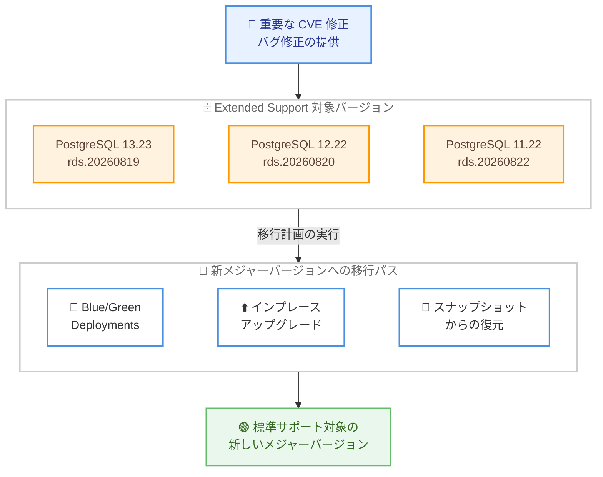

# Amazon RDS for PostgreSQL - Extended Support マイナーバージョン 13.23 / 12.22 / 11.22 のリリース

**リリース日**: 2026 年 11 月 10 日
**サービス**: Amazon RDS for PostgreSQL
**機能**: RDS Extended Support マイナーバージョン (13.23-rds.20260819、12.22-rds.20260820、11.22-rds.20260822)

📊 [このアップデートのインフォグラフィックを見る](https://takech9203.github.io/aws-news-summary/20261110-amazon-rds-postgresql-extended-support.html)

## 概要

Amazon RDS for PostgreSQL が、RDS Extended Support 対象の新しいマイナーバージョン 13.23-rds.20260819、12.22-rds.20260820、11.22-rds.20260822 をリリースしました。これらは、標準サポートが終了した PostgreSQL メジャーバージョン 13、12、11 を利用中のユーザー向けに提供される、重要な CVE (共通脆弱性識別子) 修正とバグ修正を含むアップデートです。

Amazon RDS Extended Support は、メジャーバージョンの標準サポート終了後も最大 3 年間、重要な CVE とバグに対する修正を提供するプログラムです。これにより、ユーザーは新しいメジャーバージョンへの移行計画を進めながら、既存のデータベースを安全に稼働し続けるための時間を確保できます。

旧バージョンの PostgreSQL をまだ運用しており、アップグレードの準備期間中もセキュリティパッチを適用し続けたいユーザーにとって重要なアップデートです。あわせて、新しいメジャーバージョンへの移行手段として Amazon RDS Blue/Green Deployments、インプレースアップグレード、スナップショットからの復元が案内されています。

**アップデート前の課題**

- 標準サポートが終了した PostgreSQL 13、12、11 系では、コミュニティによる修正が提供されず、脆弱性対応が困難だった
- 旧バージョンを使い続ける場合、重要な CVE やバグへの修正を適用する手段が限られていた
- メジャーバージョンアップグレードには検証期間が必要であり、その間のセキュリティリスクが懸念されていた

**アップデート後の改善**

- PostgreSQL 13.23、12.22、11.22 の各 Extended Support マイナーバージョンにより、重要な CVE 修正とバグ修正を適用できるようになった
- 標準サポート終了後も最大 3 年間、修正提供を受けながら移行計画を進められる
- マネジメントコンソールまたは AWS CLI から、新しいマイナーバージョンへ簡単に更新できる

## アーキテクチャ図



Extended Support 対象バージョンへ重要な修正が提供される一方で、3 つの移行パスを通じて標準サポート対象の新しいメジャーバージョンへ移行する流れを示しています。

## サービスアップデートの詳細

### 主要機能

1. **Extended Support マイナーバージョンの提供**
   - PostgreSQL 13 系: 13.23-rds.20260819
   - PostgreSQL 12 系: 12.22-rds.20260820
   - PostgreSQL 11 系: 11.22-rds.20260822
   - バージョン名の `rds.YYYYMMDD` 部分は、AWS が独自にビルドした Extended Support リリースであることを示す

2. **重要な CVE 修正とバグ修正**
   - 標準サポート終了後のメジャーバージョンに対し、最大 3 年間にわたり重要な CVE 修正とバグ修正を提供
   - 新しいメジャーバージョンへのアップグレード準備期間中も、セキュリティを維持したまま運用を継続できる

3. **柔軟なアップグレードパス**
   - **Amazon RDS Blue/Green Deployments**: 本番環境のコピー (Green 環境) で変更を検証してから切り替えることで、ダウンタイムとリスクを最小化
   - **インプレースアップグレード**: 既存インスタンスを直接アップグレード
   - **スナップショットからの復元**: スナップショットを新バージョンのインスタンスとして復元

## 技術仕様

### 対象バージョン

| メジャーバージョン | Extended Support マイナーバージョン |
|------|------|
| PostgreSQL 13 | 13.23-rds.20260819 |
| PostgreSQL 12 | 12.22-rds.20260820 |
| PostgreSQL 11 | 11.22-rds.20260822 |

### Extended Support の概要

| 項目 | 詳細 |
|------|------|
| 提供期間 | メジャーバージョンの標準サポート終了後、最大 3 年間 |
| 提供内容 | 重要な CVE 修正、バグ修正 |
| 更新方法 | Amazon RDS マネジメントコンソール、AWS CLI |

## 設定方法

### 前提条件

1. Amazon RDS for PostgreSQL 13、12、11 のいずれかの DB インスタンスを運用していること
2. RDS Extended Support が有効になっていること (標準サポート終了後に該当バージョンを継続利用している場合、自動的に Extended Support へ移行)
3. 更新前にスナップショットなどのバックアップを取得しておくこと

### 手順

#### ステップ1: 現在のエンジンバージョンの確認

```bash
aws rds describe-db-instances \
  --db-instance-identifier my-postgres-instance \
  --query "DBInstances[0].EngineVersion"
```

対象の DB インスタンスの現在の PostgreSQL エンジンバージョンを確認します。

#### ステップ2: 利用可能なアップグレードターゲットの確認

```bash
aws rds describe-db-engine-versions \
  --engine postgres \
  --engine-version 13.22 \
  --query "DBEngineVersions[0].ValidUpgradeTarget[].EngineVersion"
```

現在のバージョンからアップグレード可能なバージョンの一覧を取得し、新しい Extended Support マイナーバージョンが含まれることを確認します。

#### ステップ3: マイナーバージョンの適用

```bash
aws rds modify-db-instance \
  --db-instance-identifier my-postgres-instance \
  --engine-version 13.23 \
  --apply-immediately
```

DB インスタンスのエンジンバージョンを新しい Extended Support マイナーバージョンへ更新します。`--apply-immediately` を指定しない場合は、次回のメンテナンスウィンドウで適用されます。

## メリット

### ビジネス面

- **移行計画の柔軟性**: 標準サポート終了後も最大 3 年間の猶予が得られ、業務影響を考慮した計画的なアップグレードが可能
- **コンプライアンス維持**: 重要な CVE 修正が継続提供されるため、セキュリティ要件や監査要件を満たしやすい
- **事業継続性**: 旧バージョン依存のアプリケーションを急いで改修することなく、安全に運用を継続できる

### 技術面

- **セキュリティリスクの低減**: コミュニティサポートが終了したバージョンでも、重要な脆弱性への修正を適用できる
- **検証済みのアップグレードパス**: Blue/Green Deployments により、本番影響を抑えながら新バージョンを検証できる
- **運用の簡素化**: マネジメントコンソールや AWS CLI から標準的な手順でマイナーバージョンを適用できる

## デメリット・制約事項

### 制限事項

- Extended Support で提供されるのは重要な CVE 修正とバグ修正であり、新機能は追加されない
- Extended Support の提供期間は標準サポート終了後、最大 3 年間に限られる
- Extended Support 期間終了後は、新しいメジャーバージョンへのアップグレードが必要になる

### 考慮すべき点

- RDS Extended Support は標準の RDS 料金に加えて追加料金が発生するため、長期利用時のコストを考慮する必要がある
- Extended Support はあくまで移行までの猶予期間であり、早期に新しいメジャーバージョン (PostgreSQL 14 以降) への移行計画を立てることが推奨される
- マイナーバージョン適用時には短時間のダウンタイムが発生する可能性があるため、メンテナンスウィンドウの計画が必要

## ユースケース

### ユースケース1: レガシーアプリケーションのセキュリティ維持

**シナリオ**: PostgreSQL 11 に依存するレガシーアプリケーションを運用しており、改修とアップグレードの完了まで時間が必要。

**実装例**:
```bash
# 11.22-rds.20260822 へマイナーバージョンを更新
aws rds modify-db-instance \
  --db-instance-identifier legacy-app-db \
  --engine-version 11.22 \
  --no-apply-immediately
```

**効果**: アプリケーション改修期間中も重要な CVE 修正を適用し、セキュリティリスクを抑えながら運用を継続できる。

### ユースケース2: Blue/Green Deployments による安全なメジャーバージョン移行

**シナリオ**: PostgreSQL 13 から新しいメジャーバージョンへの移行を、本番影響を最小限に抑えて実施したい。

**実装例**:
```bash
# Blue/Green デプロイメントを作成して新バージョンを検証
aws rds create-blue-green-deployment \
  --blue-green-deployment-name pg13-upgrade \
  --source arn:aws:rds:ap-northeast-1:123456789012:db:prod-db \
  --target-engine-version 17.4
```

**効果**: Green 環境で新バージョンの動作を十分に検証してから切り替えでき、移行リスクとダウンタイムを最小化できる。

### ユースケース3: フリート全体のバージョン棚卸しと計画的更新

**シナリオ**: 複数の RDS for PostgreSQL インスタンスを運用しており、Extended Support 対象のインスタンスを特定して最新マイナーバージョンへ統一したい。

**実装例**:
```bash
# PostgreSQL 11/12/13 系のインスタンスを一覧化
aws rds describe-db-instances \
  --query "DBInstances[?Engine=='postgres' && starts_with(EngineVersion, '1')].[DBInstanceIdentifier, EngineVersion]" \
  --output table
```

**効果**: Extended Support 対象インスタンスを把握し、最新の修正適用と新メジャーバージョンへの移行計画を組織的に進められる。

## 料金

RDS Extended Support の利用には、標準の RDS インスタンス料金に加えて追加料金が発生します。料金は vCPU 時間単位で課金され、リージョンおよび Extended Support の経過年数によって異なります。詳細は料金ページを参照してください。

新しいマイナーバージョンの適用自体に追加費用はありません。

## 利用可能リージョン

公式発表にはリージョンに関する記載はありません。利用可能なバージョンはリージョンごとに異なる場合があるため、`describe-db-engine-versions` コマンドまたはドキュメントで確認してください。

## 関連サービス・機能

- **Amazon RDS Blue/Green Deployments**: 本番環境のコピーで変更を検証してから切り替える、安全なアップグレード手段
- **Amazon Aurora PostgreSQL**: Aurora でも同様に Extended Support が提供されており、移行先の選択肢にもなる
- **AWS Database Migration Service (DMS)**: メジャーバージョン間の移行やエンジン変更を支援するマイグレーションサービス

## 参考リンク

- 📊 [インフォグラフィック](https://takech9203.github.io/aws-news-summary/20261110-amazon-rds-postgresql-extended-support.html)
- [公式発表 (What's New)](https://aws.amazon.com/about-aws/whats-new/2026/11/amazon-rds-postgresql-extended-support/)
- [Amazon RDS Extended Support ドキュメント](https://docs.aws.amazon.com/AmazonRDS/latest/UserGuide/extended-support.html)
- [Amazon RDS Blue/Green Deployments ドキュメント](https://docs.aws.amazon.com/AmazonRDS/latest/UserGuide/blue-green-deployments.html)
- [PostgreSQL DB エンジンのアップグレード](https://docs.aws.amazon.com/AmazonRDS/latest/UserGuide/USER_UpgradeDBInstance.PostgreSQL.html)
- [Amazon RDS for PostgreSQL 製品ページ](https://aws.amazon.com/rds/postgresql/)
- [Amazon RDS for PostgreSQL 料金ページ](https://aws.amazon.com/rds/postgresql/pricing/)

## まとめ

PostgreSQL 13、12、11 を RDS Extended Support で運用しているユーザーは、重要な CVE 修正とバグ修正を含む今回のマイナーバージョン (13.23 / 12.22 / 11.22) を早期に適用することが推奨されます。あわせて、Extended Support はあくまで移行までの猶予期間であるため、Blue/Green Deployments などを活用して標準サポート対象のメジャーバージョンへの移行計画を進めることが重要です。
