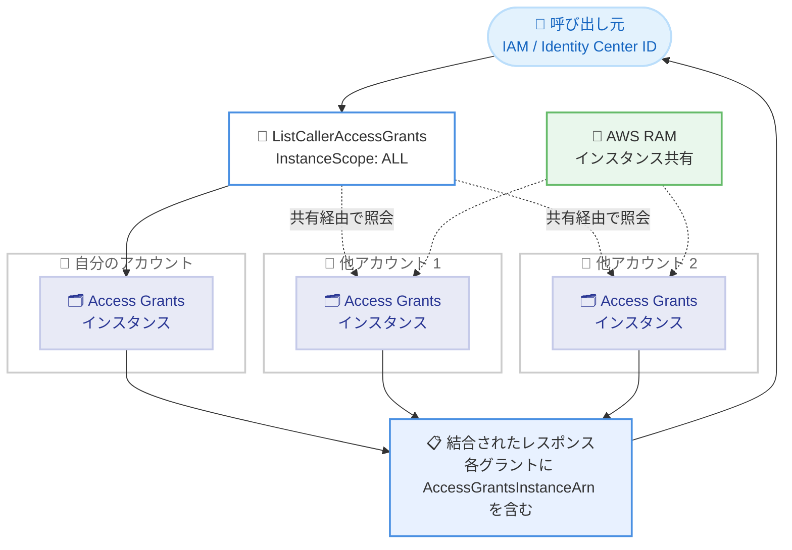

# Amazon S3 - Access Grants の複数 AWS アカウント横断でのグラント一覧表示

**リリース日**: 2026 年 11 月 10 日
**サービス**: Amazon S3 (S3 Access Grants)
**機能**: 複数 AWS アカウントにまたがるアクセスグラントの一覧表示

📊 [このアップデートのインフォグラフィックを見る](https://takech9203.github.io/aws-news-summary/20261110-amazon-s3-access-grants-list-across-regions.html)

## 概要

Amazon S3 Access Grants が、複数の AWS アカウントにまたがるアクセスグラントを 1 回の API 呼び出しで一覧表示できるようになりました。`ListCallerAccessGrants` API に新しく追加された `InstanceScope` パラメータを `ALL` に設定すると、自分のアカウントの S3 Access Grants インスタンスに加えて、AWS Resource Access Manager (AWS RAM) 経由で共有されたすべてのインスタンスのグラントが 1 つの結合されたレスポンスとして返されます。各グラントには所有アカウントを示す `AccessGrantsInstanceArn` が含まれるため、どのアカウントがそのグラントを所有しているかを判別できます。

さらに、`GetDataAccess` API でも `InstanceScope` を `ALL` に設定できるようになりました。S3 パスを指定すると、サービス側が所有アカウントを自動的に特定し、該当するインスタンスにリクエストをルーティングして、一致するグラントの一時認証情報を返します。

このアップデートは、複数アカウントにまたがる S3 データへのアクセスを提供するデータポータルやファイルブラウザアプリケーション (AWS Storage Browser for S3 など) を構築する開発者、およびマルチアカウント環境でエンドユーザーのデータアクセスを管理する組織に有用です。

**アップデート前の課題**

このアップデート以前は、複数アカウントにまたがるグラントの把握に手間がかかっていました。

- 以前はアカウントごとに個別に `ListCallerAccessGrants` を呼び出す必要があり、アクセス可能な S3 データの全体像を得るには複数回の API 呼び出しが必要だった
- 以前はアプリケーション側で、どのアカウントのどのインスタンスにグラントが存在するかを事前に把握し、管理する必要があった
- 以前は `GetDataAccess` の呼び出し時に、対象の S3 パスを所有するアカウントをアプリケーション側で特定してからリクエストを送る必要があった

**アップデート後の改善**

今回のアップデートにより、マルチアカウント環境での S3 データアクセスの可視化と利用が簡素化されました。

- 今回のアップデートにより、`InstanceScope` を `ALL` に設定した 1 回の `ListCallerAccessGrants` 呼び出しで、自分のインスタンスと共有されたすべてのインスタンスのグラントを取得できるようになった
- 今回のアップデートにより、各グラントに `AccessGrantsInstanceArn` が含まれ、所有アカウントの識別が容易になった
- 今回のアップデートにより、`GetDataAccess` が所有アカウントの特定とリクエストのルーティングを自動で行うため、アプリケーション側のアカウント管理ロジックが不要になった

## アーキテクチャ図



`InstanceScope` を `ALL` に設定した 1 回の API 呼び出しで、自分のインスタンスと AWS RAM 経由で共有されたすべてのインスタンスのグラントが照会され、結合されたレスポンスとして返される流れを示しています。

## サービスアップデートの詳細

### 主要機能

1. **複数アカウント横断でのグラント一覧表示**
   - `ListCallerAccessGrants` API に `InstanceScope` パラメータが追加された
   - `ALL` を指定すると、自分のアカウントのインスタンスと AWS RAM 経由で共有されたすべてのインスタンスのグラントを 1 回の呼び出しで取得できる
   - デフォルト (パラメータ未指定) では、従来どおり指定したアカウント ID のインスタンスのグラントのみが返される

2. **所有アカウントの識別**
   - `InstanceScope` を `ALL` に設定した場合、返される各グラントに `AccessGrantsInstanceArn` フィールドが含まれる
   - ARN にはアカウント ID が含まれるため、どのアカウントがグラントを所有しているかを判別できる

3. **GetDataAccess の自動ルーティング**
   - `GetDataAccess` API でも `InstanceScope` を `ALL` に設定できる
   - S3 パスを指定すると、サービスが所有アカウントを特定し、該当インスタンスにリクエストをルーティングして一時認証情報を返す
   - アプリケーション側でアカウントとパスの対応関係を管理する必要がなくなる

## 技術仕様

### InstanceScope パラメータ

| 項目 | 詳細 |
|------|------|
| 対象 API | `ListCallerAccessGrants`、`GetDataAccess` (S3 Control API) |
| パラメータ値 | `ALL` を指定すると共有インスタンスを含むすべてのインスタンスを対象に照会 |
| デフォルト動作 | 指定したアカウント ID のインスタンスのみを照会 |
| インスタンス共有の仕組み | AWS Resource Access Manager (AWS RAM) による共有 |
| レスポンスの追加情報 | 各グラントに `AccessGrantsInstanceArn` を含む |
| 利用方法 | AWS SDK、REST API、AWS CLI |

### API変更履歴

| 日付 | サービス | 変更内容 |
|------|----------|----------|
| 2026/11/09 | [AWS S3 Control](https://awsapichanges.com/archive/changes/588ec7-s3-control.html) | 2 updated api methods - `GetDataAccess` と `ListCallerAccessGrants` に `InstanceScope` パラメータを追加し、クロスアカウントのアクセスグラントをサポート |

## 設定方法

### 前提条件

1. S3 Access Grants インスタンスが作成済みで、IAM ID または IAM Identity Center ディレクトリ ID に対するグラントが設定されていること
2. 他アカウントのグラントを参照する場合、データ所有者側のアカウントが AWS RAM を使用して S3 Access Grants インスタンスを共有していること
3. AWS CLI、SDK、または REST API を利用できる環境があること

### 手順

#### ステップ1: 自分のアカウントのグラントを一覧表示する

```bash
aws s3control list-caller-access-grants \
  --account-id 111122223333 \
  --region us-east-2 \
  --max-results 5
```

従来どおりの呼び出し方法です。指定したアカウント ID の S3 Access Grants インスタンスから、呼び出し元がアクセス可能なグラントの一覧を取得します。

#### ステップ2: 共有されたすべてのインスタンスを横断してグラントを一覧表示する

```bash
aws s3control list-caller-access-grants \
  --account-id 111122223333 \
  --instance-scope ALL \
  --region us-east-2 \
  --max-results 5
```

`--instance-scope ALL` を指定することで、自分のアカウントのインスタンスに加えて、AWS RAM 経由で共有されたすべてのインスタンスのグラントを 1 回の呼び出しで取得します。レスポンスの各グラントには所有インスタンスを示す `AccessGrantsInstanceArn` が含まれます。

```json
{
  "CallerAccessGrantsList": [
    {
      "Permission": "READWRITE",
      "GrantScope": "s3://amzn-s3-demo-bucket/prefix1/*",
      "ApplicationArn": "NA",
      "AccessGrantsInstanceArn": "arn:aws:s3:us-east-2:111122223333:access-grants/default"
    },
    {
      "Permission": "READ",
      "GrantScope": "s3://amzn-s3-demo-other-bucket/reports/*",
      "ApplicationArn": "NA",
      "AccessGrantsInstanceArn": "arn:aws:s3:us-east-2:444455556666:access-grants/default"
    }
  ]
}
```

上記のレスポンス例では、2 つの異なるアカウント (111122223333 と 444455556666) のインスタンスからグラントが返されています。

#### ステップ3: InstanceScope を指定して一時認証情報を取得する

`GetDataAccess` でも `InstanceScope` を `ALL` に設定することで、対象の S3 パスを所有するアカウントの特定とルーティングをサービス側に任せて、一致するグラントの一時認証情報を取得できます。アプリケーション側でパスとアカウントの対応表を管理する必要はありません。

## メリット

### ビジネス面

- **マルチアカウント環境の可視性向上**: エンドユーザーがアクセスできる S3 データの全体像を 1 回の呼び出しで把握でき、データガバナンスの確認が容易になる
- **開発コストの削減**: アカウントごとのループ処理やアカウント管理ロジックが不要になり、データポータルなどのアプリケーション開発が簡素化される
- **追加コストなし**: 本機能は追加料金なしで利用できる

### 技術面

- **API 呼び出し回数の削減**: アカウント数に比例していた `ListCallerAccessGrants` の呼び出しが 1 回にまとめられる
- **自動ルーティング**: `GetDataAccess` が所有アカウントの特定とリクエストのルーティングを自動で行う
- **所有者の明示**: レスポンスの `AccessGrantsInstanceArn` により、グラントの所有アカウントをプログラムで判別できる

## デメリット・制約事項

### 制限事項

- 横断的に照会できるのは、AWS RAM 経由で呼び出し元に共有されている S3 Access Grants インスタンスに限られる
- IAM Identity Center のディレクトリ ID の場合、ID 対応セッションで使用される IAM ID のグラントが返される

### 考慮すべき点

- データ所有者側で事前に AWS RAM によるインスタンス共有の設定が必要であり、共有されていないアカウントのグラントは返されない
- 結果が複数アカウントにまたがるため、ページネーション (`NextToken`) を考慮した実装が必要になる場合がある

## ユースケース

### ユースケース1: マルチアカウント対応のデータポータル

**シナリオ**: 複数の事業部がそれぞれの AWS アカウントで S3 データを管理している企業で、エンドユーザーが自分のアクセス可能なデータを一覧できる社内データポータルを構築する。

**実装例**:
```bash
aws s3control list-caller-access-grants \
  --account-id 111122223333 \
  --instance-scope ALL \
  --region us-east-2 \
  --max-results 1000
```

**効果**: アカウントごとの照会処理が不要になり、1 回の API 呼び出しでユーザーがアクセス可能なすべての S3 データを表示できる。ポータルのツリー構造構築も容易になる。

### ユースケース2: AWS Storage Browser for S3 によるファイルブラウジング

**シナリオ**: オープンソースの UI コンポーネントである AWS Storage Browser for S3 を使用して、エンドユーザーに S3 バケットへのアクセス画面を提供する。ユーザーのグラントは複数アカウントに分散している。

**実装例**:
```text
Storage Browser for S3 は ListCallerAccessGrants を使用して、
エンドユーザーが S3 Access Grants に基づいてアクセスできる
データを表示する。InstanceScope: ALL により共有インスタンスの
データも同じ画面に表示できる。
```

**効果**: エンドユーザーは所属アカウントを意識することなく、アクセス権のあるすべての S3 データを単一のビューで参照できる。

### ユースケース3: クロスアカウントデータへの透過的なアクセス

**シナリオ**: データ分析チームが、他部門のアカウントで管理されているデータセットに対して一時認証情報を取得してアクセスする。どのアカウントがデータを所有しているかはアプリケーション側で管理したくない。

**実装例**:
```text
GetDataAccess を InstanceScope: ALL で呼び出すと、
指定した S3 パスの所有アカウントをサービスが特定し、
該当インスタンスにルーティングして一時認証情報を返す。
```

**効果**: アプリケーションはパスとアカウントの対応表を持つ必要がなく、所有アカウントが変更された場合もコード修正なしで動作する。

## 料金

本機能は追加料金なしで利用できます。AWS SDK、REST API、AWS CLI から利用可能です。

## 利用可能リージョン

S3 Access Grants が提供されているすべての AWS リージョンで利用可能です。

## 関連サービス・機能

- **AWS Resource Access Manager (AWS RAM)**: S3 Access Grants インスタンスをアカウント間で共有するために使用する。本機能の横断照会は RAM 共有されたインスタンスが対象
- **AWS IAM Identity Center**: 企業ディレクトリ ID に対するグラントの付与に使用。ID 対応セッションを通じてグラントの一覧を取得できる
- **AWS Storage Browser for S3**: S3 バケットへのアクセス UI を提供するオープンソースコンポーネント。`ListCallerAccessGrants` を利用してユーザーがアクセス可能なデータを表示する

## 参考リンク

- 📊 [インフォグラフィック](https://takech9203.github.io/aws-news-summary/20261110-amazon-s3-access-grants-list-across-regions.html)
- [公式発表 (What's New)](https://aws.amazon.com/about-aws/whats-new/2026/11/amazon-s3-access-grants-list-across-regions/)
- [ドキュメント: List the caller's access grants](https://docs.aws.amazon.com/AmazonS3/latest/userguide/access-grants-list-grants.html)
- [API リファレンス: ListCallerAccessGrants](https://docs.aws.amazon.com/AmazonS3/latest/API/API_control_ListCallerAccessGrants.html)
- [S3 Access Grants 機能ページ](https://aws.amazon.com/s3/features/access-grants/)

## まとめ

S3 Access Grants の `InstanceScope` パラメータにより、複数の AWS アカウントにまたがるアクセスグラントを 1 回の API 呼び出しで一覧表示できるようになり、マルチアカウント環境でのデータアクセスの可視化とアプリケーション開発が大幅に簡素化されました。複数アカウントの S3 データを扱うデータポータルやファイルブラウザを運用している場合は、アカウントごとの照会処理を `InstanceScope: ALL` による横断照会へ置き換えることを検討してください。
