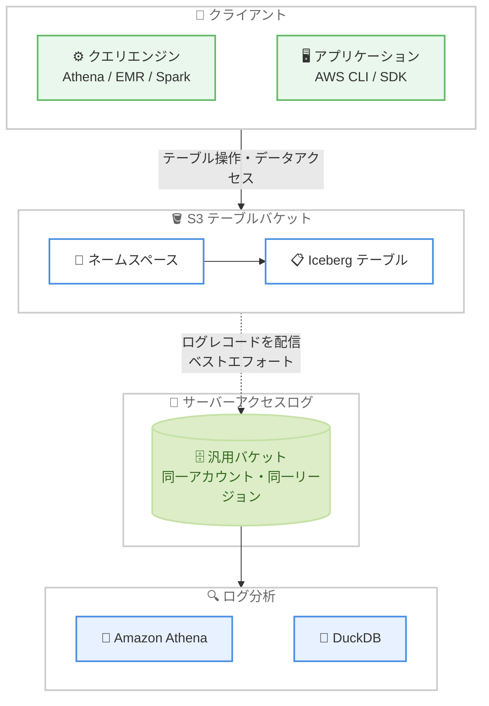

# Amazon S3 Tables - S3 サーバーアクセスログのサポート

**リリース日**: 2026 年 11 月 10 日
**サービス**: Amazon S3 (S3 Tables)
**機能**: S3 Tables のサーバーアクセスログ (Server Access Logging)

📊 [このアップデートのインフォグラフィックを見る](https://takech9203.github.io/aws-news-summary/20261110-amazon-s3-tables-server-access-logging.html)

## 概要

Amazon S3 Tables がサーバーアクセスログ (Server Access Logging) をサポートしました。テーブルバケットに対するリクエストの詳細な記録を取得できるようになり、テーブル操作、ネームスペース管理、データアクセスを追跡して、セキュリティ監査、アクセス分析、コスト配分などに活用できます。

テーブルバケットでログ記録を有効化すると、S3 はそのバケット内のすべてのテーブルとネームスペースを対象としたログを、同一アカウント・同一リージョン内の汎用バケットに配信します。各ログレコードには、リクエスト元、操作、テーブル名、ネームスペース、レスポンスステータス、リクエストのタイミングなどが含まれます。ログは標準の S3 サーバーアクセスログと同じスペース区切り形式を使用するため、Amazon Athena や DuckDB などのクエリエンジンを使った既存の分析ワークフローをそのまま再利用できます。

ログ配信自体は無料で、ログファイルの保存に対する標準の S3 料金のみが発生します。データレイクの監査要件を持つ組織や、S3 Tables の利用状況を可視化したいデータ基盤チームにとって重要なアップデートです。

**アップデート前の課題**

- 以前は S3 Tables のテーブルバケットに対するリクエストをサーバーアクセスログで記録できず、汎用バケットとの間で監査手法に差異があった
- テーブル単位・ネームスペース単位のアクセス傾向を把握するには AWS CloudTrail に依存する必要があり、リクエストレベルの詳細な分析 (レイテンシー、バイト数など) が難しかった
- データレイクのコスト配分やアクセス分析を行うための標準的なログソースが不足していた

**アップデート後の改善**

- テーブルバケット単位でサーバーアクセスログを有効化し、すべてのテーブル・ネームスペースへのリクエストを記録できるようになった
- リクエスト元、操作、テーブル名、ネームスペース、HTTP ステータス、処理時間などを含む詳細なログレコードが汎用バケットに配信されるようになった
- 標準の S3 サーバーアクセスログと同じ形式のため、Amazon Athena や DuckDB など既存の分析基盤を流用できるようになった

## アーキテクチャ図



テーブルバケットへのすべてのリクエストがログレコードとして同一アカウント・同一リージョンの汎用バケットに配信され、Amazon Athena や DuckDB で分析できます。

## サービスアップデートの詳細

### 主要機能

1. **テーブルバケット単位のログ記録**
   - ログ記録はテーブルバケットレベルで有効化・無効化する (デフォルトは無効)
   - 有効化すると、そのテーブルバケット内のすべてのネームスペースとテーブルへのリクエストが記録される
   - ネームスペース単位・テーブル単位での個別設定はできない

2. **詳細なログレコード**
   - 各ログレコードは 1 リクエストを表し、25 のフィールドを含む
   - 主なフィールド: テーブルバケット ARN、テーブル ARN、ネームスペース名、テーブル名、リクエスト元 IAM アイデンティティ、操作、HTTP ステータス、エラーコード、送信バイト数、処理時間、TLS バージョンなど
   - `operation` フィールドは S3 Tables API リクエストと Iceberg REST カタログリクエストでは `S3Tables.{ActionName}` 形式、テーブルストレージへのリクエストでは `REST.{HTTP_method}.{resource_type}` 形式で記録される

3. **既存の分析ワークフローとの互換性**
   - 標準の S3 サーバーアクセスログと同じスペース区切りテキスト形式を採用
   - Amazon Athena や DuckDB などのクエリエンジンで既存の分析手法を再利用可能
   - ログオブジェクトのキーは常に日付でパーティション化され、`EventTime` (リクエスト日時) または `DeliveryTime` (配信日時) を選択できる

4. **新しい API の追加**
   - `PutTableBucketLogging`: ログ記録の有効化・更新・無効化
   - `GetTableBucketLogging`: 現在のログ記録設定の取得
   - AWS Management Console、AWS CLI、AWS SDK、AWS CloudFormation から設定可能

## 技術仕様

### ログ配信の仕様

| 項目 | 詳細 |
|------|------|
| 設定単位 | テーブルバケットレベルのみ (テーブル・ネームスペース単位は不可) |
| 配信先 | 同一アカウント・同一リージョンの汎用バケット (クロスアカウント・クロスリージョンは不可) |
| 配信先バケットの要件 | SSE-S3 のデフォルト暗号化が必要 (SSE-KMS / DSSE-KMS は不可)、S3 Object Lock 無効、Requester Pays 無効 |
| ログ形式 | スペース区切りテキスト形式 (25 フィールド) |
| キー形式 | `{targetPrefix}{accountId}/{region}/{tableBucketName}/{YYYY}/{MM}/{DD}/...` (常に日付パーティション) |
| 配信特性 | ベストエフォート配信 (通常は数時間以内、完全性は保証されない) |
| CloudWatch Logs 配信 | 非対応 (汎用バケットへの配信のみ) |

### ログレコードの主なフィールド

| フィールド | 説明 | 例 |
|------|------|------|
| table_bucket_arn | リクエストを受けたテーブルバケットの ARN | `arn:aws:s3tables:us-east-2:111122223333:bucket/demo-bucket` |
| namespace_name | リクエスト対象のネームスペース | `sal_ns` |
| table_name | リクエスト対象のテーブル名 | `events` |
| requester | リクエスト元の IAM アイデンティティ | `arn:aws:sts::111122223333:assumed-role/Admin/session` |
| operation | 実行された操作 | `S3Tables.GetTable` |
| http_status | レスポンスの HTTP ステータスコード | `200` |
| total_time | リクエスト処理の合計時間 (ミリ秒) | `49` |

### API 変更履歴

| 日付 | サービス | 変更内容 |
|------|----------|----------|
| 2026/11/10 | [s3tables](https://awsapichanges.com/archive/changes/465577-s3tables.html) | 2 new api methods - `PutTableBucketLogging` と `GetTableBucketLogging` の追加によるテーブルバケットのサーバーアクセスログサポート |

### 配信先バケットのバケットポリシー

ログはロギングサービスプリンシパル `logging.s3.amazonaws.com` によって配信されるため、配信先の汎用バケットに `s3:PutObject` 権限を付与する必要があります。コンソールから有効化した場合は自動で設定されますが、CLI / SDK / REST API の場合は手動で追加します。

```json
{
    "Version": "2012-10-17",
    "Statement": [
        {
            "Sid": "S3TablesServerAccessLogsPolicy",
            "Effect": "Allow",
            "Principal": {
                "Service": "logging.s3.amazonaws.com"
            },
            "Action": "s3:PutObject",
            "Resource": "arn:aws:s3:::amzn-s3-demo-logging-bucket/logs/*",
            "Condition": {
                "ArnLike": {
                    "aws:SourceArn": "arn:aws:s3tables:us-east-1:111122223333:bucket/amzn-s3-demo-table-bucket"
                },
                "StringEquals": {
                    "aws:SourceAccount": "111122223333"
                }
            }
        }
    ]
}
```

## 設定方法

### 前提条件

1. S3 Tables のテーブルバケットが作成済みであること
2. 同一アカウント・同一リージョンに配信先の汎用バケットが存在し、SSE-S3 のデフォルト暗号化を使用していること (Object Lock と Requester Pays は無効)
3. 設定を行う IAM ユーザーまたはロールに `s3tables:PutTableBucketLogging` および `s3tables:GetTableBucketLogging` 権限があること
4. 配信先バケットにロギングサービスプリンシパルへの `s3:PutObject` 権限を付与するバケットポリシーが設定されていること

### 手順

#### ステップ 1: サーバーアクセスログの有効化

```bash
aws s3tables put-table-bucket-logging \
    --table-bucket-arn arn:aws:s3tables:us-east-1:111122223333:bucket/amzn-s3-demo-table-bucket \
    --table-bucket-logging-status '{
        "loggingEnabled": {
            "targetBucket": "amzn-s3-demo-logging-bucket",
            "targetPrefix": "logs/",
            "targetObjectKeyFormat": {
                "partitionedPrefix": {
                    "partitionDateSource": "EventTime"
                }
            }
        }
    }'
```

テーブルバケットのサーバーアクセスログを有効化し、汎用バケット `amzn-s3-demo-logging-bucket` の `logs/` プレフィックス配下にログを配信するよう設定します。`partitionDateSource` に `EventTime` を指定すると、ログオブジェクトのキーがリクエスト発生日時でパーティション化されます (配信日時でパーティション化する場合は `DeliveryTime` を指定)。プレフィックスの後にスラッシュは自動で追加されないため、末尾に `/` を含めることが推奨されます。

#### ステップ 2: ログ記録設定の確認

```bash
aws s3tables get-table-bucket-logging \
    --table-bucket-arn arn:aws:s3tables:us-east-1:111122223333:bucket/amzn-s3-demo-table-bucket
```

テーブルバケットの現在のログ記録設定を取得します。ログ記録が有効な場合は `loggingEnabled` 要素に配信先バケットとプレフィックスが表示され、無効な場合は空の `tableBucketLoggingStatus` が返されます。

#### ステップ 3: ログの分析 (Amazon Athena の例)

```sql
CREATE EXTERNAL TABLE s3_tables_access_logs_db.s3_tables_logs(
  `table_bucket_arn` STRING,
  `request_time` STRING,
  `table_arn` STRING,
  `namespace_name` STRING,
  `table_name` STRING,
  `key` STRING,
  `object_size` BIGINT,
  `remote_ip` STRING,
  `requester` STRING,
  `request_id` STRING,
  `operation` STRING,
  `http_status` STRING,
  `error_code` STRING,
  `bytes_sent` BIGINT,
  `total_time` STRING,
  `turnaround_time` STRING,
  `referer` STRING,
  `user_agent` STRING,
  `signature_version` STRING,
  `cipher_suite` STRING,
  `authentication_type` STRING,
  `host_header` STRING,
  `tls_version` STRING,
  `request_time_iso` STRING,
  `source_region` STRING)
PARTITIONED BY (`timestamp` string)
ROW FORMAT SERDE 'org.apache.hadoop.hive.serde2.RegexSerDe'
WITH SERDEPROPERTIES (
  'input.regex'='([^ ]*) \\[(.*?)\\] ([^ ]*) ([^ ]*) ([^ ]*) ([^ ]*) ([^ ]*) ([^ ]*) ([^ ]*) ([^ ]*) ([^ ]*) ([^ ]*) ([^ ]*) ([^ ]*) ([^ ]*) ([^ ]*) (\"[^\"]*\"|-) (\"[^\"]*\"|-) ([^ ]*) ([^ ]*) ([^ ]*) ([^ ]*) ([^ ]*) ([^ ]*) ([^ ]*).*$')
STORED AS INPUTFORMAT 'org.apache.hadoop.mapred.TextInputFormat'
OUTPUTFORMAT 'org.apache.hadoop.hive.ql.io.HiveIgnoreKeyTextOutputFormat'
LOCATION 's3://amzn-s3-demo-logging-bucket/logs/111122223333/us-east-1/amzn-s3-demo-table-bucket/'
TBLPROPERTIES (
  'projection.enabled'='true',
  'projection.timestamp.format'='yyyy/MM/dd',
  'projection.timestamp.interval'='1',
  'projection.timestamp.interval.unit'='DAYS',
  'projection.timestamp.range'='2026/01/01,NOW',
  'projection.timestamp.type'='date',
  'storage.location.template'='s3://amzn-s3-demo-logging-bucket/logs/111122223333/us-east-1/amzn-s3-demo-table-bucket/${timestamp}')
```

配信されたログファイルを Amazon Athena で分析するための外部テーブルを作成します。パーティション射影 (Partition Projection) により日付パーティションが自動で解決されるため、パーティションの追加操作は不要です。テーブル作成後は SQL クエリでアクセス傾向やエラーの分析を実行できます。

## メリット

### ビジネス面

- **セキュリティ監査の強化**: 誰がどのテーブルにいつアクセスしたかをリクエストレベルで記録でき、コンプライアンス要件への対応が容易になる
- **コスト配分の可視化**: テーブル名・ネームスペース・リクエスト元の情報を使い、データレイクの利用状況を部門やチーム単位で把握できる
- **追加コストなしで導入可能**: ログ配信自体は無料で、ログファイルの保存料金のみで利用できる

### 技術面

- **既存ワークフローの再利用**: 標準の S3 サーバーアクセスログと同じ形式のため、Amazon Athena や DuckDB を使った既存の分析パイプラインをそのまま適用できる
- **詳細なリクエスト情報**: 処理時間、送信バイト数、HTTP ステータス、TLS バージョンなど 25 フィールドの詳細情報により、パフォーマンス分析やトラブルシューティングが可能
- **柔軟な設定方法**: コンソール、AWS CLI、AWS SDK、AWS CloudFormation のいずれからでも設定でき、IaC による管理にも対応

## デメリット・制約事項

### 制限事項

- ログ記録はテーブルバケットレベルのみで、ネームスペース単位・テーブル単位の設定はできない
- 配信先は同一アカウント・同一リージョンの汎用バケットに限定される (クロスアカウント・クロスリージョン配信、CloudWatch Logs への配信は非対応)
- 配信先バケットは SSE-S3 のデフォルト暗号化が必須で、SSE-KMS / DSSE-KMS、S3 Object Lock、Requester Pays は使用できない
- AWS マネージドテーブルではサーバーアクセスログを有効化できない
- `SimplePrefix` 形式のログオブジェクトキーはサポートされない (常に日付パーティション形式)

### 考慮すべき点

- ログ配信はベストエフォートであり、完全性・適時性は保証されない。完全な監査証跡が必要な場合は AWS CloudTrail を併用する
- ログ記録設定の変更が反映されるまで時間がかかる場合がある (有効化後、配信開始まで数時間かかることがある)
- ログオブジェクトは蓄積され続けるため、S3 ライフサイクルルールによる保持期間の管理を推奨
- 配信先の汎用バケットを削除するとログレコードは通知なく破棄されるため、配信先バケットの管理に注意が必要

## ユースケース

### ユースケース 1: データレイクのセキュリティ監査

**シナリオ**: 金融機関のデータ基盤チームが、S3 Tables 上の顧客データテーブルへのアクセスを定期的に監査し、想定外のアクセスを検出したい。

**実装例**:
```sql
-- 特定テーブルへのアクセス元を集計
SELECT requester, operation, COUNT(*) AS request_count
FROM s3_tables_access_logs_db.s3_tables_logs
WHERE table_name = 'customer_transactions'
GROUP BY requester, operation
ORDER BY request_count DESC;
```

**効果**: テーブル単位でアクセス元の IAM アイデンティティと操作内容を定期的にレビューでき、最小権限の原則の検証や不審なアクセスの早期発見につながる。

### ユースケース 2: 部門別のコスト配分

**シナリオ**: 複数の部門が共有するデータレイクで、どの部門がどのテーブルをどれだけ利用しているかを把握し、コストを按分したい。

**実装例**:
```sql
-- ネームスペース別・リクエスト元別の利用量を集計
SELECT namespace_name, requester,
       COUNT(*) AS requests,
       SUM(bytes_sent) AS total_bytes_sent
FROM s3_tables_access_logs_db.s3_tables_logs
GROUP BY namespace_name, requester
ORDER BY total_bytes_sent DESC;
```

**効果**: ネームスペースやリクエスト元ごとの利用量を定量化でき、部門別のコスト配分やチャージバックの根拠として活用できる。

### ユースケース 3: クエリエラーとパフォーマンスの分析

**シナリオ**: 分析基盤の運用チームが、S3 Tables へのリクエストで発生しているエラーや遅延を可視化し、パフォーマンス改善につなげたい。

**実装例**:
```sql
-- エラー発生状況と処理時間を分析
SELECT operation, http_status, error_code,
       COUNT(*) AS cnt,
       AVG(CAST(total_time AS BIGINT)) AS avg_total_time_ms
FROM s3_tables_access_logs_db.s3_tables_logs
WHERE http_status != '200'
GROUP BY operation, http_status, error_code
ORDER BY cnt DESC;
```

**効果**: エラーコードや処理時間の傾向から、権限不足や設定ミス、パフォーマンスボトルネックを特定し、運用改善のサイクルを回せる。

## 料金

サーバーアクセスログの生成・配信に追加料金はかかりません。配信先の汎用バケットに対する標準の Amazon S3 料金 (配信されたログファイルのストレージ、リクエスト、ログファイルへのアクセスに伴うデータ転送) のみが発生します。ログファイルはいつでも削除でき、S3 ライフサイクルルールで自動削除を設定することも可能です。

最新の料金は [Amazon S3 の料金ページ](https://aws.amazon.com/s3/pricing/) を参照してください。

## 利用可能リージョン

S3 Tables が利用可能なすべての AWS リージョンで利用できます。対象リージョンの一覧は [S3 Tables のリージョンとクォータ](https://docs.aws.amazon.com/AmazonS3/latest/userguide/s3-tables-regions-quotas.html#s3-tables-regions) を参照してください。

## 関連サービス・機能

- **Amazon S3 Tables**: Apache Iceberg 形式の分析用テーブルをフルマネージドで提供するストレージ。今回のアップデートの対象サービス
- **AWS CloudTrail**: S3 Tables のすべての API 呼び出しをイベントとして記録。完全な監査証跡が必要な場合はサーバーアクセスログと併用する
- **Amazon Athena**: 配信されたサーバーアクセスログを SQL で分析するためのサーバーレスクエリサービス
- **S3 ライフサイクル**: 配信先バケットに蓄積されるログオブジェクトの保持期間管理に使用

## 参考リンク

- 📊 [インフォグラフィック](https://takech9203.github.io/aws-news-summary/20261110-amazon-s3-tables-server-access-logging.html)
- [公式発表 (What's New)](https://aws.amazon.com/about-aws/whats-new/2026/11/amazon-s3-tables-server-access-logging/)
- [ドキュメント: Logging requests for S3 Tables using server access logging](https://docs.aws.amazon.com/AmazonS3/latest/userguide/s3-tables-server-logs.html)
- [Amazon S3 Tables 製品ページ](https://aws.amazon.com/s3/features/tables/)
- [料金ページ](https://aws.amazon.com/s3/pricing/)

## まとめ

S3 Tables のサーバーアクセスログ対応により、テーブルバケットへのリクエストをリクエストレベルで記録し、セキュリティ監査、アクセス分析、コスト配分に活用できるようになりました。ログ配信は無料で、標準の S3 サーバーアクセスログと同じ形式のため既存の分析ワークフローを再利用できます。S3 Tables を本番運用している場合は、監査要件やコスト可視化の観点からログの有効化を検討し、完全な監査証跡が必要な場合は AWS CloudTrail との併用を推奨します。
