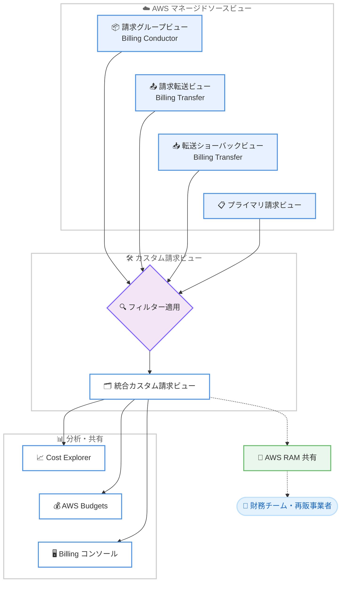

# AWS Billing and Cost Management - カスタム請求ビューのソースビューとして AWS Billing Conductor ビューと AWS Billing Transfer ビューをサポート

**リリース日**: 2026 年 11 月 10 日
**サービス**: AWS Billing and Cost Management
**機能**: マルチソース対応のカスタム請求ビュー (Multi-source Custom Billing Views)

📊 [このアップデートのインフォグラフィックを見る](https://takech9203.github.io/aws-news-summary/20261110-aws-billing-and-cost-management-multi-source-custom-billing-views.html)

## 概要

AWS Billing and Cost Management のカスタム請求ビュー (Custom Billing View) が、ソースビューとして AWS Billing Conductor の請求グループビューと AWS Billing Transfer のビューをサポートしました。これらは AWS が請求グループごと、および請求転送関係ごとに自動的に維持しているマネージドビューであり、今回のアップデートにより複数の AWS マネージドビューを 1 つのカスタム請求ビューに統合し、フィルターを適用した上で Cost Explorer、AWS Budgets、Billing and Cost Management コンソールから利用できるようになりました。

対象ユーザーは、AWS サービスを再販する AWS パートナー、AWS Billing Conductor でプロフォーマ請求を運用している組織、AWS Billing Transfer でエンドカスタマーの請求を受領している事業者などです。これまで顧客ごと、請求グループごとに分散していたコストデータを、1 つの統合ビューとして扱えるようになります。

作成したカスタム請求ビューは AWS Resource Access Manager (AWS RAM) を通じて、組織内外のアカウントと共有できます。たとえば社内の財務チームや、販売チェーンの下流にあたる再販事業者への共有が可能です。アクセス権限のモデルは従来から変更されておらず、すでにアクセス権を持つマネージドビューのみをソースビューとして利用できます。

**アップデート前の課題**

このアップデート以前は、カスタム請求ビューの活用範囲に以下の制限がありました。

- カスタム請求ビューのソースとして Billing Conductor の請求グループビューや Billing Transfer のビューを直接指定できなかった
- 請求グループや請求転送関係ごとにビューが分かれており、顧客単位・グループ単位でビューを個別に参照する必要があった
- 転送コストの合計や、エンドカスタマーが参照する請求額の全体像を把握するには、手動でのデータ集計が必要だった

**アップデート後の改善**

今回のアップデートにより、以下が可能になりました。

- 請求グループビュー、請求転送ビュー、転送ショーバックビューをソースビューとして指定し、複数の AWS マネージドビューを 1 つのカスタム請求ビューに統合できるようになった
- 統合ビューにフィルターを適用し、Cost Explorer、AWS Budgets、Billing and Cost Management コンソールで分析できるようになった
- 顧客ごと・グループごとの個別ビューではなく、転送コスト合計やエンドカスタマー向け請求総額を 1 つの統合ビューで確認できるようになった

## アーキテクチャ図



複数の AWS マネージドソースビューを 1 つのカスタム請求ビューに統合し、フィルター適用後に Cost Explorer や AWS Budgets で分析し、AWS RAM で組織内外に共有するフローを示しています。

## サービスアップデートの詳細

### 主要機能

1. **請求グループビューのソースビュー対応**
   - AWS Billing Conductor の各請求グループのコストを保持するビューをソースビューとして指定可能
   - ビジネスユニット単位のチャージバック・ショーバックに活用できる
   - 複数の請求グループを 1 つのカスタムビューに集約し、プロフォーマ請求全体を俯瞰できる

2. **請求転送ビューと転送ショーバックビューのソースビュー対応**
   - 請求転送ビュー: エンドカスタマーごとに自アカウントへ転送されたコストを表示するビュー
   - 転送ショーバックビュー: 各エンドカスタマーが参照するコストを表示するビュー
   - これらを集約することで、転送コストの合計と、エンドカスタマーが受け取る請求総額の両方を把握できる

3. **統合ビューの分析と共有**
   - 統合したカスタム請求ビューにフィルターを適用し、対象データのサブセットを定義可能
   - Cost Explorer、AWS Budgets、Billing and Cost Management コンソールで利用可能
   - AWS RAM を通じて組織内外のアカウント (財務チームや下流の再販事業者など) と共有可能

4. **変更されないアクセス権限モデル**
   - マネージドビューをソースビューとして利用できるのは、すでにそのビューへのアクセス権を持つ場合のみ
   - 既存の権限設定を変更することなく、新しい統合機能を利用できる

## 技術仕様

### 請求ビューの種類

| ビュータイプ | 管理者 | 共有可否 | 説明 |
|------|------|------|------|
| プライマリ請求ビュー | AWS | 共有不可 | アカウントに関連するすべてのコスト管理データを含むデフォルトビュー |
| 請求グループビュー | AWS | 共有不可 | Billing Conductor の請求グループごとのコストを保持するビュー |
| 請求転送ビュー | AWS | 共有不可 | Billing Transfer の転送関係ごとのビュー。My view と Showback/chargeback view の 2 種類 |
| カスタム請求ビュー | お客様 | 組織内外と共有可能 | 複数のソースビューから派生し、フィルターを適用した統合ビュー |

### カスタム請求ビューのソースビュー

| ソースビュー | 用途 |
|------|------|
| プライマリ請求ビュー | 組織の管理アカウントが持つ全コストデータの絞り込み |
| 他のカスタム請求ビュー | 既存カスタムビューのさらなる派生・絞り込み |
| 請求グループビュー | ビジネスユニット単位のチャージバック・ショーバック |
| 請求転送ビュー | エンドカスタマーごとの転送コストの集約 |
| 転送ショーバックビュー | エンドカスタマーが参照する請求額の集約 |

## 設定方法

### 前提条件

1. AWS Billing and Cost Management コンソールへのアクセス権限があること
2. ソースビューとして利用するマネージドビュー (請求グループビューまたは請求転送ビュー) へのアクセス権があること
3. Billing Conductor の請求グループビューを利用する場合は AWS Billing Conductor が有効化されていること、Billing Transfer のビューを利用する場合は請求転送関係が設定されていること

### 手順

#### ステップ 1: Billing Views ページへ移動

Billing and Cost Management コンソールのナビゲーションから [Billing Views] を選択します。利用可能なマネージドビューとカスタムビューの一覧が表示されます。

#### ステップ 2: カスタム請求ビューの作成

カスタム請求ビューの作成画面で、ソースビューとして請求グループビュー、請求転送ビュー、転送ショーバックビューなどを選択します。複数のソースビューを選択して 1 つのビューに統合し、必要に応じてフィルターを適用してデータのサブセットを定義します。

#### ステップ 3: 共有と分析

作成したカスタム請求ビューを AWS RAM で組織内外のアカウントと共有します。共有先のアカウントは、Cost Explorer や AWS Budgets を使用して、共有されたビューのコストデータを分析できます。

## メリット

### ビジネス面

- **再販ビジネスの可視化**: AWS パートナーは顧客ごとに分散していた転送コストを 1 つのビューに集約し、ビジネス全体の収支を効率的に把握できる
- **チャージバック・ショーバックの効率化**: 請求グループビューの統合により、ビジネスユニット横断のコスト配賦レポートを簡素化できる
- **手動集計の排除**: 顧客単位・グループ単位のビューを個別に参照して手動集計する作業が不要になる

### 技術面

- **既存ツールとの統合**: 統合ビューを Cost Explorer、AWS Budgets、Billing and Cost Management コンソールでそのまま利用できる
- **安全な共有**: AWS RAM による共有で、管理アカウントへのアクセスを付与することなく必要なコストデータのみを提供できる
- **権限モデルの維持**: アクセス権を持つビューのみソースとして利用できるため、意図しないデータ公開のリスクがない

## デメリット・制約事項

### 制限事項

- ソースビューとして利用できるのは、アクセス権をすでに持つマネージドビューのみ
- 請求グループビューの利用には AWS Billing Conductor の有効化が、請求転送ビューの利用には AWS Billing Transfer の転送関係の設定が前提となる
- AWS マネージドビュー (プライマリ、請求グループ、請求転送) 自体は他のアカウントへ直接共有できないため、共有にはカスタム請求ビューの作成が必要

### 考慮すべき点

- カスタム請求ビューを組織外へ共有する場合は、含まれるコストデータの範囲をフィルターで適切に制御する必要がある
- 複数ソースを統合したビューでは、プロフォーマ料金と実際の請求額の違い (Billing Conductor のカスタム料金設定など) を理解した上でデータを解釈する必要がある

## ユースケース

### ユースケース 1: AWS パートナーによる再販ビジネス全体の収支管理

**シナリオ**: AWS サービスを複数のエンドカスタマーに再販しているパートナーが、Billing Transfer で顧客ごとの請求を受領している。顧客数の増加に伴い、顧客単位のビューを個別に確認する運用が負担になっている。

**実装例**:
```
1. すべての請求転送ビューをソースビューとして選択
2. 1 つのカスタム請求ビューに統合
3. Cost Explorer で転送コスト合計の推移を分析
4. AWS Budgets で全体コストにしきい値アラートを設定
```

**効果**: 全顧客の転送コストを 1 つのビューで把握でき、収支管理とコスト超過の早期検知が効率化される。

### ユースケース 2: エンドカスタマー向け請求総額のショーバック

**シナリオ**: 再販事業者が、各エンドカスタマーに提示している請求額の総額を把握し、転送コストとの差分 (マージン) を分析したい。

**実装例**:
```
1. 転送ショーバックビューを統合したカスタムビューを作成
2. 請求転送ビューを統合したカスタムビューを別途作成
3. 2 つのビューを Cost Explorer で比較し、マージンを分析
```

**効果**: エンドカスタマーが参照する請求総額と実際の転送コストを比較でき、価格戦略の検討に活用できる。

### ユースケース 3: ビジネスユニット横断のチャージバック

**シナリオ**: Billing Conductor でビジネスユニットごとに請求グループを運用している企業が、財務チームに全ビジネスユニットのプロフォーマコストを一元的に提供したい。

**実装例**:
```
1. すべての請求グループビューをソースビューとして選択
2. 統合カスタム請求ビューを作成
3. AWS RAM で財務チームのアカウントに共有
4. 財務チームは Cost Explorer で全ユニットのコストを分析
```

**効果**: 財務チームは管理アカウントへアクセスすることなく、全ビジネスユニットのチャージバックデータを一元的に参照できる。

## 料金

この機能は追加料金なしで利用できます。カスタム請求ビューの作成、マネージドビューのソースビューとしての利用、AWS RAM による共有に追加のコストは発生しません。

## 利用可能リージョン

すべての AWS 商用リージョンで利用可能です。

## 関連サービス・機能

- **AWS Billing Conductor**: 請求グループごとのプロフォーマ請求を構成するサービス。今回のアップデートで請求グループビューがソースビューとして利用可能になった
- **AWS Billing Transfer**: 組織をまたいだ請求の転送を実現するサービス。請求転送ビューと転送ショーバックビューがソースビューとして利用可能になった
- **AWS Resource Access Manager (AWS RAM)**: カスタム請求ビューを組織内外のアカウントと共有するために使用する
- **AWS Cost Explorer / AWS Budgets**: 統合したカスタム請求ビューのコストデータを可視化・監視するツール

## 参考リンク

- 📊 [インフォグラフィック](https://takech9203.github.io/aws-news-summary/20261110-aws-billing-and-cost-management-multi-source-custom-billing-views.html)
- [公式発表 (What's New)](https://aws.amazon.com/about-aws/whats-new/2026/11/aws-billing-and-cost-management-multi-source-custom-billing-views)
- [ドキュメント: Controlling cost management data access with Billing View](https://docs.aws.amazon.com/cost-management/latest/userguide/billing-view.html)
- [ドキュメント: Creating custom billing views](https://docs.aws.amazon.com/cost-management/latest/userguide/create-custom-billing-views.html)
- [AWS Billing Conductor ユーザーガイド: Billing groups](https://docs.aws.amazon.com/billingconductor/latest/userguide/creating-abc.html)

## まとめ

今回のアップデートにより、AWS Billing Conductor の請求グループビューと AWS Billing Transfer のビューをカスタム請求ビューのソースビューとして統合できるようになり、再販ビジネスやプロフォーマ請求を運用する組織のコスト集計が大幅に効率化されます。追加料金なしですべての商用リージョンで利用できるため、顧客ごと・グループごとのビューを個別に管理している場合は、Billing and Cost Management コンソールの Billing Views から統合ビューの作成を検討することを推奨します。
