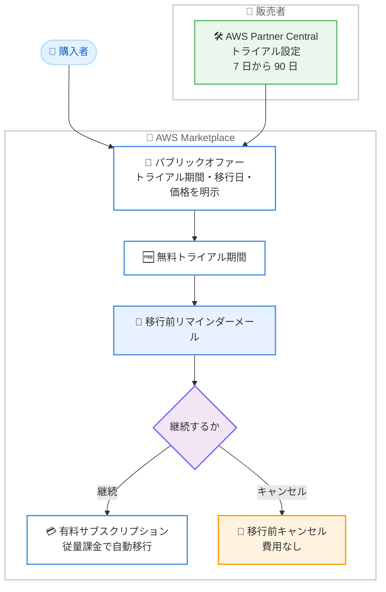

# AWS Marketplace - SaaS 無料トライアルの有料サブスクリプションへの自動移行

**リリース日**: 2026 年 11 月 10 日
**サービス**: AWS Marketplace
**機能**: 従量課金型 SaaS 製品の無料トライアル自動移行 (Free Trial Auto-Conversion)

📊 [このアップデートのインフォグラフィックを見る](https://takech9203.github.io/aws-news-summary/20261110-aws-marketplace-free-trial-conversion.html)

## 概要

AWS Marketplace において、従量課金型 (usage-based) の SaaS 製品の無料トライアルが、トライアル終了後に有料サブスクリプションへ自動的に移行できるようになりました。トライアル期間は販売者 (セラー) が 7 日から 90 日の範囲で設定でき、期間終了後はサブスクリプションが中断されることなく、販売者の従量課金型の価格設定に基づいて継続されます。購入者 (バイヤー) はトライアル終了後、実際に使用した分のみ課金されます。

販売者は AWS Partner Central でトライアルを設定します。新規に自動移行付きのトライアルを作成することも、既存の無料トライアルオファーを自動移行するように更新することも可能です。例えば、データ分析チームが分析ツールを 30 日間テストし、満足すればそのまま使い続けるといった利用が可能になります。

購入者に対しては透明性が確保されており、サブスクリプション前にトライアル期間、移行日、価格を確認できます。また、移行前にはリマインダーメールが送信され、移行前であればいつでも無料でキャンセルできます。

**アップデート前の課題**

これまでの無料トライアルには、評価から本番利用への移行に関する課題がありました。

- 無料トライアル終了後、継続利用するには購入者が改めて有料サブスクリプションを契約する必要があった
- トライアルから有料契約への切り替え時に、アクセスの中断や再設定が発生する可能性があった
- 販売者にとって、トライアルユーザーを有料顧客へ転換する際の離脱 (ドロップオフ) が発生しやすかった

**アップデート後の改善**

今回のアップデートにより、トライアルから有料利用への移行がシームレスになりました。

- トライアル終了後、新たなサブスクリプション契約手続きなしで、アクセスを中断することなく利用を継続できるようになった
- 販売者はトライアルユーザーを有料顧客へ転換しやすくなり、コンバージョン率の向上が期待できるようになった
- 購入者は事前にトライアル期間・移行日・価格を確認でき、リマインダーメールと無料キャンセルにより安心して評価できるようになった

## アーキテクチャ図



無料トライアルの開始から、リマインダーメールを経て有料サブスクリプションへ自動移行する、またはキャンセルするまでの流れを示しています。

## サービスアップデートの詳細

### 主要機能

1. **有料サブスクリプションへの自動移行**
   - 従量課金型 SaaS 製品の無料トライアルが、トライアル終了後に有料サブスクリプションへ自動的に移行する
   - 新たなサブスクリプション契約手続きは不要で、アクセスの中断も発生しない
   - 移行後は販売者の従量課金型の価格設定に基づき、実際の使用量に対してのみ課金される

2. **販売者によるトライアル設定**
   - トライアル期間は 7 日から 90 日の範囲で販売者が設定可能
   - AWS Partner Central で新規に自動移行付きトライアルを作成できる
   - 既存の無料トライアルオファーを更新して、自動移行を有効化することも可能

3. **購入者向けの透明性とキャンセル保護**
   - サブスクリプション前に、トライアル期間・移行日・価格を確認できる
   - 移行前にリマインダーメールが送信される
   - 移行前であればいつでも無料でキャンセルできる

## 技術仕様

### 機能の詳細

| 項目 | 詳細 |
|------|------|
| 対象製品 | 従量課金型 (usage-based) の SaaS 製品 |
| 対象オファー | パブリックオファー |
| トライアル期間 | 7 日から 90 日 (販売者が設定) |
| 設定場所 | AWS Partner Central |
| 移行後の課金 | 販売者の従量課金型価格設定に基づく実使用量課金 |
| 事前通知 | 移行前にリマインダーメールを送信 |
| キャンセル | 移行前はいつでも無料でキャンセル可能 |

## 設定方法

### 前提条件

1. AWS Marketplace の販売者として登録済みであること (販売者の場合)
2. 従量課金型の価格設定を持つ SaaS 製品を AWS Marketplace に出品していること (販売者の場合)
3. AWS Partner Central へのアクセス権限があること (販売者の場合)

### 手順

#### ステップ 1: AWS Partner Central でトライアルを設定する (販売者)

AWS Partner Central にサインインし、対象の SaaS 製品に対して自動移行付きの無料トライアルを新規作成します。既存の無料トライアルオファーがある場合は、そのオファーを更新して自動移行を有効化できます。トライアル期間は 7 日から 90 日の範囲で設定します。

#### ステップ 2: オファー内容を確認してトライアルを開始する (購入者)

購入者は AWS Marketplace のパブリックオファーで、トライアル期間・移行日・移行後の価格を確認した上でトライアルを開始します。トライアル期間中は無料で製品を評価できます。

#### ステップ 3: 継続またはキャンセルを判断する (購入者)

移行前に送信されるリマインダーメールを確認し、継続する場合はそのまま利用を続けます。トライアル終了後は自動的に有料サブスクリプションへ移行し、実際の使用量に応じて課金されます。継続しない場合は、移行前にキャンセルすることで費用は発生しません。

## メリット

### ビジネス面

- **コンバージョン率の向上**: 販売者はトライアルユーザーを有料顧客へシームレスに転換でき、契約手続きの手間による離脱を削減できる
- **評価から本番利用への円滑な移行**: 購入者は評価に満足すれば、追加の契約手続きなしでそのまま本番利用に移行できる
- **透明性の高い購買体験**: トライアル期間・移行日・価格が事前に明示され、リマインダーメールにより意図しない課金を回避できる

### 技術面

- **アクセスの継続性**: トライアルから有料サブスクリプションへの移行時にアクセスの中断が発生せず、再設定やデータ移行が不要
- **従量課金による低リスク**: 移行後は実際の使用量に対してのみ課金されるため、固定費用の先行コミットが不要
- **既存オファーの再利用**: 既存の無料トライアルオファーを更新するだけで自動移行を有効化できる

## デメリット・制約事項

### 制限事項

- 対象は従量課金型 (usage-based) の SaaS 製品に限られる
- 対象はパブリックオファーに限られる
- トライアル期間は 7 日から 90 日の範囲に制限される

### 考慮すべき点

- 購入者は、継続利用の意思がない場合、移行前にキャンセルしないと従量課金が開始される
- 購入者側では、リマインダーメールを見落とさないよう、トライアル終了日を管理しておくことが望ましい
- 販売者側では、移行後の従量課金の価格設定を購入者にわかりやすく提示することが重要となる

## ユースケース

### ユースケース 1: データ分析ツールの評価と継続利用

**シナリオ**: データチームが、AWS Marketplace で提供される分析ツールを本格導入前に評価したい。

**実装例**:
```text
1. AWS Marketplace で対象の分析ツールのパブリックオファーを確認
2. トライアル期間 30 日・移行日・従量課金の価格を確認してトライアル開始
3. 30 日間、実データで分析ツールを評価
4. 評価に満足したため、そのまま利用を継続 (自動的に有料サブスクリプションへ移行)
```

**効果**: 契約手続きやアクセス中断なしに、評価から本番利用へそのまま移行できる。

### ユースケース 2: ISV によるトライアル転換率の改善

**シナリオ**: SaaS 製品を提供する ISV が、無料トライアルから有料契約への転換率を改善したい。

**実装例**:
```text
1. AWS Partner Central にサインイン
2. 既存の無料トライアルオファーを更新し、自動移行を有効化
3. トライアル期間を製品の評価に適した期間 (例: 14 日) に設定
4. トライアル終了後、ユーザーは自動的に従量課金の有料顧客へ移行
```

**効果**: トライアル終了時の離脱を削減し、より多くのトライアルユーザーを有料顧客へ転換できる。

### ユースケース 3: 調達部門による低リスクなソフトウェア導入

**シナリオ**: 企業の調達部門が、新規 SaaS 製品の導入リスクを最小化しながら評価を進めたい。

**実装例**:
```text
1. オファーでトライアル期間・移行日・移行後の価格を事前に確認
2. トライアル期間中に利用部門で評価を実施
3. 導入を見送る場合は、リマインダーメールを受けて移行前にキャンセル (費用なし)
4. 導入する場合はそのまま継続し、実使用量に応じた従量課金で利用
```

**効果**: 事前の価格透明性と無料キャンセルにより、低リスクでソフトウェア評価・導入を進められる。

## 料金

無料トライアル期間中は課金されません。トライアル終了後に有料サブスクリプションへ自動移行した場合、販売者が設定した従量課金型の価格に基づき、実際の使用量に対してのみ課金されます。移行前にキャンセルした場合、費用は発生しません。

## 利用可能リージョン

AWS Marketplace が利用可能なすべての AWS リージョンのパブリックオファーで利用できます。

## 関連サービス・機能

- **AWS Marketplace**: サードパーティ製ソフトウェアの検索・購入・デプロイを行うデジタルカタログ。本機能は Marketplace 上の SaaS 製品のトライアル体験を強化する
- **AWS Partner Central**: 販売者が製品・オファーを管理するポータル。自動移行付きトライアルの作成・更新はここで行う
- **AWS Billing and Cost Management**: 移行後の従量課金は AWS の請求に統合されるため、他の AWS 利用料と一元的に管理できる

## 参考リンク

- 📊 [インフォグラフィック](https://takech9203.github.io/aws-news-summary/20261110-aws-marketplace-free-trial-conversion.html)
- [公式発表 (What's New)](https://aws.amazon.com/about-aws/whats-new/2026/11/aws-marketplace-free-trial-conversion/)
- [ドキュメント (販売者ガイド)](https://docs.aws.amazon.com/marketplace/latest/userguide/saas-free-trials.html)
- [ドキュメント (購入者ガイド)](https://docs.aws.amazon.com/marketplace/latest/buyerguide/saas-free-trials.html)
- [AWS Marketplace](https://aws.amazon.com/marketplace)

## まとめ

AWS Marketplace の従量課金型 SaaS 製品において、無料トライアルから有料サブスクリプションへの自動移行が可能になりました。販売者にとってはトライアルユーザーの有料転換を促進でき、購入者にとっては透明性の高い条件のもと、アクセスを中断することなく評価から本番利用へ移行できます。SaaS 製品を AWS Marketplace で提供している販売者は、AWS Partner Central で既存トライアルオファーの自動移行設定を検討することを推奨します。
