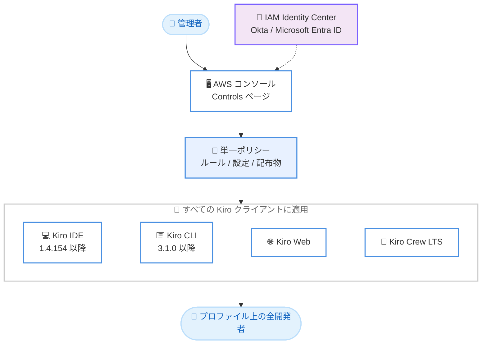

# Kiro - 2026 年 11 月 10 日 Changelog アップデート

**リリース日**: 2026 年 11 月 10 日
**サービス**: Kiro
**機能**: Enterprise Management プレビュー、Grok 4.7 対応、Kiro CLI 3.2、Kiro Crew 0.12 (Bots / ブラウザテイクオーバー)

📊 [このアップデートのインフォグラフィックを見る](https://takech9203.github.io/aws-news-summary/20261110-kiro-changelog-2026-11-10.html)

## 概要

2026 年 11 月 10 日付の Kiro Changelog では、エンタープライズ向けガバナンス機能「Enterprise Management」のプレビュー提供、xAI の最新モデル Grok 4.7 の実験的サポート、Kiro CLI 3.2 のリリース、そして Kiro Crew 0.12 における「Bots」の全ユーザー開放とブラウザテイクオーバー機能という、4 つの大きなアップデートが発表された。

最大の目玉は Enterprise Management である。管理者が AWS コンソールで 1 つのポリシーを記述するだけで、Kiro IDE、Kiro CLI、Kiro Web、Kiro Crew LTS のすべての Kiro クライアントに同じポリシーが適用される。モデル利用、シェルコマンド実行、ファイル読み書き、Web 検索、MCP ツール呼び出しを許可・拒否・確認の 3 段階で制御でき、IAM Identity Center、Okta、Microsoft Entra ID を ID ソースとして利用できる。あわせて、Enterprise Management で統制された組織向けの Kiro Crew エディションである Kiro Crew LTS も登場した。

モデル面では Grok 4.7 が Kiro IDE、CLI、Crew、Web で実験的サポートとして利用可能になった。また、Kiro CLI 3.2.0 は Mermaid 図のフルスクリーンビューアと MCP サーバーへのサインイン改善を含み、Kiro Crew 0.12 では「Mates」が「Bots」に改称されてすべてのインストールで有効化され、エージェントが操作するブラウザをユーザーがいつでも引き継げるようになった。なお、同日発表の Kiro IDE 1.4.154「Approve for Me and Chat Permission Modes」については、既存レポート ([2026-11-10-kiro-introducing-approve-for-me.md](./2026-11-10-kiro-introducing-approve-for-me.md)) を参照されたい。

**アップデート前の課題**

- Kiro の利用ポリシーをクライアント (IDE、CLI、Web、Crew) ごとに個別管理する必要があり、組織全体で一貫した統制をかける手段がなかった
- Grok 系の最新モデルを Kiro から利用できなかった
- ターミナル幅を超える Mermaid 図は CLI 上で読みづらく、動的クライアント登録を提供しない MCP サーバーへは OAuth 設定を手動で記述する必要があった
- Kiro Crew の Mates 機能はプレビュー扱いで、エージェントがブラウザを操作している間、ユーザーが途中で介入する手段がなかった

**アップデート後の改善**

- AWS コンソールで記述した 1 つのポリシーが、プロファイル上のすべての開発者の Kiro IDE、CLI、Web、Crew LTS に自動適用されるようになった
- Grok 4.7 (500K トークンコンテキストウィンドウ) を Pro、Pro+、Pro Max、Power の各プランで利用できるようになった
- CLI でワイドな Mermaid 図を専用画面で全幅表示でき、Client ID Metadata Documents 対応の MCP サーバーへ OAuth 設定なしでサインインできるようになった
- Bots が全インストールで有効になり、Bot ごとに独立した Git ワーキングツリーで作業を分離でき、エージェントのブラウザ操作をライブ表示からワンクリックで引き継げるようになった

## アーキテクチャ図



Enterprise Management の構成。管理者が AWS コンソールの Controls ページで記述した 1 つのポリシーが、プロファイルに属するすべての開発者の Kiro クライアント (IDE、CLI、Web、Crew LTS) に配布・適用される。

## サービスアップデートの詳細

### 主要機能

1. **Enterprise Management プレビュー: すべての Kiro クライアントに 1 つのポリシー**
   - 米国東部 (バージニア北部) リージョン (us-east-1) で新規作成した Kiro プロファイルで利用可能。プロファイルを作成すると Controls ページが追加設定なしでコンソールに表示される。既存プロファイルおよび欧州リージョンのプロファイルへの対応は後日提供予定
   - ポリシーは 3 つの要素で構成される。(1) モデル利用、シェルコマンド実行、ファイル読み書き、Web 検索、MCP ツール呼び出しを許可 (allow)・拒否 (deny)・確認 (ask) で制御するルール、(2) デフォルトモデル、プロンプトログ、使用状況レポートなどの設定、(3) 開発者に配布するステアリングファイル、Skills、Powers
   - ルールはプロファイル全体、特定グループ、特定ユーザーのいずれかを対象に適用できる
   - ID ソースとして IAM Identity Center、Okta、Microsoft Entra ID と連携可能
   - デフォルト動作: モデル、API キー、Kiro Crew のメッセージング・ネットワークアクセスはルールで許可されるまで拒否。ファイル、シェル、Web、MCP、Kiro Crew のスケジュールジョブはルールで指定されるまで Kiro 自身のデフォルトを維持
   - **Kiro Crew LTS**: Enterprise Management で統制する組織向けの Kiro Crew エディション。全クライアント共通ポリシーに加え、Crew 固有の第 2 層ルール (接続可能なメッセージングチャネル、承認モードの選択可否、スケジュールジョブ実行可否、fetch ツールの到達可能ホスト、ブラウザ操作可否、Tailscale 経由のダッシュボード公開可否、サードパーティテーマのインストール可否) を適用する。通常の Kiro Crew と並行インストールされ、専用の lts チャネルからのみ更新される。利用前に組織の SSO 経由で Kiro CLI からサインインしておく必要がある

2. **Grok 4.7 が Kiro で利用可能に**
   - Kiro IDE、CLI、Crew、Web の全クライアントで実験的サポート (experimental support) として提供
   - 対象は Pro、Pro+、Pro Max、Power の各プラン
   - Grok 4.7 は xAI のコーディング・ナレッジワーク向け最上位モデルで、数時間に及ぶ困難なタスクでも集中を維持し、次に進む前に自己検証を行うよう設計されている
   - コンテキストウィンドウは 500K トークン
   - 最新のモデルリストを読み込むには、IDE または CLI の再起動、Crew では `kirocrew restart` の実行、Web ではブラウザの更新が必要

3. **Kiro CLI 3.2.0 リリース (最新パッチ: 3.2.1)**
   - **フルスクリーン図ビューア**: ターミナル幅を超える Mermaid 図はソースと通知が表示され、`Ctrl+]` または `/diagram` で専用画面を開いて全幅レイアウトで閲覧できる。矢印キーやマウスホイールで移動、`Tab` で過去の図へ切り替え、`Esc` で入力中のドラフトを保持したままチャットへ戻る。キーは `chat.keybindings.viewDiagram` で変更可能
   - **MCP サーバーへのサインイン改善**: Tableau のホステッド MCP のように Client ID Metadata Documents をサポートするが動的クライアント登録を提供しないサーバーに対し、Kiro 自身のホステッドクライアントメタデータドキュメントでサインインできるようになった。設定に `oauth` ブロックを書く必要がない。動的クライアント登録対応サーバーは従来どおり動作し、設定済みの `clientId` や `clientMetadataUrl` が優先される
   - そのほか、イテレーションを使い切ったワークフローループの追加実行・完了、自律モードでワークフローが利用不可である旨の通知、V2 シェルコマンドが `XDG_CONFIG_HOME` や `HOME` を設定する前の確認、ファイル検索・カスタムエージェント・ワークフロー・スペック・Hook などの修正を含む
   - 2026 年 11 月 11 日のパッチ 3.2.1 では、ツール呼び出しの出力詳細度を `/settings` で選択する機能の全ユーザー展開と、Linux ホストでのサインイン問題などの修正が行われた

4. **Kiro Crew 0.12: Bots for Everyone とブラウザテイクオーバー**
   - **Mates は Bots に改称**: すべての画面・プロンプト・コマンドバーで名称が Bots に統一され、プレビュースイッチなしで全インストールで有効化された。旧 .crewjam / .crewmate エクスポートファイルのインポートは引き続き可能
   - **Bot ごとの分離**: 各 Bot は自身の名前が付いたサイドバーフォルダにチャットを保持し、リポジトリごとに専用の Git ワーキングツリーで作業するため、同一リポジトリ上の 2 つの Bot の変更が混ざらない。プロファイルカードの Export as file で .kirobot ファイルとして書き出し、Bots → Import from file で読み戻せる。ワーカーに作業を委譲する Bot は各項目をワークレジャーで追跡する
   - **ブラウザのライブ表示とテイクオーバー**: エージェントがブラウザを使うと、ページがチャットにライブ配信される。画像をクリックすると操作を引き継ぎ、手動でステップを実行してからエージェントに返せる。サインインではシートがシークレットをページに代理入力し、エージェントはその内容を見ることがなく、入力内容も保存されない。Settings → Browser で使用ブラウザ (Chrome、Windows の Edge、Kiro 内蔵の Chromium)、ライブビューの有効化、品質・フレームレート、録画を制御できる
   - **エージェントハーネスの追加**: Strands CLI インストール後に Strands がハーネス一覧に表示され、GitHub Copilot CLI も選択可能になった。各ハーネスのモデルピッカーはバックエンド固有のモデル名を表示する
   - **Connections とナレッジ**: Connections ページに Gmail、Google Drive、Google Calendar、Google Sheets、Google Docs、Google Slides が追加された (ユーザー自身の Google OAuth クライアント経由の読み取り専用スコープ)。Capabilities → Knowledge → Sources の Add Knowledge Base で既存の Amazon Bedrock Knowledge Base を登録し、ナレッジ検索にライブ統合できる。初回検索前に AWS アカウント、リージョン、コストの確認カードが表示される
   - **通知の強化**: アプリを閉じた後もインストール済み Web アプリ (iOS のホーム画面追加を含む) にプッシュ通知を配信可能。カテゴリごとのカスタムサウンド (MP3、WAV、OGG) にも対応
   - **そのほかの変更**: Developer Mode は廃止され Settings → Developer が常時表示に。Crew Mode は Ultra Mode に改称。Feature Previews として Ultra Mode、Explore、Bot ごとのエージェントハーネス、Shared Crew (Tailscale 経由の共有)、Remote dispatch が利用可能

## 技術仕様

### Enterprise Management の要件

| 項目 | 詳細 |
|------|------|
| 提供状態 | プレビュー |
| 対象プロファイル | 米国東部 (バージニア北部) us-east-1 で新規作成した Kiro プロファイル |
| Kiro IDE | バージョン 1.4.154 以降 |
| Kiro CLI | バージョン 3.1.0 以降 |
| ID ソース | IAM Identity Center、Okta、Microsoft Entra ID |
| ポリシー構成 | ルール (allow / deny / ask)、設定、配布物 (ステアリングファイル、Skills、Powers) |
| ルールの適用範囲 | プロファイル全体、グループ単位、ユーザー単位 |

### Grok 4.7 の仕様

| 項目 | 詳細 |
|------|------|
| 提供形態 | 実験的サポート (Experimental) |
| 対応クライアント | Kiro IDE、CLI、Crew、Web |
| 対象プラン | Pro、Pro+、Pro Max、Power |
| コンテキストウィンドウ | 500K トークン |
| クレジット倍率 | 200K トークン以下のリクエスト: 2.7 倍、200K トークン超: 5.4 倍 |

### 今回のバージョン一覧

| コンポーネント | バージョン | 主な内容 |
|----------------|-----------|----------|
| Kiro IDE | 1.4.154 | Approve for Me、権限モードメニュー (別レポート参照) |
| Kiro CLI | 3.2.0 (最新パッチ 3.2.1) | フルスクリーン図ビューア、MCP サインイン改善 |
| Kiro Crew | 0.12.0 / 0.12.1 | Bots 全面展開、ブラウザテイクオーバー |
| Kiro Crew LTS | 0.1.0 | Enterprise Management 対応エディション |

## 設定方法

### 前提条件

1. Enterprise Management を利用する場合、米国東部 (バージニア北部) リージョンで新規に Kiro プロファイルを作成できる AWS アカウントがあること
2. Kiro IDE 1.4.154 以降、Kiro CLI 3.1.0 以降にアップデートしていること
3. Grok 4.7 を利用する場合、Pro、Pro+、Pro Max、Power のいずれかのプランに加入していること

### 手順

#### ステップ 1: Enterprise Management の開始

AWS コンソールで米国東部 (バージニア北部) リージョンを選択し、新規 Kiro プロファイルを作成する。作成すると Controls ページが追加のセットアップなしでコンソールに表示されるので、モデル利用やシェルコマンドなどに対する allow / deny / ask のルール、デフォルトモデルなどの設定、配布するステアリングファイル・Skills・Powers を定義する。

#### ステップ 2: Kiro Crew LTS のインストール

```bash
# 組織の SSO 経由で Kiro CLI からサインイン
kiro-cli login

# 各プラットフォーム向けインストーラをダウンロード
# macOS: KiroCrew-LTS.dmg / KiroCrew-LTS-arm64.dmg
# Linux: KiroCrew-LTS-x86_64.AppImage
# Windows: KiroCrew-LTS-Setup.exe
```

Kiro Crew LTS には専用のサインインダイアログがないため、事前に Kiro CLI から組織のシングルサインオン (IAM Identity Center または外部 ID プロバイダー) でサインインしておく。未サインインの場合はゲートウェイエラーが表示されるので、サインイン後に Retry を選択する。通常の Kiro Crew アプリと並行インストールされ、lts チャネルからのみ更新される。

#### ステップ 3: Grok 4.7 の利用開始

```bash
# Kiro Crew の場合はプロセスを再起動してモデルリストを更新
kirocrew restart
```

IDE または CLI は再起動、Kiro Web はブラウザの更新で最新のモデルリストが読み込まれ、モデルピッカーから Grok 4.7 を選択できるようになる。

#### ステップ 4: CLI のフルスクリーン図ビューアの利用

```bash
# ワイドな Mermaid 図を専用画面で開く
/diagram
```

エージェントの応答に含まれる Mermaid 図がターミナル幅を超える場合、`Ctrl+]` または `/diagram` で専用画面を開き、矢印キーで移動、`Tab` で過去の図に切り替え、`Esc` でチャットに戻る。

## メリット

### ビジネス面

- **組織統制の一元化**: AWS コンソールの単一ポリシーで全 Kiro クライアントを統制でき、クライアントごとの設定漏れによるガバナンスリスクを低減できる
- **既存 ID 基盤の活用**: IAM Identity Center、Okta、Microsoft Entra ID と連携し、既存の ID 管理プロセスをそのまま利用できる
- **セキュアバイデフォルト**: モデル、API キー、Crew のメッセージング・ネットワークアクセスは明示的に許可するまで拒否されるため、意図しない利用を防止できる

### 技術面

- **モデル選択肢の拡大**: Grok 4.7 の 500K トークンコンテキストウィンドウにより、大規模なコードベースを扱う長時間タスクに対応しやすくなった
- **Bot 単位の作業分離**: Bot ごとに独立した Git ワーキングツリーを持つため、同一リポジトリ上で複数の自律エージェントを安全に並行稼働できる
- **ブラウザ操作の透明性**: エージェントのブラウザ操作がライブ表示され、必要な時点で人間が介入できる。シークレットはエージェントから隔離されたまま代理入力される
- **MCP 接続の簡素化**: 動的クライアント登録のない MCP サーバーにも OAuth 設定なしで接続でき、設定ファイルの記述量が減る

## デメリット・制約事項

### 制限事項

- Enterprise Management はプレビューであり、us-east-1 で新規作成したプロファイルのみが対象。既存プロファイルと欧州のプロファイルへの対応は後日提供予定
- Grok 4.7 は実験的サポートであり、クレジット倍率が 2.7 倍 (200K トークン超は 5.4 倍) と高めに設定されている
- Kiro Crew LTS では Feature Previews と Debug tools が無効化され、auto-approve はルールで許可されない限りオフになる
- Enterprise Management の利用には Kiro IDE 1.4.154 以降、Kiro CLI 3.1.0 以降が必要

### 考慮すべき点

- Kiro Crew の Mates を利用していた場合、名称が Bots に変わり、Developer Mode の廃止や MCP Management の Connections ページへの移動など UI 構成が変更されているため、運用手順書の更新が必要
- Bedrock Knowledge Base をナレッジソースに登録すると検索のたびにライブクエリが発生するため、初回確認カードに表示される AWS アカウント・リージョン・コストを確認してから有効化する
- Grok 4.7 の利用可否やモデル選択は、Enterprise Management のモデルルールの影響を受ける (許可されるまでモデルは拒否される)

## ユースケース

### ユースケース 1: 全社での Kiro 利用ポリシーの統一

**シナリオ**: 数百名の開発者が IDE、CLI、Web と異なる Kiro クライアントを使っており、セキュリティ部門が利用可能モデルと実行可能コマンドを一元統制したい。

**実装例**:
```
1. us-east-1 で Kiro プロファイルを新規作成し、IAM Identity Center と連携
2. Controls ページでポリシーを定義
   - 承認済みモデルのみ allow、その他は deny
   - 破壊的なシェルコマンドは ask、既知の安全なコマンドは allow
   - 全社共通のステアリングファイルと Skills を配布物に登録
3. グループ単位のルールでチームごとの例外を設定
```

**効果**: 1 つのポリシーが IDE、CLI、Web、Crew LTS のすべてに適用され、クライアントごとの設定作業と監査負荷を削減できる。

### ユースケース 2: 大規模コードベースのリファクタリングに Grok 4.7 を活用

**シナリオ**: モノレポ全体にまたがる長時間のリファクタリングタスクで、広いコンテキストを維持できるモデルを使いたい。

**実装例**:
```
1. IDE / CLI を再起動してモデルリストを更新
2. モデルピッカーで Grok 4.7 を選択
3. リクエストを 200K トークン以下に収めてクレジット倍率 2.7 倍で運用
```

**効果**: 500K トークンのコンテキストウィンドウと自己検証型の動作により、数時間に及ぶマルチステップタスクでも一貫した作業を期待できる。

### ユースケース 3: ブラウザテイクオーバーによる安全な Web 操作の委任

**シナリオ**: エージェントに Web ベースの管理画面の操作を任せたいが、サインインや重要な確認ステップは人間が実施したい。

**実装例**:
```
1. Kiro Crew 0.12 の Settings → Browser でライブビューを有効化
2. エージェントにブラウザ操作タスクを依頼し、チャット上のライブ表示を監視
3. サインインや確認ダイアログの場面で画像をクリックして操作を引き継ぎ、
   完了後にエージェントへ操作を返す
```

**効果**: 認証情報をエージェントに渡すことなく Web 操作を自動化でき、重要な操作のみ人間が確実に関与するワークフローを実現できる。

## 料金

Kiro の既存サブスクリプションプラン (Pro、Pro+、Pro Max、Power など) の枠内で提供される。Grok 4.7 の利用は、200K トークン以下のリクエストで 2.7 倍、200K トークンを超えるリクエストで 5.4 倍のクレジット倍率が適用される。Enterprise Management プレビューおよび Kiro Crew 0.12 の新機能自体に追加料金の記載はない。Bedrock Knowledge Base をナレッジソースとして利用する場合は、接続先 AWS アカウント側でクエリコストが発生する。

## 利用可能リージョン

グローバル (Kiro はグローバルサービス)。ただし Enterprise Management プレビューは、米国東部 (バージニア北部) us-east-1 で新規作成した Kiro プロファイルのみが対象で、既存プロファイルおよび欧州のプロファイルへの対応は後日提供予定。

## 関連サービス・機能

- **IAM Identity Center / Okta / Microsoft Entra ID**: Enterprise Management の ID ソースとして連携し、グループ・ユーザー単位のルール適用を実現する
- **Amazon Bedrock Knowledge Bases**: Kiro Crew のナレッジ検索ソースとして既存のナレッジベースを登録し、ライブクエリで統合できる
- **Kiro IDE 1.4.154 (Approve for Me)**: 同日リリースの権限モード機能。詳細は [既存レポート](./2026-11-10-kiro-introducing-approve-for-me.md) を参照
- **Strands / GitHub Copilot CLI**: Kiro Crew のエージェントハーネスとして選択可能になった外部コーディングエージェント

## 参考リンク

- 📊 [インフォグラフィック](https://takech9203.github.io/aws-news-summary/20261110-kiro-changelog-2026-11-10.html)
- [Kiro Changelog](https://kiro.dev/changelog/)
- [Kiro ドキュメント](https://kiro.dev/docs/)
- [Kiro 料金ページ](https://kiro.dev/pricing/)

## まとめ

2026 年 11 月 10 日の Kiro アップデートは、Enterprise Management による組織ガバナンスの一元化、Grok 4.7 によるモデル選択肢の拡大、CLI と Crew の大幅な機能強化を含む、エンタープライズ利用に向けた重要なマイルストーンである。組織で Kiro を展開している管理者は us-east-1 での Enterprise Management プレビューの評価を、個々の開発者は IDE / CLI / Crew の最新バージョンへのアップデートと新機能の活用を推奨する。
