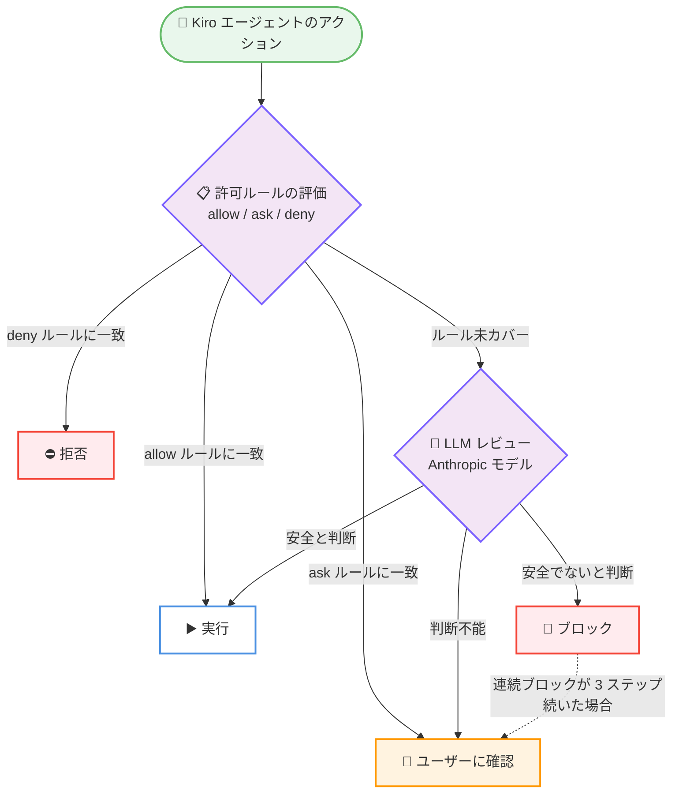

# Kiro - Approve for me (LLM による承認レビュー機能)

**リリース日**: 2026 年 11 月 10 日
**サービス**: Kiro
**機能**: Approve for me

📊 [このアップデートのインフォグラフィックを見る](https://takech9203.github.io/aws-news-summary/20261110-kiro-introducing-approve-for-me.html)

## 概要

AWS が提供する AI 搭載 IDE である Kiro に、新しい承認モード「Approve for me」が導入されました。Kiro IDE、Kiro CLI、Kiro Web のすべてで利用できます。Approve for me を有効にすると、ユーザーが設定した許可ルールでカバーされないアクションに対して、Kiro が LLM レビュー (現在は Anthropic のモデルを使用) を実行します。レビューの結果に基づき、定型的なアクションは自動承認、安全でないと判断したアクションはブロック、判断がつかない場合はユーザーに確認します。

これまでユーザーは「すべてのアクションを手動で承認する」「独自のカスタム許可ルールを整備する」「承認を完全にオフにする (trust-all-tools)」のいずれかを選ぶ必要がありました。Kiro の内部データによると、Kiro CLI のインタラクティブセッションでは、1 週間のサンプル期間中にツール呼び出しの 15.8% で承認が求められ、そのうち 97.1% がユーザーに承認されていました。また、同期間中に 13.4% のセッションが trust-all-tools を有効にした状態で開始されていました。つまり、承認プロンプトの大半は形式的なものとなっており、承認疲れによって安全でないアクションを見逃すリスクが生じていました。

あわせて、2026 年 11 月 10 日付の Changelog では、チャットの Autopilot トグルが権限モードメニューに変更され、「Supervised」「Accept file changes (旧 Autopilot)」「Approve for me」の 3 つのモードから選択できるようになったことが発表されています。

**アップデート前の課題**

- 長時間のエージェントタスク (複数ファイルのリファクタリング、依存関係のセットアップ、探索的なデバッグなど) では、読み取り・書き込み・シェル実行のたびに承認が必要で、作業のフローが中断されていた
- 承認プロンプトの頻発により、多くのユーザーが trust-all-tools を有効化し、安全でないアクションも無条件に実行されるリスクを抱えていた
- カスタムエージェントでの事前承認ルールの整備には手間がかかり、すべてのアクションを網羅することは困難だった

**アップデート後の改善**

- 許可ルールでカバーされないアクションを LLM がレビューし、定型的なアクションは自動承認されるため、承認プロンプトが大幅に減少した
- 安全でないと判断されたアクションは自動的にブロックされ、trust-all-tools よりも安全に作業を進められるようになった
- 判断が難しいアクションのみユーザーに確認が求められるため、承認の意思決定が本当に必要な場面に集中できるようになった

## アーキテクチャ図

Approve for me 有効時のアクション承認フローです。ユーザーが設定した許可ルール (allow / ask / deny) が常に優先され、ルールでカバーされないアクションのみが LLM レビューに送られます。

## サービスアップデートの詳細

### 主要機能

1. **LLM レビューによる自動承認 (evaluate)**
   - 許可ルールは従来、アクションに対して「許可 (allow)」「確認 (ask)」「拒否 (deny)」のいずれかを指定するものだった
   - Approve for me は 4 つ目の選択肢「evaluate」を追加し、ユーザーに確認する代わりに LLM レビューがアクションをチェックする
   - Approve for me を有効にすると、allow / ask / deny のいずれのルールにもカバーされないアクションに evaluate が適用される
   - 現在、LLM レビューには Anthropic のモデルが使用される

2. **ユーザー設定の許可ルールが常に優先**
   - 明示的に許可・拒否したアクションや「常に確認」とマークしたアクションは、LLM レビューに送られない
   - LLM レビューが安全と判断すればそのまま実行、安全でないと判断すればブロック、判断できない場合はユーザーに確認する
   - ブロックされたアクションを含むステップが 3 回連続すると、Kiro はユーザーへの確認に戻り、その理由をプロンプトに含める

3. **チャットの権限モードメニュー (Changelog より)**
   - 従来の Autopilot トグルが権限モードメニューに変更された
   - 「Supervised」「Accept file changes (旧 Autopilot)」「Approve for me」の 3 モードから選択できる
   - Kiro IDE では、What's new のスイッチで新規チャットすべてに対して有効化するか、チャット入力欄のメニューから現在のチャットに対して選択できる

4. **多層防御 (defense-in-depth) の一部としての位置付け**
   - Approve for me はどのアクションに承認が必要かを判断するものであり、シェルコマンドが実行後にアクセスできる範囲を制限するものではない
   - 別の保護レイヤーとして、Kiro IDE と Kiro CLI ではローカルサンドボックスを有効化でき、シェルコマンドに OS レベルの境界を設け、アウトバウンドネットワークアクセスを既定でブロックする
   - Kiro Web のセッションは、すでにマネージドなクラウドサンドボックス内で実行されている

### 実測データ (Kiro チームの社内利用)

Kiro チームが社内で 2 週間利用した結果として、1 週間のサンプル期間における以下のデータが公開されています。

| 項目 | 結果 |
|------|------|
| 許可ルールのみで処理されたアクション | 約 70% |
| LLM レビューに送られたアクション | 約 30% |
| レビューされたアクションのうちユーザーへの確認なしで処理された割合 | 約 97% |
| レビューされたアクションのうちユーザーに確認された割合 | 約 2% |
| レビューされたアクションのうちブロックされた割合 | 1% 未満 |
| レビューの所要時間 (中央値) | 1 秒未満 |

## 技術仕様

### 利用要件

| 項目 | 詳細 |
|------|------|
| 対象プラン | 有料プランのユーザー |
| 対象製品 | Kiro IDE、Kiro CLI、Kiro Web |
| 必要バージョン | Kiro IDE 1.4.154 以降、Kiro CLI 2.36 以降 (Kiro Web は更新不要) |
| 提供リージョン | us-east-1 (バージニア北部)、eu-central-1 (フランクフルト) |
| デフォルト状態 | 無効 (オプトイン) |
| レビューに使用するモデル | Anthropic のモデル |

機能または基盤となる Anthropic モデルが利用できない環境では、従来の承認エクスペリエンスが継続されます。

## 設定方法

### 前提条件

1. Kiro の有料プランを利用していること
2. Kiro IDE 1.4.154 以降、または Kiro CLI 2.36 以降に更新していること (Kiro Web は更新不要)
3. us-east-1 または eu-central-1 で機能が利用可能であること

### 手順

#### ステップ 1: Kiro を最新バージョンに更新する

Kiro IDE を 1.4.154 以降、Kiro CLI を 2.36 以降に更新します。新規ユーザーは kiro.dev のダウンロードページから入手できます。

#### ステップ 2: Approve for me を有効にする

Approve for me はデフォルトで無効のため、明示的に有効化します。

- **Kiro IDE**: What's new のスイッチですべての新規チャットに対して有効化するか、チャット入力欄のメニューから現在のチャットに対して Approve for me を選択する
- **Kiro CLI / Kiro Web**: 各製品の権限モード設定から Approve for me を選択する

#### ステップ 3: 必要に応じて許可ルールとサンドボックスを併用する

明示的に制御したいアクションには allow / ask / deny の許可ルールを設定します。これらのルールは LLM レビューより常に優先されます。さらに、Kiro IDE と Kiro CLI ではローカルサンドボックスを有効化することで、シェルコマンドの実行に OS レベルの境界を追加できます。

## メリット

### ビジネス面

- **開発フローの維持による生産性向上**: 定型的なアクションの承認プロンプトが大幅に減少し、長時間のエージェントタスクでも作業の流れが中断されにくくなる。社内ユーザーからは「以前は ls のような基本操作に 15 回の承認が必要だったタスクが、承認ゼロになった」というフィードバックが報告されている
- **trust-all-tools からの安全な移行**: 承認疲れを理由に trust-all-tools を有効化していたユーザーが、重要なアクションに対するコントロールを取り戻せる
- **本番ワークロードでのリスク低減**: 安全でないアクションの自動ブロックにより、無条件実行に伴うリスクを抑制できる

### 技術面

- **許可ルールとの統合**: 既存の allow / ask / deny ルールが常に優先され、ルール未カバーのアクションのみが LLM レビューの対象となるため、既存の設定を変更せずに導入できる
- **低レイテンシ**: レビューの所要時間は中央値で 1 秒未満であり、作業のテンポへの影響が小さい
- **多層防御との組み合わせ**: ローカルサンドボックスやクラウドサンドボックスと組み合わせることで、承認判断と実行時の境界という複数の安全レイヤーを構成できる

## デメリット・制約事項

### 制限事項

- 有料プランのユーザーのみ利用可能
- LLM レビューの提供リージョンは us-east-1 と eu-central-1 に限定される
- 機能または基盤の Anthropic モデルが利用できない環境では、従来の承認エクスペリエンスのままとなる
- すべての承認プロンプトがなくなるわけではなく、判断が難しいアクションでは引き続きユーザーへの確認が行われる (安全側に倒す設計)

### 考慮すべき点

- LLM レビューに送られたアクションはプランの利用量として課金されるため、利用量への影響を考慮する必要がある
- Approve for me は承認要否の判断を行うものであり、実行されたシェルコマンドのアクセス範囲を制限するものではない。実行時の保護にはローカルサンドボックスなど別のレイヤーの併用が推奨される
- LLM の判断に依存するため、重要な操作 (本番環境への反映、破壊的な変更など) には明示的な deny / ask ルールを設定しておくことが望ましい

## ユースケース

### ユースケース 1: 複数ファイルにまたがるリファクタリング

**シナリオ**: 大規模なコードベースで、複数ファイルの読み取り・編集・テスト実行を繰り返す長時間のリファクタリングタスクを Kiro に依頼する。

**実装例**: Approve for me を有効にしてタスクを依頼する。ファイルの読み書きやテストスイートの実行といった定型的なアクションは LLM レビューが自動承認する。

**効果**: 従来はアクションごとに承認が必要で作業が中断されていたが、承認プロンプトが最小限になり、タスクが途切れずに進行する。

### ユースケース 2: trust-all-tools を利用していたチームの安全性向上

**シナリオ**: 承認疲れを避けるために trust-all-tools を常用していたが、本番関連のリポジトリでは無条件実行のリスクが懸念されている。

**実装例**: trust-all-tools の代わりに Approve for me を有効にし、特に危険な操作 (デプロイコマンドや削除系コマンドなど) には deny / ask ルールを明示的に設定する。

**効果**: 日常的なアクションの快適さを維持しながら、安全でないアクションは自動ブロックまたはユーザー確認となり、リスクが低減する。

### ユースケース 3: サンドボックスと組み合わせた多層防御

**シナリオ**: エージェントによるシェルコマンド実行を許可しつつ、ネットワークアクセスやファイルシステムへの影響範囲を制限したい。

**実装例**: Approve for me を有効にしたうえで、Kiro IDE / CLI のローカルサンドボックスを有効化する。アウトバウンドネットワークアクセスは明示的に許可しない限りブロックされる。

**効果**: 承認判断 (Approve for me) と実行時境界 (サンドボックス) の 2 つのレイヤーで保護され、単一レイヤーの見逃しを補完する多層防御が実現する。

## 料金

Approve for me は有料プランのユーザーが利用できます。LLM レビューに送られたアクションは、利用中のプランに対して課金されます。許可ルールのみで処理されたアクション (社内データでは約 70%) は LLM レビューを経由しないため、課金対象のレビューは残りの一部に限られます。

## 利用可能リージョン

Kiro はグローバルに利用可能なサービスです。Approve for me の LLM レビューは、us-east-1 (バージニア北部) および eu-central-1 (フランクフルト) で提供されます。

## 関連サービス・機能

- **Kiro 許可ルール (allow / ask / deny)**: Approve for me より常に優先して適用されるユーザー定義ルール。明示的に制御したいアクションの指定に使用する
- **Kiro ローカルサンドボックス**: Kiro IDE / CLI でシェルコマンドの実行に OS レベルの境界を設ける機能。Approve for me と組み合わせて多層防御を構成する
- **Kiro 権限モード (Supervised / Accept file changes)**: 今回の Changelog で Autopilot トグルから置き換えられた権限モードメニューの選択肢。用途に応じて使い分ける

## 参考リンク

- 📊 [インフォグラフィック](https://takech9203.github.io/aws-news-summary/20261110-kiro-introducing-approve-for-me.html)
- [Kiro Blog: Introducing 'Approve for me' in Kiro](https://kiro.dev/blog/introducing-approve-for-me/)
- [Kiro Changelog](https://kiro.dev/changelog/)
- [Kiro ダウンロードページ](https://kiro.dev/downloads/)

## まとめ

Approve for me は、「すべて承認するか、すべて信頼するか」という二択だったエージェントの承認モデルに、LLM レビューによる第三の選択肢を導入するアップデートです。許可ルールが優先される設計のため既存設定と安全に共存でき、trust-all-tools を常用していたユーザーには特に有効な代替手段となります。有料プランを利用している場合は、Kiro IDE 1.4.154 以降または Kiro CLI 2.36 以降に更新し、次のタスクで有効化を試すことを推奨します。
