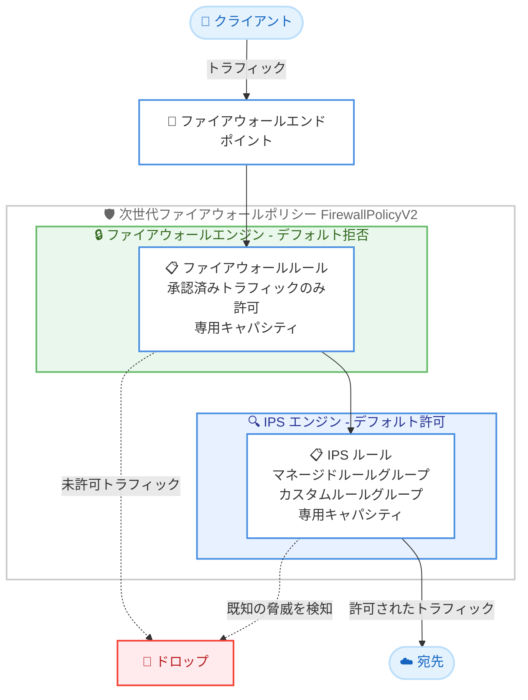

# AWS Network Firewall - 次世代ファイアウォール (NGFW) ポリシー

**リリース日**: 2026 年 11 月 10 日
**サービス**: AWS Network Firewall
**機能**: 次世代ファイアウォール (Next-Generation Firewall、NGFW) ポリシー

📊 [このアップデートのインフォグラフィックを見る](https://takech9203.github.io/aws-news-summary/20261110-network-firewall-launches-ngfw-policy.html)

## 概要

AWS Network Firewall が、新しいポリシーモデルである次世代ファイアウォール (NGFW) ポリシーを発表しました。NGFW ポリシーは、よりシンプルなポリシー構造と拡張されたルールキャパシティを提供し、Amazon VPC を保護するためのアクセス制御と脅威検知をより管理しやすくします。

NGFW ポリシーは、従来の Classic ポリシーとは別のリソースタイプ (`FirewallPolicyV2`) として提供され、ファイアウォールとしての保護を 2 つの独立したインスペクションエンジンに分離します。アクセス制御を担う「ファイアウォールエンジン」と、侵入検知・防御を担う「IPS エンジン」をレイヤーとして分けることで、ポリシーの管理が容易になります。既存の Classic ポリシーはそのまま動作し、IPS ルールは後方互換性が維持されます。AWS は新規のファイアウォールには NGFW ポリシーの利用を推奨しています。

VPC のネットワークセキュリティを運用するすべてのユーザー、特にアクセス制御ルールと IPS ルールを単一のステートフルエンジンで混在管理していたユーザーにとって、運用をシンプルにする重要なアップデートです。

**アップデート前の課題**

- 以前はアクセス制御ルールと脅威検知ルールを同じステートフルルールエンジンの中で混在させて管理する必要があり、ポリシー構造が複雑になりやすかった
- 以前はファイアウォールルールと IPS ルールが同じキャパシティを共有していたため、一方を増やすともう一方を削る必要があった
- 以前はポリシー間で共有しないルールであっても、ルールグループ作成時に事前のキャパシティ割り当てが必要だった

**アップデート後の改善**

- ファイアウォール保護と IPS 保護がレイヤーとして分離され、ポリシーの管理が容易になった
- ファイアウォールルールと IPS ルールがそれぞれ専用のキャパシティを持つため、トレードオフが不要になった
- ポリシー間で共有しないルールは埋め込みルールグループとして定義でき、事前のキャパシティ割り当てなしでオンデマンドにキャパシティを利用できるようになった
- すべてのルールがステートフルに評価され、完全なコネクションコンテキストに基づく一貫したトラフィック処理が可能になった

## アーキテクチャ図



次世代ファイアウォールポリシーでは、デフォルト拒否のファイアウォールエンジンでアクセス制御を行い、通過を許可されたトラフィックに対してデフォルト許可の IPS エンジンで脅威検知・防御を行う 2 層構造になっています。

## サービスアップデートの詳細

### 主要機能

1. **レイヤー化された保護構造**
   - ファイアウォール保護 (アクセス制御) と IPS 保護 (脅威検知・防御) を別々のレイヤーとして定義
   - ファイアウォールエンジンはデフォルト拒否で動作し、明示的に許可していないトラフィックをブロック
   - IPS エンジンはデフォルト許可で動作し、ルールに一致した既知の脅威を検知・ブロック
   - 役割が明確に分離されるため、ポリシーの意図が読み取りやすく管理が容易

2. **デフォルト拒否のアクセス制御**
   - 承認済みトラフィックのみを許可するファイアウォールルールを記述可能
   - 例として、承認済みドメインへのトラフィックのみを許可する構成が可能
   - FQDN やプロトコルコンテキストに基づく制御に対応

3. **IPS ルールの柔軟な選択肢**
   - AWS が提供するマネージドルールグループ、または AWS Marketplace パートナーのルールグループを利用可能
   - マネージドルールグループは新しい脅威の出現に応じて自動的に更新
   - 独自要件に応じたカスタム IPS ルールグループの作成にも対応

4. **独立したルールキャパシティ**
   - ファイアウォールルールと IPS ルールがそれぞれ専用のキャパシティを保持
   - 従来のようにアクセス制御ルールと IPS ルールでキャパシティをトレードオフする必要がない

5. **埋め込みルールグループ (インラインルール)**
   - ポリシー間で共有しないルールは、ポリシー内に直接記述する埋め込みルールグループとして定義可能
   - 事前のキャパシティ割り当てが不要で、オンデマンドにキャパシティを利用

6. **ステートフルな評価**
   - NGFW ポリシー配下のすべてのルールはステートフルで、完全なコネクションコンテキストに基づいて評価
   - ステートレスルールグループは使用せず、一貫したトラフィック処理を実現

## 技術仕様

### Classic ポリシーと NGFW ポリシーの比較

| 項目 | Classic ポリシー | NGFW ポリシー |
|------|------------------|----------------|
| リソースタイプ | `FirewallPolicy` | `FirewallPolicyV2` |
| エンジン構成 | ステートレスエンジン + ステートフルエンジン | ファイアウォールエンジン + IPS エンジン |
| デフォルト動作 | エンジン単位で設定 | ファイアウォールエンジンはデフォルト拒否、IPS エンジンはデフォルト許可 |
| ルールキャパシティ | ルールグループ単位で事前割り当て | エンジンごとに独立、埋め込みルールはオンデマンド |
| ルール評価 | ステートレス / ステートフル混在 | すべてステートフル |
| 既存ポリシーへの影響 | 引き続き完全サポート | 新規ファイアウォールに推奨 |

1 つのファイアウォールには Classic ポリシーまたは NGFW ポリシーのいずれか一方のみを関連付けできます。

### API変更履歴

| 日付 | サービス | 変更内容 |
|------|----------|----------|
| 2026/11/10 | [AWS Network Firewall](https://awsapichanges.com/archive/changes/465577-network-firewall.html) | 5 new 7 updated api methods - Firewall Policy V2 for Network Firewall |

**新規 API:**

- `CreateFirewallPolicyV2`: NGFW ポリシーの作成
- `UpdateFirewallPolicyV2`: NGFW ポリシーの更新
- `DeleteFirewallPolicyV2`: NGFW ポリシーの削除
- `ListFirewallPoliciesV2`: NGFW ポリシーの一覧取得
- `DescribeFirewallPolicyV2`: NGFW ポリシーの詳細取得

**更新 API:**

`CreateRuleGroup`、`UpdateRuleGroup`、`DeleteRuleGroup`、`DescribeRuleGroup`、`DescribeRuleGroupMetadata`、`DescribeRuleGroupSummary`、`ListRuleGroups` が NGFW ポリシー向けのルールグループに対応するよう更新されています。

## 設定方法

### 前提条件

1. AWS Network Firewall を利用できる AWS アカウント
2. Network Firewall のポリシー・ルールグループ操作権限を持つ IAM プリンシパル
3. ファイアウォールエンドポイントを配置する VPC とサブネット

### 手順

#### ステップ1: NGFW ポリシーの作成

```bash
aws network-firewall create-firewall-policy-v2 \
  --firewall-policy-v2-name my-ngfw-policy \
  --firewall-policy-v2 '{
    "FirewallRuleGroupEntries": [
      {
        "Priority": 10,
        "ResourceArn": "arn:aws:network-firewall:ap-northeast-1:123456789012:firewall-rule-group/allow-approved-domains"
      }
    ],
    "IPSRuleGroupEntries": [
      {
        "Priority": 10,
        "ResourceArn": "arn:aws:network-firewall:ap-northeast-1:123456789012:ips-rule-group/managed-threat-rules"
      }
    ]
  }'
```

`create-firewall-policy-v2` コマンドで NGFW ポリシーを作成します。ファイアウォールセクション (アクセス制御) と IPS セクション (脅威検知) にそれぞれルールグループを優先度付きで登録します。共有不要なルールは `InlineRuleGroup` として埋め込みルールを直接記述することもできます。

#### ステップ2: ポリシーの確認

```bash
aws network-firewall describe-firewall-policy-v2 \
  --firewall-policy-v2-name my-ngfw-policy
```

作成した NGFW ポリシーの内容 (登録されたルールグループ、デフォルトアクション、ポリシーモードなど) を確認します。

#### ステップ3: ファイアウォールへの関連付け

作成した NGFW ポリシーをファイアウォールエンドポイントまたはファイアウォールエンドポイント関連付けに関連付けます。1 つのファイアウォールに関連付けできるのは Classic ポリシーまたは NGFW ポリシーのいずれか一方のみである点に注意してください。

## メリット

### ビジネス面

- **追加料金なし**: NGFW ポリシーは追加料金なしで利用でき、既存の Network Firewall の料金体系のまま新しいポリシーモデルの利点を得られる
- **運用コストの削減**: アクセス制御と脅威検知の分離により、ポリシーのレビューや監査が容易になり、セキュリティ運用の工数を削減できる
- **段階的な移行が可能**: 既存の Classic ポリシーは引き続き完全サポートされるため、業務影響なく計画的に移行を進められる

### 技術面

- **明確な責務分離**: デフォルト拒否のファイアウォールエンジンとデフォルト許可の IPS エンジンにより、各レイヤーの役割と期待される動作が明確になる
- **キャパシティ管理の簡素化**: ファイアウォールルールと IPS ルールが独立したキャパシティを持ち、埋め込みルールはオンデマンドでキャパシティを利用するため、事前のキャパシティ設計の負担が軽減される
- **一貫したステートフル評価**: すべてのルールが完全なコネクションコンテキストで評価されるため、ステートレス・ステートフル混在による評価順序の複雑さがなくなる

## デメリット・制約事項

### 制限事項

- 1 つのファイアウォールに関連付けできるのは Classic ポリシーまたは NGFW ポリシーのいずれか一方のみ
- NGFW ポリシーはステートレスルールグループを使用しないため、ステートレスルールに依存した既存構成はそのまま移行できない
- NGFW ポリシーは Classic ポリシーとは別のリソースタイプ (`FirewallPolicyV2`) であり、既存ポリシーの設定を自動で変換する仕組みは発表内容には含まれていない

### 考慮すべき点

- 新規ファイアウォールには NGFW ポリシーが推奨されるため、今後の設計標準として NGFW ポリシーを前提にすることを検討する
- 既存の Classic ポリシーからの移行では、ステートレスルールの扱いやルール評価順序の違いを事前に検証する必要がある
- IaC (CloudFormation、Terraform など) のテンプレートは新しいリソースタイプへの対応状況を確認する必要がある

## ユースケース

### ユースケース1: 承認済みドメインのみへのアウトバウンド通信許可

**シナリオ**: 社内ワークロードからインターネットへのアウトバウンド通信を、業務上承認されたドメインのみに制限したい。

**実装例**:
```
ファイアウォールセクション (デフォルト拒否):
- 承認済みドメインリストへの HTTPS 通信を許可するルールを登録
- その他のアウトバウンド通信はデフォルトでドロップ
```

**効果**: デフォルト拒否のファイアウォールエンジンにより、許可リスト方式のアクセス制御をシンプルに実現でき、意図しない外部通信を防止できます。

### ユースケース2: マネージドルールによる脅威防御の自動更新

**シナリオ**: 既知の脆弱性や脅威に対する防御を、運用負荷をかけずに常に最新の状態に保ちたい。

**実装例**:
```
IPS セクション (デフォルト許可):
- AWS マネージド IPS ルールグループを登録
- 必要に応じて AWS Marketplace パートナーのルールグループを追加
```

**効果**: マネージドルールグループは新しい脅威の出現に応じて自動更新されるため、シグネチャ管理の運用負荷なしに最新の脅威防御を維持できます。

### ユースケース3: アクセス制御と IPS のキャパシティ競合の解消

**シナリオ**: Classic ポリシーでアクセス制御ルールと IPS ルールが同じキャパシティを共有しており、ルール追加のたびにキャパシティ調整が必要になっている。

**実装例**:
```
NGFW ポリシーへの移行:
- アクセス制御ルールをファイアウォールセクションへ配置
- IPS ルールを IPS セクションへ配置
- ポリシー固有のルールは埋め込みルールグループとして定義
```

**効果**: ファイアウォールルールと IPS ルールが独立したキャパシティを持つため、一方のルール追加が他方を圧迫することがなくなり、埋め込みルールは事前割り当てなしで利用できます。

## 料金

NGFW ポリシー自体に追加料金は発生しません。AWS Network Firewall の既存の料金体系 (エンドポイント時間料金とトラフィック処理量に基づく料金) が適用されます。詳細は [AWS Network Firewall の料金ページ](https://aws.amazon.com/network-firewall/pricing/) を参照してください。

## 利用可能リージョン

すべての商用 AWS リージョンおよび AWS GovCloud (US) リージョンで利用可能です (東京・大阪リージョンを含む)。最新のリージョン対応状況は [AWS Capabilities by Region](https://aws.amazon.com/about-aws/global-infrastructure/regional-product-services/) を参照してください。

## 関連サービス・機能

- **Amazon VPC**: Network Firewall が保護する対象。ファイアウォールエンドポイントを VPC サブネットに配置してトラフィックを検査する
- **AWS Firewall Manager**: 複数アカウント・複数 VPC にわたる Network Firewall ポリシーの一元管理に利用できる
- **AWS Marketplace**: パートナー提供の IPS マネージドルールグループを調達でき、NGFW ポリシーの IPS セクションで利用できる
- **AWS WAF**: Web アプリケーションレイヤーの保護を担い、ネットワークレイヤーを守る Network Firewall と補完関係にある

## 参考リンク

- 📊 [インフォグラフィック](https://takech9203.github.io/aws-news-summary/20261110-network-firewall-launches-ngfw-policy.html)
- [公式発表 (What's New)](https://aws.amazon.com/about-aws/whats-new/2026/11/network-firewall-launches-ngfw-policy/)
- [ドキュメント: Next Generation policies in AWS Network Firewall](https://docs.aws.amazon.com/network-firewall/latest/developerguide/firewall-policies-v2.html)
- [ドキュメント: Firewall policy versions](https://docs.aws.amazon.com/network-firewall/latest/developerguide/firewall-policy-versions.html)
- [AWS Network Firewall 製品ページ](https://aws.amazon.com/network-firewall/)
- [料金ページ](https://aws.amazon.com/network-firewall/pricing/)
- [API 変更履歴 (awsapichanges.com)](https://awsapichanges.com/archive/changes/465577-network-firewall.html)

## まとめ

AWS Network Firewall の次世代ファイアウォール (NGFW) ポリシーは、アクセス制御と脅威検知をレイヤーとして分離し、独立したルールキャパシティと埋め込みルールグループによりポリシー管理を大幅に簡素化するアップデートです。追加料金なしで全商用リージョンと GovCloud (US) で利用でき、既存の Classic ポリシーも引き続きサポートされます。新規のファイアウォール構築では NGFW ポリシーの採用を検討し、既存環境ではステートレスルールの扱いを含めた移行計画の策定を推奨します。
