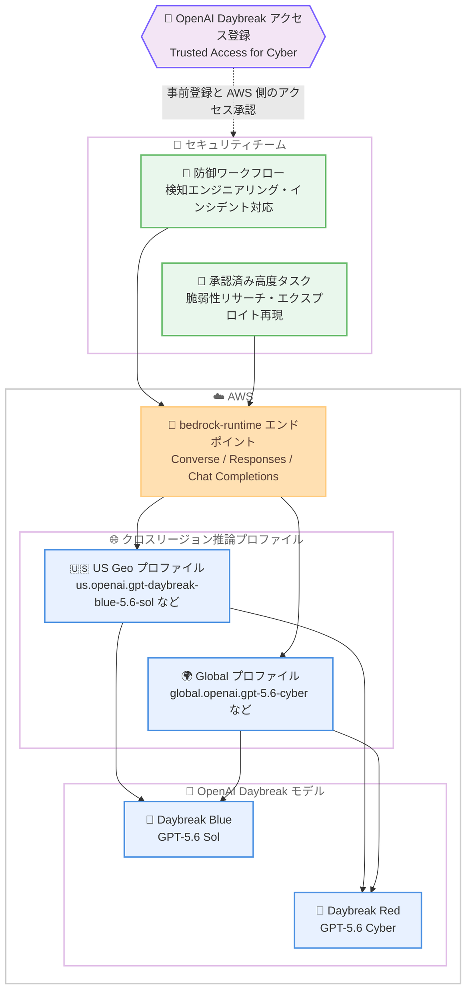

# Amazon Bedrock - OpenAI Daybreak モデルの bedrock-runtime エンドポイント対応

**リリース日**: 2026 年 11 月 10 日
**サービス**: Amazon Bedrock
**機能**: OpenAI Daybreak モデル (Daybreak Red: GPT-5.6 Cyber / Daybreak Blue: GPT-5.6 Sol) の bedrock-runtime エンドポイントサポート

📊 [このアップデートのインフォグラフィックを見る](https://takech9203.github.io/aws-news-summary/20261110-openai-gpt-daybreak-on-amazon-bedrock-runtime.html)

## 概要

Amazon Bedrock において、OpenAI のサイバーセキュリティ特化モデルである Daybreak Red: GPT-5.6 Cyber および Daybreak Blue: GPT-5.6 Sol が、bedrock-runtime エンドポイント経由で利用可能になりました。対象は OpenAI の Daybreak アクセスプログラム (Trusted Access for Cyber) に登録済みの適格なお客様です。

Daybreak Blue は、脆弱性の発見、検知エンジニアリング、インシデント対応といった防御的ワークフローを担う多くのセキュリティチームにとっての出発点となるモデルです。一方、Daybreak Red は、脆弱性リサーチ、エクスプロイトの再現、緩和策の開発といった高度かつ承認済みのタスク向けに設計されています。Daybreak Red では、より強力な本人確認、モニタリング、アクセス制御と引き換えに拒否のしきい値が低く設定されており、調査のスピードと深度が向上します。

推論データはモデルのトレーニングには使用されず、いずれのモデルも OpenAI とのデータ共有へのオプトインは不要です。bedrock-runtime エンドポイントでは、US および Global のクロスリージョン推論 (CRIS) プロファイルを通じてモデルを利用できます。

**アップデート前の課題**

- Daybreak モデルは bedrock-mantle エンドポイント経由での利用に限られていた
- bedrock-mantle では Converse API が利用できず、Guardrails やアプリケーション推論プロファイルなどの Bedrock ネイティブ機能と組み合わせにくかった
- bedrock-mantle の In-Region 提供は us-east-2 (オハイオ) などに限定されており、利用元リージョンの選択肢が狭かった

**アップデート後の改善**

- bedrock-runtime エンドポイントから Converse API、Responses API、Chat Completions API で Daybreak モデルを呼び出せるようになった
- US Geo および Global の CRIS プロファイルにより、東京や大阪を含む多数のリージョンをソースリージョンとして利用できるようになった
- Guardrails、呼び出しログ、レスポンスストリーミング、プロンプトキャッシュなど bedrock-runtime の機能を Daybreak モデルで活用できるようになった

## アーキテクチャ図



事前に OpenAI の Daybreak アクセスに登録したうえで、bedrock-runtime エンドポイントから US または Global の CRIS プロファイルを指定して Daybreak モデルを呼び出す構成です。

## サービスアップデートの詳細

### 主要機能

1. **Daybreak Blue: GPT-5.6 Sol - 防御ワークフロー向けモデル**
   - 脆弱性の発見、検知エンジニアリング、インシデント対応など、防御的ワークフロー全般に対応
   - 多くのセキュリティチームにとっての標準的な選択肢として位置付けられる
   - 検証済みの防御者 (verified defenders) による高度かつ承認済みのセキュリティ業務を想定

2. **Daybreak Red: GPT-5.6 Cyber - 高度な承認済みタスク向けモデル**
   - 脆弱性リサーチ、エクスプロイトの再現、緩和策の開発といった高度なタスク向けに設計
   - 拒否のしきい値を低く設定し、強力な本人確認、モニタリング、アクセス制御で補完することで、調査のスピードと深度を向上
   - 利用には OpenAI の Trusted Access for Cyber への登録が必須

3. **bedrock-runtime エンドポイントでの提供**
   - Converse API、Responses API、Chat Completions API をサポート (Invoke API は非サポート)
   - US Geo および Global の CRIS プロファイル経由で利用 (In-Region 推論は非対応)
   - Guardrails (Converse API のみ)、呼び出しログ、レスポンスストリーミング、プロンプトキャッシュ、構造化出力 (JSON Schema)、Reasoning Summaries などの Bedrock 機能に対応

4. **データプライバシー**
   - 推論データはモデルのトレーニングに使用されない
   - OpenAI とのデータ共有へのオプトインは不要

## 技術仕様

### モデル仕様

| 項目 | Daybreak Blue: GPT-5.6 Sol | Daybreak Red: GPT-5.6 Cyber |
|------|---------------------------|------------------------------|
| モデル ID | `openai.gpt-daybreak-blue-5.6-sol` | `openai.gpt-5.6-cyber` |
| US Geo 推論プロファイル | `us.openai.gpt-daybreak-blue-5.6-sol` | `us.openai.gpt-5.6-cyber` |
| Global 推論プロファイル | `global.openai.gpt-daybreak-blue-5.6-sol` | `global.openai.gpt-5.6-cyber` |
| コンテキストウィンドウ | 1,050,000 トークン | 1,050,000 トークン |
| 入力モダリティ | テキスト、画像 | テキスト、画像 |
| 出力モダリティ | テキスト | テキスト |
| 主な用途 | 脆弱性発見、検知エンジニアリング、インシデント対応 | 脆弱性リサーチ、エクスプロイト再現、緩和策開発 |
| ファインチューニング | 非対応 | 非対応 |
| サービスティア | Standard のみ (Priority / Flex は非対応) | Standard のみ (Priority / Flex は非対応) |

### bedrock-runtime エンドポイントでの API サポート

| API | サポート |
|------|------|
| Converse / ConverseStream | 対応 |
| Responses API | 対応 |
| Chat Completions API | 対応 |
| InvokeModel | 非対応 |

### 利用時の注意点

- Converse API ではユーザーメッセージに `text` および `image` コンテンツブロックのみを受け付ける。`document` ブロックや `toolResult` 内の `image` ブロックは `ValidationException` となるため、ドキュメントを送る場合は Responses API の `input_file` を使用する
- bedrock-runtime ではクォータが TPM (tokens per minute) で管理され、出力 1 トークンが 10 トークン分を消費する 10 倍のバーンダウンレートが適用される
- IAM アイデンティティには、推論プロファイルに加えてアカウントのデフォルトプロジェクト (`arn:aws:bedrock:{region}:{account-id}:project/default`) に対する `bedrock:InvokeModel` 権限が必要

## 設定方法

### 前提条件

1. OpenAI の [Daybreak アクセス (Trusted Access for Cyber)](https://openai.com/form/enterprise-trusted-access-for-cyber/) への登録が承認されていること。登録は OpenAI への直接連絡、または AWS アカウントチームへの相談で開始できる
2. 承認後、AWS アカウントチームと連携して AWS 側でモデルアクセスをリクエストしていること
3. Amazon Bedrock の API キーまたは適切な IAM 権限 (推論プロファイルおよびデフォルトプロジェクトへの `bedrock:InvokeModel`) を保有していること

### 手順

#### ステップ 1: 環境変数の設定

```bash
export OPENAI_API_KEY="<Bedrock API キー>"
export OPENAI_BASE_URL="https://bedrock-runtime.us-east-1.amazonaws.com/openai/v1"
```

OpenAI SDK から bedrock-runtime エンドポイントを利用するために、認証用の API キーとベース URL を環境変数に設定します。

#### ステップ 2: Daybreak Blue の呼び出し (Responses API)

```python
from openai import OpenAI

client = OpenAI()

response = client.responses.create(
    model="us.openai.gpt-daybreak-blue-5.6-sol",
    input="検知ルールの改善案を提案してください。"
)
print(response)
```

US Geo の CRIS プロファイル ID をモデル名に指定して、Responses API で Daybreak Blue を呼び出します。bedrock-runtime では In-Region 推論は利用できないため、必ず `us.` または `global.` のプロファイル ID を指定します。

#### ステップ 3: Converse API での呼び出し (AWS SDK)

```python
import boto3

client = boto3.client("bedrock-runtime", region_name="us-east-1")

response = client.converse(
    modelId="global.openai.gpt-daybreak-blue-5.6-sol",
    messages=[{
        "role": "user",
        "content": [{"text": "このログから不審なアクティビティを分析してください。"}]
    }]
)
print(response["output"]["message"]["content"][0]["text"])
```

AWS SDK の Converse API から Global CRIS プロファイルを指定して呼び出す例です。Converse API を使用することで、Guardrails やアプリケーション推論プロファイルなどの Bedrock 機能と組み合わせられます。

## メリット

### ビジネス面

- **セキュリティ調査の高速化**: Daybreak Red の低い拒否しきい値により、承認済みの脆弱性リサーチやエクスプロイト再現を深く迅速に実施できる
- **データプライバシーの担保**: 推論データがモデルトレーニングに使用されず、OpenAI とのデータ共有も不要なため、機密性の高いセキュリティデータを扱いやすい
- **AWS 統合による運用簡素化**: 既存の AWS アカウント、IAM、課金体系の中で OpenAI の特化モデルを利用できる

### 技術面

- **Bedrock ネイティブ機能との統合**: Converse API 経由で Guardrails、呼び出しログ、ストリーミング、プロンプトキャッシュを活用できる
- **広いリージョンカバレッジ**: Global CRIS プロファイルにより、東京 (ap-northeast-1) や大阪 (ap-northeast-3) を含む多数のリージョンをソースとして利用できる
- **大規模コンテキスト**: 1,050,000 トークンのコンテキストウィンドウにより、大量のログやコードベースを一度に分析できる

## デメリット・制約事項

### 制限事項

- 利用には OpenAI の Trusted Access for Cyber への登録と AWS 側でのアクセス承認が必要で、適格なお客様に限定される
- bedrock-runtime では In-Region 推論は利用できず、US Geo または Global の CRIS プロファイルのみ
- InvokeModel API、サーバーサイドツール使用、インテリジェントプロンプトルーティング、トークンカウント、ファインチューニングは非対応
- サービスティアは Standard のみで、Priority / Flex / Reserved は利用できない

### 考慮すべき点

- Daybreak Red は拒否しきい値が低いため、承認済みタスクに限定した利用と、本人確認・モニタリング・アクセス制御の整備が前提となる
- CRIS によりリクエストが地理的に異なるリージョンへルーティングされるため、データレジデンシー要件がある場合は US Geo プロファイルの利用やルーティング先の確認が必要
- 出力トークンに 10 倍のバーンダウンレートが適用されるため、TPM クォータの消費計画に注意が必要

## ユースケース

### ユースケース 1: インシデント対応の加速

**シナリオ**: SOC チームが大量のログやアラートからインシデントの全容を迅速に把握したい。

**実装例**:
```python
response = client.converse(
    modelId="us.openai.gpt-daybreak-blue-5.6-sol",
    messages=[{
        "role": "user",
        "content": [{"text": "以下のアラートとログを分析し、攻撃のタイムラインと推奨される封じ込め手順をまとめてください。\n" + incident_logs}]
    }]
)
```

**効果**: 1,050,000 トークンの大規模コンテキストを活用して大量のログを一括分析し、初動対応までの時間を短縮できる。

### ユースケース 2: 検知エンジニアリング

**シナリオ**: 新たな攻撃手法に対応する検知ルールを Daybreak Blue で設計・改善したい。

**実装例**:
```python
response = client.responses.create(
    model="us.openai.gpt-daybreak-blue-5.6-sol",
    input="この攻撃手法 TTP に対する Sigma ルールを作成し、誤検知を減らす改善案も提示してください。"
)
```

**効果**: 検知ルールの作成とチューニングを効率化し、カバレッジの向上と誤検知の削減を両立できる。

### ユースケース 3: 承認済みの脆弱性リサーチ

**シナリオ**: 承認を得たレッドチームが、自社製品の脆弱性リサーチとエクスプロイト再現、緩和策の開発を行いたい。

**実装例**:
```python
response = client.responses.create(
    model="global.openai.gpt-5.6-cyber",
    input="この CVE について、再現手順の分析と有効な緩和策の候補を提示してください。"
)
```

**効果**: Daybreak Red の低い拒否しきい値により、通常の汎用モデルでは回答が制限されがちな高度な調査を深く実施し、修正までのリードタイムを短縮できる。

## 料金

Standard ティアの従量課金 (100 万トークンあたり、USD) で提供されます。商用リージョンの In-Region 価格には OpenAI のレートに対する 10% の手数料が含まれており、追加の手数料は不要です。

### 料金例 (短コンテキスト: 入力 272K トークン以下)

| モデル | 入力 | 入力 - キャッシュ書き込み 30 分 | 入力 - キャッシュ読み取り | 出力 |
|--------|------|-------------------------------|---------------------------|------|
| Daybreak Blue: GPT-5.6 Sol | $4.40 | $5.50 | $0.44 | $22.00 |
| Daybreak Red: GPT-5.6 Cyber | $13.75 | $17.1875 | $1.375 | $82.50 |

Daybreak Blue は長コンテキスト (入力 272K トークン超) の場合、入力 $8.80 / 出力 $33.00 となります。最新の料金は [Amazon Bedrock 料金ページ](https://aws.amazon.com/bedrock/pricing/) を確認してください。

## 利用可能リージョン

bedrock-runtime エンドポイントでは、US Geo および Global の CRIS プロファイル経由で利用できます (In-Region 推論は非対応)。

- **US Geo プロファイル**: us-east-1 (バージニア北部)、us-east-2 (オハイオ)、us-west-1 (北カリフォルニア)、us-west-2 (オレゴン)、ca-central-1 (カナダ)、ca-west-1 (カルガリー) をソースリージョンとして利用可能
- **Global プロファイル**: 上記に加え、欧州各リージョン、ap-northeast-1 (東京)、ap-northeast-3 (大阪) を含むアジアパシフィック各リージョン、中東、アフリカ、南米の多数のリージョンをソースリージョンとして利用可能

bedrock-mantle エンドポイントでは us-east-2 (オハイオ) の In-Region 提供です (Daybreak Red は AWS GovCloud US-East でも利用可能)。

## 関連サービス・機能

- **Amazon Bedrock Guardrails**: Converse API 経由で Daybreak モデルの入出力にコンテンツフィルタを適用できる
- **クロスリージョン推論 (CRIS)**: US Geo / Global プロファイルによる自動ルーティングで可用性とスループットを確保する仕組み
- **Amazon Bedrock プロンプトキャッシュ**: 暗黙的キャッシュは各 API で、明示的キャッシュは Responses API で利用でき、繰り返し分析のコストを削減できる
- **Amazon Bedrock モデル呼び出しログ**: セキュリティ用途で重要となる呼び出しの監査証跡を記録できる

## 参考リンク

- 📊 [インフォグラフィック](https://takech9203.github.io/aws-news-summary/20261110-openai-gpt-daybreak-on-amazon-bedrock-runtime.html)
- [公式発表 (What's New)](https://aws.amazon.com/about-aws/whats-new/2026/11/openai-gpt-daybreak-on-amazon-bedrock-runtime/)
- [AWS Blog - Accelerate cyber defense with OpenAI and AWS](https://aws.amazon.com/blogs/machine-learning/accelerate-cyber-defense-with-openai-and-aws-daybreak-red-daybreak-blue-now-available-to-eligible-customers-on-amazon-bedrock/)
- [ドキュメント - OpenAI モデルカード](https://docs.aws.amazon.com/bedrock/latest/userguide/model-cards-openai.html)
- [ドキュメント - Daybreak Red: GPT-5.6 Cyber](https://docs.aws.amazon.com/bedrock/latest/userguide/model-card-openai-gpt-56-cyber.html)
- [ドキュメント - Daybreak Blue: GPT-5.6 Sol](https://docs.aws.amazon.com/bedrock/latest/userguide/model-card-openai-gpt-daybreak-blue-56-sol.html)
- [OpenAI Daybreak アクセス登録フォーム](https://openai.com/form/enterprise-trusted-access-for-cyber/)
- [料金ページ](https://aws.amazon.com/bedrock/pricing/)

## まとめ

OpenAI のサイバーセキュリティ特化モデル Daybreak Red / Daybreak Blue が bedrock-runtime エンドポイントに対応し、Converse API や CRIS プロファイルを通じて東京を含む多数のリージョンから利用できるようになりました。Guardrails や呼び出しログなどの Bedrock ネイティブ機能と組み合わせたセキュリティワークフローの構築が可能になります。利用を検討する場合は、まず OpenAI の Trusted Access for Cyber への登録について AWS アカウントチームに相談することを推奨します。
