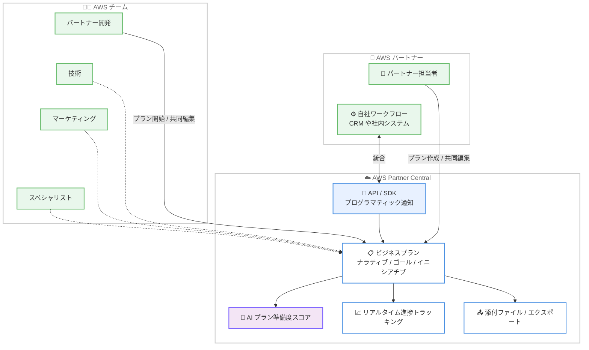

# AWS Partner Central - ビジネスプランニングエクスペリエンスの改善

**リリース日**: 2026 年 11 月 10 日
**サービス**: AWS Partner Central
**機能**: ビジネスプランニング (Business Planning)

📊 [このアップデートのインフォグラフィックを見る](https://takech9203.github.io/aws-news-summary/20261110-partner-central-business-planning.html)

## 概要

AWS Partner Central が、AWS コンソール上で新しいビジネスプランニングエクスペリエンスを提供するようになりました。AWS パートナーは、自社の AWS ビジネスを成長させるためのプランを自ら開始できるほか、AWS チームが開始したプランに参加して共同作業することもできます。

パートナーは、AWS のパートナー開発チーム、技術チーム、マーケティングチーム、スペシャリストチームと協力して、プランのナラティブ (構想)、ゴール、イニシアチブを定義できます。AI によるプラン準備度スコア (plan readiness score) が改善すべき領域の特定を支援し、リアルタイムトラッキングによってゴールに対する進捗を可視化できます。さらに、添付ファイルの追加やプランのエクスポートにより、ビジネスレビューの準備を効率的に行えます。

API および SDK を使用してビジネスプランニングを自社のワークフローに統合することも可能で、プログラマティックな通知にも対応しています。本機能は、AWS パートナーマネジメントチームと積極的に連携している AWS パートナーが利用できます。

**アップデート前の課題**

- 以前は AWS チームとの共同ビジネスプランニングを Partner Central 上で一元的に管理する仕組みがなく、メールやドキュメント共有など個別の手段に依存する必要があった
- プランの完成度や改善すべき領域を客観的に評価する指標がなかった
- ゴールに対する進捗をリアルタイムに追跡する手段が限られていた
- ビジネスプランニングを自社システムやワークフローにプログラマティックに統合できなかった

**アップデート後の改善**

- パートナー自身がプランを開始、または AWS チームが開始したプランに参加して、AWS コンソール上で共同編集できるようになった
- AI によるプラン準備度スコアにより、改善すべき領域を客観的に特定できるようになった
- リアルタイムトラッキングにより、ゴールに対する進捗を継続的に可視化できるようになった
- API / SDK とプログラマティック通知により、ビジネスプランニングを自社ワークフローに統合できるようになった
- 添付ファイルの追加とプランのエクスポートにより、ビジネスレビューの準備が容易になった

## アーキテクチャ図



AWS パートナーと AWS の各チームが Partner Central 上のビジネスプランを共同で作成、編集し、AI スコアとリアルタイムトラッキングで品質と進捗を管理する流れを示しています。API / SDK を利用すれば、自社ワークフローとの統合も可能です。

## サービスアップデートの詳細

### 主要機能

1. **プランの作成と共同編集**
   - パートナーが自社の AWS ビジネス成長に向けたプランを自ら開始可能
   - AWS チームが開始したプランにパートナーが参加して共同作業することも可能
   - AWS のパートナー開発、技術、マーケティング、スペシャリストの各チームと協力して、プランのナラティブ、ゴール、イニシアチブを定義

2. **AI によるプラン準備度スコア**
   - AI がプランの準備度をスコアとして提示
   - パートナーが改善すべき領域を客観的に特定することを支援

3. **リアルタイム進捗トラッキング**
   - 設定したゴールに対する進捗をリアルタイムに可視化
   - ビジネスレビューに向けた状況把握が容易に

4. **添付ファイルとエクスポート**
   - プランへの添付ファイルの追加に対応
   - プランをエクスポートしてビジネスレビューの準備に活用可能

5. **API / SDK とプログラマティック通知**
   - API および SDK を通じてビジネスプランニングを自社ワークフローに統合可能
   - プランに関するプログラマティックな通知を受信可能

## 技術仕様

### 機能概要

| 項目 | 詳細 |
|------|------|
| 提供場所 | AWS コンソール上の AWS Partner Central |
| 対象ユーザー | AWS パートナーマネジメントチームと積極的に連携している AWS パートナー |
| 共同作業の相手 | AWS パートナー開発、技術、マーケティング、スペシャリストチーム |
| プランの構成要素 | ナラティブ、ゴール、イニシアチブ |
| 評価機能 | AI によるプラン準備度スコア |
| 進捗管理 | ゴールに対するリアルタイムトラッキング |
| 統合手段 | API、SDK、プログラマティック通知 |
| その他 | 添付ファイル追加、プランのエクスポート |

### API 変更履歴

公式発表では API / SDK によるワークフロー統合への対応が明記されていますが、awsapichanges.com では本アップデートに対応する Partner Central 関連の API 変更エントリは確認できませんでした (2026 年 11 月 11 日時点)。API の詳細は [AWS Partner Central API Reference](https://docs.aws.amazon.com/partner-central/latest/APIReference/) を参照してください。

## 設定方法

### 前提条件

1. AWS Partner Network (APN) に登録済みであること
2. AWS Partner Central のアカウントを保有していること
3. AWS パートナーマネジメントチームと積極的に連携していること (本機能の利用条件)

### 手順

#### ステップ 1: AWS Partner Central にサインイン

AWS Partner Central にサインインします。ビジネスプランニング機能は AWS コンソール上の Partner Central エクスペリエンスで提供されます。

#### ステップ 2: Business Plan を選択

ナビゲーションから [Business Plan] を選択します。ここから新しいプランの開始、または AWS チームが開始したプランへの参加が可能です。

#### ステップ 3: プランの定義と管理

AWS チームと協力してナラティブ、ゴール、イニシアチブを定義します。AI によるプラン準備度スコアを参考に内容を改善し、リアルタイムトラッキングで進捗を管理します。必要に応じて添付ファイルを追加し、ビジネスレビュー用にプランをエクスポートします。

#### ステップ 4: ワークフロー統合 (オプション)

API / SDK を使用して、ビジネスプランニングを自社の CRM や社内システムなどのワークフローに統合します。プログラマティック通知を設定することで、プランに関する更新を自動的に受け取れます。

## メリット

### ビジネス面

- **AWS との戦略的連携の強化**: パートナー開発、技術、マーケティング、スペシャリストの各チームと一つのプラン上で共同作業でき、AWS との協業を体系的に推進できる
- **ビジネスレビューの効率化**: 添付ファイルやエクスポート機能により、四半期レビューなどの準備工数を削減できる
- **目標達成の可視化**: リアルタイムトラッキングにより、ゴールに対する進捗を経営層やステークホルダーに示しやすくなる

### 技術面

- **AI による客観的評価**: プラン準備度スコアにより、改善すべき領域をデータに基づいて特定できる
- **プログラマティック統合**: API / SDK により、自社の CRM や業務システムとビジネスプランニングを連携できる
- **自動通知**: プログラマティック通知により、プランの更新を自社ワークフロー内で自動的に検知できる

## デメリット・制約事項

### 制限事項

- 本機能は AWS パートナーマネジメントチームと積極的に連携しているパートナーのみが利用可能
- AWS Partner Central は米国東部 (バージニア北部) リージョンでの提供

### 考慮すべき点

- 既存のビジネスプランニングプロセス (スプレッドシートや独自ツールなど) からの移行方法を検討する必要がある
- API / SDK 統合を行う場合は、Partner Central API の認証設定 (AWS アカウントとのリンクや IAM ロール) が必要になる

## ユースケース

### ユースケース 1: AWS との年間共同ビジネスプランの策定

**シナリオ**: コンサルティングパートナーが、翌年度の AWS ビジネス成長に向けた年間プランを AWS パートナー開発チームと共同で策定する。

**実装例**:
```text
1. Partner Central で [Business Plan] を選択し、新規プランを開始
2. ナラティブに事業戦略、ゴールに売上目標や認定取得数を設定
3. AWS パートナー開発チームを招いてイニシアチブを共同定義
4. AI プラン準備度スコアを確認し、不足している領域を補強
```

**効果**: AWS と目標を共有した実行可能なプランを短期間で策定でき、年間を通じた協業の土台を構築できる。

### ユースケース 2: 四半期ビジネスレビュー (QBR) の準備

**シナリオ**: パートナーのアライアンス担当者が、AWS との四半期ビジネスレビューに向けて進捗資料を準備する。

**実装例**:
```text
1. リアルタイムトラッキングでゴールに対する進捗を確認
2. 補足資料をプランに添付
3. プランをエクスポートしてレビュー資料として共有
```

**効果**: 進捗データの収集と資料作成の工数を削減し、レビューの議論を実質的な内容に集中できる。

### ユースケース 3: 自社 CRM とのワークフロー統合

**シナリオ**: 大規模なパートナー企業が、ビジネスプランの進捗を自社 CRM ダッシュボードで一元管理する。

**実装例**:
```text
1. Partner Central API / SDK を使用してプラン情報を取得
2. プログラマティック通知を設定し、プラン更新イベントを受信
3. 受信した更新を自社 CRM に反映し、営業チームへ自動共有
```

**効果**: Partner Central と自社システムの二重管理を解消し、プラン更新の情報伝達を自動化できる。

## 料金

公式発表には料金に関する記載はありません。AWS Partner Central の利用には AWS Partner Network への登録が必要です。

## 利用可能リージョン

AWS Partner Central は米国東部 (バージニア北部) リージョンで利用可能です。

## 関連サービス・機能

- **AWS Partner Central API**: ビジネスプランニングを含む Partner Central の機能をプログラマティックに操作するための API
- **Partner CRM Integrations**: パートナーの CRM と Partner Central を連携し、セル / コセル業務を効率化する統合機能
- **APN Customer Engagements (ACE)**: AWS とパートナーのコセル案件 (オポチュニティ) を管理する仕組みで、ビジネスプランのゴール達成に向けた実行と連動

## 参考リンク

- 📊 [インフォグラフィック](https://takech9203.github.io/aws-news-summary/20261110-partner-central-business-planning.html)
- [公式発表 (What's New)](https://aws.amazon.com/about-aws/whats-new/2026/11/partner-central-business-planning/)
- [AWS Partner Central ドキュメント](https://docs.aws.amazon.com/partner-central/)
- [AWS Partner Central API Reference](https://docs.aws.amazon.com/partner-central/latest/APIReference/)
- [AWS Partner Central Developer Guide](https://docs.aws.amazon.com/partner-central/latest/developer-guide/)

## まとめ

AWS Partner Central のビジネスプランニング機能により、AWS パートナーは AWS の各チームと一つのプラン上で共同作業し、AI スコアとリアルタイムトラッキングでプランの品質と進捗を管理できるようになりました。AWS パートナーマネジメントチームと連携しているパートナーは、Partner Central にサインインして [Business Plan] から利用を開始できます。API / SDK による自社ワークフローとの統合も、あわせて検討することを推奨します。
