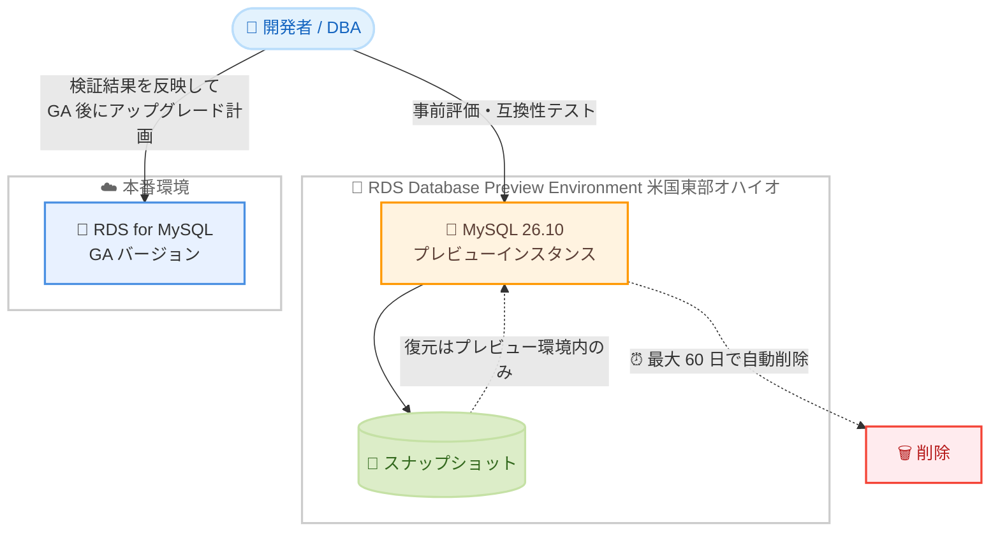

# Amazon RDS for MySQL - MySQL 26.10 の RDS Database Preview Environment 提供開始

**リリース日**: 2026 年 11 月 10 日
**サービス**: Amazon RDS for MySQL
**機能**: Amazon RDS Database Preview Environment での MySQL 26.10 サポート

📊 [このアップデートのインフォグラフィックを見る](https://takech9203.github.io/aws-news-summary/20261110-rds-mysql-26-10-preview-environment.html)

## 概要

Amazon RDS for MySQL において、MySQL コミュニティ版の新バージョン 26.10 が Amazon RDS Database Preview Environment で利用可能になりました。これにより、ユーザーは一般提供 (GA) に先立って、プレリリース版の MySQL 26.10 を RDS のマネージド環境で評価できます。

MySQL 26.10 にはバグ修正とセキュリティパッチに加え、パフォーマンスと運用監視に関する改善が含まれています。特に、READ COMMITTED 分離レベルにおける read view クローズ時のグローバルミューテックス排除によるパフォーマンス向上と、パージ遅延 (purge lag) をエラーログで早期検知できる監視機能の強化が注目ポイントです。

新しいメジャー/マイナーバージョンへのアップグレードを計画しているデータベース管理者や開発者にとって、本番適用前にアプリケーションの互換性や性能を検証できる貴重な機会となります。

**アップデート前の課題**

このアップデート以前に存在していた課題や制限は以下のとおりです。

- MySQL 26.10 のプレリリース版を RDS のマネージド環境で評価できず、GA まで待つかセルフマネージド環境で検証する必要があった
- ビジー状態の NUMA システムでは、READ COMMITTED 分離レベルで read view をクローズするたびにグローバルミューテックスが必要となり、パフォーマンスのボトルネックになっていた
- パージ処理の遅延 (履歴リスト長の増大) を早期に検知する仕組みが乏しく、問題が顕在化してから対応することが多かった

**アップデート後の改善**

今回のアップデートにより可能になったことは以下のとおりです。

- RDS Database Preview Environment で MySQL 26.10 をマネージド環境のまま評価でき、GA 前にアプリケーションの互換性検証が可能になった
- read view オブジェクトの再利用により、クローズ時のグローバルミューテックスが排除され、READ COMMITTED 使用時のパフォーマンスが向上した
- 履歴リスト長 (HLL) が `innodb_max_purge_lag` を超えた場合や、パージ遅延が DML を遅延させ始めた場合にエラーログへ警告が出力され、パージの滞留を早期に検知できるようになった

## アーキテクチャ図



RDS Database Preview Environment で MySQL 26.10 を事前評価し、検証結果を本番環境のアップグレード計画に反映するフローを示しています。プレビューインスタンスは最大 60 日で自動削除され、スナップショットの利用もプレビュー環境内に限定されます。

## サービスアップデートの詳細

### 主要機能

1. **MySQL 26.10 のプレビュー提供**
   - MySQL コミュニティ版 26.10 を RDS のマネージド環境で評価可能
   - バグ修正とセキュリティパッチを含むプレリリース版
   - GA 前にアプリケーションの互換性や性能を検証できる

2. **READ COMMITTED 分離レベルのパフォーマンス改善**
   - 従来はビジー状態の NUMA システムで read view のクローズごとにグローバルミューテックスが必要だった
   - read view オブジェクトが再利用可能になり、クローズ時のグローバルミューテックスが排除された
   - 高並列ワークロードでのスループット向上が期待できる

3. **パージ遅延の監視強化**
   - 履歴リスト長 (HLL) が `innodb_max_purge_lag` を超えた場合にエラーログへ警告を出力
   - パージ遅延が DML の遅延を引き起こし始めた時点でも警告を出力
   - パージの滞留をより早い段階で検知し、対処できる

## 技術仕様

### RDS Database Preview Environment の仕様

| 項目 | 詳細 |
|------|------|
| 提供バージョン | MySQL 26.10 (プレリリース版) |
| 提供リージョン | 米国東部 (オハイオ) のみ |
| インスタンス保持期間 | 最大 60 日 (経過後に自動削除) |
| スナップショット | プレビュー環境内でのみ作成・復元が可能 |
| 料金 | 通常の RDS for MySQL の料金体系が適用 |
| 用途 | 評価・検証目的 (本番利用は非推奨) |

## 設定方法

### 前提条件

1. AWS アカウントを保有していること
2. 米国東部 (オハイオ) リージョンで RDS Database Preview Environment にアクセスできること
3. 評価対象のアプリケーションやテストデータを準備していること

### 手順

#### ステップ1: RDS Database Preview Environment にアクセス

AWS マネジメントコンソールで Amazon RDS を開き、米国東部 (オハイオ) リージョンを選択したうえで、ナビゲーションから Database Preview Environment にアクセスします。

#### ステップ2: MySQL 26.10 のプレビューインスタンスを作成

```bash
# プレビュー環境のエンドポイントを指定して DB インスタンスを作成
aws rds create-db-instance \
  --db-instance-identifier mysql-2610-preview \
  --engine mysql \
  --engine-version 26.10 \
  --db-instance-class db.m7g.large \
  --allocated-storage 100 \
  --master-username admin \
  --manage-master-user-password \
  --region us-east-2 \
  --endpoint-url https://rds-preview.us-east-2.amazonaws.com
```

このコマンドは、プレビュー環境専用のエンドポイントに対して MySQL 26.10 の DB インスタンスを作成します。`--manage-master-user-password` により、マスターユーザーのパスワードは AWS Secrets Manager で管理されます。

#### ステップ3: アプリケーションの互換性と性能を検証

作成したプレビューインスタンスに対してテストデータを投入し、アプリケーションの接続確認、SQL の互換性テスト、READ COMMITTED 分離レベルでの性能測定などを実施します。インスタンスは最大 60 日で自動削除されるため、検証は計画的に進めます。

## メリット

### ビジネス面

- **アップグレードリスクの低減**: GA 前に互換性問題を発見でき、本番アップグレード時の障害リスクを低減できる
- **移行計画の前倒し**: 新バージョンの評価を早期に開始でき、アップグレード計画を余裕を持って策定できる
- **検証環境構築コストの削減**: セルフマネージドで検証環境を構築する手間なく、マネージド環境で評価できる

### 技術面

- **READ COMMITTED の性能向上**: read view オブジェクトの再利用により、NUMA システム上の高並列ワークロードでグローバルミューテックス競合が解消される
- **パージ遅延の早期検知**: エラーログの警告により、履歴リスト長の増大や DML 遅延の兆候を運用監視に組み込める
- **マネージド環境での検証**: バックアップやモニタリングなど RDS の機能を使いながらプレリリース版を評価できる

## デメリット・制約事項

### 制限事項

- プレビューインスタンスは最大 60 日間のみ保持され、その後自動的に削除される
- プレビュー環境で作成したスナップショットは、プレビュー環境内でのみインスタンスの作成・復元に使用できる (本番環境への移行は不可)
- 提供リージョンは米国東部 (オハイオ) のみ

### 考慮すべき点

- プレリリース版のため、本番ワークロードでの利用は想定されていない
- プレビュー環境であっても通常の RDS for MySQL の料金が発生するため、検証完了後は速やかにインスタンスを削除することが望ましい
- MySQL 26.10 の GA 時期は本発表では示されていないため、本番適用のスケジュールは別途確認が必要

## ユースケース

### ユースケース1: 本番アップグレード前の互換性検証

**シナリオ**: 現在 MySQL の旧バージョンで稼働している本番データベースを、将来的に 26.10 へアップグレードする計画があり、アプリケーションの互換性を事前に確認したい。

**実装例**:
```bash
# 本番と同等のスキーマとサンプルデータをプレビューインスタンスへ投入
mysql -h mysql-2610-preview.xxxxxxxx.us-east-2.rds-preview.amazonaws.com \
  -u admin -p < schema_and_sample_data.sql

# アプリケーションの統合テストをプレビューインスタンスに向けて実行
./run_integration_tests.sh --db-endpoint mysql-2610-preview.xxxxxxxx.us-east-2.rds-preview.amazonaws.com
```

**効果**: GA 後のアップグレードで発生し得る非互換や性能劣化を事前に把握し、修正計画を立てられる。

### ユースケース2: READ COMMITTED 高並列ワークロードの性能評価

**シナリオ**: READ COMMITTED 分離レベルを使用する高並列な OLTP ワークロードで、26.10 の read view 再利用によるパフォーマンス改善効果を測定したい。

**実装例**:
```bash
# sysbench で READ COMMITTED の高並列ベンチマークを実行
sysbench oltp_read_write \
  --mysql-host=mysql-2610-preview.xxxxxxxx.us-east-2.rds-preview.amazonaws.com \
  --mysql-user=admin --mysql-password=xxxx \
  --tables=10 --table-size=1000000 \
  --threads=256 --time=600 \
  --mysql-ignore-errors=all run
```

**効果**: 現行バージョンとの性能比較データを取得し、アップグレードによるスループット向上効果を定量的に評価できる。

### ユースケース3: パージ遅延監視の運用手順の整備

**シナリオ**: 長時間トランザクションによるパージ滞留が過去に問題となったため、26.10 の新しい警告ログを活用した監視・対応手順を整備したい。

**実装例**:
```bash
# エラーログを CloudWatch Logs へエクスポートする設定でインスタンスを変更
aws rds modify-db-instance \
  --db-instance-identifier mysql-2610-preview \
  --cloudwatch-logs-export-configuration '{"EnableLogTypes":["error"]}' \
  --region us-east-2 \
  --endpoint-url https://rds-preview.us-east-2.amazonaws.com

# CloudWatch Logs で purge lag 警告を検知するメトリクスフィルターを作成
aws logs put-metric-filter \
  --log-group-name /aws/rds/instance/mysql-2610-preview/error \
  --filter-name purge-lag-warning \
  --filter-pattern "purge lag" \
  --metric-transformations metricName=PurgeLagWarnings,metricNamespace=Custom/RDS,metricValue=1
```

**効果**: 履歴リスト長の増大を早期に検知してアラート化する運用を、GA 前に確立できる。

## 料金

RDS Database Preview Environment で作成したインスタンスには、通常の Amazon RDS for MySQL と同じ料金体系が適用されます。インスタンスクラス、ストレージ、バックアップなどの利用量に応じた従量課金です。

検証用途であっても課金が発生するため、検証完了後はインスタンスを削除することを推奨します。詳細は [Amazon RDS for MySQL 料金ページ](https://aws.amazon.com/rds/mysql/pricing/) を参照してください。

## 利用可能リージョン

- 米国東部 (オハイオ) — RDS Database Preview Environment が提供されている唯一のリージョン

## 関連サービス・機能

- **Amazon RDS for MySQL**: 本プレビューの対象となるマネージド MySQL データベースサービス
- **Amazon RDS Database Preview Environment**: GA 前のデータベースエンジンバージョンを評価できるプレビュー専用環境
- **Amazon CloudWatch Logs**: エラーログをエクスポートすることで、パージ遅延警告の監視やアラート化に活用できる

## 参考リンク

- 📊 [インフォグラフィック](https://takech9203.github.io/aws-news-summary/20261110-rds-mysql-26-10-preview-environment.html)
- [公式発表 (What's New)](https://aws.amazon.com/about-aws/whats-new/2026/11/rds-mysql-26-10-preview-environment/)
- [Amazon RDS for MySQL 製品ページ](https://aws.amazon.com/rds/mysql/)
- [RDS Database Preview Environment ドキュメント](https://docs.aws.amazon.com/AmazonRDS/latest/UserGuide/CHAP_PreviewEnvironment.html)
- [MySQL 26.10 リリースノート](https://dev.mysql.com/doc/relnotes/mysql/)
- [Amazon RDS for MySQL 料金ページ](https://aws.amazon.com/rds/mysql/pricing/)

## まとめ

MySQL 26.10 が RDS Database Preview Environment で利用可能になり、GA に先立ってマネージド環境でプレリリース版を評価できるようになりました。READ COMMITTED のパフォーマンス改善とパージ遅延監視の強化は、高並列ワークロードを運用するユーザーにとって特に有益です。将来のアップグレードを計画している場合は、60 日の保持期限を考慮しつつ、互換性検証と性能評価を早期に開始することを推奨します。
