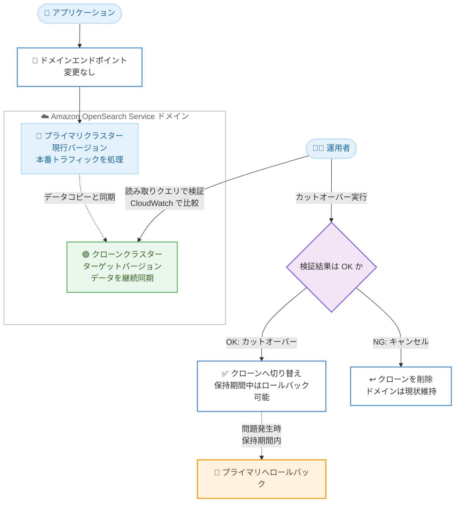

# Amazon OpenSearch Service - バージョンアップグレードの検証とロールバック機能

**リリース日**: 2026 年 11 月 10 日
**サービス**: Amazon OpenSearch Service
**機能**: クローンベースアップグレード (バージョンアップグレードの事前検証・カットオーバー・ロールバック)

📊 [このアップデートのインフォグラフィックを見る](https://takech9203.github.io/aws-news-summary/20261110-upgrades.html)

## 概要

Amazon OpenSearch Service が、バージョンアップグレードを本番トラフィックに影響を与えずに検証し、問題があればロールバックできる「クローンベースアップグレード」を発表しました。アップグレードを開始すると、既存クラスター (プライマリクラスター) のデータが新バージョンで動作する第 2 のクラスター (クローンクラスター) にコピーされ、プライマリクラスターが本番トラフィックを処理し続けている間に、クローンクラスターに対して同一のクエリを実行して Amazon CloudWatch メトリクスで結果を比較できます。

検証に満足した時点でカットオーバーを実行し、新バージョンへ切り替えます。カットオーバー前であればいつでもアップグレードをキャンセルでき、カットオーバー後も設定した保持期間内であればいつでも旧バージョンのプライマリクラスターへロールバックできます。操作は AWS Management Console、AWS CLI、OpenSearch Service API から実行できます。

本機能は、検索基盤やログ分析基盤のバージョンアップグレードに伴うリスクを最小化したい運用チームや、ダウングレード手段がないことを理由にアップグレードを先送りしてきたユーザーにとって重要なアップデートです。

**アップデート前の課題**

従来のインプレースアップグレードには以下の制限がありました。

- アップグレードの一時停止、キャンセル、ロールバックができず、アップグレード完了と同時に新バージョンのクラスターが本番トラフィックを引き継いでいた
- 新バージョンの動作を本番データ・本番相当のクエリで事前に検証するには、スナップショットを別ドメインに復元してテスト環境を手動で構築する必要があった
- 旧バージョンへ戻すには、スナップショットを新しいドメインに復元するしかなく、エンドポイントの変更やアプリケーション側の切り替え作業が発生していた
- アップグレード中に書き込みパフォーマンスが低下する可能性があった

**アップデート後の改善**

今回のアップデートにより以下が可能になりました。

- 本番トラフィックを処理し続けながら、新バージョンのクローンクラスターを隔離された環境で検証できるようになった
- プライマリとクローンの両方に同一クエリを実行し、CloudWatch メトリクスで性能や結果を比較してからカットオーバーを判断できるようになった
- カットオーバー前のキャンセル、およびカットオーバー後の保持期間内のロールバックが可能になり、ドメインエンドポイントを変更せずに安全にアップグレードできるようになった
- アップグレード実行中もプライマリクラスターへの書き込みは影響を受けなくなった (書き込みがブロックされるのはカットオーバー完了までの間のみ)

## アーキテクチャ図



クローンベースアップグレードでは、プライマリクラスターが本番トラフィックを処理し続ける間にターゲットバージョンのクローンクラスターが作成・同期され、検証後にカットオーバー、問題があればキャンセルまたはロールバックが可能です。

## サービスアップデートの詳細

### 主要機能

1. **クローンクラスターによる事前検証**
   - アップグレード開始時に、プライマリクラスターのデータがターゲットバージョンのクローンクラスターにコピーされ、継続的に同期される
   - クローンクラスターは隔離された環境 (Blue/Green デプロイにおける Green 環境) として維持され、本番トラフィックに影響しない
   - プライマリとクローンに同一の読み取りクエリを実行し、CloudWatch メトリクスで性能・結果を比較できる
   - 検証できるのは読み取りリクエストのみで、オプションで読み取りトラフィックの一部をクローンに振り分けることも可能

2. **任意のタイミングでのカットオーバー**
   - 検証に満足したタイミングで、ユーザーが明示的にカットオーバーを実行する
   - カットオーバー中は書き込みがブロックされ、クローンクラスターがデータの同期を完了した後にトラフィックが切り替わる
   - ドメインエンドポイントは変更されないため、アプリケーション側の変更は不要

3. **キャンセルとロールバック**
   - カットオーバー前であればいつでもアップグレードをキャンセル可能。クローンクラスターは削除され、ドメインは元の状態のまま維持される
   - カットオーバー後は、設定した保持期間内であればいつでもプライマリクラスター (旧バージョン) へロールバック可能
   - 保持期間はカットオーバー完了時点から開始され、保持期間を設定しない場合はカットオーバー直後にプライマリクラスターが削除される

## 技術仕様

### インプレースアップグレードとの比較

| 項目 | インプレースアップグレード | クローンベースアップグレード |
|------|--------------------------|------------------------------|
| 動作方式 | 既存クラスターを Blue/Green デプロイでアップグレード | クローンクラスターを Green 環境として作成・同期し、検証後にカットオーバー |
| 対応バージョン | OpenSearch 1.0 以降、Elasticsearch 5.1 以降 | OpenSearch 1.1 以降、Elasticsearch 7.10 |
| 事前検証 | 不可 (完了と同時に切り替え) | 可能 (本番トラフィック処理中に検証) |
| キャンセル | 不可 | カットオーバー前はいつでも可能 |
| ロールバック | 不可 (スナップショットから別ドメインに復元が必要) | 保持期間内はいつでも可能 |
| アップグレード中の書き込み | 書き込みパフォーマンスが低下する可能性あり | 影響なし (カットオーバー完了まで一時的にブロック) |

### クローンベースアップグレードで対応するアップグレードパス

| 移行元 | 移行先 |
|--------|--------|
| Elasticsearch 7.10 | OpenSearch 1.3 |
| OpenSearch 1.1 | OpenSearch 1.3 |
| OpenSearch 1.3 | OpenSearch 2.19 |
| OpenSearch 2.x | OpenSearch 2.19 |
| OpenSearch 2.19 | OpenSearch 3.x |

上記以外のアップグレードパスでは、従来どおりインプレースアップグレードを使用します。

### API 変更履歴

| 日付 | サービス | 変更内容 |
|------|----------|----------|
| 2026/11/09 | [Amazon OpenSearch Service](https://awsapichanges.com/archive/changes/588ec7-es.html) | 1 new 2 updated api methods - `UpgradeDomain` が `DeploymentStrategyOptions` を受け付けクローンクラスターでのアップグレードを指定可能に。新規 `UpdateClone` API で検索トラフィックの振り分け、カットオーバー、保持期間の設定を実行。`DescribeDomainChangeProgress` がアップグレードの詳細を返却 |

## 設定方法

### 前提条件

1. ドメインが Elasticsearch 7.10 または OpenSearch 1.1 以降で稼働していること (それより古いバージョンの場合は、まずインプレースアップグレードで対応バージョンに到達する)
2. アップグレード前に手動スナップショットを取得しておくこと (旧バージョンに戻すための最終的なバックアップとして機能)
3. 対象ドメインがクローンベースアップグレードの制限事項 (OR1/OR2、UltraWarm、クロスクラスターレプリケーション、カスタムプラグイン、SAML/Cognito 認証など) に該当しないこと
4. マネージド型ディザスタリカバリを使用している場合は、事前にレプリケーション関係を解除しておくこと

### 手順

#### ステップ1: 事前チェックとアップグレードの開始

```bash
aws opensearch upgrade-domain \
  --domain-name my-domain \
  --target-version "OpenSearch_2.19" \
  --deployment-strategy-options Strategy=CLONE
```

`UpgradeDomain` API でクローンベースアップグレードを開始します。サービスは事前チェックとスナップショット取得を行った後、ターゲットバージョンのクローンクラスターを作成し、データのコピーと同期を開始します。この間、プライマリクラスターは読み取り・書き込みを通常どおり処理し続けます。

#### ステップ2: クローンクラスターの検証

```bash
# アップグレードの進行状況を確認
aws opensearch describe-domain-change-progress \
  --domain-name my-domain

# オプション: 読み取りトラフィックの一部をクローンに振り分け
aws opensearch update-clone \
  --domain-name my-domain \
  --search-traffic-percentage 10
```

`DescribeDomainChangeProgress` でクローンクラスターの準備完了を確認した後、クローンに対して読み取りクエリを実行して動作を検証します。`UpdateClone` API で読み取りトラフィックの一部をクローンへ振り分け、CloudWatch メトリクスでプライマリとクローンの性能を比較できます。

#### ステップ3: カットオーバーまたはキャンセル

```bash
# 検証に問題がなければカットオーバー (保持期間を設定してロールバックに備える)
aws opensearch update-clone \
  --domain-name my-domain \
  --action CUTOVER \
  --retention-period-hours 72

# 問題があればカットオーバー前にキャンセル
aws opensearch update-clone \
  --domain-name my-domain \
  --action CANCEL
```

カットオーバーを実行すると、書き込みが一時的にブロックされ、クローンがデータ同期を完了した後にトラフィックが切り替わります。保持期間を設定しておけば、カットオーバー後も期間内であればロールバックが可能です。キャンセルした場合はクローンクラスターが削除され、ドメインは元の状態のまま維持されます。

**注意**: 上記の CLI パラメータは説明用の例です。実際のパラメータ名・値は [UpgradeDomain](https://docs.aws.amazon.com/opensearch-service/latest/APIReference/API_UpgradeDomain.html) などの API リファレンスおよび[開発者ガイド](https://docs.aws.amazon.com/opensearch-service/latest/developerguide/clone-based-upgrade.html)で確認してください。

## メリット

### ビジネス面

- **アップグレードリスクの最小化**: 本番環境に影響を与える前に新バージョンを実データで検証でき、問題発生時もロールバックで迅速に復旧できるため、サービス停止や性能劣化のリスクを大幅に低減できる
- **アップグレードの先送り解消**: ロールバック手段がないことを理由にバージョンアップを延期してきた組織でも、安全にアップグレードを計画・実行できる
- **運用工数の削減**: スナップショット復元による検証用ドメインの手動構築や、切り戻し用の復元手順の準備が不要になる

### 技術面

- **エンドポイント不変**: カットオーバー後もドメインエンドポイントが変わらないため、アプリケーションやデータ取り込みパイプラインの設定変更が不要
- **データ同期の自動化**: クローンクラスターはプライマリクラスターのデータと継続的に同期されるため、検証中も最新データでテストできる
- **メトリクスベースの比較検証**: プライマリとクローンに同一クエリを実行し、CloudWatch メトリクスでレイテンシーやエラー率を定量的に比較してからカットオーバーを判断できる
- **書き込みへの影響を限定**: インプレースアップグレードと異なり、アップグレード実行中の書き込み性能への影響がなく、書き込みがブロックされるのはカットオーバー完了までの短時間のみ

## デメリット・制約事項

### 制限事項

- Elasticsearch 7.10 または OpenSearch 1.1 以降のドメインのみ対応 (それより古いバージョンはインプレースアップグレードで対応バージョンへの到達が必要)
- OpenSearch Optimized インスタンス (OR1、OR2) を使用するドメインは非対応
- UltraWarm インスタンスを使用するドメインは非対応
- クロスクラスターレプリケーションを使用するドメインは非対応
- カスタムプラグインまたはサードパーティプラグインパッケージが関連付けられたドメインは非対応
- OpenSearch Dashboards で SAML 認証または Amazon Cognito 認証を使用するドメインは非対応
- アップグレード中はドメインの構成変更ができない
- クローンクラスターで検証できるのは読み取りリクエストのみ

### 考慮すべき点

- 検証期間中はプライマリクラスターとクローンクラスターの両方に対して課金が発生するため、検証期間を計画的に設定する必要がある
- カットオーバー後にロールバックに備えてプライマリクラスターを保持する場合、保持期間が終了するまで両クラスター分の課金が継続する
- 保持期間を設定しない場合、カットオーバー直後にプライマリクラスターが削除され、ロールバックできなくなる
- カットオーバー中は書き込みがブロックされるため、書き込みが集中する時間帯を避けて実行することが望ましい
- マネージド型ディザスタリカバリを使用している場合は、レプリケーション関係の解除と再設定の手順が追加で必要になる

## ユースケース

### ユースケース1: ログ分析基盤のメジャーバージョンアップグレード

**シナリオ**: OpenSearch 2.19 で稼働するログ分析基盤を OpenSearch 3.x にアップグレードしたいが、ダッシュボードやアラートクエリの互換性に不安があり、問題発生時に即座に切り戻せる手段を確保したい。

**実装例**:
```
1. 手動スナップショットを取得
2. クローンベースアップグレードで OpenSearch 3.x のクローンクラスターを作成
3. 主要なダッシュボードクエリ・集計クエリをクローンに対して実行し、
   CloudWatch メトリクスでレイテンシーとエラー率をプライマリと比較
4. 問題がなければ保持期間 72 時間を設定してカットオーバー
5. 本番運用で問題を検知した場合は保持期間内にロールバック
```

**効果**: 本番トラフィックへの影響なしに互換性を検証でき、万一の問題発生時も保持期間内なら即座に旧バージョンへ復旧できる。

### ユースケース2: 性能回帰の事前検出

**シナリオ**: 検索レイテンシーの SLA が厳しい EC サイトの検索基盤で、新バージョンへのアップグレードによる性能回帰を本番切り替え前に検出したい。

**実装例**:
```
1. クローンベースアップグレードを開始し、クローンクラスターを作成
2. UpdateClone API で読み取りトラフィックの一部 (例: 10%) をクローンに振り分け
3. CloudWatch でプライマリとクローンの検索レイテンシー p50/p90/p99 を比較
4. ピーク時間帯を含む数日間の検証後、性能が同等以上であればカットオーバー
5. 性能回帰を検出した場合はキャンセルし、チューニング後に再実行
```

**効果**: 実際の本番クエリパターンの一部を使った現実的な性能検証ができ、性能回帰によるユーザー体験の悪化を未然に防げる。

### ユースケース3: Elasticsearch 7.10 から OpenSearch への安全な移行

**シナリオ**: Elasticsearch 7.10 で稼働するドメインを OpenSearch 1.3 へ移行したいが、クライアントライブラリやプラグインの互換性を本番データで確認してから切り替えたい。

**実装例**:
```
1. クローンベースアップグレードで OpenSearch 1.3 のクローンクラスターを作成
2. アプリケーションのステージング環境からクローンに接続し、
   クライアントライブラリの互換性と主要 API の動作を検証
3. 検証完了後、メンテナンスウィンドウ内にカットオーバーを実行
4. 保持期間を設定し、本番で問題がないことを確認してから保持期間を終了
```

**効果**: Elasticsearch から OpenSearch への移行に伴う互換性リスクを本番データで事前に排除でき、エンドポイント変更なしで移行を完了できる。

## 料金

クローンベースアップグレード自体に追加機能料金はありませんが、クローンクラスターのインスタンスとストレージに対して、ドメインの他のノードと同様の標準料金が適用されます。

- **検証期間中**: プライマリクラスターとクローンクラスターの両方に課金
- **カットオーバー後の保持期間中**: ロールバック用に保持するプライマリクラスターとクローンクラスター (新しい本番クラスター) の両方に課金 (保持期間終了まで)
- **インプレースアップグレード**: 追加料金なし

なお、検証・保持期間を短くするほど二重課金の期間を抑えられます。詳細は [Amazon OpenSearch Service の料金ページ](https://aws.amazon.com/opensearch-service/pricing/)を参照してください。

## 利用可能リージョン

Amazon OpenSearch Service が提供されているすべての AWS 商用リージョンで利用可能です。ただし、以下のリージョンを除きます。

- アジアパシフィック (ニュージーランド)
- アジアパシフィック (台北)
- アジアパシフィック (タイ)
- メキシコ (中部)

東京リージョン、大阪リージョンを含む主要リージョンで利用できます。最新のリージョン対応状況は [AWS リージョン別サービス表](https://aws.amazon.com/about-aws/global-infrastructure/regional-product-services/)を参照してください。

## 関連サービス・機能

- **Amazon CloudWatch**: プライマリクラスターとクローンクラスターのメトリクスを比較し、カットオーバー判断の根拠として使用
- **OpenSearch Service マネージド型クロスリージョンディザスタリカバリ**: 同日に発表された DR 機能。DR を構成したドメインをアップグレードする場合は、レプリケーション関係の解除が事前に必要
- **OpenSearch Service スナップショット**: アップグレード前の手動スナップショットは、保持期間終了後に旧バージョンへ戻すための最終的なバックアップ手段
- **Amazon Data Firehose / Amazon CloudWatch Logs**: これらのサービスから OpenSearch Service へデータをストリーミングしている場合、移行前に新バージョンへの対応状況の確認が必要

## 参考リンク

- 📊 [インフォグラフィック](https://takech9203.github.io/aws-news-summary/20261110-upgrades.html)
- [公式発表 (What's New)](https://aws.amazon.com/about-aws/whats-new/2026/11/amazon-opensearch-service/upgrades/)
- [ドキュメント: Upgrading Amazon OpenSearch Service domains](https://docs.aws.amazon.com/opensearch-service/latest/developerguide/version-migration.html)
- [ドキュメント: Validating, cutting over, and rolling back during a clone-based upgrade](https://docs.aws.amazon.com/opensearch-service/latest/developerguide/clone-based-upgrade.html)
- [API 変更履歴 (awsapichanges.com)](https://awsapichanges.com/archive/changes/588ec7-es.html)
- [料金ページ](https://aws.amazon.com/opensearch-service/pricing/)

## まとめ

Amazon OpenSearch Service のクローンベースアップグレードにより、バージョンアップグレードを本番トラフィックに影響なく検証し、カットオーバー前のキャンセルやカットオーバー後のロールバックが可能になりました。これまで「戻せない」ことがアップグレードの最大の障壁だった運用チームにとって、大きなリスク低減となるアップデートです。対応バージョン (Elasticsearch 7.10、OpenSearch 1.1 以降) と制限事項 (OR1/OR2、UltraWarm、カスタムプラグインなどは非対応) を確認のうえ、次回のバージョンアップグレード計画への組み込みを推奨します。
