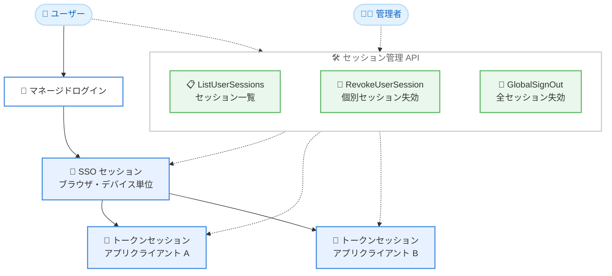

# Amazon Cognito - ユーザープールセッション管理

**リリース日**: 2026 年 11 月 11 日
**サービス**: Amazon Cognito
**機能**: ユーザープールセッション管理 (User Pool Session Management)

📊 [このアップデートのインフォグラフィックを見る](https://takech9203.github.io/aws-news-summary/20261111-amazon-cognito-session-management.html)

## 概要

Amazon Cognito が、ユーザープールにおけるセッション管理機能をサポートしました。ユーザーがアプリケーションにサインインした際に確立されるセッションを可視化し、制御できるようになります。Cognito ユーザープールには 2 種類のセッションがあります。マネージドログイン経由のサインインで作成され、他のアプリクライアントへの再認証なしのアクセスを可能にする SSO (シングルサインオン) セッションと、ユーザーがアプリクライアントにサインインしてトークンを受け取った際に作成されるトークンセッションです。

セッション管理機能により、すべてのデバイスとアプリクライアントにわたるユーザーのアクティブな SSO セッションとトークンセッションを一覧表示し、任意のセッションをオンデマンドで失効できるようになりました。また、従来は 1 時間に固定されていた SSO セッションの再利用期間を、アプリクライアントごとに設定できるようになりました。

各セッションには、セッションタイプ、アプリクライアント ID、デバイスタイプ、最終アクティビティ時刻と場所、初回サインイン時刻などの詳細情報が含まれるため、エンドユーザー向けや管理者向けの独自のセッション管理画面を構築できます。アカウント侵害への対応、紛失・盗難デバイスのリモートサインアウト、アクティブセッション数の制限といったセキュリティ要件に対応する際に有用です。

**アップデート前の課題**

- ユーザーがどのデバイス・アプリクライアントでアクティブなセッションを保持しているかを確認する手段がなかった
- 特定のセッションだけを選択して失効することができず、`GlobalSignOut` による全セッションの一括サインアウトか、アプリが保持するリフレッシュトークンを使った `RevokeToken` に限られていた
- SSO セッションの再利用期間が 1 時間に固定されており、アプリクライアントごとに調整できなかった
- ユーザーごとのアクティブセッション数を制限する仕組みがなかった

**アップデート後の改善**

- `ListUserSessions` / `AdminListUserSessions` により、全デバイス・全アプリクライアントにわたるユーザーのアクティブセッションを一覧表示できるようになった
- `RevokeUserSession` / `AdminRevokeUserSession` により、セッション ID を指定して個別のセッションを失効できるようになった。リンクされたセッションへのカスケード失効も選択可能
- SSO セッションの再利用期間をアプリクライアントごとに 0 分から 129,600 分 (90 日) の範囲で設定できるようになった
- ユーザーごとのアクティブなトークンセッション数の上限を設定できるようになった (デフォルト 20、最大 100)

## アーキテクチャ図



マネージドログインで作成された SSO セッションを起点に、アプリクライアントごとのトークンセッションが作成されます。ユーザーと管理者はセッション管理 API を通じて、これらのセッションの一覧表示と失効を実行できます。

## サービスアップデートの詳細

### 主要機能

1. **セッションの一覧表示**
   - `ListUserSessions`: サインイン済みユーザーが自身のセッションを一覧表示 (アクセストークンで認可)
   - `AdminListUserSessions`: 管理者が IAM 認証情報を使用してユーザーのセッションを一覧表示
   - ユーザープール内のすべてのアプリクライアントにわたるセッションを、最大 125 件の単一ページのフラットなリストとして返却
   - アクティブなセッションのみが返され、失効済み・期限切れのセッションは含まれない

2. **セッションの失効**
   - `RevokeUserSession`: サインイン済みユーザーが自身のセッションをセッション ID 指定で失効
   - `AdminRevokeUserSession`: 管理者がユーザーのセッションを失効
   - `RevokeAssociatedSessions` パラメータでリンクされたセッションへのカスケード失効を制御 (`NONE` または `LINKED`)
   - トークンセッションに対する `LINKED` 指定では、親の SSO セッションも失効。SSO セッションに対する `LINKED` 指定では、その SSO セッション経由で作成されたトークンセッションも失効
   - セッション追跡が有効な場合、`GlobalSignOut` と `AdminUserGlobalSignOut` はユーザーのすべてのトークンセッションと SSO セッションを自動的に失効

3. **SSO セッション再利用期間のアプリクライアントごとの設定**
   - `SetUserPoolClientSessionConfiguration` で `SSOSession.MaxValidityMinutes` を設定
   - 0 分から 129,600 分 (90 日) の範囲で指定可能、デフォルトは 60 分 (従来の固定値と同じ)
   - 0 を指定すると、そのアプリクライアントでは SSO セッションを再利用せず、常に再サインインを要求
   - 適用される有効期間は、ユーザーが現在サインインしているアプリクライアントの設定値

4. **アクティブセッション数の上限設定**
   - `SetUserPoolSessionConfiguration` の `TokenSession.MaxPerUser` でユーザーごとのトークンセッション数の上限をプールレベルで設定 (デフォルト 20、最大 100)
   - 上限到達後のサインインは拒否されず、最も長く使用されていないセッションが自動的に失効される (`TERMINATE_LEAST_RECENTLY_USED` 方式)
   - SSO セッションはユーザーごとに最大 10 で固定 (変更不可)

5. **sid クレームの追加**
   - セッション追跡を有効にすると、発行される ID トークンとアクセストークンに `sid` クレーム (セッション識別子) が追加される
   - `sid` は OpenID Connect 標準のセッション ID クレーム名に準拠し、同一セッション内のトークン更新・ローテーションを通じて不変

## 技術仕様

### セッションタイプ

| 項目 | SSO セッション | トークンセッション |
|------|----------------|--------------------|
| 作成タイミング | マネージドログイン経由のサインイン時 | アプリクライアントへのサインインとトークン発行時 |
| スコープ | 単一のブラウザまたはデバイス (Cookie ベース) | 特定のアプリクライアント (リフレッシュトークンのライフサイクルを追跡) |
| セッション ID プレフィックス | `sso` | `tkn` |
| ユーザーごとの上限 | 10 (固定) | デフォルト 20、最大 100 (設定可能) |
| 有効期間 | 最終認証から 90 日で失効 (再利用では延長されない) | リフレッシュトークンの有効期間に準拠 |

### セッション情報のフィールド

| フィールド | 説明 |
|------|------|
| SessionId | 28 文字の一意な識別子 |
| SessionType | `TOKEN` または `SSO` |
| ClientId | セッションが属するアプリクライアント |
| CreateDate | セッション作成日時 |
| LastActiveDate | 最終アクティビティ日時 |
| DeviceType | ユーザーエージェントから導出された OS とブラウザまたはアプリ |
| LastIPAddress | 最終アクティビティの IP アドレス |
| LastLocation | IP アドレスから導出された都市と国 |
| OriginSessionId | トークンセッションの作成元となった SSO セッション (トークンセッションのみ) |
| IsCurrentSession | リクエストのアクセストークンと一致するセッションかどうか |

### 新しい API オペレーション

| オペレーション | 説明 |
|------|------|
| `SetUserPoolSessionConfiguration` / `GetUserPoolSessionConfiguration` | プールレベルのセッション追跡の有効化とトークンセッション上限の設定・取得 |
| `SetUserPoolClientSessionConfiguration` / `GetUserPoolClientSessionConfiguration` | アプリクライアントごとの SSO セッション有効期間の設定・取得 |
| `ListUserSessions` / `AdminListUserSessions` | ユーザー自身または管理者によるセッション一覧の取得 |
| `RevokeUserSession` / `AdminRevokeUserSession` | セッション ID を指定したセッションの失効 |

### AWS CloudFormation サポート

| リソース | 説明 |
|------|------|
| `AWS::Cognito::UserPoolSessionConfigurationAttachment` | プールレベルのセッション設定。削除時はデフォルト値 (セッション追跡無効、`MaxPerUser` 20) にリセット |
| `AWS::Cognito::UserPoolClientSessionConfigurationAttachment` | アプリクライアントごとの設定。削除時はデフォルト値 (`SSOSession.MaxValidityMinutes` 60) にリセット |

アプリクライアントごとの設定はプールレベルのセッション追跡が有効であることを前提とするため、クライアント側のアタッチメントにはプール側のアタッチメントへの `DependsOn` 参照を宣言します。

## 設定方法

### 前提条件

1. ユーザープールが Essentials または Plus 機能プランであること (Lite プランでは `FeatureUnavailableInTierException` が返される)
2. Pre Token Generation トリガーで独自の `sid` クレームを追加していないこと (追加している場合、セッション追跡は動作しない)
3. セッション管理 API を呼び出す権限 (管理者向けオペレーションは IAM 認証情報、ユーザー向けオペレーションはアクセストークン)

### 手順

#### ステップ 1: セッション追跡の有効化

```bash
aws cognito-idp set-user-pool-session-configuration \
  --user-pool-id us-east-1_aBcDeFgHi \
  --user-session-tracking ENABLED \
  --token-session '{"MaxPerUser": 20}'
```

ユーザープールレベルでセッション追跡を有効化し、ユーザーごとのアクティブなトークンセッション数の上限を 20 に設定します。セッション追跡はデフォルトで無効のため、明示的なオプトインが必要です。

#### ステップ 2: アプリクライアントごとの SSO セッション有効期間の設定

```bash
aws cognito-idp set-user-pool-client-session-configuration \
  --user-pool-id us-east-1_aBcDeFgHi \
  --client-id 1example23456789 \
  --sso-session '{"MaxValidityMinutes": 43200}'
```

指定したアプリクライアントが SSO セッションを再利用できる期間を 43,200 分 (30 日) に設定します。この期間内は、ユーザーは再サインインなしで新しいトークンを取得できます。

#### ステップ 3: セッションの一覧表示と失効

```bash
# 管理者としてユーザーのセッションを一覧表示
aws cognito-idp admin-list-user-sessions \
  --user-pool-id us-east-1_aBcDeFgHi \
  --username example-user

# 特定のセッションをリンクされたセッションごと失効
aws cognito-idp admin-revoke-user-session \
  --user-pool-id us-east-1_aBcDeFgHi \
  --username example-user \
  --session-id sso1234567890abcdefghijklmnop \
  --revoke-associated-sessions LINKED
```

1 つ目のコマンドでユーザーのすべてのアクティブセッションを取得し、2 つ目のコマンドで SSO セッションとその配下のトークンセッションをまとめて失効します。

## メリット

### ビジネス面

- **セキュリティインシデントへの迅速な対応**: アカウント侵害や不審なアクティビティを検知した際に、特定のデバイスやアプリのセッションだけを選択的に失効でき、ユーザー全体への影響を最小化できる
- **エンドユーザー体験の向上**: 「ログイン中のデバイス一覧」や「他のデバイスからサインアウト」といった、一般的な Web サービスで提供されるセッション管理機能を自社アプリに実装できる
- **コンプライアンス対応**: セッションの可視化とアクティブセッション数の制限により、同時接続数の制御やセッション監査といったセキュリティ要件に対応しやすくなる

### 技術面

- **独自実装の削減**: セッションの追跡・一覧・失効をマネージドな API として利用でき、セッションストアの自前構築が不要になる
- **柔軟な SSO 制御**: 従来 1 時間固定だった SSO セッションの再利用期間を、アプリクライアントごとに 0 分 (常に再認証) から 90 日まで調整できる
- **標準準拠の sid クレーム**: OpenID Connect 標準のセッション ID クレームがトークンに付与され、アプリ側でのセッション相関が容易になる
- **CloudFormation 対応**: セッション設定を IaC (Infrastructure as Code) として管理できる

## デメリット・制約事項

### 制限事項

- Essentials または Plus 機能プランが必要で、Lite プランでは利用できない。セッション追跡を有効にしたまま Lite プランへのダウングレードはできない
- セッション一覧は最大 125 セッションの単一ページで返却される
- SSO セッションの上限はユーザーごとに 10 で固定であり、変更できない
- SSO セッションは最終の新規認証から 90 日で必ず失効し、サイレントな再利用では延長されない
- マシンツーマシン (クライアントクレデンシャル) のトークンはリフレッシュトークンを使用しないため、セッションとして追跡されない

### 考慮すべき点

- セッション追跡はデフォルトで無効のため、利用するにはユーザープールレベルでの明示的な有効化が必要
- Pre Token Generation トリガーで独自の `sid` クレームを追加している場合、セッション追跡は動作しない。利用するにはトリガーから `sid` クレームを削除する必要がある
- トークンセッション上限を現在のセッション数より低く変更しても即時には失効されず、次回サインイン時に最も長く使用されていないセッションから失効される
- マルチリージョンユーザープールでは、トークンセッション上限はリージョンごとに適用され、リージョン間のカウントは結果整合性となる。ほぼ同時のサインインで一時的に上限を超える可能性がある

## ユースケース

### ユースケース 1: エンドユーザー向けのデバイス管理画面

**シナリオ**: コンシューマー向けアプリで、ユーザー自身がログイン中のデバイスを確認し、身に覚えのないセッションをサインアウトできる画面を提供したい。

**実装例**:
```
1. アプリから ListUserSessions をアクセストークンで呼び出し、セッション一覧を取得
2. DeviceType、LastLocation、LastActiveDate を画面に表示
3. ユーザーが選択したセッションに対して RevokeUserSession を
   RevokeAssociatedSessions=LINKED で呼び出し
```

**効果**: ユーザー自身による不正アクセスの発見と対処が可能になり、サポート問い合わせの削減とセキュリティ向上につながる。

### ユースケース 2: 管理者による侵害アカウントへの対応

**シナリオ**: セキュリティチームが不審なサインインを検知し、該当ユーザーの特定デバイスのセッションのみを強制終了したい。

**実装例**:
```
1. AdminListUserSessions で該当ユーザーの全セッションを取得
2. LastIPAddress や LastLocation から不審なセッションを特定
3. AdminRevokeUserSession で該当セッションを失効
4. 全デバイスからのサインアウトが必要な場合は AdminUserGlobalSignOut を実行
```

**効果**: 正常なセッションを維持したまま侵害が疑われるセッションのみを失効でき、ユーザーへの影響を最小限に抑えたインシデント対応が可能になる。

### ユースケース 3: アプリクライアントごとの再認証ポリシー

**シナリオ**: 同一ユーザープール内で、一般向けポータルは 30 日間の SSO セッション再利用を許可し、決済管理などの機密性の高いアプリでは毎回再認証を要求したい。

**実装例**:
```
# 一般向けポータル: 30 日間の再利用を許可
SetUserPoolClientSessionConfiguration
  ClientId: portal-client, SSOSession.MaxValidityMinutes: 43200

# 決済管理アプリ: 常に再認証を要求
SetUserPoolClientSessionConfiguration
  ClientId: payment-client, SSOSession.MaxValidityMinutes: 0
```

**効果**: アプリケーションの機密度に応じた再認証ポリシーを単一のユーザープールで実現でき、利便性とセキュリティを両立できる。

## 料金

セッション管理は Essentials または Plus 機能プランのユーザープールで利用できます。Cognito ユーザープールの料金は月間アクティブユーザー (MAU) 数に基づく従量課金です。プランごとの詳細な料金は [Amazon Cognito 料金ページ](https://aws.amazon.com/cognito/pricing/) を参照してください。

## 利用可能リージョン

Amazon Cognito が利用可能なすべての AWS リージョンで利用できます。

## 関連サービス・機能

- **マネージドログイン**: SSO セッションはマネージドログイン経由のサインインで作成されるため、SSO セッション管理の前提となる機能
- **トークンの失効 (RevokeToken)**: 従来からのリフレッシュトークン失効機能。セッション管理はこの仕組みの上に構築されており、`RevokeToken` も `RevokeAssociatedSessions` パラメータをサポート
- **Cognito 機能プラン (Lite / Essentials / Plus)**: セッション管理の利用には Essentials 以上のプランが必要
- **Pre Token Generation Lambda トリガー**: 独自の `sid` クレームを追加している場合はセッション追跡と競合するため注意が必要

## 参考リンク

- 📊 [インフォグラフィック](https://takech9203.github.io/aws-news-summary/20261111-amazon-cognito-session-management.html)
- [公式発表 (What's New)](https://aws.amazon.com/about-aws/whats-new/2026/11/amazon-cognito-session-management/)
- [ドキュメント: Managing user sessions](https://docs.aws.amazon.com/cognito/latest/developerguide/managing-user-sessions.html)
- [API リファレンス](https://docs.aws.amazon.com/cognito-user-identity-pools/latest/APIReference/API_Operations.html)
- [料金ページ](https://aws.amazon.com/cognito/pricing/)

## まとめ

Amazon Cognito のセッション管理機能により、これまで自前実装が必要だったセッションの可視化・個別失効・同時セッション数制限がマネージドな API として利用できるようになりました。SSO セッションの再利用期間もアプリクライアントごとに調整可能になり、利便性とセキュリティのバランスを柔軟に設計できます。Essentials または Plus プランのユーザープールを運用している場合は、セッション追跡の有効化と、デバイス管理画面やインシデント対応フローへの組み込みを検討することを推奨します。
