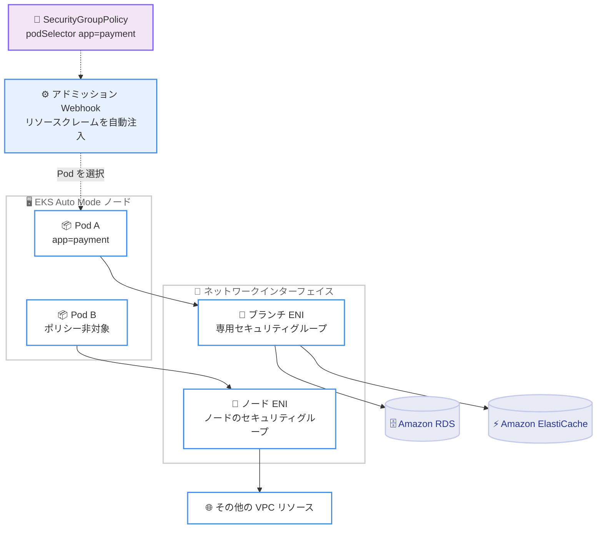

# Amazon EKS - EKS Auto Mode が Pod 単位のセキュリティグループに対応

**リリース日**: 2026 年 11 月 11 日
**サービス**: Amazon EKS (EKS Auto Mode)
**機能**: Security groups for Pods (Pod 単位のセキュリティグループ割り当て)

📊 [このアップデートのインフォグラフィックを見る](https://takech9203.github.io/aws-news-summary/20261111-amazon-eks-auto-mode-security-groups-for-pods.html)

## 概要

Amazon EKS Auto Mode が security groups for Pods をサポートしました。これにより、個々の Pod に専用の Amazon EC2 セキュリティグループルールを適用できるようになります。同一ノード上で稼働する異なるワークロードに異なるセキュリティグループを割り当てられるため、アプリケーションごとに個別のノードプールを作成することなく、Pod レベルのネットワークセグメンテーションを実現できます。

本機能は、既存の AWS ネットワーク制御を Pod レベルまで拡張するものです。セキュリティグループで接続を許可する Amazon RDS や Amazon ElastiCache などのリソースに対して、VPC 内の他のリソースと同じルールで Pod からアクセスできます。どの Pod にどのセキュリティグループを適用するかは `SecurityGroupPolicy` リソースで定義し、ポリシーに一致しない Pod は従来どおりノードのセキュリティグループを使用します。

EKS Auto Mode では、本機能を `SecurityGroupPolicy` リソース、Kubernetes の Dynamic Resource Allocation (DRA)、EC2 ブランチネットワークインターフェイスの組み合わせで実装しています。ポリシーに一致した Pod には、ノードのトランクインターフェイスにアタッチされた専用のブランチネットワークインターフェイスが割り当てられ、指定したセキュリティグループのみがそのインターフェイスに適用されます。

**アップデート前の課題**

- EKS Auto Mode では Pod 単位でセキュリティグループを割り当てる手段がなく、Pod はノードのセキュリティグループを共有する必要があった
- NodeClass の `podSecurityGroupSelectorTerms` は、そのノード上のすべての Pod に同一のセキュリティグループセットを適用するため、ワークロードごとの分離にはノードプールの分割が必要だった
- セキュリティグループベースでアクセス制御している RDS や ElastiCache などへのアクセスを、特定のワークロードのみに限定することが困難だった
- VPC CNI 版の security groups for Pods (`vpcresources.k8s.aws/v1beta1`) は EKS Auto Mode ノードには適用されなかった

**アップデート後の改善**

- 同一ノード上の Pod ごとに異なるセキュリティグループを割り当てられるようになり、ノードプールを分割せずにネットワークレベルのセグメンテーションが可能になった
- `SecurityGroupPolicy` リソースで Pod ラベルまたはサービスアカウントラベルによる柔軟な対象選択が可能になった
- セキュリティグループで接続を許可するデータストアへのアクセスを、該当する Pod のみに限定できるようになった
- 非 Auto Mode クラスターの security groups for Pods と同等の運用モデルを EKS Auto Mode でも利用できるようになった

## アーキテクチャ図



`SecurityGroupPolicy` に一致した Pod A には専用のブランチ ENI が割り当てられ、指定したセキュリティグループのみが適用されます。ポリシーに一致しない Pod B は従来どおりノードのセキュリティグループを使用します。

## サービスアップデートの詳細

### 主要機能

1. **SecurityGroupPolicy リソースによる Pod 単位のセキュリティグループ割り当て**
   - `eks.amazonaws.com/v1` API グループの `SecurityGroupPolicy` リソースで、対象 Pod とセキュリティグループを宣言的に定義
   - `podSelector` (Pod ラベル)、`serviceAccountSelector` (サービスアカウントラベル)、またはその両方で対象 Pod を選択。両方を設定した場合は両方に一致する Pod のみが対象
   - アドミッション Webhook が一致した Pod にリソースクレームを自動注入するため、Pod スペック自体の変更は不要
   - ポリシーに一致しない Pod はノードのセキュリティグループを引き続き使用

2. **ブランチネットワークインターフェイスによる独立したトラフィック評価**
   - 一致した Pod にはノードのトランクインターフェイスにアタッチされた専用のブランチ ENI が割り当てられる
   - Pod との送受信トラフィックは、ノードのセキュリティグループとは独立して、ブランチ ENI 上の指定セキュリティグループで評価される
   - 同一ノード上の Pod 間トラフィックにもセキュリティグループが適用される (オープンソース VPC CNI の `standard` モードとは異なる動作)

3. **柔軟なセキュリティグループ選択**
   - `securityGroupSelectorTerms` で ID、名前、タグのいずれかによりセキュリティグループを指定 (1 つのタームに最大 30 個、各タームは OR 評価)
   - `name` や `tags` によるタームは動的に再解決されるため、ポリシーを編集しなくても実効セキュリティグループが変化し得る
   - `nodeSelector` (`karpenter.sh/nodepool` キーのみ) で特定の NodePool にポリシーを限定可能

4. **ネイティブ DRA によるオプトイン方式 (代替手段)**
   - 各 `SecurityGroupPolicy` に対してコントローラーが `ResourceClaimTemplate` を自動生成
   - Pod スペックの `resourceClaims` フィールドからこのテンプレートを直接参照することで、ラベルマッチングを使わず明示的に Pod を関連付けることも可能

## 技術仕様

### 機能の比較

| メカニズム | API グループ | 動作 |
|------|------|------|
| NodeClass `podSecurityGroupSelectorTerms` | `eks.amazonaws.com/v1` | EKS Auto Mode。ノード上のすべての Pod に同一のセキュリティグループを適用 |
| `SecurityGroupPolicy` (今回のアップデート) | `eks.amazonaws.com/v1` | EKS Auto Mode。Pod ごとに異なるセキュリティグループを適用 |
| `SecurityGroupPolicy` (VPC CNI) | `vpcresources.k8s.aws/v1beta1` | 非 Auto Mode クラスター用。スペックは今回の API と互換性なし |

### 主な仕様と制限値

| 項目 | 詳細 |
|------|------|
| 対象クラスター | Kubernetes 1.36 以降の EKS Auto Mode クラスター |
| Pod ごとのポリシー数 | 最大 1 つ (複数ポリシーに一致した Pod は拒否される) |
| セキュリティグループ解決の上限 | ポリシーあたり最大 16 個 |
| ENI あたりのセキュリティグループクォータ | デフォルト 5 個 (VPC クォータ。16 個まで引き上げ可能) |
| `securityGroupSelectorTerms` | 最大 30 ターム、タグ指定は 1 タームあたり最大 20 キーバリューペア |
| ノードあたりの推奨ポリシー数 | 5 個以下 (超過するとスケジューリング遅延のリスク) |
| 追加 IAM 権限 | クラスターロールに `ec2:CreateNetworkInterfacePermission` が必要 |

### SecurityGroupPolicy の定義例

```yaml
apiVersion: eks.amazonaws.com/v1
kind: SecurityGroupPolicy
metadata:
  name: my-sgp
  namespace: my-namespace
spec:
  podSelector:
    matchLabels:
      app: my-app
  securityGroupSelectorTerms:
    - id: sg-0123456789abcdef0
```

## 設定方法

### 前提条件

1. Kubernetes 1.36 以降で稼働する EKS Auto Mode クラスター
2. クラスターの IAM ロールに `AmazonEKSNetworkingPolicy` 管理ポリシーに加えて `ec2:CreateNetworkInterfacePermission` を許可するポリシーステートメントを付与
3. Pod に適用するセキュリティグループをクラスターの VPC に作成済みであること

### 手順

#### ステップ 1: セキュリティグループの準備

```bash
# 同一ポリシー配下の Pod 間通信が必要な場合、自己参照のインバウンドルールを追加
aws ec2 authorize-security-group-ingress --group-id sg-0123456789abcdef0 \
  --source-group sg-0123456789abcdef0 --protocol -1
```

`SecurityGroupPolicy` は既存のセキュリティグループを選択するだけで、セキュリティグループ自体は作成しません。EKS Auto Mode は同一ノード上の Pod 間トラフィックにもセキュリティグループを適用するため、同じポリシー配下の Pod 同士が通信する場合は、このコマンドで自己参照のインバウンドルールを追加しておく必要があります。

#### ステップ 2: SecurityGroupPolicy の作成

```bash
kubectl apply -f my-sgp.yaml
```

前述の YAML 定義例のように、`podSelector` または `serviceAccountSelector` で対象 Pod を指定し、`securityGroupSelectorTerms` で適用するセキュリティグループを指定した `SecurityGroupPolicy` を適用します。

#### ステップ 3: ポリシーの解決状態の確認

```bash
kubectl get securitygrouppolicies.eks.amazonaws.com my-sgp -n my-namespace -o yaml
```

`status.securityGroups` に解決されたセキュリティグループ ID が、`status.conditions[]` の `SecurityGroupsResolved` に解決結果が表示されます。`False` の場合は `reason` フィールド (`no_sgs_matched`、`sg_quota_exceeded`、`invalid_spec`、`resolution_error`) で失敗原因を確認できます。解決に失敗したポリシーに一致する Pod は、ノードのセキュリティグループで起動されるのではなく Pending のままになる点に注意してください。

#### ステップ 4: Pod へのリソースクレーム注入の確認

```bash
kubectl get pod <pod-name> -o jsonpath='{.spec.resourceClaims}'
```

対象ラベルを持つ Pod をデプロイした後、このコマンドでリソースクレームが注入されていることを確認します。結果が空の場合は、Pod のラベルが同一ネームスペース内のどの `SecurityGroupPolicy` にも一致していないことを示します。

## メリット

### ビジネス面

- **インフラコストの最適化**: ワークロードの分離のためだけにノードプールを分割する必要がなくなり、ノードの集約率を高められる
- **コンプライアンス対応の強化**: 決済処理や個人情報を扱うワークロードへのネットワークアクセスを Pod 単位で制御でき、監査要件に対応しやすくなる
- **追加コストなし**: EKS Auto Mode の一部として追加料金なしで利用可能

### 技術面

- **既存の AWS ネットワーク制御との統合**: セキュリティグループで接続を許可する RDS や ElastiCache などに対し、VPC 内の他リソースと同じモデルでアクセス制御できる
- **宣言的かつ Pod スペック変更不要**: `SecurityGroupPolicy` を適用するだけで、アドミッション Webhook が対象 Pod に自動的にリソースクレームを注入する
- **同一ノード内トラフィックの確実な制御**: 同一ノード上の Pod 間通信にもセキュリティグループが適用され、意図しない水平方向のアクセスを防止できる
- **非 Auto Mode からの移行が容易**: VPC CNI 版の `SecurityGroupPolicy` から `podSelector` と `serviceAccountSelector` をそのまま引き継げるフィールドマッピングが用意されている

## デメリット・制約事項

### 制限事項

- Kubernetes 1.36 以降の EKS Auto Mode クラスターでのみ利用可能
- 1 つの Pod に一致できるポリシーは最大 1 つ。複数ポリシーに一致した Pod は拒否されるため、セレクターはポリシー間で重複しないように設計する必要がある
- ポリシーが解決できるセキュリティグループは最大 16 個だが、ENI あたりのセキュリティグループ数の VPC クォータはデフォルト 5 個のため、6 個以上を使用する場合は事前のクォータ引き上げが必要
- IPv6 クラスターで `enableV4Egress` が有効 (デフォルト) の場合、Pod の IPv4 エグレストラフィックはノードの ENI 経由となり、Pod のセキュリティグループでは評価されない
- 代替 CNI プラグインやネットワークポリシープラグインとの併用は不可 (EKS Auto Mode 組み込みネットワーキングの Pod にのみ適用)
- トランク対応インスタンスタイプのうち ENI スロットが 2 つしかないものでは、本機能と Pod 用の個別サブネット機能を同時に利用できない

### 考慮すべき点

- ブランチ ENI はノードの ENI スロットと IP アドレスを消費するため、ノードの実効 `maxPods` が低下する。既存の NodePool で本機能を導入する場合は、`maxPods` を正しく反映させるためにノードのリサイクルが推奨される
- 同一ノードを対象とする `SecurityGroupPolicy` は 5 個以下に抑えることが強く推奨される。超過するとスケジューリング遅延や、大規模環境での Karpenter と kube-scheduler のリソース消費増加のリスクがある
- IMDS、EKS Pod Identity Agent、kubelet のヘルスチェック、CoreDNS といったノードローカルエンドポイントとの通信はセキュリティグループ評価の対象外 (固定の例外セットで、カスタマイズ不可)
- クラスターを 1.36 以降にアップグレードした直後は、コントロールプレーンコンポーネントの再起動完了まで数分間、本機能が利用できない場合がある
- EKS Auto Mode を無効化する前に、ポリシー配下の Pod を終了させてすべての `SecurityGroupPolicy` を削除しておくことが推奨される

## ユースケース

### ユースケース 1: 決済ワークロードのデータベースアクセス制限

**シナリオ**: 同一クラスター上で決済処理アプリケーションと一般的な Web アプリケーションが稼働しており、決済用の Amazon RDS データベースには決済処理 Pod のみがアクセスできるようにしたい。

**実装例**:
```yaml
apiVersion: eks.amazonaws.com/v1
kind: SecurityGroupPolicy
metadata:
  name: payment-sgp
  namespace: payment
spec:
  podSelector:
    matchLabels:
      app: payment-api
  securityGroupSelectorTerms:
    - id: sg-payment0123456789
```

RDS のセキュリティグループで `sg-payment0123456789` からのインバウンドのみを許可します。

**効果**: 決済処理 Pod だけがデータベースに到達でき、同一ノード上の他の Pod からのアクセスはネットワークレベルで遮断される。

### ユースケース 2: ノードプール分割からの統合によるコスト削減

**シナリオ**: これまでセキュリティ要件の異なるワークロードごとにノードプールを分割し、ノードレベルのセキュリティグループで分離していたため、ノードの集約率が低くコストがかさんでいた。

**実装例**:
```yaml
apiVersion: eks.amazonaws.com/v1
kind: SecurityGroupPolicy
metadata:
  name: internal-api-sgp
  namespace: backend
spec:
  serviceAccountSelector:
    matchLabels:
      security-tier: internal
  securityGroupSelectorTerms:
    - tags:
        Team: platform
```

**効果**: 複数のワークロードを同一ノードプールに統合しつつ Pod 単位の分離を維持でき、ノード台数と運用対象の NodePool 数を削減できる。

### ユースケース 3: 非 Auto Mode クラスターからの移行

**シナリオ**: マネージドノードグループで VPC CNI 版の security groups for Pods を利用しており、EKS Auto Mode への移行後も同等の Pod 単位のネットワーク制御を維持したい。

**実装例**:
```yaml
# 移行前 vpcresources.k8s.aws/v1beta1
spec:
  securityGroups:
    groupIds:
      - sg-0123456789abcdef0

# 移行後 eks.amazonaws.com/v1
spec:
  securityGroupSelectorTerms:
    - id: sg-0123456789abcdef0
```

**効果**: `podSelector` と `serviceAccountSelector` はそのまま引き継げるため、最小限のマニフェスト変更で EKS Auto Mode へ移行できる。移行期間中は両方の API グループのポリシーを併存させることで、Auto Mode ノードと非 Auto Mode ノードの両方で Pod を保護できる。

## 料金

Security groups for Pods は EKS Auto Mode の一部として追加料金なしで利用できます。EKS Auto Mode 自体の料金 (管理対象の EC2 インスタンスに対する管理料金) と、EC2 インスタンスなどの基盤リソースの料金は通常どおり発生します。

## 利用可能リージョン

EKS Auto Mode が利用可能なすべての AWS リージョンで利用できます。

## 関連サービス・機能

- **Amazon VPC CNI の security groups for Pods**: 非 Auto Mode クラスター向けの同等機能。`vpcresources.k8s.aws/v1beta1` API グループを使用し、スペックの互換性はないが移行パスが用意されている
- **NodeClass の podSecurityGroupSelectorTerms**: ノード上のすべての Pod に同一のセキュリティグループを適用する EKS Auto Mode の既存機能。本機能と併用可能
- **Kubernetes Dynamic Resource Allocation (DRA)**: 本機能の実装基盤。ブランチ ENI のスロットをデバイスとしてスケジューラーが割り当てる
- **Amazon RDS / Amazon ElastiCache**: セキュリティグループでアクセスを許可するデータストア。本機能により Pod 単位でのアクセス制御が可能になる

## 参考リンク

- 📊 [インフォグラフィック](https://takech9203.github.io/aws-news-summary/20261111-amazon-eks-auto-mode-security-groups-for-pods.html)
- [公式発表 (What's New)](https://aws.amazon.com/about-aws/whats-new/2026/11/amazon-eks-auto-mode-security-groups-for-pods/)
- [ドキュメント: Assign security groups to individual Pods in EKS Auto Mode](https://docs.aws.amazon.com/eks/latest/userguide/auto-sgp.html)
- [Amazon EKS Auto Mode 製品ページ](https://aws.amazon.com/eks/auto-mode/)
- [Amazon EKS 料金ページ](https://aws.amazon.com/eks/pricing/)

## まとめ

EKS Auto Mode でも Pod 単位のセキュリティグループ割り当てが可能になり、非 Auto Mode クラスターとの機能差分が 1 つ解消されました。セキュリティグループベースでアクセス制御しているデータストアを利用する環境や、分離要件のためにノードプールを分割している環境では、クラスターの Kubernetes 1.36 以降へのアップグレードと `SecurityGroupPolicy` の導入を検討する価値があります。導入時は、Pod あたり 1 ポリシーの制約、ENI あたりのセキュリティグループクォータ (デフォルト 5 個)、ノードの実効 `maxPods` への影響を事前に確認してください。
