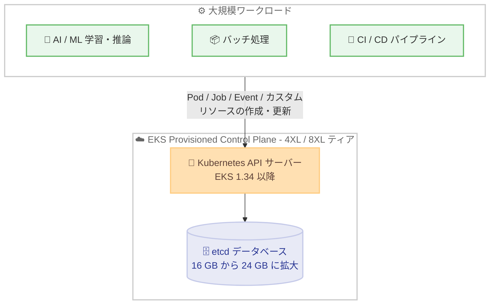

# Amazon EKS - Provisioned Control Plane の 4XL / 8XL ティアで 24 GB の etcd データベースを提供開始

**リリース日**: 2026 年 11 月 11 日
**サービス**: Amazon Elastic Kubernetes Service (Amazon EKS)
**機能**: Provisioned Control Plane における etcd データベースサイズの拡大 (16 GB から 24 GB へ)

📊 [このアップデートのインフォグラフィックを見る](https://takech9203.github.io/aws-news-summary/20261111-amazon-eks-provisioned-control-plane-larger-etcd-database.html)

## 概要

Amazon EKS は、Provisioned Control Plane の 4XL および 8XL ティアにおいて、従来の 16 GB から 50% 増となる 24 GB の etcd データベースの提供を開始しました。etcd は Kubernetes コントロールプレーンのキーバリューストアであり、クラスターの状態を保持します。そのサイズはクラスターに格納できる Kubernetes オブジェクト数の上限を決定するため、容量の拡大により、より多くの Pod、Job、Event、カスタムリソースを持つ大規模クラスターを運用できるようになります。

今回の拡大は、大規模な AI / ML の学習・推論、バッチ処理、CI / CD パイプラインなど、多数の Kubernetes オブジェクトを作成・更新するワークロードに大きな余裕をもたらします。etcd データベースが満杯になるとクラスター内のオブジェクトの追加や変更ができなくなるため、追加の容量はこれらのワークロードがスケールし続けるうえで重要な意味を持ちます。

24 GB の etcd データベースを利用するには、EKS バージョン 1.34 以降を実行するクラスターで Provisioned Control Plane の 4XL または 8XL ティアを選択します。対象バージョンで既に 4XL / 8XL ティアを利用している既存クラスターには、追加の操作なしで自動的に適用されます。

**アップデート前の課題**

- Provisioned Control Plane のすべてのティアで etcd データベースサイズの上限は 16 GB であり、格納できる Kubernetes オブジェクト数に制約があった
- 大規模な AI / ML 学習や推論、バッチ処理、CI / CD パイプラインなど、大量のオブジェクトを生成するワークロードでは、etcd の容量上限がスケーリングのボトルネックになる可能性があった
- etcd データベースが上限に達すると、クラスター内のオブジェクトの追加や変更ができなくなり、ワークロードの継続に影響が生じた

**アップデート後の改善**

- EKS 1.34 以降の 4XL / 8XL ティアで etcd データベースサイズが 24 GB に拡大され、従来比 50% 多くの Kubernetes オブジェクトを格納できるようになった
- より多くの Pod、Job、Event、カスタムリソースを持つ、より大規模なクラスターを運用できるようになった
- 対象バージョンで稼働中の既存 4XL / 8XL クラスターには自動的に適用されるため、移行作業が不要になった

## アーキテクチャ図



多数の Kubernetes オブジェクトを生成するワークロードからの作成・更新リクエストは API サーバーを経由して etcd に格納されます。4XL / 8XL ティアでは etcd の容量が 24 GB に拡大され、スケーリング時の余裕が増加します。

## サービスアップデートの詳細

### 主要機能

1. **24 GB etcd データベース**
   - Provisioned Control Plane の 4XL および 8XL ティアで、etcd データベースサイズが従来の 16 GB から 24 GB に拡大
   - 50% の容量増加により、より多くの Kubernetes オブジェクト (Pod、Job、Event、カスタムリソースなど) を格納可能
   - XL および 2XL ティアは引き続き 16 GB

2. **既存クラスターへの自動適用**
   - EKS 1.34 以降で 4XL / 8XL ティアを利用中の既存クラスターには、追加の操作なしで自動的に適用
   - 新規クラスターは、EKS 1.34 以降で 4XL または 8XL ティアを選択することで利用可能

3. **大規模ワークロード向けのヘッドルーム拡大**
   - 大規模な AI / ML の学習・推論、バッチ処理、CI / CD パイプラインなど、多数のオブジェクトを作成・更新するワークロードに対応
   - etcd が満杯になるとオブジェクトの追加・変更ができなくなるため、追加容量によりワークロードのスケール継続を支援

## 技術仕様

### Provisioned Control Plane スケーリングティア (EKS 1.34 以降)

| ティア | API リクエスト同時実行数 (シート) | Pod スケジューリングレート (Pod/秒) | クラスターデータベースサイズ (GB) | SLA (1 分間隔で測定) |
|--------|----------------------------------|-------------------------------------|----------------------------------|----------------------|
| XL | 2,000 | 167 | 16 | 99.99% |
| 2XL | 4,000 | 283 | 16 | 99.99% |
| 4XL | 8,000 | 400 | **24** | 99.99% |
| 8XL | 16,000 | 400 | **24** | 99.99% |

参考として、EKS 1.30 から 1.33 では全ティアのクラスターデータベースサイズは 16 GB です。

### etcd データベースサイズの監視

| 監視対象 | Prometheus メトリクス | CloudWatch メトリクス |
|----------|----------------------|----------------------|
| クラスターデータベースサイズ | apiserver_storage_size_bytes | etcd_mvcc_db_total_size_in_use_in_bytes |

EKS コンソールのクラスター概要ページから [クラスターをモニタリング] を選択し、[コントロールプレーンモニタリング] タブでコントロールプレーンの使用状況を確認できます。

## 設定方法

### 前提条件

1. EKS バージョン 1.34 以降を実行するクラスター
2. Provisioned Control Plane の 4XL または 8XL ティアの利用 (ティアごとの時間課金が発生)
3. Provisioned Control Plane が利用可能な商用 AWS リージョン

### 手順

#### ステップ1: 現在のスケーリングティアと EKS バージョンの確認

```bash
aws eks describe-cluster --name my-cluster \
  --query "cluster.{version:version,tier:controlPlaneScalingConfig}"
```

`describe-cluster` コマンドでクラスターの Kubernetes バージョンと現在のコントロールプレーンスケーリングティアを確認します。EKS 1.34 以降かつ 4XL / 8XL ティアであれば、24 GB の etcd データベースが自動的に適用されています。

#### ステップ2: ティア変更の実行 (必要な場合)

EKS コンソール、API、または CLI を使用して 4XL または 8XL ティアに変更します。ティア変更後、`ScalingTierConfigUpdate` タイプのクラスター更新が作成されるため、以下のコマンドで進行状況を確認します。

```bash
aws eks list-updates --name my-cluster
aws eks describe-update --name my-cluster --update-id <update-id>
```

`list-updates` で更新 ID を取得し、`describe-update` でステータスを確認します。ステータスが `Successful` になれば変更完了です。ティア変更は数分で完了し、API サーバーのダウンタイムは発生しません。

#### ステップ3: etcd 使用量の監視

```bash
aws cloudwatch get-metric-statistics \
  --namespace AWS/EKS \
  --metric-name etcd_mvcc_db_total_size_in_use_in_bytes \
  --dimensions Name=ClusterName,Value=my-cluster \
  --start-time 2026-11-11T00:00:00Z \
  --end-time 2026-11-12T00:00:00Z \
  --period 3600 \
  --statistics Maximum
```

CloudWatch メトリクスで etcd データベースの使用量を取得し、容量上限に対する余裕を継続的に監視します。

## メリット

### ビジネス面

- **スケール上限の拡大**: より大規模なクラスターを単一クラスターとして運用でき、クラスター分割によるコストや運用負荷を回避できる
- **ワークロード継続性の向上**: etcd 容量不足によるオブジェクト追加・変更の停止リスクが低減し、大規模ワークロードの安定稼働に寄与する
- **移行作業が不要**: 対象の既存クラスターには自動適用されるため、追加の計画や作業なしでメリットを享受できる

### 技術面

- **50% の容量増加**: 16 GB から 24 GB への拡大により、Pod、Job、Event、カスタムリソースなどの格納可能オブジェクト数が増加する
- **CRD を多用するワークロードへの対応**: Kubeflow や Argo Workflows などカスタムリソースを大量に生成する基盤でも余裕を持った運用が可能になる
- **ダウンタイムなしのティア変更**: ティア変更時は新しい API サーバーが起動してから古いものが終了するため、API サーバーのダウンタイムが発生しない

## デメリット・制約事項

### 制限事項

- 24 GB の etcd データベースは 4XL および 8XL ティアのみが対象 (XL / 2XL ティアは 16 GB のまま)
- EKS バージョン 1.34 以降が必要 (1.30 から 1.33 では全ティア 16 GB)
- 利用可能なのは Provisioned Control Plane が提供されている商用 AWS リージョンのみ

### 考慮すべき点

- 小さいティアや Standard モードへ移行する場合、etcd データベースサイズが移行先の上限内である必要がある。Standard モードは最大 8 GB、XL / 2XL ティアは最大 16 GB のため、例えば 20 GB のデータベースを持つ 4XL クラスターを XL / 2XL に移行するには 16 GB 未満まで削減が必要
- Provisioned Control Plane はティアごとの時間課金が EKS クラスターの標準料金に加算されるため、4XL / 8XL ティアの利用コストを事前に確認する必要がある
- ティア間の自動スケーリングは行われないため、使用状況メトリクスの監視と必要に応じたティア変更の運用設計が必要

## ユースケース

### ユースケース1: 大規模 AI / ML 学習・推論基盤

**シナリオ**: 数千ノード規模で AI / ML の学習ジョブや推論サービスを実行し、Pod や Job、カスタムリソースが大量に生成されるクラスターを運用している。

**実装例**:
```bash
# 4XL ティアで EKS 1.34 以降のクラスターを運用し、etcd 使用量を監視
aws eks describe-cluster --name ml-cluster --query "cluster.version"
```

**効果**: etcd の容量上限が 24 GB に拡大されることで、学習ジョブのスケールアウト時にもオブジェクト追加が停止するリスクが低減し、大規模学習を安定して継続できる。

### ユースケース2: 大規模バッチ処理基盤

**シナリオ**: 夜間バッチや大規模データ処理で数万単位の Job と Pod を短時間に生成し、Event やオブジェクト履歴が etcd 容量を圧迫している。

**実装例**:
```bash
# CloudWatch で etcd 使用量のアラームを設定し、閾値超過を検知
aws cloudwatch put-metric-alarm \
  --alarm-name eks-etcd-db-size \
  --namespace AWS/EKS \
  --metric-name etcd_mvcc_db_total_size_in_use_in_bytes \
  --dimensions Name=ClusterName,Value=batch-cluster \
  --threshold 20000000000 \
  --comparison-operator GreaterThanThreshold \
  --evaluation-periods 1 --period 300 --statistic Maximum \
  --alarm-actions <SNS トピック ARN>
```

**効果**: 50% 増加した容量によりピーク時のオブジェクト数増加に耐えられるようになり、バッチ処理の同時実行数を拡大できる。

### ユースケース3: 大規模 CI / CD パイプライン基盤

**シナリオ**: Kubernetes 上で CI / CD パイプラインを運用し、ビルドやテストのたびに大量の Pod、Job、カスタムリソースが作成・更新される。

**実装例**:
```bash
# クラスターを 4XL ティアに変更し、更新の進行状況を確認
aws eks list-updates --name cicd-cluster
```

**効果**: パイプラインの同時実行数が増えても etcd の空き容量に余裕があるため、オブジェクト作成の失敗によるパイプライン停止を回避できる。

## 料金

Provisioned Control Plane を利用する場合、選択したスケーリングティアの時間単位料金が、EKS クラスターの標準サポートまたは延長サポートの時間課金に加算されます。24 GB の etcd データベースは、EKS 1.34 以降の 4XL / 8XL ティアの機能として提供されます。ティアごとの料金詳細は [Amazon EKS 料金ページ](https://aws.amazon.com/eks/pricing/) を参照してください。

## 利用可能リージョン

24 GB の etcd データベースは、Provisioned Control Plane が利用可能なすべての商用 AWS リージョンで利用できます。なお、Provisioned Control Plane 自体は AWS の商用、GovCloud (US)、中国リージョンでサポートされています。

## 関連サービス・機能

- **Amazon EKS Provisioned Control Plane**: コントロールプレーンの容量を事前にプロビジョニングし、高く予測可能な性能と 99.99% SLA を提供する機能。今回のアップデートの対象機能
- **Amazon CloudWatch**: etcd データベースサイズ (etcd_mvcc_db_total_size_in_use_in_bytes) や API リクエスト同時実行数などのコントロールプレーンメトリクスを監視
- **Amazon EKS コンソールのコントロールプレーンモニタリング**: ティア使用状況を可視化するオブザーバビリティダッシュボードを提供

## 参考リンク

- 📊 [インフォグラフィック](https://takech9203.github.io/aws-news-summary/20261111-amazon-eks-provisioned-control-plane-larger-etcd-database.html)
- [公式発表 (What's New)](https://aws.amazon.com/about-aws/whats-new/2026/11/amazon-eks-provisioned-control-plane-larger-etcd-database/)
- [ドキュメント: Amazon EKS Provisioned Control Plane ユーザーガイド](https://docs.aws.amazon.com/eks/latest/userguide/eks-provisioned-control-plane.html)
- [料金ページ](https://aws.amazon.com/eks/pricing/)
- [Amazon EKS SLA](https://aws.amazon.com/eks/sla/)

## まとめ

Amazon EKS Provisioned Control Plane の 4XL / 8XL ティアで etcd データベースが 24 GB に拡大され、大規模な AI / ML、バッチ処理、CI / CD ワークロードのスケール上限が引き上げられました。EKS 1.34 以降の対象クラスターには自動適用されるため追加作業は不要ですが、etcd 使用量のメトリクス監視を設定し、ティア移行時のデータベースサイズ制約を考慮した運用設計を行うことを推奨します。
