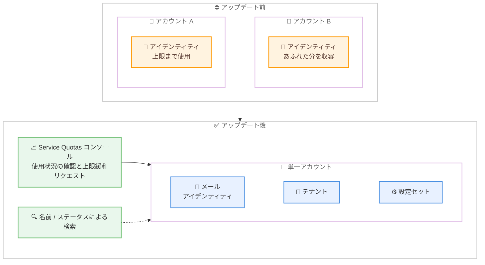

# Amazon SES - メールアイデンティティ、テナント、設定セットの上限引き上げ

**リリース日**: 2026 年 11 月 11 日
**サービス**: Amazon Simple Email Service (Amazon SES)
**機能**: メールアイデンティティ、テナント、設定セットの上限引き上げと Service Quotas 対応

📊 [このアップデートのインフォグラフィックを見る](https://takech9203.github.io/aws-news-summary/20261111-amazon-ses-higher-resource-limits.html)

## 概要

Amazon Simple Email Service (Amazon SES) が、メールアイデンティティ、テナント、設定セット (configuration set) のより高い上限をサポートするようになりました。AWS Service Quotas コンソールで各上限に対する現在の使用状況を確認し、上限緩和をリクエストできます。これにより、単一のアカウントでビジネスの成長に対応できるようになり、アカウントごとの上限内に収めるためにメールワークロードを複数のアカウントに分割する必要がなくなりました。

マルチテナントワークロードを運用するユーザーは、サービスを提供する顧客、ブランド、AI エージェントごとに個別のメールアイデンティティ、テナント、設定セットを作成することが一般的です。顧客、ブランド、AI エージェントが増えるにつれてこれらのリソースは急速に増加しますが、上限の引き上げにより、これらすべてのワークロードを 1 つのアカウント内で拡張できます。また、規模の大きいアカウントの管理を支援するため、これらのリソースを名前やステータスで検索できるようになりました。

**アップデート前の課題**

- 以前はアカウントごとのリソース上限が固定されており、上限に達した場合はメールワークロードを複数の AWS アカウントに分割する必要があった
- マルチテナント構成で顧客やブランドごとにリソースを作成すると、ビジネスの成長に伴い上限に到達しやすかった
- リソース数が増えた際に、目的のメールアイデンティティや設定セットを効率的に探す手段が限られていた

**アップデート後の改善**

- AWS Service Quotas コンソールから各上限に対する現在の使用状況を確認し、上限緩和をリクエストできるようになった
- 単一のアカウント内で顧客、ブランド、AI エージェント向けのワークロードを拡張でき、マルチアカウント分割による運用負荷を回避できるようになった
- メールアイデンティティ、テナント、設定セットを名前やステータスで検索できるようになり、大規模アカウントの管理性が向上した

## アーキテクチャ図



アップデート前は上限に達するとワークロードを複数アカウントに分割する必要がありましたが、アップデート後は Service Quotas コンソールから上限緩和をリクエストし、単一アカウント内でリソースを拡張できます。

## サービスアップデートの詳細

### 主要機能

1. **リソース上限の引き上げ**
   - メールアイデンティティ、テナント、設定セットの 3 種類のリソースについて、より高い上限がサポートされた
   - アカウントごとの上限を理由としたマルチアカウント分割が不要になり、単一アカウントでの成長に対応できる
   - 顧客、ブランド、AI エージェントごとにリソースを作成するマルチテナントワークロードに特に有効

2. **Service Quotas コンソールとの統合**
   - AWS Service Quotas コンソールで各上限に対する現在の使用状況を確認できる
   - 同コンソールから上限緩和リクエストを直接申請できる
   - 公式ドキュメントによると、メールアイデンティティ、テナント、設定セットの各クォータは「調整可能 (Adjustable)」として掲載されている

3. **リソースの検索機能**
   - メールアイデンティティ、テナント、設定セットを名前で検索できるようになった
   - ステータスによる検索にも対応し、大量のリソースを持つアカウントでの管理作業が効率化された

## 技術仕様

### 対象リソースとクォータ

公式ドキュメント (Service quotas in Amazon SES) に記載されている関連クォータは以下のとおりです。

| リソース | デフォルトクォータ | 調整可否 |
|------|------|------|
| メールアイデンティティの最大数 | 10,000 (リージョンごと) | 調整可能 (Service Quotas 経由) |
| テナントの最大数 | 10,000 | 調整可能 (Service Quotas 経由) |
| 設定セットの最大数 | 10,000 | 調整可能 (Service Quotas 経由) |

**補足**: SES のクォータは AWS アカウントで使用するリージョンごとに適用されます。メールアイデンティティとは、SES でメール送信に使用するドメインまたはメールアドレスを指します。

### 上限緩和リクエストの対象クォータコード

| クォータ | Service Quotas コンソールのリンク |
|------|------|
| Maximum number of identities | [L-5C01A92C](https://console.aws.amazon.com/servicequotas/home/services/ses/quotas/L-5C01A92C) |
| Maximum number of tenants | [L-E7F21B4C](https://console.aws.amazon.com/servicequotas/home/services/ses/quotas/L-E7F21B4C) |
| Maximum number of configuration sets | [L-10E24536](https://console.aws.amazon.com/servicequotas/home/services/ses/quotas/L-10E24536) |

## 設定方法

### 前提条件

1. Amazon SES を利用している AWS アカウントがあること
2. Service Quotas コンソールへのアクセス権限 (`servicequotas:GetServiceQuota`、`servicequotas:RequestServiceQuotaIncrease` など) があること
3. 上限緩和が必要なリージョンを特定していること (クォータはリージョンごとに適用されるため)

### 手順

#### ステップ 1: 現在の使用状況を確認する

```bash
# メールアイデンティティのクォータ適用値を確認
aws service-quotas get-service-quota \
  --service-code ses \
  --quota-code L-5C01A92C \
  --region ap-northeast-1
```

Service Quotas API を使用して、対象リージョンにおけるメールアイデンティティのクォータ適用値を取得しています。コンソールの場合は Service Quotas コンソールで「Amazon Simple Email Service」を選択すると、各クォータに対する使用状況を確認できます。

#### ステップ 2: 上限緩和をリクエストする

```bash
# メールアイデンティティの上限緩和をリクエスト (例: 50,000 に引き上げ)
aws service-quotas request-service-quota-increase \
  --service-code ses \
  --quota-code L-5C01A92C \
  --desired-value 50000 \
  --region ap-northeast-1
```

Service Quotas API を使用して、メールアイデンティティの上限緩和リクエストを申請しています。テナントは `L-E7F21B4C`、設定セットは `L-10E24536` のクォータコードを使用します。

#### ステップ 3: リソースを名前やステータスで検索する

SES コンソールのアイデンティティ、テナント、設定セットの一覧画面で、名前またはステータスによる検索を使用して目的のリソースを絞り込めます。リソース数が多いアカウントでも、特定の顧客やブランドに対応するリソースを素早く見つけられます。

## メリット

### ビジネス面

- **アカウント分割の回避**: 上限を理由としたマルチアカウント分割が不要になり、アカウント管理や請求管理のオーバーヘッドを削減できる
- **成長への追従**: 顧客、ブランド、AI エージェントの増加に合わせて、同一アカウント内でメール基盤を拡張できる
- **SaaS ビジネスの拡大支援**: テナントごとにリソースを分離するマルチテナント型 SaaS で、顧客数の増加に対する構造的な制約が緩和される

### 技術面

- **Service Quotas による一元管理**: 使用状況の可視化と上限緩和リクエストを Service Quotas コンソールに統合し、他の AWS サービスと同じ運用フローで管理できる
- **運用のシンプル化**: クロスアカウントの IAM 設計、イベント集約、レピュテーション管理の分散といったマルチアカウント構成特有の複雑さを回避できる
- **管理性の向上**: 名前やステータスによる検索で、大量のリソースの中から対象を効率的に特定できる

## デメリット・制約事項

### 制限事項

- クォータはリージョンごとに適用されるため、複数リージョンで利用する場合はリージョンごとに上限緩和リクエストが必要
- 上限緩和リクエストは自動承認とは限らず、希望値によっては審査に時間がかかる場合がある
- 専用 IP プールの最大数 (50) やメールテンプレートの最大数 (20,000) など、調整不可のクォータは引き続き存在する

### 考慮すべき点

- 単一アカウントにワークロードを集約する場合、送信レピュテーションの影響範囲も単一アカウントに集中するため、設定セットや専用 IP プールによるテナント分離の設計が重要になる
- 送信クォータ (24 時間あたりの送信数、秒あたりの送信レート) は本アップデートの対象ではなく、従来どおり個別の緩和申請が必要
- 既にマルチアカウント分割で運用している場合、集約に伴う移行 (DNS 検証の再実施、イベント連携の変更など) の影響を評価する必要がある

## ユースケース

### ユースケース 1: マルチテナント型 SaaS のメール基盤

**シナリオ**: SaaS 事業者が顧客ごとにテナントと設定セットを作成し、顧客ドメインをメールアイデンティティとして検証している。顧客数の増加により、アカウントごとの上限に近づいている。

**実装例**:
```bash
# 顧客ごとにテナントを作成
aws sesv2 create-tenant --tenant-name customer-example-corp

# 顧客ごとに設定セットを作成してイベントを分離
aws sesv2 create-configuration-set \
  --configuration-set-name customer-example-corp-events
```

**効果**: 上限緩和により、顧客数が増えても単一アカウント内でテナントと設定セットを増やし続けられ、アカウント分割に伴う運用コストを回避できる。

### ユースケース 2: 多ブランド企業のドメイン集約管理

**シナリオ**: 多数のブランドを展開する企業が、ブランドごとに送信ドメインを検証してメールを配信している。ブランドやキャンペーン用サブドメインの増加でアイデンティティ数が増え続けている。

**実装例**:
```bash
# ブランドごとのドメインアイデンティティを作成
aws sesv2 create-email-identity --email-identity brand-a.example.com

# 名前でアイデンティティを検索して管理 (コンソールの検索機能を使用)
```

**効果**: すべてのブランドのドメインを 1 つのアカウントで管理でき、名前検索により大量のアイデンティティの中から対象ブランドのリソースを素早く特定できる。

### ユースケース 3: AI エージェントごとのメール送信リソース管理

**シナリオ**: AI エージェントプラットフォームで、エージェントごとに送信元アイデンティティと設定セットを割り当て、送信結果のイベントをエージェント単位で追跡している。エージェント数の急増でリソースが急速に増加している。

**実装例**:
```bash
# エージェントごとの送信用アイデンティティと設定セットを作成
aws sesv2 create-email-identity --email-identity agent-001@mail.example.com
aws sesv2 create-configuration-set --configuration-set-name agent-001-tracking
```

**効果**: AI エージェントの増加に合わせて Service Quotas で上限を引き上げ、エージェント単位の送信管理とイベント追跡を単一アカウントで継続できる。

## 料金

本アップデートによる追加料金はありません。Amazon SES の料金は送信・受信したメッセージ数などの使用量に基づき、リソース (アイデンティティ、テナント、設定セット) の作成自体には料金が発生しません。上限緩和リクエストも無料です。

詳細は [Amazon SES 料金ページ](https://aws.amazon.com/ses/pricing/) を参照してください。

## 利用可能リージョン

Amazon SES が利用可能なすべての AWS リージョンで利用できます (東京リージョン、大阪リージョンを含む)。

## 関連サービス・機能

- **AWS Service Quotas**: 各上限に対する使用状況の確認と上限緩和リクエストを行うコンソール。本アップデートで SES のリソース上限管理が統合された
- **Amazon SES テナント管理**: マルチテナント構成でテナントごとに送信リソースとレピュテーションを分離する機能。本アップデートでテナント数の上限緩和が可能になった
- **Amazon CloudWatch**: 設定セットのイベント送信先として利用でき、テナントや顧客単位の送信メトリクスを可視化できる

## 参考リンク

- 📊 [インフォグラフィック](https://takech9203.github.io/aws-news-summary/20261111-amazon-ses-higher-resource-limits.html)
- [公式発表 (What's New)](https://aws.amazon.com/about-aws/whats-new/2026/11/amazon-ses-higher-resource-limits/)
- [ドキュメント: Service quotas in Amazon SES](https://docs.aws.amazon.com/ses/latest/dg/quotas.html)
- [Amazon SES 製品ページ](https://aws.amazon.com/ses/)
- [料金ページ](https://aws.amazon.com/ses/pricing/)

## まとめ

Amazon SES のメールアイデンティティ、テナント、設定セットの上限が引き上げ可能になり、Service Quotas コンソールから使用状況の確認と上限緩和リクエストを行えるようになりました。マルチテナント型 SaaS や多ブランド展開、AI エージェントのように送信リソースが急増するワークロードでは、アカウント分割を前提としない構成を再検討する好機です。まずは Service Quotas コンソールで現在の使用状況を確認し、成長見込みに応じた上限緩和を計画することを推奨します。
