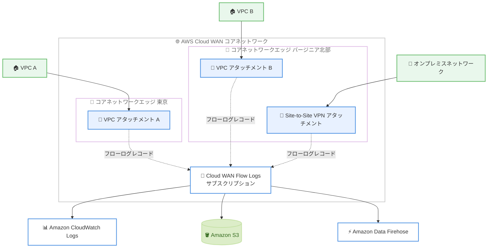

# AWS Cloud WAN - Flow Logs サポート

**リリース日**: 2026 年 11 月 11 日
**サービス**: AWS Cloud WAN
**機能**: Cloud WAN Flow Logs

📊 [このアップデートのインフォグラフィックを見る](https://takech9203.github.io/aws-news-summary/20261111-aws-cloud-wan-flow-logs.html)

## 概要

AWS Cloud WAN が Flow Logs をサポートしました。これにより、グローバルネットワーク全体の IP トラフィックを、Cloud WAN のアカウントから離れることなく一元的に可視化できるようになります。Flow Logs はフローごとに詳細な情報をキャプチャし、コアネットワークを流れるトラフィックの把握を可能にします。

Cloud WAN Flow Logs は、コアネットワーク上のアタッチメント間のエンドツーエンドのフローをキャプチャします。フローログレコードは、トラフィックがコアネットワークに入る (ingress)、またはコアネットワークから出る (egress) 各アタッチメントで記録されます。ログデータはネットワークトラフィックの経路外で収集されるため、ネットワークのスループットやレイテンシーには影響しません。

接続性やパフォーマンスの問題のトラブルシューティング、過去の帯域幅トレンドに基づくキャパシティプランニング、異常なトラフィックパターンの検出、セキュリティ・コンプライアンス目的の記録保持などに活用できます。マルチアカウント・マルチリージョンのグローバルネットワークを運用するネットワーク管理者にとって、特に価値の高いアップデートです。

**アップデート前の課題**

- グローバルネットワーク全体のトラフィックを把握するには、多数の VPC、アカウント、リージョンにまたがる VPC Flow Logs を個別に収集して突き合わせる必要があった
- ログへのアクセスを VPC 所有者など他のチームに依存することが多く、コアネットワーク所有者が自律的に調査できなかった
- オンプレミスとの接続を含むコアネットワーク上のフローを、一貫した形式で横断的に分析する手段がなかった

**アップデート後の改善**

- コアネットワーク所有者が、VPC 間、リージョン間、AWS Direct Connect・AWS Site-to-Site VPN・SD-WAN 経由で接続されたオンプレミスネットワークとの間のトラフィックを 1 つの統合ビューで確認できるようになった
- コアネットワーク全体、単一のコアネットワークエッジ、個別のアタッチメントという柔軟な単位で Flow Logs を有効化できるようになった
- Amazon CloudWatch Logs、Amazon S3、Amazon Data Firehose の 3 種類の配信先に発行できるようになった

## アーキテクチャ図



コアネットワークの各アタッチメントで ingress / egress のフローログレコードが記録され、CloudWatch Logs、Amazon S3、Amazon Data Firehose のいずれかに発行されます。

## サービスアップデートの詳細

### 主要機能

1. **グローバルネットワークの一元的な可視化**
   - VPC 間、リージョン間、オンプレミスネットワーク (AWS Direct Connect、AWS Site-to-Site VPN、SD-WAN 経由) との間のトラフィックを統合的に把握できる
   - 個々の VPC の Flow Logs を収集・結合する作業が不要になり、他チームへの依存も解消される
   - フローログレコードには IP アドレス、ポート、プロトコル、トラフィック量、パケットロスカウンターに加え、セグメント、リージョン、サービス挿入ホップ、アタッチメント詳細といった Cloud WAN 固有のメタデータが含まれる

2. **柔軟な有効化スコープ**
   - コアネットワーク全体、単一のコアネットワークエッジ、個別のアタッチメントのいずれの単位でも Flow Logs を有効化できる
   - サブスクリプションにはタグを付与でき、目的や所有者による整理が可能
   - フローログデータはトラフィック経路外で収集されるため、作成・削除によるネットワークパフォーマンスへの影響はない

3. **3 種類の配信先**
   - Amazon CloudWatch Logs: CloudWatch Logs Insights によるクエリやアラーム連携に適する
   - Amazon S3: 長期保管や Amazon Athena などによる分析に適する (プレーンテキストまたは Parquet 形式)
   - Amazon Data Firehose: リアルタイムに近いストリーミング連携や外部 SIEM への転送に適する

4. **カスタムフォーマット対応**
   - デフォルトフォーマットでは、1:1 NAT フィールド (src-nat-addr、dst-nat-addr) を除くバージョン 2 からバージョン 13 までの全フィールドが含まれる
   - カスタムフォーマットを指定すると、必要なフィールドのみを任意の順序で出力でき、後続の抽出処理を削減できる

## 技術仕様

### フローログレコードの主なフィールド

Cloud WAN Flow Logs はバージョン 13 のフィールドを使用します。代表的なフィールドは以下のとおりです。

| 分類 | フィールド例 | 説明 |
|------|-------------|------|
| 基本情報 | srcaddr、dstaddr、srcport、dstport、protocol | 送信元・宛先の IP アドレス、ポート、IANA プロトコル番号 |
| トラフィック量 | packets、bytes、start、end | 転送パケット数・バイト数、集計間隔内の開始・終了時刻 |
| パケットロス | packets-lost-no-route、packets-lost-blackhole、packets-lost-mtu-exceeded、packets-lost-ttl-expired | ルート未指定、ブラックホール、MTU 超過、TTL 失効によるパケットロス数 |
| Cloud WAN メタデータ | core-network-id、cwan-attachment-id、cwan-pair-attachment-id、src-segment-name、dst-segment-name、src-region、dst-region | コアネットワーク ID、フロー両端のアタッチメント、セグメント名、リージョン |
| VPC 詳細 | src-vpc-id、dst-vpc-id、src-subnet-id、dst-subnet-id、src-eni、dst-eni | フロー両端が VPC アタッチメントの場合の VPC・サブネット・ENI 情報 |
| サービス挿入 | network-function-group-attachment-ids | フローが通過したネットワーク機能グループアタッチメントの ID リスト |
| ステータス | log-status、flow-direction | ログ状態 (OK、NODATA、SKIPDATA、INCOMPLETEDATA) とフロー方向 (ingress、egress) |

### 有効化スコープと配信先

| 項目 | 詳細 |
|------|------|
| 有効化スコープ | コアネットワーク全体 / コアネットワークエッジ単位 / アタッチメント単位 |
| 配信先 | Amazon CloudWatch Logs / Amazon S3 / Amazon Data Firehose |
| フォーマット | デフォルトフォーマットまたはカスタムフォーマット |
| S3 出力形式 | プレーンテキスト (全フィールド STRING) または Parquet |
| 必要な権限 | コアネットワークの所有者であり、対象リソースに対する networkmanager:GetCoreNetwork 権限が必要 |
| サブスクリプション作成先 | Cloud WAN のホームリージョンのみ |

## 設定方法

### 前提条件

1. AWS Cloud WAN のコアネットワークが作成済みであること
2. フローログを作成するユーザーがコアネットワークの所有者であり、対象リソースに対する networkmanager:GetCoreNetwork 権限を持つこと
3. 配信先 (CloudWatch Logs、Amazon S3、Amazon Data Firehose) に応じた IAM ロールおよびアクセス許可が設定済みであること

### 手順

#### ステップ 1: 対象リソースと配信先の決定

フローログを作成する対象 (コアネットワーク全体、コアネットワークエッジ、またはアタッチメント) と、発行先 (CloudWatch Logs、Amazon S3、Amazon Data Firehose) を決定します。配信先ごとに必要な IAM 設定が異なるため、事前にユーザーガイドで確認します。

#### ステップ 2: フローログサブスクリプションの作成

AWS Management Console、AWS CLI、または API を使用して、Cloud WAN のホームリージョンでフローログサブスクリプションを作成します。作成時にデフォルトフォーマットまたはカスタムフォーマットを選択します。作成直後のサブスクリプションは PROVISIONING 状態となり、初回作成時はコアネットワークが一時的に UPDATING 状態になります。

#### ステップ 3: ログ配信の確認と分析

サブスクリプションが ACTIVE 状態になった後、数分程度でログ配信が開始されます。CloudWatch Logs Insights でのクエリ、Amazon Athena による S3 上の Parquet データの分析、Firehose 経由での外部分析基盤への連携など、配信先に応じた方法でフローログを分析します。

## メリット

### ビジネス面

- **運用負荷の削減**: 複数アカウント・複数リージョンの VPC Flow Logs を収集・結合する作業や、他チームへのログアクセス依頼が不要になり、ネットワーク運用の効率が向上する
- **コンプライアンス対応**: グローバルネットワーク全体の通信記録を一貫した形式で保持でき、セキュリティ監査やコンプライアンス要件への対応が容易になる
- **追加コストなしで利用可能**: Cloud WAN 側の追加料金は発生せず、配信先の標準料金のみで利用できる

### 技術面

- **パフォーマンスへの影響なし**: フローログデータはトラフィック経路外で収集されるため、スループットやレイテンシーに影響を与えずに有効化・無効化できる
- **豊富なメタデータ**: セグメント名、リージョン、アタッチメント、サービス挿入ホップなど Cloud WAN 固有の情報が含まれ、トラブルシューティングや経路分析が容易になる
- **パケットロスの可視化**: ルート未指定、ブラックホール、MTU 超過、TTL 失効といった原因別のパケットロスカウンターにより、接続性問題の切り分けが迅速になる

## デメリット・制約事項

### 制限事項

- サブスクリプションは 1 アカウントあたり、リソースごとに最大 250 件まで
- Tunnel-less Connect (TLC) アタッチメントは非対応。TLC アタッチメントを通過するフローは基盤となるトランスポート (VPC) アタッチメント側に記録されるため、トランスポートアタッチメントでフローログを作成する必要がある
- Route Table アタッチメントは非対応。これを通過するフローは基盤となるピアリング接続側に記録される
- サブスクリプションは Cloud WAN のホームリージョンでのみ作成可能

### 考慮すべき点

- フローログはリアルタイムのログストリームではなく、配信開始まで数分かかる場合がある
- 初回のサブスクリプション作成時には、コアネットワークが一時的に UPDATING 状態になり、ACTIVE になってからもログ配信開始まで数分を要する
- セグメント ID は初期伝播中に一時的に古い値になる場合がある
- 内部エラーやログ伝播遅延により、フローがエンドツーエンドで相関されず、log-status が INCOMPLETEDATA となる場合がある
- フローログの削除では既存のログデータは削除されないため、不要なログは CloudWatch Logs や Amazon S3 側で別途削除する必要がある

## ユースケース

### ユースケース 1: グローバルネットワークの接続性トラブルシューティング

**シナリオ**: 東京リージョンの VPC からバージニア北部リージョンの VPC への通信が断続的に失敗しており、原因を特定したい。

**実装例**:
```
1. コアネットワーク全体でフローログを有効化し、CloudWatch Logs に発行
2. CloudWatch Logs Insights で該当の送信元・宛先 IP のフローを抽出
3. packets-lost-no-route や packets-lost-blackhole などの
   原因別パケットロスカウンターを確認し、ルーティング設定を修正
```

**効果**: 複数リージョンの VPC Flow Logs を突き合わせることなく、コアネットワーク上のどこでパケットが失われているかを迅速に特定できる。

### ユースケース 2: 帯域幅トレンドに基づくキャパシティプランニング

**シナリオ**: オンプレミスと AWS 間のトラフィックが増加傾向にあり、Direct Connect の増強時期を計画したい。

**実装例**:
```
1. Direct Connect 関連のアタッチメントでフローログを有効化し、
   Parquet 形式で Amazon S3 に発行
2. Amazon Athena で bytes フィールドを期間・アタッチメント別に集計
3. 過去の帯域幅トレンドから将来の必要帯域を予測
```

**効果**: 実測データに基づいた精度の高いキャパシティプランニングが可能になり、帯域不足による障害や過剰投資を回避できる。

### ユースケース 3: セキュリティ監視と異常トラフィックの検出

**シナリオ**: グローバルネットワーク上でセグメント間の想定外の通信や異常なトラフィックパターンを検出したい。

**実装例**:
```
1. コアネットワーク全体でフローログを有効化し、
   Amazon Data Firehose 経由で SIEM に連携
2. src-segment-name と dst-segment-name を用いて
   セグメント間通信のベースラインを作成
3. ベースラインから逸脱する通信を検出した際にアラートを発報
```

**効果**: Cloud WAN メタデータを活用したセグメント単位の監視により、ネットワーク全体のセキュリティ態勢を強化し、インシデントの早期検出につながる。

## 料金

Cloud WAN Flow Logs 自体に追加料金は発生しません。配信先ごとの標準料金 (Vended Logs のデータ取り込み・保存料金など) が適用されます。

| 配信先 | 課金の考え方 |
|--------|-------------|
| Amazon CloudWatch Logs | Vended Logs のデータ取り込みおよび保存料金 |
| Amazon S3 | Vended Logs の配信料金およびストレージ料金 |
| Amazon Data Firehose | Firehose のデータ取り込み料金 |

詳細は [Amazon CloudWatch 料金ページ](https://aws.amazon.com/cloudwatch/pricing/) の Paid tier にある Logs の Vended Logs を参照してください。

## 利用可能リージョン

AWS Cloud WAN が利用可能なすべての AWS リージョンで利用できます。なお、フローログサブスクリプションの作成は Cloud WAN のホームリージョンでのみ可能です。

## 関連サービス・機能

- **VPC Flow Logs**: VPC 内の ENI 単位で IP トラフィックをキャプチャする機能。Cloud WAN Flow Logs はコアネットワーク上のアタッチメント間フローを対象とする点で補完関係にある
- **Amazon CloudWatch Logs**: フローログの配信先の 1 つ。CloudWatch Logs Insights によるクエリやメトリクスフィルターと組み合わせた監視が可能
- **Amazon S3**: フローログの長期保管先。Parquet 形式で出力すれば Amazon Athena による効率的な分析が可能
- **Amazon Data Firehose**: フローログをストリーミングで外部の分析基盤や SIEM に連携する際に使用
- **AWS Transit Gateway Flow Logs**: Transit Gateway 向けの同様のフローログ機能。Cloud WAN への移行時にも一貫した可観測性を維持できる

## 参考リンク

- 📊 [インフォグラフィック](https://takech9203.github.io/aws-news-summary/20261111-aws-cloud-wan-flow-logs.html)
- [公式発表 (What's New)](https://aws.amazon.com/about-aws/whats-new/2026/11/aws-cloud-wan-flow-logs/)
- [ドキュメント: AWS Cloud WAN Flow Logs ユーザーガイド](https://docs.aws.amazon.com/network-manager/latest/cloudwan/cwan-flow-logs)
- [AWS Cloud WAN 製品ページ](https://aws.amazon.com/cloud-wan/)
- [Amazon CloudWatch 料金ページ](https://aws.amazon.com/cloudwatch/pricing/)

## まとめ

AWS Cloud WAN の Flow Logs サポートにより、これまで多数の VPC Flow Logs を突き合わせる必要があったグローバルネットワークのトラフィック可視化が、コアネットワーク所有者の単一ビューで完結するようになりました。Cloud WAN 側の追加料金なしで利用でき、ネットワークパフォーマンスへの影響もないため、Cloud WAN を利用中のネットワーク管理者はまずコアネットワーク全体で有効化し、トラブルシューティングやセキュリティ監視への活用を検討することを推奨します。
