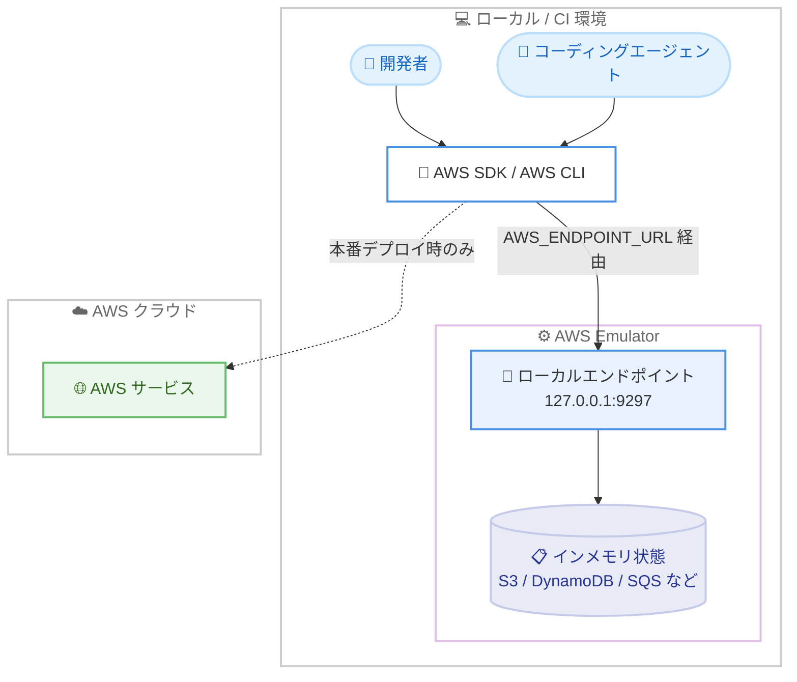

# AWS Emulator - AWS アプリケーションのローカル構築・テスト機能の一般提供開始

**リリース日**: 2026 年 11 月 11 日
**サービス**: AWS Emulator
**機能**: AWS アプリケーションをローカルで構築・テストできるエミュレーターの一般提供開始

📊 [このアップデートのインフォグラフィックを見る](https://takech9203.github.io/aws-news-summary/20261111-aws-emulator-now-available.html)

## 概要

AWS Emulator が一般提供開始されました。AWS Emulator は、開発者のローカルマシンや継続的インテグレーション (CI) 環境上で AWS アプリケーションを構築・テストできるツールです。既存の AWS SDK や AWS CLI の呼び出しをそのまま AWS Emulator に向けるだけで、ミリ秒単位で応答が返るため、デプロイや AWS アカウントを必要とせずに、開発者やコーディングエージェントがエラーをローカルで発見・修正できます。

リソースの作成・管理には、AWS で使用するものと同じ AWS SDK / AWS CLI の呼び出しを使用し、エミュレーターが提供する認証情報で署名します。サポートされているオペレーションについては、AWS Emulator は有効な呼び出しに対して AWS と同じ結果を返し、無効な呼び出しに対しては AWS と同じエラーを返します。未サポートのオペレーションは 501 Not Implemented を返します。リソースの状態は停止するまでメモリ上に保持され、起動した各インスタンスは独自のポート、キー、インメモリ状態を持つため、エージェント、テストスイート、CI ジョブが互いのリソースを参照することはありません。

AWS Emulator 内のサービスは、AWS SDK の基盤と同じ、AWS が公開している API モデルから生成されます。AWS がサービスや API を追加すると AWS Emulator にも反映され、その挙動はリリースごとに実装・検証されていきます。ソースコードは CC0 1.0 Universal パブリックドメインとして公開されており、追加のサービス料金はかかりません。

**アップデート前の課題**

- ローカルでの AWS アプリケーションのテストには、実際の AWS アカウントへのデプロイか、サードパーティ製エミュレーターや手書きのモックが必要だった
- デプロイを伴うテストはフィードバックループが長く、コーディングエージェントによる反復的な開発に不向きだった
- 手書きのモックは実際の AWS の挙動と乖離しやすく、本番環境で初めてエラーが発覚するリスクがあった
- 並列実行されるテストスイートや CI ジョブ間でリソースの競合が発生しないよう、名前空間の分離などの工夫が必要だった

**アップデート後の改善**

- AWS アカウントもデプロイも不要で、既存の SDK / CLI 呼び出しをそのまま使ってミリ秒単位の応答でローカルテストが可能になった
- サポート対象のオペレーションでは AWS と同じ結果・同じエラーが返るため、モックの乖離による問題を減らせるようになった
- インスタンスごとに独立したポート、キー、インメモリ状態を持つため、エージェントや CI ジョブを安全に並列実行できるようになった
- AWS が公開する API モデルからサービスが自動生成されるため、新しいサービスや API が追加されるとエミュレーターにも反映されるようになった

## アーキテクチャ図



開発者やコーディングエージェントの AWS SDK / AWS CLI 呼び出しは、環境変数 `AWS_ENDPOINT_URL` の設定によりローカルの AWS Emulator に送信され、リソースの状態はインメモリで保持されます。実際の AWS クラウドへのアクセスは本番デプロイ時のみ発生します。

## サービスアップデートの詳細

### 主要機能

1. **既存の SDK / CLI 呼び出しによるローカルテスト**
   - AWS で使用するものと同じ AWS SDK / AWS CLI の呼び出しをそのまま使用可能
   - エミュレーターが提供する認証情報 (アクセスキー ID は `EMULATOR` で始まる) で SigV4 署名を行う
   - 応答はミリ秒単位で返り、デプロイや AWS アカウントは不要
   - サポート対象のオペレーションでは、有効な呼び出しに AWS と同じ結果を、無効な呼び出しに AWS と同じエラーを返す

2. **インスタンスごとの完全な分離**
   - 起動した各インスタンスが独自のポート、キー、インメモリ状態を持つ
   - エージェント、テストスイート、CI ジョブが互いのリソースを参照しない
   - リソースの状態は停止するまでメモリ上に保持され、毎回クリーンな状態で開始できる

3. **AWS 公開 API モデルからの自動生成**
   - AWS SDK の基盤と同じ、AWS が公開する API モデルからサービスを生成
   - AWS が新しいサービスや API を追加すると AWS Emulator にも反映される
   - 挙動はリリースごとに実装・検証され、未サポートのオペレーションは 501 Not Implemented を返す
   - AWS との応答の一致度は [AWS Emulator fidelity report](https://docs.aws.amazon.com/emulator/latest/userguide/fidelity.html) で確認可能

4. **オープンソースとしての公開**
   - ソースコードは CC0 1.0 Universal パブリックドメインとして [GitHub リポジトリ](https://github.com/aws/aws-emulator) で公開
   - Rust で実装されており、Rust のテストではエミュレーターをテストプロセス内で実行する埋め込みモード (`aws-emulator-embedded` クレート) も利用可能

## 技術仕様

### 主要な仕様

| 項目 | 詳細 |
|------|------|
| エンドポイント | `https://127.0.0.1:9297` (デフォルト、localhost のみにバインド) |
| プロトコル | HTTPS、すべてのリクエストに SigV4 署名が必要 |
| 認証情報 | 起動ごとにキー、設定、証明書を新規生成し `~/.aws/emulator/{port}/` に出力 |
| アカウントモデル | 単一アカウント `000000000000` (クロスアカウント / クロスリージョンの挙動なし) |
| 状態管理 | インメモリのみ (停止時に消去) |
| 未サポート操作 | HTTP 501 Not Implemented を返却 |
| ヘルスチェック | `/__admin/health` エンドポイント |
| 対応プラットフォーム | Amazon Linux 2023 / Debian 系はネイティブパッケージ、macOS / Windows は Docker イメージをビルド、ソースからのビルドも可能 |
| テレメトリ | 匿名の利用状況データをデフォルトで送信 (無効化可能) |
| ライセンス | CC0 1.0 Universal (vendor ディレクトリ内のサードパーティコードは Apache License 2.0) |

## 設定方法

### 前提条件

1. Amazon Linux 2023 または Debian 系 Linux (ネイティブバイナリの場合)、もしくは Docker が利用可能な macOS / Windows 環境
2. AWS CLI または AWS SDK がインストールされていること
3. AWS アカウントは不要

### 手順

#### ステップ 1: AWS Emulator のインストール

```bash
PKG=https://downloads.aws.com/aws-emulator/packages/aws-emulator/LTS/latest
sudo dnf install -y $PKG/aws-emulator-x86_64.rpm
aws-emulator -v
```

Amazon Linux 2023 の場合、LTS チャネルから最新の RPM パッケージをダウンロードしてインストールし、バージョンを確認しています。

#### ステップ 2: エミュレーターの起動

```bash
aws-emulator
```

エミュレーターを起動します。デフォルトでは `127.0.0.1:9297` で HTTPS を待ち受け、アドレス、設定ファイル、証明書ファイルのパスを JSON 形式のログとして出力します。

#### ステップ 3: AWS CLI / SDK の接続先をエミュレーターに設定

```bash
export AWS_ENDPOINT_URL=https://127.0.0.1:9297
export AWS_SHARED_CREDENTIALS_FILE=~/.aws/emulator/9297/emulator_credentials
export AWS_CONFIG_FILE=~/.aws/emulator/9297/config
export AWS_EC2_METADATA_DISABLED=true
export AWS_DISABLE_HOST_PREFIX_INJECTION=true
export AWS_REGION=us-east-1
export AWS_DEFAULT_REGION=us-east-1
unset AWS_ACCESS_KEY_ID AWS_SECRET_ACCESS_KEY AWS_SESSION_TOKEN AWS_PROFILE
```

AWS CLI / SDK のエンドポイントをエミュレーターに向け、エミュレーターが生成した認証情報ファイルと設定ファイルを使用するように環境変数を設定しています。既存の AWS 認証情報の環境変数は解除します。

#### ステップ 4: 動作確認とリソース操作

```bash
# ヘルスチェックと呼び出し元の確認
curl --cacert ~/.aws/emulator/9297/ca.pem https://127.0.0.1:9297/__admin/health
aws sts get-caller-identity

# S3 バケットの作成とオブジェクトのアップロード
aws s3 mb s3://local-getting-started
echo "hello from the emulator" > hello.txt
aws s3 cp hello.txt s3://local-getting-started/
aws s3 ls s3://local-getting-started/
```

エミュレーターのヘルスチェックを行った後、通常の AWS CLI コマンドで S3 バケットの作成とオブジェクトのアップロード・一覧表示をローカルで実行しています。

## メリット

### ビジネス面

- **コスト削減**: AWS Emulator 自体に追加料金はなく、開発・テスト段階では AWS リソースの利用料金が発生しない。料金が発生するのは実際に AWS へデプロイしたときのみ
- **開発速度の向上**: デプロイ不要でミリ秒単位の応答が得られるため、開発のフィードバックループが大幅に短縮される
- **オンボーディングの容易化**: AWS アカウントの払い出しが不要なため、ワークショップや新規メンバーのオンボーディングを迅速に開始できる

### 技術面

- **高い忠実度**: サポート対象のオペレーションでは AWS と同じ結果・同じエラーを返すため、手書きモックのような実環境との乖離を減らせる。一致度は fidelity report で公開されている
- **並列実行の安全性**: インスタンスごとにポート、キー、状態が分離されるため、複数のコーディングエージェントや CI ジョブを競合なく並列実行できる
- **コーディングエージェントとの親和性**: エージェントが DynamoDB テーブルを作成してオフラインでテストし、デプロイ前にコードを修正するといったワークフローを、ネットワーク遮断されたサンドボックス内でも実現できる
- **自動的な追従**: AWS が公開する API モデルから生成されるため、新しいサービスや API の追加に自動的に追従する

## デメリット・制約事項

### 制限事項

- リソースの状態はインメモリのみで、エミュレーターを停止すると消去される (永続化されない)
- すべてのオペレーションがサポートされているわけではなく、未サポートのオペレーションは 501 Not Implemented を返す
- IAM ポリシーやリソースベースポリシーは AWS と同じようには評価されないため、実環境では拒否されるリクエストがローカルでは成功する場合がある。セキュリティ設定のテストには使用できない
- 単一アカウント `000000000000` のみのモデルであり、クロスアカウントやクロスリージョンの挙動は再現されない
- 開発・テスト専用であり、耐久性、可用性、セキュリティの保証はない

### 考慮すべき点

- サービスや機能ごとに忠実度が異なるため、利用前に fidelity report で対象 API のカバレッジを確認することが推奨される
- macOS / Windows ではビルド済みイメージが公開されておらず、ドキュメントの Dockerfile から Docker イメージをビルドする必要がある
- 一部の SDK (Java など) ではエミュレーターの証明書を信頼させるための追加設定が必要
- 匿名の利用状況テレメトリがデフォルトで有効なため、必要に応じて無効化を検討する
- 埋め込みモードはローンチ時点で Rust のみの対応

## ユースケース

### ユースケース 1: コーディングエージェントによる自律的な開発ループ

**シナリオ**: コーディングエージェントが DynamoDB を使用するアプリケーションを開発する際、デプロイせずにテーブル操作の動作を検証したい。

**実装例**:
```bash
aws dynamodb create-table --table-name kiro-demo \
  --attribute-definitions AttributeName=id,AttributeType=S \
  --key-schema AttributeName=id,KeyType=HASH \
  --billing-mode PAY_PER_REQUEST
aws dynamodb put-item --table-name kiro-demo \
  --item '{"id": {"S": "item-1"}, "msg": {"S": "hello from kiro"}}'
aws dynamodb get-item --table-name kiro-demo --key '{"id": {"S": "item-1"}}'
```

**効果**: エージェントがテーブルの作成、書き込み、読み取りをオフラインで検証し、デプロイ前にエラーを修正できる。ネットワークを遮断したサンドボックス内でも安全に動作する。

### ユースケース 2: CI でのプルリクエストごとの統合テスト

**シナリオ**: プルリクエストごとに S3 や SQS を使用する統合テストを実行したいが、共有 AWS アカウントでのリソース競合やコストを避けたい。

**実装例**:
```yaml
# CI パイプラインの例
steps:
  - run: aws-emulator &            # ジョブごとに独立したエミュレーターを起動
  - run: export AWS_ENDPOINT_URL=https://127.0.0.1:9297
  - run: ./run-integration-tests.sh
```

**効果**: CI ジョブごとに独立した状態を持つエミュレーターが起動するため、並列実行でもリソース競合が発生せず、AWS アカウントへのアクセス権限を CI に付与する必要もない。

### ユースケース 3: 手書きモックからの置き換え

**シナリオ**: ユニットテストで AWS SDK のレスポンスを手書きモックで再現しているが、実際の AWS の挙動との乖離により本番でのみ発生する不具合に悩まされている。

**実装例**:
```toml
# Rust の場合は埋め込みモードを利用可能
[dev-dependencies]
aws-emulator-embedded = "*"
```

**効果**: AWS の公開 API モデルから生成された、有効な呼び出しには AWS と同じ結果を、無効な呼び出しには同じエラーを返すエミュレーターに置き換えることで、モックの保守コストと実環境との乖離を削減できる。

## 料金

AWS Emulator に追加のサービス料金はありません。ローカルや CI 環境での構築・テストは無料で実行でき、料金が発生するのは実際に AWS へリソースをデプロイしたときのみです。ソースコードは CC0 1.0 Universal パブリックドメインとして公開されています。

## 利用可能リージョン

AWS Emulator は AWS リージョンに依存しません。ローカルマシンや CI 環境など、任意の場所で実行できます。

## 関連サービス・機能

- **AWS SDK / AWS CLI**: 既存の SDK / CLI 呼び出しをエンドポイント設定の変更のみでエミュレーターに向けられる
- **Amazon S3 / Amazon DynamoDB / Amazon SQS**: ローカルでのバケット作成、テーブル操作、キュー操作など、代表的なユースケースとして挙げられているサービス
- **AWS SAM Local / Lambda ローカルテスト**: サーバーレスアプリケーションのローカルテストを補完する既存の仕組み。AWS Emulator は SDK / CLI 呼び出し全般を対象とする点が異なる
- **Kiro などのコーディングエージェント**: エージェントがデプロイ前にローカルでコードを検証するワークフローと組み合わせて利用できる

## 参考リンク

- 📊 [インフォグラフィック](https://takech9203.github.io/aws-news-summary/20261111-aws-emulator-now-available.html)
- [公式発表 (What's New)](https://aws.amazon.com/about-aws/whats-new/2026/11/aws-emulator-now-available/)
- [AWS Blog: Test your applications against AWS locally with AWS Emulator](https://aws.amazon.com/blogs/aws/test-your-applications-against-aws-locally-with-aws-emulator/)
- [AWS Emulator 製品ページ](https://aws.amazon.com/products/developer-tools/emulator/)
- [AWS Emulator ドキュメント](https://docs.aws.amazon.com/emulator)
- [AWS Emulator fidelity report](https://docs.aws.amazon.com/emulator/latest/userguide/fidelity.html)
- [AWS Emulator GitHub リポジトリ](https://github.com/aws/aws-emulator)

## まとめ

AWS Emulator の一般提供開始により、AWS アカウントやデプロイを必要とせず、既存の AWS SDK / AWS CLI 呼び出しをそのまま使ってローカルや CI 環境で AWS アプリケーションをテストできるようになりました。特にコーディングエージェントの自律的な開発ループや、並列実行される CI の統合テストで大きな効果が期待できます。まずは fidelity report で利用予定のサービスのカバレッジを確認し、Getting Started ガイドに従ってローカル環境で試すことを推奨します。
