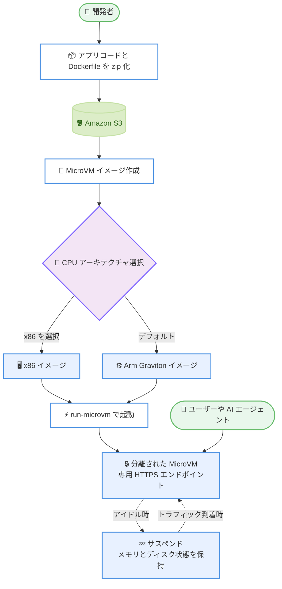

# AWS Lambda - Lambda MicroVMs の x86 CPU アーキテクチャサポート

**リリース日**: 2026 年 11 月 11 日
**サービス**: AWS Lambda
**機能**: AWS Lambda MicroVMs x86 CPU アーキテクチャサポート

📊 [このアップデートのインフォグラフィックを見る](https://takech9203.github.io/aws-news-summary/20261111-aws-lambda-microvms-x86-architecture.html)

## 概要

AWS Lambda MicroVMs が x86 CPU アーキテクチャをサポートしました。これにより、既存の x86 ベースのアプリケーション、ツール、ソフトウェア依存関係を、再コンパイルや移植なしでそのまま Lambda MicroVMs 上で実行できるようになりました。MicroVM イメージの作成時に、x86 と Arm (AWS Graviton) のいずれかを選択し、ユーザーやジョブごとに分離された MicroVM をワークロードに適したアーキテクチャで起動できます。

Lambda MicroVMs は、VM レベルの分離、ほぼ瞬時の起動と再開、状態の保持を提供するサーバーレスコンピューティングプリミティブです。AI コーディングアシスタント、CI/CD ランナー、インタラクティブな開発環境、脆弱性スキャナーなど、ユーザーや AI が生成したコードを実行するアプリケーションに適しています。今回のリリースにより、x86 ベースのワークロードを変更なしで Lambda MicroVMs 上で実行できます。Arm で動作するワークロードについては、引き続きデフォルトの CPU アーキテクチャである AWS Graviton プロセッサを使用できます。

**アップデート前の課題**

このアップデート以前は、Lambda MicroVMs は Arm (AWS Graviton) アーキテクチャのみをサポートしていました。

- x86 向けにビルドされた既存のアプリケーションやバイナリを実行するには、Arm 向けの再コンパイルや移植が必要だった
- x86 のみに対応するツールやソフトウェア依存関係を持つワークロードは Lambda MicroVMs に移行できなかった
- アーキテクチャの制約により、AI サンドボックスや CI/CD などで扱えるワークロードの範囲が限定されていた

**アップデート後の改善**

今回のアップデートにより、以下が可能になりました。

- 既存の x86 アプリケーション、ツール、依存関係を再コンパイルや移植なしでそのまま実行できるようになった
- MicroVM イメージ作成時に x86 と Arm (AWS Graviton) をワークロードごとに選択できるようになった
- ユーザーやジョブごとに、ワークロードが使用するアーキテクチャ上で分離された MicroVM を割り当てられるようになった

## アーキテクチャ図



MicroVM イメージ作成時に x86 または Arm のアーキテクチャを選択し、そのイメージから分離された MicroVM を起動するフローを示しています。アイドル時はサスペンドにより状態を保持したままコストを削減できます。

## サービスアップデートの詳細

### 主要機能

1. **x86 CPU アーキテクチャの選択**
   - MicroVM イメージを Dockerfile から作成する際に、x86 アーキテクチャを選択可能
   - 既存の x86 アプリケーション、ツール、ソフトウェア依存関係を再コンパイルや移植なしで実行可能
   - Arm (AWS Graviton) は引き続きデフォルトの CPU アーキテクチャとして利用可能

2. **ワークロードごとのアーキテクチャ割り当て**
   - ユーザーやジョブごとに、分離された MicroVM をワークロードに適したアーキテクチャで起動
   - x86 と Arm のイメージを同一アプリケーション内で使い分け可能

3. **既存の MicroVMs 機能との統合**
   - VM レベルの分離、スナップショットベースの高速起動、サスペンド・レジュームによる状態保持は両アーキテクチャで利用可能
   - AWS Lambda コンソール、AWS CloudFormation、AWS CDK、および Agent Toolkit for AWS を使用したエージェント型開発ツールから利用可能

## 技術仕様

### Lambda MicroVMs の主な特徴

| 項目 | 詳細 |
|------|------|
| CPU アーキテクチャ | x86 (今回追加) および Arm (AWS Graviton、デフォルト) |
| 分離レベル | Firecracker 仮想化による VM レベルの分離 |
| 起動方式 | 初期化済み環境のスナップショットから高速起動 |
| 状態保持 | サスペンド時にメモリとディスクの状態を保持し、再開時に復元 |
| ネットワーク | 専用 HTTPS エンドポイント、HTTP/2、gRPC、WebSocket 対応、パブリックインターネットおよび VPC へのアウトバウンドアクセス |
| リソース割り当て | ベースライン設定に対して最大 4 倍まで垂直スケール可能 |
| 利用方法 | Lambda コンソール、AWS CloudFormation、AWS CDK、Agent Toolkit for AWS |

### API 変更履歴

| 日付 | サービス | 変更内容 |
|------|----------|----------|
| 2026/11/05 | [Lambda MicroVMs](https://awsapichanges.com/archive/changes/7e892e-lambda.html) | 8 updated api methods - MicroVM 起動時に ARM64 (Graviton) に加えて x86-64 CPU アーキテクチャを選択可能に |

## 設定方法

### 前提条件

1. AWS アカウントと Lambda MicroVMs を操作できる IAM 権限
2. アプリケーションコードと Dockerfile (x86 対応のベースイメージと依存関係)
3. Lambda MicroVMs が利用可能なリージョン (x86 サポート対象リージョン)

### 手順

#### ステップ 1: アプリケーションのパッケージング

```bash
# アプリケーションコードと Dockerfile を zip 化して S3 にアップロード
zip -r my-app.zip Dockerfile src/
aws s3 cp my-app.zip s3://my-bucket/my-app.zip
```

アプリケーションコードと Dockerfile を zip アーカイブにまとめ、Amazon S3 にアップロードします。この zip が MicroVM イメージの作成元になります。

#### ステップ 2: x86 アーキテクチャを指定して MicroVM イメージを作成

Lambda API を呼び出して MicroVM イメージを作成します。このとき CPU アーキテクチャとして x86 を選択します。Lambda が Dockerfile を実行し、アプリケーションを起動した上で、完全に初期化された環境のスナップショットを取得します。AWS Lambda コンソール、AWS CloudFormation、AWS CDK からも同様に作成できます。

#### ステップ 3: MicroVM の起動と利用

ユーザーセッションやジョブごとに `run-microvm` を呼び出すと、スナップショットから x86 の MicroVM が高速に起動します。クライアントは専用の HTTPS エンドポイント経由で接続します。アイドル時は `suspend-microvm`、再開時は `resume-microvm` を呼び出すか、ライフサイクルポリシーによる自動サスペンド・レジュームを構成できます。具体的なパラメータは [Lambda MicroVMs 開発者ガイド](https://docs.aws.amazon.com/lambda/latest/dg/lambda-microvms-guide.html)を参照してください。

## メリット

### ビジネス面

- **移行コストの削減**: 既存の x86 アプリケーションを再コンパイルや移植なしで実行できるため、移行にかかる工数とリスクを削減できる
- **対象ワークロードの拡大**: x86 のみに対応するツールや商用ソフトウェアを含むワークロードも Lambda MicroVMs で実行可能になる
- **アイドルコストの削減**: サスペンド・レジューム機能により、アイドル時間の長いインタラクティブな用途でもコストを抑制できる

### 技術面

- **アーキテクチャの柔軟性**: ワークロードごとに x86 と Arm を使い分けられ、依存関係の互換性問題を回避できる
- **強力な分離**: Firecracker 仮想化による VM レベルの分離で、ユーザーや AI が生成した信頼できないコードを安全に実行できる
- **高速な起動と状態保持**: スナップショットからの高速起動と、サスペンド時のメモリ・ディスク状態の保持により、ほぼ瞬時の応答性を維持できる

## デメリット・制約事項

### 制限事項

- アジアパシフィック (香港)、アジアパシフィック (マレーシア)、アジアパシフィック (タイ)、欧州 (スペイン) の各リージョンでは x86 サポートを利用できない
- CPU アーキテクチャは MicroVM イメージ作成時に選択するため、既存の Arm イメージをそのまま x86 で起動することはできない (イメージの再作成が必要)

### 考慮すべき点

- デフォルトの CPU アーキテクチャは Arm (AWS Graviton) であるため、x86 を使用する場合は明示的に選択する必要がある
- 価格性能比の観点では Graviton が有利な場合があるため、x86 固有の依存関係がないワークロードでは Arm の利用を検討する価値がある
- 料金はアーキテクチャやリソース設定により異なる可能性があるため、[Lambda 料金ページ](https://aws.amazon.com/lambda/pricing/)で確認が必要

## ユースケース

### ユースケース 1: AI コーディングアシスタントのコード実行サンドボックス

**シナリオ**: AI コーディングアシスタントが生成したコードを安全に実行したいが、ビルドツールチェーンや依存ライブラリが x86 向けにしか提供されていない。

**実装例**:
```
1. x86 対応の Dockerfile でビルド環境を定義し、MicroVM イメージを x86 アーキテクチャで作成
2. ユーザーセッションごとに run-microvm でサンドボックスを起動
3. AI 待機中などのアイドル時間はサスペンドして状態を保持
```

**効果**: x86 専用のツールチェーンを移植せずに利用でき、VM レベルの分離で AI 生成コードを安全に実行できる。

### ユースケース 2: マルチテナント CI/CD ランナー

**シナリオ**: 複数テナントのビルドジョブを分離して実行する CI/CD 基盤で、x86 向けバイナリのビルドやテストが必要。

**実装例**:
```
1. ビルドツールを含む x86 の MicroVM イメージを作成
2. ジョブごとに独立した MicroVM を起動し、テナント間を VM レベルで分離
3. ジョブ完了後に MicroVM を終了してリソースを解放
```

**効果**: x86 ターゲットのビルドをネイティブに実行しつつ、テナント間の強力な分離とサーバーレスの運用性を両立できる。

### ユースケース 3: 脆弱性スキャンやセキュリティ検証環境

**シナリオ**: x86 バイナリを対象とした脆弱性スキャンツールを、隔離された環境で多数並列に実行したい。

**実装例**:
```
1. スキャンツールを組み込んだ x86 の MicroVM イメージを作成
2. スキャン対象ごとに MicroVM を起動して検査を実行
3. 検査結果を収集後、MicroVM を終了
```

**効果**: 検査対象ごとに使い捨ての隔離環境を高速に用意でき、x86 専用ツールもそのまま利用できる。

## 料金

Lambda MicroVMs の料金は AWS Lambda の料金体系に含まれます。MicroVM の実行中はベースラインのリソース設定に対して課金され、ベースラインを超えるアクティブな使用分は使用した分のみ課金されます。サスペンド中は状態を保持しながらコストを削減できます。x86 アーキテクチャの利用に伴う具体的な料金は、[Lambda 料金ページ](https://aws.amazon.com/lambda/pricing/)を参照してください。

## 利用可能リージョン

Lambda MicroVMs が利用可能なすべての AWS リージョンで x86 CPU アーキテクチャを利用できます。ただし、以下のリージョンを除きます。

- アジアパシフィック (香港)
- アジアパシフィック (マレーシア)
- アジアパシフィック (タイ)
- 欧州 (スペイン)

## 関連サービス・機能

- **AWS Lambda**: MicroVMs は Lambda のサーバーレスコンピューティングプリミティブとして提供され、Lambda コンソールや API から操作する
- **AWS Graviton**: デフォルトの CPU アーキテクチャである Arm ベースのプロセッサ。価格性能比に優れ、Arm 対応ワークロードに適する
- **Amazon S3**: MicroVM イメージの作成元となるアプリケーションコードと Dockerfile の zip アーカイブを格納する
- **AWS CloudFormation / AWS CDK**: MicroVM イメージや関連リソースを IaC として管理できる
- **Agent Toolkit for AWS**: エージェント型開発ツールから Lambda MicroVMs を利用するためのツールキット

## 参考リンク

- 📊 [インフォグラフィック](https://takech9203.github.io/aws-news-summary/20261111-aws-lambda-microvms-x86-architecture.html)
- [公式発表 (What's New)](https://aws.amazon.com/about-aws/whats-new/2026/11/aws-lambda-microvms-x86-architecture/)
- [AWS Lambda MicroVMs 開発者ガイド](https://docs.aws.amazon.com/lambda/latest/dg/lambda-microvms-guide.html)
- [Agent Toolkit for AWS - Lambda MicroVMs スキル](https://github.com/aws/agent-toolkit-for-aws/tree/main/skills/specialized-skills/serverless-skills/aws-lambda-microvms)
- [料金ページ](https://aws.amazon.com/lambda/pricing/)

## まとめ

Lambda MicroVMs の x86 CPU アーキテクチャサポートにより、既存の x86 アプリケーションや依存関係を再コンパイルなしでサーバーレスの分離環境に持ち込めるようになりました。AI コード実行サンドボックスや CI/CD ランナーなどで x86 固有の依存関係が障壁になっていた場合は、MicroVM イメージ作成時に x86 を選択して移行を検討することを推奨します。Arm 対応可能なワークロードについては、引き続きデフォルトの AWS Graviton の利用も比較検討してください。
