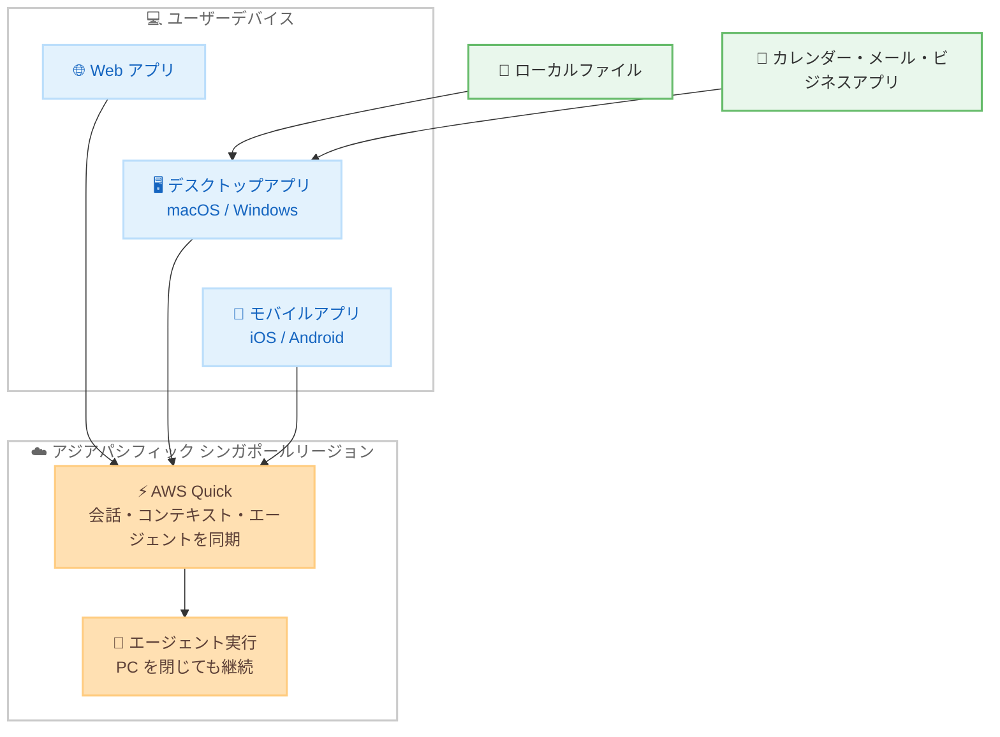

# AWS Quick - デスクトップアプリとモバイルアプリがアジアパシフィック (シンガポール) リージョンで利用可能に

**リリース日**: 2026 年 11 月 11 日
**サービス**: AWS Quick
**機能**: デスクトップアプリ (macOS / Windows) およびモバイルアプリ (iOS / Android) のアジアパシフィック (シンガポール) リージョン対応

📊 [このアップデートのインフォグラフィックを見る](https://takech9203.github.io/aws-news-summary/20261111-aws-quick-apps-available-in-asia-pacific-singapore.html)

## 概要

macOS および Windows 向けの AWS Quick デスクトップアプリと、iOS および Android 向けの Quick モバイルアプリが、アジアパシフィック (シンガポール) リージョンで利用可能になりました。今回のローンチは、2026 年 10 月に発表されたシンガポールリージョンでの Quick 本体の提供開始を基盤とした拡張です。

デスクトップアプリはローカルファイルを扱えるほか、カレンダー、メール、ビジネスアプリと接続できます。モバイルアプリでは、Quick とのチャット、アクティビティフィードの確認、ダッシュボードの閲覧が可能です。会話、コンテキスト、エージェントは Web、デスクトップ、モバイルの間で同期されるため、デスクトップで開始したエージェントをスマートフォンから確認し、PC を閉じた後も実行を継続させることができます。

シンガポールリージョンで Quick を利用している、またはデータレジデンシーの観点からシンガポールリージョンを選択している組織のユーザーが、Web 版に加えてネイティブアプリでも AI ワークスペースを活用できるようになります。

**アップデート前の課題**

- シンガポールリージョンの Quick 環境では、デスクトップアプリとモバイルアプリが利用できず、Web 版のみの利用に限られていた
- ローカルファイルを直接扱う作業や、カレンダー / メールなどのデスクトップ環境との連携が制限されていた
- 外出先からエージェントの実行状況やアクティビティフィードをネイティブアプリで確認する手段がなかった

**アップデート後の改善**

- シンガポールリージョンのユーザーが macOS / Windows 向けデスクトップアプリをダウンロードして利用できるようになった
- iOS / Android 向けモバイルアプリで、チャット、アクティビティフィードの確認、ダッシュボードの閲覧が可能になった
- 会話、コンテキスト、エージェントが Web、デスクトップ、モバイル間で同期され、デバイスをまたいだシームレスな作業が可能になった

## アーキテクチャ図



Web、デスクトップ、モバイルの各アプリがシンガポールリージョンの AWS Quick に接続し、会話、コンテキスト、エージェントがデバイス間で同期される構成を示しています。

## サービスアップデートの詳細

### 主要機能

1. **デスクトップアプリ (macOS / Windows)**
   - ローカルに保存されたファイルを直接扱うことが可能
   - カレンダー、メール、ビジネスアプリとの接続に対応
   - AWS Quick ダウンロードページから入手可能

2. **モバイルアプリ (iOS / Android)**
   - Quick とのチャットによる質問や指示が可能
   - アクティビティフィードでエージェントや処理の状況を確認可能
   - ダッシュボードをモバイル端末から閲覧可能
   - Apple App Store および Google Play から入手可能

3. **デバイス間の同期**
   - 会話、コンテキスト、エージェントが Web、デスクトップ、モバイル間で同期
   - デスクトップで開始したエージェントをスマートフォンから確認可能
   - PC を閉じた後もエージェントの実行が継続

## 技術仕様

### 提供プラットフォーム

| 項目 | 詳細 |
|------|------|
| デスクトップアプリ | macOS、Windows |
| モバイルアプリ | iOS (Apple App Store)、Android (Google Play) |
| 対象リージョン | アジアパシフィック (シンガポール) |
| 同期対象 | 会話、コンテキスト、エージェント |
| 前提となる発表 | 2026 年 10 月の Quick シンガポールリージョン提供開始 |

### モバイルアプリの位置づけ

AWS Quick ユーザーガイドによると、モバイルアプリはデスクトップアプリと併用するコンパニオンアプリとして提供されます。同じアカウントでサインインすることで、会話がデバイス間で同期されます。モバイルアプリはスマートフォンでの利用頻度が高いタスクに焦点を当てており、デスクトップで利用できる機能の一部はモバイルでは制限される、または利用できない場合があります。

## 設定方法

### 前提条件

1. AWS Quick のアカウントがシンガポールリージョンでセットアップされていること
2. デスクトップアプリの場合は macOS または Windows 環境があること
3. モバイルアプリの場合は iOS または Android 端末があること

### 手順

#### ステップ 1: デスクトップアプリのダウンロード

[AWS Quick ダウンロードページ](https://aws.amazon.com/quick/download/) から macOS 版または Windows 版のインストーラーをダウンロードし、インストールします。

#### ステップ 2: モバイルアプリのダウンロード

[Apple App Store](https://apps.apple.com/us/app/amazon-quick/id1148226615) または [Google Play](https://play.google.com/store/apps/details?id=com.amazonaws.quicksight.mobile) から Quick モバイルアプリをインストールします。

#### ステップ 3: サインインと同期の確認

各アプリで Web 版と同じアカウントを使用してサインインします。サインイン後、会話、コンテキスト、エージェントが Web、デスクトップ、モバイル間で同期されていることを確認します。

## メリット

### ビジネス面

- **データレジデンシー要件への対応**: シンガポールリージョンを選択している組織でも、Web 版に加えてネイティブアプリの利便性を享受できる
- **生産性の向上**: 外出先からもエージェントの状況確認やダッシュボードの閲覧が可能になり、意思決定のスピードが向上する
- **業務の継続性**: PC を閉じてもエージェントが実行を継続するため、長時間のタスクを中断なく進められる

### 技術面

- **ローカル環境との統合**: デスクトップアプリがローカルファイル、カレンダー、メール、ビジネスアプリと連携し、Web 版では難しい作業が可能になる
- **シームレスなデバイス間同期**: 会話、コンテキスト、エージェントが自動的に同期され、デバイスを切り替えても作業を継続できる
- **マルチプラットフォーム対応**: macOS、Windows、iOS、Android の主要プラットフォームを網羅

## デメリット・制約事項

### 制限事項

- モバイルアプリでは、デスクトップで利用できる機能の一部が制限される、または利用できない
- iOS と Android の間で挙動に差異がある場合がある (詳細はユーザーガイドを参照)

### 考慮すべき点

- デスクトップアプリはローカルファイルやメール、カレンダーにアクセスするため、組織のセキュリティポリシーに沿った導入判断が必要
- モバイル端末での利用にあたっては、組織のモバイルデバイス管理 (MDM) ポリシーとの整合性を確認することが望ましい

## ユースケース

### ユースケース 1: 外出先からのエージェント監視

**シナリオ**: シンガポール拠点のアナリストが、デスクトップで大量データの分析エージェントを開始した後、外出する必要がある。

**実装例**:
```
1. デスクトップアプリで分析エージェントを開始
2. PC を閉じて外出 (エージェントは実行を継続)
3. モバイルアプリのアクティビティフィードで進捗を確認
4. 完了後、モバイルアプリから結果のダッシュボードを閲覧
```

**効果**: 長時間の分析タスクを中断することなく、場所を問わず進捗を把握できる。

### ユースケース 2: ローカルファイルとビジネスアプリを組み合わせた資料作成

**シナリオ**: 営業担当者が、ローカルに保存した提案資料のドラフトとカレンダーの予定情報を組み合わせて、顧客向け資料を仕上げたい。

**実装例**:
```
1. デスクトップアプリでローカルの提案資料ドラフトを Quick に読み込む
2. カレンダー連携で次回の顧客ミーティング情報を参照
3. Quick に資料の仕上げと要約の作成を指示
```

**効果**: Web 版ではアップロードが必要だったローカルファイルの活用が、デスクトップアプリでシームレスに行える。

### ユースケース 3: 経営層によるモバイルでのダッシュボード確認

**シナリオ**: データレジデンシーの要件でシンガポールリージョンを利用している企業の経営層が、移動中に最新の KPI を確認したい。

**実装例**:
```
1. モバイルアプリにサインイン
2. ダッシュボード一覧から KPI ダッシュボードを開く
3. 必要に応じて Quick とチャットし、数値の背景を質問
```

**効果**: PC を開くことなく、移動中でも最新のビジネス状況を把握し、迅速な意思決定につなげられる。

## 料金

今回の発表に追加料金に関する記載はありません。デスクトップアプリとモバイルアプリの利用料金については、AWS Quick の料金ページを参照してください。

## 利用可能リージョン

- アジアパシフィック (シンガポール) リージョンで新たに利用可能

今回のアップデートは、2026 年 10 月に発表された Quick 本体のシンガポールリージョン対応に続くものです。

## 関連サービス・機能

- **AWS Quick**: 仕事専用に構築された AI ワークスペース。エージェントによるリサーチ、分析、実行を既存のデータやアプリケーション全体で行える
- **AWS Quick Sight**: Quick に含まれるビジネスインテリジェンス機能。モバイルアプリからダッシュボードを閲覧可能
- **AWS Quick デスクトップアプリ**: 2026 年 9 月に macOS / Windows 向けに一般提供開始されたネイティブアプリ

## 参考リンク

- 📊 [インフォグラフィック](https://takech9203.github.io/aws-news-summary/20261111-aws-quick-apps-available-in-asia-pacific-singapore.html)
- [公式発表 (What's New)](https://aws.amazon.com/about-aws/whats-new/2026/11/aws-quick-apps-available-in-asia-pacific-singapore/)
- [関連発表: Quick のシンガポールリージョン提供開始](https://aws.amazon.com/about-aws/whats-new/2026/10/amazon-quick-now-available-in-the-aws-singapore-region/)
- [AWS Quick ダウンロードページ](https://aws.amazon.com/quick/download/)
- [ドキュメント: AWS Quick on mobile](https://docs.aws.amazon.com/quick/latest/userguide/amazon-quick-mobile.html)
- [AWS Quick 製品ページ](https://aws.amazon.com/quick/)

## まとめ

AWS Quick のデスクトップアプリとモバイルアプリがアジアパシフィック (シンガポール) リージョンで利用可能になり、同リージョンのユーザーも Web、デスクトップ、モバイルをまたいだシームレスな AI ワークスペース体験を得られるようになりました。シンガポールリージョンで Quick を利用している組織は、ダウンロードページや各アプリストアからアプリを導入し、デバイス間同期やローカル環境との連携を活用することを推奨します。
