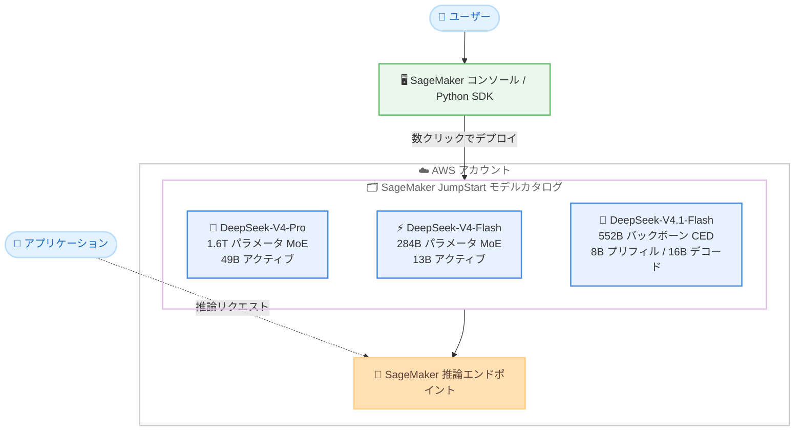

# Amazon SageMaker JumpStart - DeepSeek-V4-Pro / DeepSeek-V4-Flash / DeepSeek-V4.1-Flash モデルの提供開始

**リリース日**: 2026 年 11 月 11 日
**サービス**: Amazon SageMaker JumpStart
**機能**: DeepSeek-V4-Pro、DeepSeek-V4-Flash、DeepSeek-V4.1-Flash モデルの提供開始

📊 [このアップデートのインフォグラフィックを見る](https://takech9203.github.io/aws-news-summary/20261111-deepseek-v4-pro-v4-flash-v4.1-flash-on-sagemaker-jumpstart.html)

## 概要

DeepSeek の DeepSeek-V4-Pro、DeepSeek-V4-Flash、DeepSeek-V4.1-Flash の 3 つのモデルが Amazon SageMaker JumpStart で利用可能になりました。これにより、AWS のお客様が利用できる基盤モデルのポートフォリオがさらに拡大します。

これら 3 つのモデルは、MIT ライセンスで公開されたオープンウェイトの Mixture-of-Experts (MoE) 言語モデルです。トークンごとに総パラメータのごく一部のみをアクティブ化する MoE アーキテクチャにより、推論、コーディング、エージェントワークロードにおいてフロンティアクラスの性能を維持しながら、大規模運用時の高い効率性を実現します。

SageMaker JumpStart を利用することで、お客様は数クリックでこれらのモデルをデプロイし、自社の AI ユースケースに適用できます。

**アップデート前の課題**

このアップデート以前に存在していた課題や制限は以下のとおりです。

- DeepSeek V4 系の最新モデルを AWS 上で利用するには、モデルウェイトを自前でダウンロードし、推論コンテナやサービング基盤を独自に構築する必要があった
- 1M トークンのコンテキストウィンドウを持つ大規模 MoE モデルのデプロイには、インフラ設計やサービング設定に関する高度な専門知識が必要だった
- エージェントワークロードやマルチモーダルタスク向けに、コスト効率と性能のバランスが取れた最新のオープンウェイトモデルの選択肢が限られていた

**アップデート後の改善**

今回のアップデートにより可能になったことは以下のとおりです。

- SageMaker JumpStart のモデルカタログから数クリックで DeepSeek V4 系モデルをデプロイできるようになった
- 用途に応じて、フラッグシップの V4-Pro、コスト効率重視の V4-Flash、エージェント特化かつマルチモーダル対応の V4.1-Flash を選択できるようになった
- MIT ライセンスのオープンウェイトモデルを自社の AWS アカウント内で安全にホストし、データを外部に送信せずに利用できるようになった

## アーキテクチャ図



SageMaker JumpStart のモデルカタログから 3 つの DeepSeek V4 系モデルを選択し、自社 AWS アカウント内の SageMaker 推論エンドポイントとしてデプロイする流れを示しています。

## サービスアップデートの詳細

### 主要機能

1. **DeepSeek-V4-Pro: フラッグシップスケールの複雑な推論と高品質テキスト生成**
   - 総パラメータ数 1.6T の MoE モデルで、トークンごとに 49B パラメータをアクティブ化
   - 1M トークンのコンテキストウィンドウをサポート
   - 長文ドキュメント分析、マルチステップ推論、最大限のモデル容量を必要とする高度な生成タスクに適している

2. **DeepSeek-V4-Flash: 大幅に低い計算コストで高い性能を実現**
   - 総パラメータ数 284B の効率的な MoE モデルで、トークンごとに 13B パラメータをアクティブ化
   - V4-Pro と同じ 1M トークンのコンテキストウィンドウをサポート
   - レイテンシに敏感でコスト重視の本番デプロイメントに最適で、幅広い言語タスクに対応

3. **DeepSeek-V4.1-Flash: 次世代のエージェント効率とネイティブマルチモーダル対応**
   - 新しい Causal Encoder-Decoder (CED) アーキテクチャを採用し、552B パラメータのバックボーンを持つ
   - プリフィル時は 8B、デコード時は 16B のパラメータのみをアクティブ化
   - 1M トークンのコンテキストウィンドウと 384K の最大出力トークンをサポート
   - Compressed Sparse Attention 2 (CSA2) と FP4 KV キャッシングにより、グローバル KV キャッシュのフットプリントを V4-Flash の約 1/4 に削減
   - エージェントワークロード、コーディング、ビジョンタスクで大幅に向上したコスト効率を実現

4. **MIT ライセンスのオープンウェイトモデル**
   - 3 モデルとも MIT ライセンスで公開されており、商用利用やカスタマイズの自由度が高い
   - 自社 AWS アカウント内でホストするため、データのコントロールを維持できる

## 技術仕様

### モデル比較

| 項目 | DeepSeek-V4-Pro | DeepSeek-V4-Flash | DeepSeek-V4.1-Flash |
|------|-----------------|-------------------|---------------------|
| 総パラメータ数 | 1.6T | 284B | 552B (バックボーン) |
| アクティブパラメータ | 49B / トークン | 13B / トークン | プリフィル 8B / デコード 16B |
| アーキテクチャ | MoE | MoE | Causal Encoder-Decoder (CED) |
| コンテキストウィンドウ | 1M トークン | 1M トークン | 1M トークン |
| 最大出力トークン | - | - | 384K |
| マルチモーダル | - | - | ネイティブ対応 |
| KV キャッシュ最適化 | - | - | CSA2 + FP4 KV キャッシング (V4-Flash 比約 1/4) |
| ライセンス | MIT | MIT | MIT |
| 主な用途 | 複雑な推論、長文分析、高品質生成 | 低レイテンシ・低コストの本番運用 | エージェント、コーディング、ビジョン |

## 設定方法

### 前提条件

1. AWS アカウントと SageMaker AI を利用できる IAM 権限
2. Amazon SageMaker Studio または SageMaker Python SDK の実行環境
3. デプロイ先リージョンで対象モデルに必要な推論インスタンスのクォータ

### 手順

#### ステップ 1: SageMaker JumpStart モデルカタログでモデルを検索

SageMaker コンソールから SageMaker Studio を開き、JumpStart のモデルカタログで「DeepSeek」を検索します。DeepSeek-V4-Pro、DeepSeek-V4-Flash、DeepSeek-V4.1-Flash から用途に合ったモデルを選択します。

#### ステップ 2: モデルをデプロイ

コンソールの場合はモデル詳細ページで [デプロイ] を選択し、インスタンスタイプやエンドポイント名を確認してデプロイします。SageMaker Python SDK を使用する場合の例は以下のとおりです。

```python
from sagemaker.jumpstart.model import JumpStartModel

# JumpStart のモデル ID を指定してモデルを作成
# 実際のモデル ID は JumpStart モデルカタログで確認してください
model = JumpStartModel(model_id="<deepseek-v4-model-id>")

# 推論エンドポイントとしてデプロイ
predictor = model.deploy()
```

JumpStart のモデル ID を指定してモデルオブジェクトを作成し、`deploy()` で自社アカウント内に推論エンドポイントを作成しています。

#### ステップ 3: 推論リクエストの実行

```python
# デプロイしたエンドポイントに推論リクエストを送信
response = predictor.predict({
    "messages": [
        {"role": "user", "content": "AWS の MoE モデル活用のベストプラクティスを教えてください。"}
    ],
    "max_tokens": 1024
})
print(response)
```

デプロイ済みのエンドポイントに対してチャット形式のリクエストを送信し、モデルの応答を取得しています。

## メリット

### ビジネス面

- **導入までの時間短縮**: 数クリックまたは数行のコードで最新の DeepSeek V4 系モデルをデプロイでき、検証や本番導入までのリードタイムを大幅に短縮できる
- **コスト効率の高い選択肢**: 用途に応じて 3 モデルから選択でき、特に V4.1-Flash は KV キャッシュ削減によりエージェントワークロードの運用コストを抑えられる
- **ライセンスの柔軟性**: MIT ライセンスのオープンウェイトモデルのため、商用利用やファインチューニングなどの自由度が高い

### 技術面

- **MoE による高効率推論**: トークンごとに総パラメータの一部のみをアクティブ化するため、モデル容量と推論効率を両立できる
- **1M トークンの長大コンテキスト**: 3 モデルとも 1M トークンのコンテキストウィンドウをサポートし、長文ドキュメント分析や大規模コードベースの処理に対応できる
- **データのコントロール**: モデルを自社 AWS アカウント内のエンドポイントとしてホストするため、推論データが外部に送信されない

## デメリット・制約事項

### 制限事項

- 公式発表では利用可能リージョンが明記されていないため、利用予定リージョンの JumpStart モデルカタログで提供状況を確認する必要がある
- 大規模 MoE モデルのホスティングには高性能な GPU インスタンスが必要となり、インスタンスクォータの引き上げが必要になる場合がある
- マルチモーダル対応は V4.1-Flash のみで、V4-Pro と V4-Flash はテキストタスクが中心となる

### 考慮すべき点

- セルフホスト型のため、Amazon Bedrock のようなサーバーレス従量課金ではなく、エンドポイント稼働時間に応じたインスタンス課金となる点を考慮する
- モデルごとにアクティブパラメータ数や KV キャッシュ特性が異なるため、ワークロードの特性 (レイテンシ要件、コンテキスト長、エージェント利用の有無) に応じたモデル選定と負荷テストを実施する

## ユースケース

### ユースケース 1: 長文ドキュメントの分析と高品質レポート生成

**シナリオ**: 金融機関が数百ページに及ぶ契約書や規制文書を分析し、要約や論点整理を自動化したい。

**実装例**:
```
DeepSeek-V4-Pro を SageMaker JumpStart からデプロイし、
1M トークンのコンテキストウィンドウを活用して
文書全体を一度に投入し、マルチステップ推論で論点を抽出する。
```

**効果**: 文書を分割せずに全体の文脈を保ったまま分析でき、高精度な要約と論点抽出を実現できる。

### ユースケース 2: コスト重視の本番チャットアプリケーション

**シナリオ**: SaaS 企業が顧客向けチャットアシスタントを提供しており、応答品質を維持しながら推論コストとレイテンシを削減したい。

**実装例**:
```
DeepSeek-V4-Flash をデプロイし、アクティブパラメータ 13B の
効率的な推論でレイテンシに敏感な本番トラフィックを処理する。
```

**効果**: V4-Pro と同じ 1M トークンのコンテキストを維持しつつ、大幅に低い計算コストで本番運用できる。

### ユースケース 3: マルチモーダル対応のコーディングエージェント

**シナリオ**: 開発チームが、スクリーンショットや設計図を理解しながら長時間動作するコーディングエージェントを構築したい。

**実装例**:
```
DeepSeek-V4.1-Flash をデプロイし、CED アーキテクチャと
CSA2 + FP4 KV キャッシングによる低い KV キャッシュ
フットプリントを活かして、長いエージェントセッションを処理する。
```

**効果**: ビジョン入力を含むエージェントワークロードを、V4-Flash 比約 1/4 の KV キャッシュで効率的に実行し、コスト効率を大幅に改善できる。

## 料金

SageMaker JumpStart からデプロイしたモデルは、エンドポイントで使用する SageMaker AI 推論インスタンスの稼働時間に基づいて課金されます。モデル自体は MIT ライセンスのオープンウェイトモデルのため、追加のモデル利用料は発生しません。詳細は [Amazon SageMaker AI の料金ページ](https://aws.amazon.com/sagemaker-ai/pricing/) を参照してください。

## 利用可能リージョン

公式発表ではリージョンは明記されていません。利用予定リージョンの SageMaker JumpStart モデルカタログで提供状況を確認してください。

## 関連サービス・機能

- **Amazon SageMaker JumpStart**: 基盤モデルのカタログからのワンクリックデプロイを提供するハブ。今回の 3 モデルの提供基盤
- **Amazon SageMaker AI 推論エンドポイント**: デプロイしたモデルのホスティング基盤。インスタンスタイプやオートスケーリングを設定可能
- **Amazon Bedrock**: サーバーレスで基盤モデルを利用できるサービス。セルフホスト型の JumpStart とは利用形態や課金モデルが異なるため、要件に応じて使い分ける

## 参考リンク

- 📊 [インフォグラフィック](https://takech9203.github.io/aws-news-summary/20261111-deepseek-v4-pro-v4-flash-v4.1-flash-on-sagemaker-jumpstart.html)
- [公式発表 (What's New)](https://aws.amazon.com/about-aws/whats-new/2026/01/deepseek-v4-pro-v4-flash-v4.1-flash-on-sagemaker-jumpstart/)
- [Amazon SageMaker JumpStart ドキュメント](https://docs.aws.amazon.com/sagemaker/latest/dg/studio-jumpstart.html)
- [Amazon SageMaker AI 料金ページ](https://aws.amazon.com/sagemaker-ai/pricing/)

## まとめ

DeepSeek の最新 V4 系モデル 3 種が SageMaker JumpStart に追加され、フラッグシップの推論性能からエージェント特化の高効率マルチモーダルまで、用途に応じたオープンウェイトモデルを数クリックでデプロイできるようになりました。MIT ライセンスと 1M トークンのコンテキストウィンドウを備えたこれらのモデルは、長文分析やエージェントワークロードの有力な選択肢です。まずは JumpStart モデルカタログで対象モデルの提供状況を確認し、ワークロードに合わせた負荷テストから始めることを推奨します。
