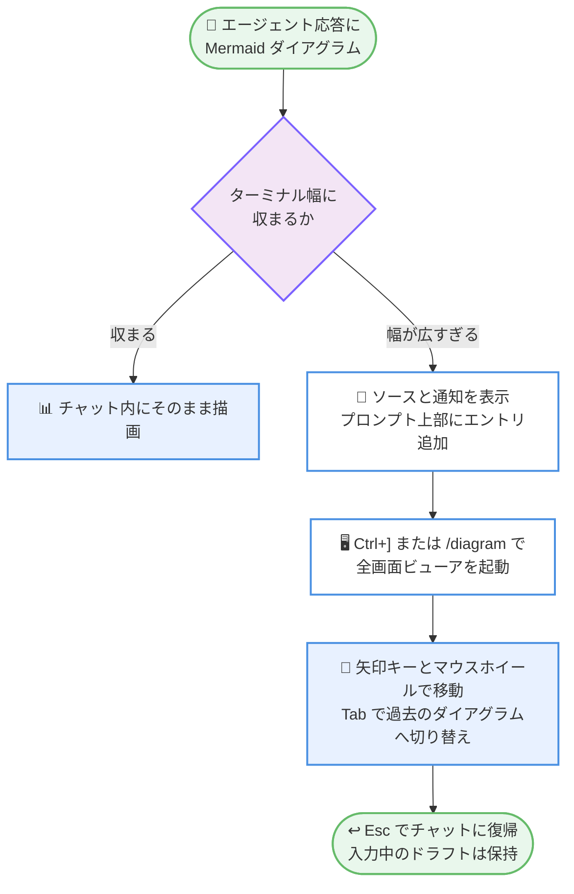

# Kiro - CLI 3.2 の Output Details、全画面ダイアグラムビューア、MCP サインイン拡張

**リリース日**: 2026 年 11 月 11 日
**サービス**: Kiro (AWS が提供する AI 搭載 IDE)
**機能**: Output Details 設定とサインイン修正 (CLI 3.2.1)、全画面ダイアグラムビューアと MCP サーバーへのサインイン拡張 (CLI 3.2.0 系)

📊 [このアップデートのインフォグラフィックを見る](https://takech9203.github.io/aws-news-summary/20261111-kiro-changelog-2026-11-11.html)

## 概要

Kiro CLI の 3.2 系アップデートに関する 2 件のチェンジログが公開されました。1 つ目の「Output Details and Sign-In Fixes」(CLI 3.2.1) では、ツール呼び出しの表示詳細度を `/settings` で選択できる Output details 機能が全ユーザーに提供されました。ツール呼び出しごとに 1 行の最小表示から完全な出力まで、好みに応じて表示量を調整できます。また、グラフィカルセッションのない Linux ホストや IAM Identity Center フラグ使用時のサインイン問題も修正されています。

2 つ目の「Full-Screen Diagram Viewer and Sign-In to More MCP Servers」では、ターミナル幅に収まらない Mermaid ダイアグラムを全画面で表示するビューアが追加されました。さらに、OAuth 設定なしでサインインできる MCP サーバーの範囲が拡大し、Client ID Metadata Documents (CIMD) をサポートするが動的クライアント登録を提供しないサーバーにも接続できるようになりました。イテレーション上限に達したワークフローループの継続操作、自律モードでのワークフロー非対応の明示、V2 シェルコマンドが `XDG_CONFIG_HOME` や `HOME` を設定する前の確認など、運用性とセキュリティの改善も含まれています。

**アップデート前の課題**

- ツール呼び出しの出力表示量を細かく調整する手段が限られており、長い出力でチャットが読みにくくなる、または必要な詳細が見えないという問題があった
- ターミナル幅より広い Mermaid ダイアグラムは正しく描画できず、内容を確認しにくかった
- 動的クライアント登録を提供しない MCP サーバー (Tableau のホステッド MCP など) に接続するには、`oauth` ブロックで `clientId` などを手動設定する必要があった
- イテレーション上限に達したワークフローループは、そのまま継続や完了の判断を行う手段がなかった
- グラフィカルセッションのない Linux ホストや Identity Center フラグ使用時にサインインが失敗することがあった
- シェルコマンドが `XDG_CONFIG_HOME` や `HOME` といった設定ディレクトリを書き換える環境変数を設定しても、確認なしに実行されていた

**アップデート後の改善**

- `/settings` の Output details で、`collapsed`、`lean`、`default`、`full` のプリセット、またはツール引数・推論・出力フィルター・サブエージェント詳細・切り詰めの個別設定により表示量を選択できるようになった
- 幅の広い Mermaid ダイアグラムを `Ctrl+]` または `/diagram` で全画面表示し、矢印キーやマウスホイールで移動できるようになった
- Kiro 自身がホストするクライアントメタデータドキュメントを使用し、OAuth 設定なしで CIMD 対応 MCP サーバーにサインインできるようになった
- イテレーションを使い切ったワークフローループに対し、「もう 1 回イテレーションを実行」または「ループを完了として実行を継続」を選択できるようになった
- 自律モードでワークフローを要求すると、リクエストを引き渡す代わりにワークフローが利用できない旨を明示するようになった
- V2 シェルコマンドが `XDG_CONFIG_HOME` または `HOME` を設定する前に確認を求めるようになった

## アーキテクチャ図



ターミナル幅に収まらない Mermaid ダイアグラムを全画面ビューアで表示するまでの流れです。ビューアを閉じても入力中のドラフトはそのまま保持されます。

## サービスアップデートの詳細

### 主要機能

1. **Output Details (ツール呼び出し表示の詳細度設定)**
   - `/settings` を実行して Output details を開くか、`/settings output-details` を直接実行して設定する
   - `collapsed`、`lean`、`default`、`full` の 4 つのプリセットから選択できる
   - ツール引数、推論 (reasoning)、出力フィルター、サブエージェント詳細、切り詰め (truncation) を個別に設定することも可能
   - 思考 (thinking) 表示の設定は `/settings display` からこの Output details 配下に移動した

2. **ツール呼び出し表示の統一**
   - シェル、検索、汎用ツールの出力がツール呼び出しの直下にまとまって表示されるようになった
   - `read` 呼び出しは返却したファイル行を表示する
   - 連続して完了した 2 つ以上のツール呼び出しは 1 つのサマリー行に折りたたまれ、`Ctrl+O` で展開できる
   - ファイル書き込みの承認時には、上限付きプレビューではなく完全な差分が表示される
   - スクロールバック内の完了済み検索は、ファイル名を列挙せず結果件数のみを保持する

3. **全画面ダイアグラムビューア**
   - エージェント応答内の Mermaid ダイアグラムがターミナル幅に収まらない場合、ソースと通知、プロンプト上部のエントリが表示される
   - `Ctrl+]` を押すか `/diagram` を実行すると、最新の幅広ダイアグラムが全幅レイアウトの専用画面で開く
   - 矢印キーまたはマウスホイールで移動し、`Tab` で過去のダイアグラムに切り替え、`Esc` でチャットに戻る (入力中のドラフトは保持)
   - キーバインドは `chat.keybindings.viewDiagram` で変更できる

4. **MCP サーバーへのサインイン拡張 (CIMD 対応)**
   - Tableau のホステッド MCP のように、Client ID Metadata Documents をサポートするが動的クライアント登録を提供しない MCP サーバーに対応
   - Kiro 自身がホストするクライアントメタデータドキュメントでサインインするため、設定に `oauth` ブロックを記述せずにサーバーを追加してサインインできる
   - 動的クライアント登録を提供するサーバーは引き続きそれを使用し、設定済みの `clientId` または `clientMetadataUrl` が優先される

5. **ワークフローループの継続操作**
   - イテレーションをすべて使い切って一時停止したワークフローループに対し、ワークフローモニターと一時停止行の下に 2 つの選択肢が表示される
   - 「もう 1 回イテレーションを実行する」または「ループを完了としてマークし実行を継続する」を選択できる

6. **自律モードでのワークフロー非対応の明示**
   - 自律モードでワークフローを要求した場合、リクエストをそのまま引き渡すのではなく、ワークフローは自律モードでは実行されないことを通知する

7. **環境変数設定時の確認**
   - V2 シェルコマンドが `XDG_CONFIG_HOME` または `HOME` を設定する前に、実行してよいか確認を求めるようになった
   - これらの環境変数は設定ファイルの参照先を変更できるため、意図しない設定の上書きを防止する

### 主な修正

- グラフィカルセッションのない Linux ホストでのサインインが修正された
- IAM Identity Center フラグを使用した場合のサインインが修正された
- `/model fallback` の設定が現在のエージェントで引き続き機能するようになった
- ワークフロー、スペック、Skills、ファイル検索、権限 (permissions)、セッションリロードに関する問題が修正された (3.2.1)
- ファイル検索、カスタムエージェント、ワークフロー、スペック、Hook、クリップボード、ヘルプテキスト、セッションに関する問題が修正された (3.2.0 系)

## 技術仕様

### Output Details の設定項目

| 項目 | 詳細 |
|------|------|
| 設定コマンド | `/settings` から Output details を開く、または `/settings output-details` |
| プリセット | `collapsed` / `lean` / `default` / `full` |
| 個別設定 | ツール引数、推論、出力フィルター、サブエージェント詳細、切り詰め |
| 思考表示 | `/settings display` から Output details 配下に移動 |
| 折りたたみ展開 | 連続する完了済みツール呼び出しのサマリー行を `Ctrl+O` で展開 |

### 全画面ダイアグラムビューアの操作

| 操作 | キーまたはコマンド |
|------|--------------------|
| ビューアを開く | `Ctrl+]` または `/diagram` |
| ダイアグラム内の移動 | 矢印キー、マウスホイール |
| 過去のダイアグラムへ切り替え | `Tab` |
| チャットに戻る | `Esc` (入力中のドラフトは保持) |
| キーバインド変更 | `chat.keybindings.viewDiagram` |

### MCP サインイン方式の優先順位

| 条件 | 使用される方式 |
|------|----------------|
| `clientId` または `clientMetadataUrl` を設定済み | 設定値を優先 |
| サーバーが動的クライアント登録を提供 | 動的クライアント登録を継続使用 |
| CIMD 対応かつ動的クライアント登録なし | Kiro がホストするクライアントメタデータドキュメント |

## 設定方法

### 前提条件

1. Kiro CLI 3.2.1 以降がインストールされていること (3.2.0 系の機能は 3.2.0 以降)
2. MCP サインイン拡張を利用する場合は、対象サーバーが Client ID Metadata Documents をサポートしていること

### 手順

#### ステップ 1: Kiro CLI を最新バージョンに更新

Kiro CLI を再起動するか、アップデートを確認して 3.2.1 以降に更新します。

#### ステップ 2: Output details を設定

```bash
/settings output-details
```

このコマンドは Output details の設定画面を開きます。`collapsed`、`lean`、`default`、`full` のプリセットを選択するか、ツール引数、推論、出力フィルター、サブエージェント詳細、切り詰めを個別に調整します。

#### ステップ 3: 全画面ダイアグラムビューアを使用

```bash
/diagram
```

このコマンド (または `Ctrl+]`) は、直近の幅広 Mermaid ダイアグラムを全画面で開きます。矢印キーで移動し、`Tab` で過去のダイアグラムへ切り替え、`Esc` でチャットに戻ります。

#### ステップ 4: CIMD 対応 MCP サーバーを追加

MCP 設定にサーバーを追加し、サインインを実行します。CIMD 対応サーバーであれば `oauth` ブロックの記述は不要で、Kiro がホストするクライアントメタデータドキュメントによりサインインが完了します。

## メリット

### ビジネス面

- **レビュー効率の向上**: ツール呼び出しの表示量を用途に応じて調整でき、エージェントの作業内容の確認が速くなる
- **MCP 導入の簡素化**: OAuth 設定を手動で用意せずに企業向け MCP サーバーへ接続でき、チームへの展開が容易になる
- **長時間ワークフローの柔軟な運用**: イテレーション上限に達したループを途中で打ち切らず、状況に応じて延長または完了を選択できる

### 技術面

- **ターミナル体験の改善**: 幅広の Mermaid ダイアグラムを全画面で確認でき、アーキテクチャ図などの視認性が向上する
- **安全なシェル実行**: `XDG_CONFIG_HOME` や `HOME` の設定前に確認が入ることで、設定ファイルの意図しない書き換えを防げる
- **サインインの信頼性向上**: グラフィカルセッションのない Linux ホストや Identity Center フラグ使用時でもサインインが機能する

## デメリット・制約事項

### 制限事項

- 全画面ダイアグラムビューアは、ターミナル幅に収まらない Mermaid ダイアグラムが対象であり、Kiro CLI がサポートする Mermaid 記法の範囲内で動作する
- CIMD によるサインインは、サーバー側が Client ID Metadata Documents をサポートしている場合にのみ利用できる
- ワークフローは自律モードでは実行されない (今回のアップデートはその旨を明示する改善であり、自律モードでの実行を可能にするものではない)

### 考慮すべき点

- Output details を `full` に設定すると出力量が増えるため、長時間のセッションではスクロールバックが長くなる
- `collapsed` 設定では詳細が省略されるため、トラブルシューティング時は一時的に詳細度を上げることが望ましい
- `clientId` や `clientMetadataUrl` を設定済みのサーバーは従来どおりその設定が優先されるため、CIMD へ切り替える場合は設定の見直しが必要になる

## ユースケース

### ユースケース 1: 長時間セッションでの表示量の最適化

**シナリオ**: 大規模なリファクタリングで多数のツール呼び出しが発生し、チャットのスクロールバックが読みにくい。

**実装例**:
```
/settings output-details を実行し、プリセットを collapsed または lean に設定する。
詳細を確認したいときはサマリー行で Ctrl+O を押して展開する。
```

**効果**: 通常はコンパクトな表示で作業の流れを把握し、必要な箇所だけ展開して詳細を確認できる。

### ユースケース 2: ターミナルでのアーキテクチャ図レビュー

**シナリオ**: エージェントが生成した幅の広いアーキテクチャ図 (Mermaid) をターミナル上で確認したい。

**実装例**:
```
幅広ダイアグラムの通知が表示されたら Ctrl+] を押す。
全画面ビューアで矢印キーとマウスホイールを使って図全体を確認し、
Tab で過去の図と比較して、Esc でチャットに戻る。
```

**効果**: ターミナル幅の制約を受けずに図全体を確認でき、入力中のプロンプトも失われない。

### ユースケース 3: OAuth 設定なしでの企業向け MCP サーバー接続

**シナリオ**: Tableau のホステッド MCP のような、動的クライアント登録を提供しない CIMD 対応 MCP サーバーへ接続したい。

**実装例**:
```
MCP 設定にサーバーの URL を追加する (oauth ブロックは不要)。
サインインを実行すると、Kiro がホストするクライアントメタデータ
ドキュメントにより認証が完了する。
```

**効果**: クライアント ID の発行やメタデータの手動設定なしで、対応サーバーへのサインインが完了する。

## 利用可能リージョン

グローバル (Kiro はリージョンに依存しないサービスとして提供)

## 関連サービス・機能

- **Kiro Workflows**: 長時間タスクをステップに分割して実行する機能。今回イテレーション上限到達時の継続・完了の選択肢が追加された
- **Kiro MCP サポート**: Model Context Protocol によるツール連携。今回 Client ID Metadata Documents によるサインインが追加された
- **Kiro CLI ターミナル UI**: チャット内の Mermaid ダイアグラム描画やツール表示。今回全画面ビューアと表示統一が追加された
- **IAM Identity Center**: 組織のシングルサインオン基盤。今回 Identity Center フラグ使用時のサインイン問題が修正された

## 参考リンク

- 📊 [インフォグラフィック](https://takech9203.github.io/aws-news-summary/20261111-kiro-changelog-2026-11-11.html)
- [Kiro Changelog](https://kiro.dev/changelog/)
- [Kiro CLI Chat Settings ドキュメント - Output Details](https://kiro.dev/docs/cli/chat/settings/#settings-output-details)
- [Kiro CLI Terminal UI ドキュメント - Mermaid Diagrams](https://kiro.dev/docs/cli/terminal-ui/#mermaid-diagrams)
- [Kiro MCP Configuration ドキュメント - Client ID Metadata Documents](https://kiro.dev/docs/mcp/configuration/#client-id-metadata-documents-cimd)
- [Kiro Workflows ドキュメント - Resume](https://kiro.dev/docs/workflows/manage/#resume)

## まとめ

Kiro CLI 3.2 系のアップデートは、ツール呼び出し表示の詳細度を自由に選べる Output Details、幅広 Mermaid ダイアグラムの全画面ビューア、OAuth 設定不要の MCP サインイン拡張など、ターミナルでの日常的な開発体験を大きく改善するものです。環境変数設定前の確認やサインイン修正により、安全性と信頼性も向上しています。Kiro CLI ユーザーは 3.2.1 へ更新し、まず `/settings output-details` で自分の作業スタイルに合った表示設定を試すことを推奨します。
