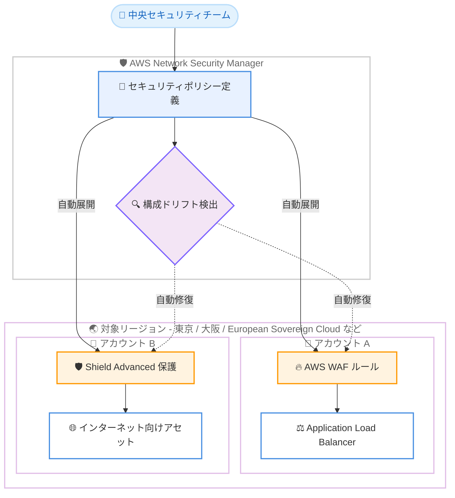

# AWS Network Security Manager - AWS European Sovereign Cloud および 31 の新規リージョンで利用可能に

**リリース日**: 2026 年 11 月 11 日
**サービス**: AWS Network Security Manager
**機能**: AWS European Sovereign Cloud リージョンおよび追加 31 リージョンへの提供拡大

📊 [このアップデートのインフォグラフィックを見る](https://takech9203.github.io/aws-news-summary/20261111-network-security-mgr-eu-sovereign-cloud.html)

## 概要

AWS Network Security Manager が、AWS European Sovereign Cloud リージョンおよび追加の 31 リージョンで一般提供を開始しました。Network Security Manager は、ネットワークセキュリティポリシーの展開と適用を大規模環境で簡素化する、包括的なネットワークセキュリティ管理ソリューションです。AWS European Sovereign Cloud リージョンでは AWS WAF と AWS Shield をサポートします。

今回の拡大により、東京リージョンと大阪リージョンを含むアジアパシフィック 14 リージョンをはじめ、北米、欧州、南米、アフリカ、中東の主要リージョンで Network Security Manager を利用できるようになりました。複数リージョンにワークロードを展開している組織や、欧州のデータ主権要件に対応する必要がある組織にとって、セキュリティポリシーの一元管理を広範囲に適用できる重要なアップデートです。

Network Security Manager は、Application Load Balancer などのインターネット向けアセットに AWS WAF による保護を自動適用する、常時稼働のセキュリティ展開自動化機能を備えています。セキュリティチームは WAF ルールと AWS Shield Advanced の保護を効率的に展開・管理し、対象アカウントとリソース全体で一貫したセキュリティ態勢を維持できます。

**アップデート前の課題**

- Network Security Manager は限られたリージョンでのみ利用可能であり、東京リージョンや大阪リージョンを含む多くのリージョンでは一元的なセキュリティポリシー管理に利用できなかった
- AWS European Sovereign Cloud を利用する組織は、データ主権要件を満たしながら Network Security Manager による WAF / Shield の集中管理を行うことができなかった
- 未対応リージョンでは、WAF ルールや Shield Advanced の保護を手動またはリージョンごとの個別の仕組みで管理する必要があり、運用負荷と設定のばらつきが発生していた

**アップデート後の改善**

- AWS European Sovereign Cloud リージョンで AWS WAF と AWS Shield を対象とした Network Security Manager が利用可能になり、欧州のデータ主権要件に対応しながらセキュリティポリシーを一元管理できるようになった
- 東京・大阪を含む 31 の新規リージョンで、セキュリティポリシーの集中管理、構成ドリフトの自動検出、修復の自動適用が可能になった
- グローバルに展開するワークロードに対して、より多くのリージョンで一貫したセキュリティ態勢を自動的に維持できるようになった

## アーキテクチャ図



中央セキュリティチームが Network Security Manager でポリシーを一度定義すると、対象アカウント・リージョンのインターネット向けアセットに WAF ルールと Shield Advanced 保護が自動展開され、構成ドリフトの検出と修復も自動的に行われます。

## サービスアップデートの詳細

### 主要機能

1. **AWS European Sovereign Cloud リージョンでの一般提供**
   - AWS European Sovereign Cloud リージョンで Network Security Manager が利用可能になった
   - European Sovereign Cloud では AWS WAF と AWS Shield をサポート
   - 欧州のデータ主権要件に対応しながら、セキュリティポリシーの一元管理を実現できる

2. **31 の新規リージョンへの拡大**
   - 東京、大阪を含むアジアパシフィック 14 リージョンで利用可能になった
   - 北米、欧州、南米、アフリカ、中東の主要リージョンをカバー
   - 詳細は「利用可能リージョン」セクションを参照

3. **常時稼働のセキュリティ展開自動化**
   - Application Load Balancer などのインターネット向けアセットに AWS WAF の保護を自動適用
   - WAF ルールと AWS Shield Advanced の保護を効率的に展開・管理
   - 対象アカウントとリソース全体で一貫したセキュリティ態勢を維持

4. **構成ドリフトの検出と自動修復**
   - セキュリティポリシーからの構成ドリフトを自動検出
   - 定義されたベースラインへの修復を自動適用
   - 手動のセキュリティ管理による運用負荷を削減しながら包括的な保護を維持

## 技術仕様

### Network Security Manager の主な特徴

| 項目 | 詳細 |
|------|------|
| 管理対象 | AWS WAF ルール、AWS Shield Advanced 保護、ロギング設定 |
| 保護対象アセット | Application Load Balancer、API Gateway、CloudFront ディストリビューションなどのインターネット向けアセット |
| ポリシー階層 | 組織全体のベースラインからアプリケーション固有ルールまで階層的に定義し、リソースごとに単一の構成へマージ |
| スコープ指定 | アカウント、OU、リソースタイプ、タグ、属性を AND / OR / NOT 条件で指定 |
| 変更管理 | ドラフト状態での検証、公開バージョンの不変性と監査可能性、ロールバック |
| ドリフト対応 | 構成ドリフトを継続的に監視し、定義済みベースラインを自動復元 |
| European Sovereign Cloud 対応 | AWS WAF と AWS Shield をサポート |

### ガードレールモデル

Network Security Manager では、中央セキュリティチームが設定する必須ベースラインと、アプリケーションチームが追加する個別ルールの両方をリソースごとに単一の構成へマージします。これにより、中央チームの統制とアプリケーションチームの自律性を両立できます。

## 設定方法

### 前提条件

1. AWS Organizations を利用した組織構成であること (複数アカウントへのポリシー適用を行う場合)
2. Network Security Manager を利用するリージョンがサポート対象であること
3. 保護対象となる AWS WAF / AWS Shield Advanced の利用要件を満たしていること

### 手順

#### ステップ 1: Network Security Manager のセットアップ

AWS マネジメントコンソールで Network Security Manager を開き、セットアップガイドに従って管理者アカウントと対象スコープを設定します。詳細は[セットアップドキュメント](https://docs.aws.amazon.com/network-security-manager/latest/devguide/setting-up.html)を参照してください。

#### ステップ 2: セキュリティポリシーの作成

対象アカウント、OU、リソースタイプ、タグなどのスコープ条件を指定し、WAF ルールや Shield Advanced 保護を含むポリシーを定義します。ポリシーはドラフト状態で検証したうえで公開します。

#### ステップ 3: 自動展開とドリフト監視の確認

ポリシー公開後、スコープ内のインターネット向けアセットへ保護が自動展開されます。コンソールで展開状況と構成ドリフトの検出・修復状況を確認します。

## メリット

### ビジネス面

- **データ主権要件への対応**: AWS European Sovereign Cloud リージョンで利用可能になり、欧州の規制要件を満たしながらセキュリティ管理を一元化できる
- **運用コストの削減**: 手動のセキュリティ管理による運用負荷を削減し、セキュリティチームの工数をより付加価値の高い業務に振り向けられる
- **ガバナンスの強化**: 東京・大阪を含む多数のリージョンで一貫したセキュリティポリシーを適用し、組織全体の統制を強化できる

### 技術面

- **広域での一元管理**: 32 の追加リージョンにまたがる WAF ルールと Shield Advanced 保護を単一のポリシーから管理できる
- **構成ドリフトの自動修復**: 意図した設定と実際の設定の乖離を自動検出・修復し、セキュリティ態勢を常に維持できる
- **新規リソースへの自動適用**: ポリシー作成後に作成されたリソースにも保護が自動適用され、保護漏れを防止できる

## デメリット・制約事項

### 制限事項

- AWS European Sovereign Cloud リージョンでのサポート対象は AWS WAF と AWS Shield であり、利用可能な機能は標準リージョンと異なる場合がある
- Network Security Manager の利用料金に加えて、AWS WAF や AWS Shield Advanced などの基盤となるファイアウォールサービスの料金が別途発生する
- アカウント単位・リージョン単位の時間課金のため、多数のアカウント・リージョンで利用する場合はコストを事前に見積もる必要がある

### 考慮すべき点

- 既に AWS Firewall Manager で WAF / Shield のポリシーを管理している場合は、Network Security Manager との役割分担や移行方針を検討する必要がある
- 複数の保護 (WAF と Shield Advanced の両方など) を適用するアセットは、保護するファイアウォールごとに課金される点に注意が必要
- European Sovereign Cloud の料金は専用の料金ページ (aws.eu) で確認する必要がある

## ユースケース

### ユースケース 1: 東京・大阪リージョンでのマルチアカウント WAF 管理

**シナリオ**: 日本国内で東京リージョンと大阪リージョンに複数アカウントのワークロードを展開している企業が、各アカウントの ALB に適用する WAF ルールを一元管理したい。

**実装例**:
```
1. Network Security Manager で組織全体のベースラインポリシーを作成
2. スコープに東京・大阪リージョンの対象 OU とリソースタイプ ALB を指定
3. ポリシーを公開し、全アカウントの ALB へ WAF ルールを自動展開
```

**効果**: アカウントごとの個別設定が不要になり、新規作成された ALB にも保護が自動適用されるため、保護漏れと設定のばらつきを防止できる。

### ユースケース 2: 欧州データ主権要件下でのセキュリティ統制

**シナリオ**: 欧州の公共部門や規制業種の組織が、AWS European Sovereign Cloud 上のワークロードに対して WAF / Shield による保護を一元的に適用したい。

**実装例**:
```
1. AWS European Sovereign Cloud リージョンで Network Security Manager を有効化
2. インターネット向けアセットを対象とする WAF / Shield ポリシーを定義
3. 構成ドリフト検出により、ベースラインからの逸脱を自動修復
```

**効果**: データ主権要件を満たしながら、標準リージョンと同様のセキュリティポリシー管理と自動修復を実現できる。

### ユースケース 3: セキュリティアドバイザリへの迅速な対応

**シナリオ**: 新たな脅威情報が公開された際に、グローバルに展開する全リージョンのインターネット向けアセットへ対策ルールを迅速に適用したい。

**実装例**:
```
1. 該当ポリシーに新しい WAF ルールをドラフトとして追加
2. 検証後にポリシーを公開
3. スコープ内の全アカウント・全リージョンへ数分で展開
```

**効果**: リージョンごと・アカウントごとの手動展開が不要になり、脅威への対応時間を大幅に短縮できる。

## 料金

Network Security Manager の料金は、以下の 2 つの要素で構成されます。最低料金や前払いのコミットメントはなく、従量課金制です。

- **サービス利用料**: ポリシーを作成したアカウントごと・リージョンごとに 0.35 USD/時間
- **保護対象アセット料**: 保護するファイアウォールごと・アセットごと・リージョンごとに 0.004 USD/時間 (ALB、API Gateway、CloudFront ディストリビューションなどが対象)

AWS WAF や AWS Shield Advanced など、基盤となるファイアウォールサービスの料金は別途発生します。European Sovereign Cloud の料金は [European Sovereign Cloud 料金ページ](https://aws.eu/network-security-manager/pricing/)を参照してください。

### 料金例

| 使用量 | 月額料金 (概算) |
|--------|------------------|
| 1 アカウント、ALB 4 台を保護 | 約 263.52 USD (利用料 252.00 USD + アセット料 11.52 USD) |
| 4 アカウント、2 リージョン、40 アセットを保護 | 約 1,123.20 USD (利用料 1,008.00 USD + アセット料 115.20 USD) |

複数のファイアウォール (WAF と Shield Advanced の両方など) で保護されるアセットは、保護するファイアウォールごとに課金されます。

## 利用可能リージョン

今回のアップデートで、AWS European Sovereign Cloud リージョンに加えて以下の 31 リージョンで利用可能になりました。

- **北米・中南米**: 米国東部 (オハイオ)、米国西部 (北カリフォルニア)、米国西部 (オレゴン)、カナダ (中部)、カナダ西部 (カルガリー)、メキシコ (中部)、南米 (サンパウロ)
- **アジアパシフィック**: 東京、大阪、ソウル、シンガポール、シドニー、メルボルン、ムンバイ、ハイデラバード、香港、台北、マレーシア、ニュージーランド、タイ、ジョホール
- **欧州**: フランクフルト、チューリッヒ、ストックホルム、アイルランド、ミラノ、スペイン、ロンドン、パリ
- **中東・アフリカ**: イスラエル (テルアビブ)、アフリカ (ケープタウン)

最新の提供状況は [AWS リージョン別サービス表](https://aws.amazon.com/about-aws/global-infrastructure/regional-product-services/)を参照してください。

## 関連サービス・機能

- **AWS WAF**: Network Security Manager が自動展開する Web アプリケーションファイアウォール。ALB や CloudFront などへのルール適用を一元管理できる
- **AWS Shield Advanced**: DDoS 保護サービス。Network Security Manager により保護対象リソースへの適用を自動化できる
- **AWS Firewall Manager**: WAF / Shield などのポリシーを組織全体で管理する既存サービス。Network Security Manager との役割分担の検討が必要
- **AWS Organizations**: マルチアカウント環境でのスコープ指定 (アカウント、OU) の基盤となるサービス

## 参考リンク

- 📊 [インフォグラフィック](https://takech9203.github.io/aws-news-summary/20261111-network-security-mgr-eu-sovereign-cloud.html)
- [公式発表 (What's New)](https://aws.amazon.com/about-aws/whats-new/2026/11/network-security-mgr-eu-sovereign-cloud/)
- [AWS Network Security Manager 製品ページ](https://aws.amazon.com/network-security-manager/)
- [ドキュメント (セットアップガイド)](https://docs.aws.amazon.com/network-security-manager/latest/devguide/setting-up.html)
- [料金ページ](https://aws.amazon.com/network-security-manager/pricing/)
- [European Sovereign Cloud 料金ページ](https://aws.eu/network-security-manager/pricing/)

## まとめ

AWS Network Security Manager が AWS European Sovereign Cloud と東京・大阪を含む 31 の新規リージョンに拡大し、グローバル規模での WAF / Shield 保護の一元管理と構成ドリフトの自動修復が広く利用可能になりました。マルチアカウント・マルチリージョンでインターネット向けワークロードを運用している場合は、既存の AWS Firewall Manager による運用との比較を含めて、Network Security Manager の採用を検討することをお勧めします。
